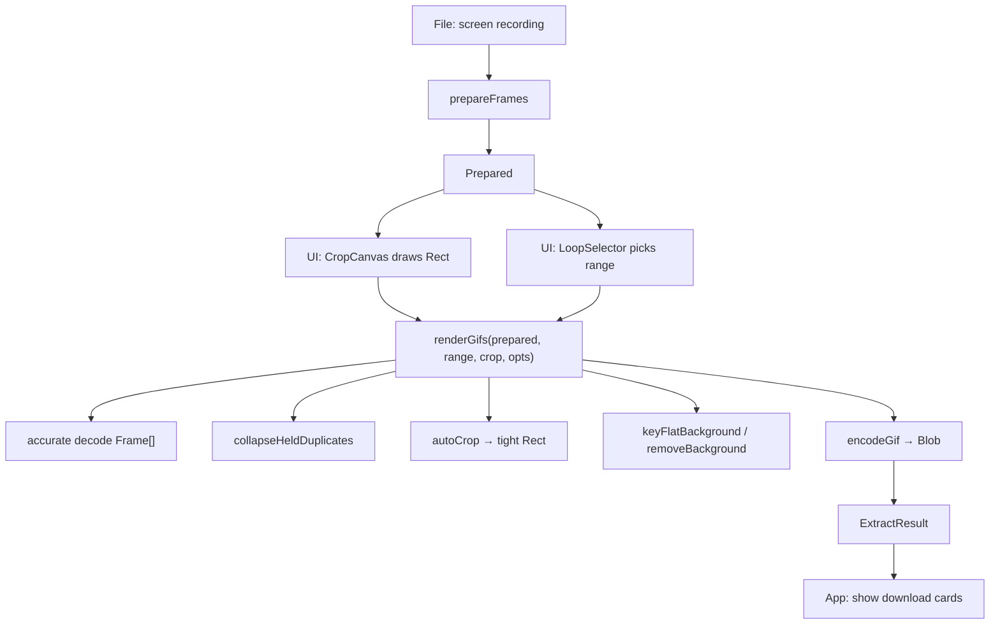
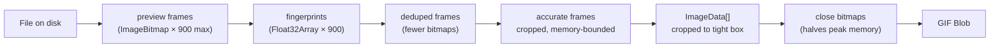

# Types & Data Flow

All shared types live in `pipeline/types.ts` and `pipeline/index.ts`. This document maps every interface, its fields, and how data flows between pipeline stages.

Source: `pipeline/types.ts` — ~50 lines, `pipeline/index.ts` — types + orchestrator.

## Core Types

### Frame

Source: `pipeline/types.ts:1-10`

```ts
export interface Frame {
  bitmap: ImageBitmap;
  timestampUs: number;
  durationUs?: number;
}
```

| Field | Type | Description |
|-------|------|-------------|
| `bitmap` | `ImageBitmap` | Decoded frame image data |
| `timestampUs` | `number` | Presentation timestamp in microseconds |
| `durationUs` | `number?` | How long this frame stays on screen (µs), set during dedupe |

### Rect

Source: `pipeline/types.ts:13-18`

```ts
export interface Rect {
  x: number; y: number; width: number; height: number;
}
```

Axis-aligned crop rectangle in source-pixel coordinates.

### LoopRange

Source: `pipeline/types.ts:21-29`

```ts
export interface LoopRange {
  startIndex: number;
  endIndex: number;
  fps: number;
  seamError: number;
}
```

| Field | Type | Description |
|-------|------|-------------|
| `startIndex` | `number` | First frame index of the loop (inclusive) |
| `endIndex` | `number` | One past the last frame index (exclusive) |
| `fps` | `number` | Estimated frames-per-second |
| `seamError` | `number` | Mean per-pixel difference at the loop seam (lower = cleaner) |

### ExportOptions

Source: `pipeline/types.ts:32-38`

```ts
export interface ExportOptions {
  maxEdge: number | null;
  fps: number;
  removeBackground: boolean;
  maxBytes: number | null;
}
```

| Field | Type | Default | Description |
|-------|------|---------|-------------|
| `maxEdge` | `number \| null` | null | Target longest edge in px |
| `fps` | `number` | detected | Frames per second for GIF timing |
| `removeBackground` | `boolean` | false | Enable background removal |
| `maxBytes` | `number \| null` | null | Hard byte ceiling (Slack = 128KB) |

## Pipeline Types

### Prepared

Source: `pipeline/index.ts:30-50`

```ts
export interface Prepared {
  frames: Frame[];
  fps: number;
  width: number;
  height: number;
  suggested: { start: number; end: number };
  file: File;
  compat: "webcodecs" | "fallback" | "incompatible";
}
```

The output of `prepareFrames()`. Contains:
- **`frames`** — Preview frames (fast, possibly lossy) that drive the UI scrubber
- **`fps`** — Estimated frame rate
- **`suggested`** — Auto-detected loop range (indices into `frames`)
- **`file`** — Original File object (kept for accurate re-decode)
- **`compat`** — How this browser decodes the file

### ExtractResult

Source: `pipeline/index.ts:22-28`

```ts
export interface ExtractResult {
  outputs: SizedResult[];
  finalCrop: Rect;
  frameCount: number;
  fps: number;
}
```

The output of `renderGifs()`.

### SizedResult

Source: `pipeline/index.ts:19-21`

```ts
export interface SizedResult {
  label: string;
  gif: Blob;
  bytes: number;
}
```

One output GIF with its label ("Original size", "Slack emoji") and byte count.

### SizeSpec

Source: `pipeline/index.ts:12-18`

```ts
export interface SizeSpec {
  label: string;
  maxEdge: number | null;
  maxBytes: number | null;
}
```

### Stage

Source: `pipeline/index.ts:10`

```ts
export type Stage = "extract" | "background" | "encode" | "done";
```

Progress stages reported to the UI via `onStage` callback during `renderGifs()`.

## Data Flow Diagram



## Memory Flow



Aha: The accurate decode produces frames already cropped to the selection (`crop` parameter). So downstream stages never hold full-resolution frames — only the cropped region. The `renderFrames` function closes each source bitmap immediately after converting to ImageData (`f.bitmap.close()`), halving peak memory usage. The preview bitmaps stay open because the UI still needs them for the scrubber.

## Cross-References

- [Overview](00-overview.md) — Package summary
- [Pipeline Deep Dive](01-pipeline.md) — How each stage uses these types
- [UI Components](02-ui.md) — How the UI interacts with Prepared and Rect
- [Scripts](04-scripts.md) — E2E test exercises this data flow
