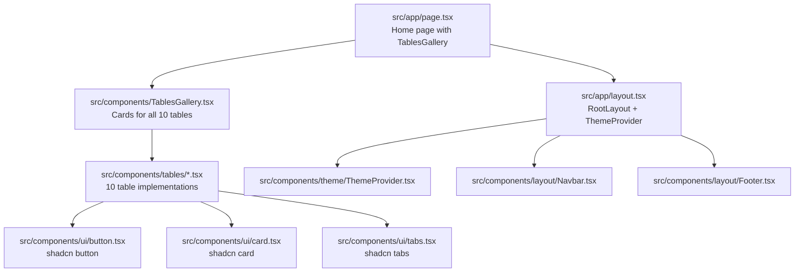

# table-forge: Overview

A Next.js showcase app demonstrating 10 different table patterns — from basic bordered tables to sortable, filterable, paginated, and responsive mobile-first designs. Built with shadcn/ui primitives and Tailwind CSS.

**Source:** `https://github.com/[...]/table-forge`
**Location:** `/home/darkvoid/Boxxed/@formulas/src.rust/src.AI/src.UIComponents/table-forge/`
**Version:** 0.1.0

## Quick Start

```bash
cd table-forge
npm install
npm run dev        # next dev
npm run build      # next build
```

Opens on `http://localhost:3000` with a gallery of 10 table implementations.

## Architecture



## 10 Table Implementations

| # | Component | Source | Lines | Features |
|---|-----------|--------|-------|----------|
| 1 | BasicBorderedTable | `tables/BasicBorderedTable.tsx` | 34 | Simple bordered table with header row |
| 2 | StripedRowsTable | `tables/StripedRowsTable.tsx` | 52 | Alternating row colors |
| 3 | CompactTable | `tables/CompactTable.tsx` | 42 | Dense layout, minimal padding |
| 4 | MinimalistUI | `tables/MinimalistUI.tsx` | 44 | Ultra-clean, borderless design |
| 5 | SortableTable | `tables/SortableTable.tsx` | 168 | Column sorting with indicators |
| 6 | FilterableTable | `tables/FilterableTable.tsx` | 100 | Text filter with real-time search |
| 7 | PaginatedTable | `tables/PaginatedTable.tsx` | 185 | Pagination with page controls |
| 8 | WithActionsTable | `tables/WithActionsTable.tsx` | 56 | Action buttons per row |
| 9 | ResponsiveCardsOnMobile | `tables/ResponsiveCardsOnMobile.tsx` | 57 | Card layout on mobile, table on desktop |
| 10 | TopControlsSortableTable | `tables/TopControlsSortable.tsx` | 129 | Sort + filter + pagination combined |

## Technology Stack

| Layer | Technology | Version |
|-------|-----------|---------|
| Framework | Next.js | 15.x (App Router) |
| React | React | 19.0.0 |
| CSS | Tailwind CSS | 4.x |
| UI Primitives | shadcn/ui | -- |
| Icons | lucide-react | -- |
| Types | TypeScript | 5.x |

## Directory Structure

```
table-forge/
├── src/
│   ├── app/
│   │   ├── layout.tsx        # Root layout with ThemeProvider, SEO
│   │   ├── page.tsx          # Home: TablesGallery
│   │   ├── robots.ts         # robots.txt generation
│   │   └── sitemap.ts        # sitemap.xml generation
│   ├── components/
│   │   ├── tables/           # 10 table implementations
│   │   │   ├── BasicBorderedTable.tsx
│   │   │   ├── StripedRowsTable.tsx
│   │   │   ├── CompactTable.tsx
│   │   │   ├── MinimalistUI.tsx
│   │   │   ├── SortableTable.tsx
│   │   │   ├── FilterableTable.tsx
│   │   │   ├── PaginatedTable.tsx
│   │   │   ├── WithActionsTable.tsx
│   │   │   ├── ResponsiveCardsOnMobile.tsx
│   │   │   └── TopControlsSortableTable.tsx
│   │   ├── TablesGallery.tsx # Gallery card grid
│   │   ├── ExampleCard.tsx   # Example card wrapper
│   │   ├── TableExample.tsx  # Example with tabs
│   │   ├── layout/           # Navbar, Footer
│   │   ├── theme/            # ThemeProvider, ThemeToggle
│   │   └── ui/               # shadcn primitives
│   ├── examples/
│   │   └── index.ts          # Sample data (100 lines)
│   └── lib/
│       ├── utils.ts          # cn() utility
│       └── seo.ts            # SEO metadata generation
├── package.json
├── next.config.ts
└── components.json           # shadcn config
```

## Related Documents

- [Table Components](01-table-components.md) — All 10 table implementations
- [Data Handling](02-data-handling.md) — Sorting, filtering, pagination logic
- [Styling](03-styling.md) — Tailwind, responsive design, mobile cards
- [App Structure](04-app-structure.md) — Next.js routing, SEO, layout

[Next → Table Components](01-table-components.md)
