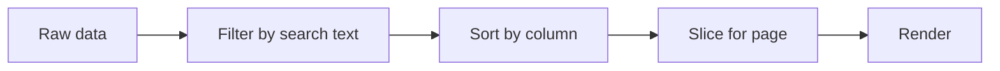

# Data Handling

Sorting, filtering, and pagination patterns across the 10 table implementations.

## Sorting

Used in: `SortableTable.tsx` (168 lines), `TopControlsSortableTable.tsx` (129 lines).

### Sort State

```tsx
const [sortColumn, setSortColumn] = useState<string | null>(null)
const [sortDirection, setSortDirection] = useState<'asc' | 'desc'>('asc')
```

### Sort Logic

```tsx
const sorted = useMemo(() => {
  if (!sortColumn) return data
  return [...data].sort((a, b) => {
    const aVal = a[sortColumn]
    const bVal = b[sortColumn]
    const comparison = aVal > bVal ? 1 : aVal < bVal ? -1 : 0
    return sortDirection === 'asc' ? comparison : -comparison
  })
}, [data, sortColumn, sortDirection])
```

Uses `useMemo` to avoid re-sorting on every render. Spreads data to avoid mutating the original array.

## Filtering

Used in: `FilterableTable.tsx` (100 lines), `TopControlsSortableTable.tsx` (129 lines).

### Filter Logic

```tsx
const filtered = useMemo(() => {
  if (!filter) return data
  return data.filter(row =>
    Object.values(row).some(val =>
      String(val).toLowerCase().includes(filter.toLowerCase())
    )
  )
}, [data, filter])
```

Searches all columns. Case-insensitive string matching.

## Pagination

Used in: `PaginatedTable.tsx` (185 lines), `TopControlsSortableTable.tsx` (129 lines).

### Pagination Logic

```tsx
const pageSize = 10
const totalPages = Math.ceil(filtered.length / pageSize)
const currentPage = Math.min(page, totalPages)
const paginated = filtered.slice(
  (currentPage - 1) * pageSize,
  currentPage * pageSize
)
```

Page is clamped to total pages to prevent out-of-bounds navigation.

## Data Pipeline

For `TopControlsSortableTable`, the pipeline is:



```tsx
const processed = useMemo(() => {
  let result = filter ? data.filter(...) : data
  if (sortColumn) result = [...result].sort(...)
  const total = result.length
  const page = Math.min(currentPage, Math.ceil(total / pageSize))
  const start = (page - 1) * pageSize
  return { data: result.slice(start, start + pageSize), total, totalPages: Math.ceil(total / pageSize) }
}, [data, filter, sortColumn, sortDirection, currentPage, pageSize])
```

Aha: The pipeline order matters. Filtering happens before sorting (fewer items to sort), and sorting happens before pagination (correct page contents). Reversing the order would produce wrong results — you'd sort only the current page, not the full dataset.

## Cross-References

- [Overview](00-overview.md) — Package summary
- [Table Components](01-table-components.md) — All 10 tables
- [Styling](03-styling.md) — Tailwind, responsive design
- [App Structure](04-app-structure.md) — Next.js layout, SEO
