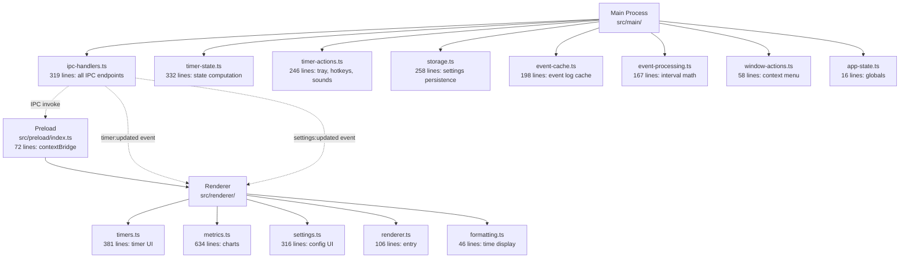
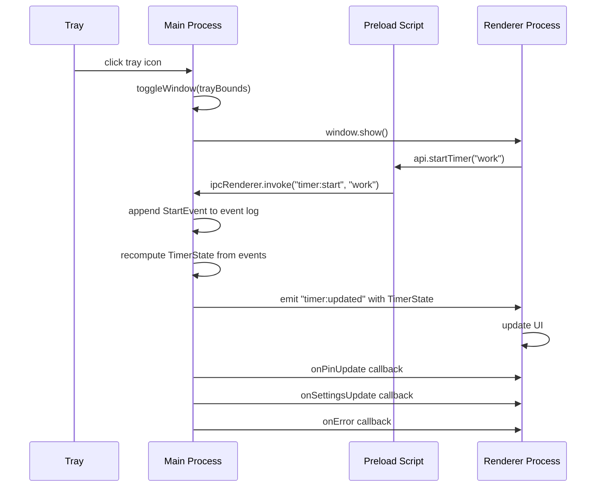

# universal-timer: Overview

A lightweight macOS menu bar time tracker built with Electron. Multiple named timers, event-sourced time logging, weekly/monthly metrics, global hotkeys, tray icon state, and configurable settings — all from a frameless window that hides when you click away.

**Source:** `https://github.com/vorpus/universal-timer`
**Location:** `/home/darkvoid/Boxxed/@formulas/src.rust/src.AI/src.UIComponents/universal-timer/`
**Version:** 1.0.0

## Quick Start

```bash
cd universal-timer
npm install
npm run dev        # electron-vite dev
npm run dist       # electron-vite build && electron-builder --mac
```

Opens as a 360×520 frameless window in the menu bar. Click the tray icon to show/hide. Pin to keep visible.

## Architecture at a Glance



The app follows Electron's 3-process architecture:
1. **Main** (`src/main/`) — Tray, window, timer logic, IPC handlers, event storage
2. **Preload** (`src/preload/`) — `contextBridge` exposing TimerAPI to renderer
3. **Renderer** (`src/renderer/`) — UI: timers, metrics, settings views

Aha: The timer uses an event-sourced model instead of storing elapsed time directly. Every start/pause is an event in a log (`StartEvent`, `PauseEvent`, `PauseAllEvent`). The current state is computed from the full event history. This means you can reconstruct any historical state, export/import the full log, and recalculate metrics from scratch without losing accuracy.

## Process Architecture



## Key Types

Source: `src/shared/types.ts` — 198 lines.

| Type | Purpose |
|------|---------|
| `StartEvent`, `PauseEvent`, `PauseAllEvent` | Timer events in the log |
| `TimerInfo` | Single timer's stats (name, elapsed, running, weekly) |
| `TimerState` | Full app state (all timers, running set, totals) |
| `Settings` | All user settings (hotkeys, sounds, timer order, colors) |
| `TimelineSegment` | One time segment for a timer on a given day |
| `TimerAPI` | The full API exposed via `contextBridge` |

## Dependencies

| Package | Purpose |
|---------|---------|
| `electron` | Desktop app framework |
| `electron-vite` | Vite-based Electron builder |
| `electron-builder` | macOS .dmg packaging |

## Directory Structure

```
universal-timer/
├── src/
│   ├── main/              # Main process (Electron backend)
│   │   ├── index.ts       # Entry: createWindow, init tray, register IPC
│   │   ├── ipc-handlers.ts # 319 lines: all ipcMain.handle registrations
│   │   ├── timer-state.ts  # 332 lines: TimerState computation from events
│   │   ├── timer-actions.ts # 246 lines: tray icon, hotkeys, sounds
│   │   ├── storage.ts      # 258 lines: settings load/save, normalizeTimerName
│   │   ├── event-cache.ts  # 198 lines: event log with in-memory cache
│   │   ├── event-processing.ts # 167 lines: interval math, overlap, trend
│   │   ├── window-actions.ts # 58 lines: context menu rebuild
│   │   └── app-state.ts    # 16 lines: global mainWindow/tray refs
│   ├── preload/
│   │   └── index.ts        # 72 lines: contextBridge (TimerAPI)
│   ├── renderer/
│   │   └── src/
│   │       ├── renderer.ts  # 106 lines: entry, view switching
│   │       ├── timers.ts    # 381 lines: timer list UI
│   │       ├── metrics.ts   # 634 lines: charts, calendar, timeline
│   │       ├── settings.ts  # 316 lines: settings UI
│   │       └── formatting.ts # 46 lines: ms→h:m:s formatting
│   └── shared/
│       └── types.ts         # 198 lines: shared TypeScript types
├── electron.vite.config.ts  # Vite config with externalizeDepsPlugin
├── package.json             # electron-builder config for macOS
└── resources/               # Icons, tray icons, sounds
```

## Related Documents

- [Main Process](01-main-process.md) — Window, tray, IPC, initialization
- [Timer Engine](03-timer-engine.md) — Event sourcing, state computation, interval math
- [Renderer Process](02-renderer-process.md) — Timers UI, metrics, settings
- [Features](04-features.md) — Hotkeys, pin behavior, data export
- [Build & Config](05-build-config.md) — electron-vite, electron-builder, packaging

[Next → Main Process](01-main-process.md)
