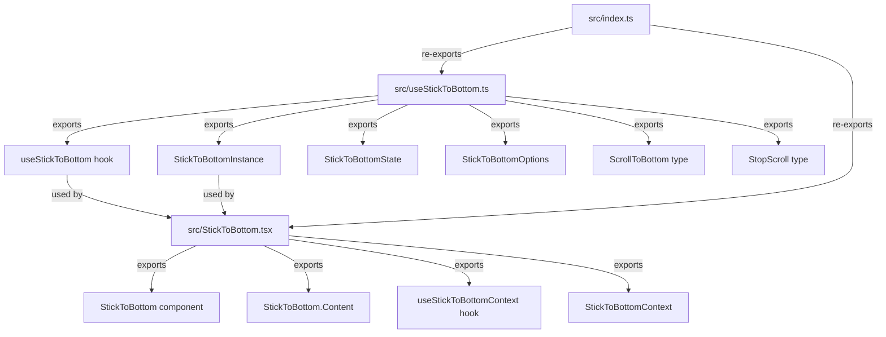
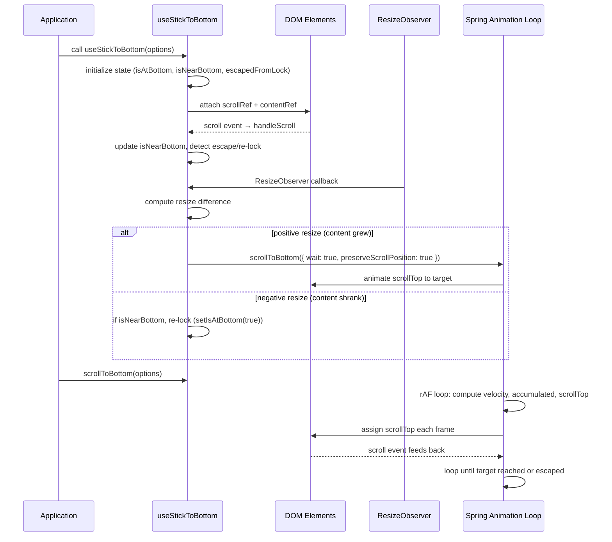

# use-stick-to-bottom: Overview

A lightweight React hook and component library for smoothly sticking scrollable content to the bottom. Designed primarily for AI chat applications where new messages continuously appear and the viewport must track the bottom edge without fighting user-initiated scroll escapes.

## Philosophy

Auto-scrolling in chat UIs is deceptively hard. The naive approach — set `scrollTop = scrollHeight` — breaks the moment a user tries to read older messages. `use-stick-to-bottom` solves this with a **lock/escape model**: the scroll locks to the bottom by default, but the user can escape at any time by scrolling up, and the lock re-engages when they scroll back down near the bottom.

Three principles drive the design:

1. **User control is absolute.** Scroll up to escape. Scroll down near bottom to re-lock. Mouse wheel up to escape. Text selection during scroll pauses animation.
2. **Spring physics, not linear easing.** A configurable spring animation (damping, stiffness, mass) produces natural-feeling motion that reacts to content growth mid-flight.
3. **Resize-aware.** A `ResizeObserver` on the content element detects when messages grow or shrink and adjusts scroll position accordingly, distinguishing between content growth (scroll to bottom) and container shrinkage (re-check bottom state).

## Quick Start

Install the package:

```bash
npm install use-stick-to-bottom
```

Use the component wrapper:

```tsx
import { StickToBottom } from 'use-stick-to-bottom';

function Chat() {
  return (
    <StickToBottom className="h-[50vh]">
      <StickToBottom.Content className="flex flex-col gap-4 p-6">
        {messages.map(msg => <Message key={msg.id} msg={msg} />)}
      </StickToBottom.Content>
    </StickToBottom>
  );
}
```

Use the hook directly:

```tsx
import { useStickToBottom } from 'use-stick-to-bottom';

function Chat() {
  const { scrollRef, contentRef, scrollToBottom, isAtBottom } = useStickToBottom();

  return (
    <div ref={scrollRef} style={{ height: '50vh', overflow: 'auto' }}>
      <div ref={contentRef}>
        {messages.map(msg => <Message key={msg.id} msg={msg} />)}
      </div>
      {!isAtBottom && <button onClick={() => scrollToBottom()}>Scroll to bottom</button>}
    </div>
  );
}
```

Source: `src/index.ts:1-2` — re-exports both `useStickToBottom` and `StickToBottom` from their respective source files.

## Architecture at a Glance

The package has two entry points that share the same underlying scroll engine:



The hook (`useStickToBottom`) is the engine. It manages scroll state, spring animation loops, resize observation, and user escape detection. The component (`StickToBottom`) is a convenience wrapper that creates a React context, wires up the hook, and renders a `<div>` with `scrollRef` and `contentRef` already attached.

## Component Lifecycle



## Core Concepts

### Lock/Escape Model

The hook tracks three boolean states:

| State | Meaning | Set by |
|-------|---------|--------|
| `isAtBottom` | The scroll is locked to the bottom; new content triggers auto-scroll | `handleScroll` (scrolling down re-locks), `ResizeObserver` (positive resize re-locks) |
| `isNearBottom` | The scroll is within 70px of the bottom | Computed from `scrollDifference <= STICK_TO_BOTTOM_OFFSET_PX` |
| `escapedFromLock` | The user has scrolled up to escape the auto-scroll | `handleScroll` (scrolling up), `handleWheel` (wheel up), `isSelecting` (text selection) |

Source: `src/useStickToBottom.ts:152-154` — state initialization with `useState`.

### Spring Animation

Instead of relying on `scroll-behavior: smooth`, the hook implements its own spring physics loop:

```
velocity = (damping * velocity + stiffness * scrollDifference) / mass
accumulated += velocity * tickDelta
scrollTop += accumulated
```

Source: `src/useStickToBottom.ts:340-345` — the spring calculation inside `scrollToBottom`.

Default spring parameters (source: `src/useStickToBottom.ts:41-64`):

| Parameter | Default | Effect |
|-----------|---------|--------|
| `damping` | 0.7 | Energy dissipation per tick (0 = no damping, 1 = full damping) |
| `stiffness` | 0.05 | How fast the animation accelerates toward the target |
| `mass` | 1.25 | Inertial mass; higher values produce slower, heavier motion |

### Near-Bottom Threshold

The hook considers itself "near the bottom" when within **70px** of the target scroll position. This constant is defined at the module level:

```typescript
// src/useStickToBottom.ts:131
const STICK_TO_BOTTOM_OFFSET_PX = 70;
```

Source: `src/useStickToBottom.ts:271-273` — `isNearBottom` getter.

## Key Constants

| Constant | Value | Location | Purpose |
|----------|-------|----------|---------|
| `STICK_TO_BOTTOM_OFFSET_PX` | 70 | `src/useStickToBottom.ts:131` | Near-bottom threshold in pixels |
| `SIXTY_FPS_INTERVAL_MS` | 1000/60 (~16.67) | `src/useStickToBottom.ts:132` | Frame interval for spring physics normalization |
| `RETAIN_ANIMATION_DURATION_MS` | 350 | `src/useStickToBottom.ts:133` | Extra duration for resize-triggered scrolls |

## Aha: The Mouse Selection Pause

**Aha:** The hook pauses its animation loop when the user is selecting text within the scroll area. It tracks a module-level `mouseDown` flag via global `mousedown`/`mouseup`/`click` listeners (source: `src/useStickToBottom.ts:135-147`), and in the animation loop checks `isSelecting()` — which verifies that the mouse is down AND the selection range contains the scroll element (source: `src/useStickToBottom.ts:159-174`). This means users can highlight and copy chat messages without the scroll jumping away mid-selection. A subtle but critical UX detail that most auto-scroll libraries miss entirely.

## Aha: CSS scroll-behavior Override

**Aha:** The `scrollTop` setter temporarily overrides the CSS `scroll-behavior` property to `auto` before assigning the value, then restores it afterward (source: `src/useStickToBottom.ts:203-220`). This prevents the browser's native smooth scrolling from intercepting programmatic `scrollTop` assignments, which would fight with the custom spring animation. The hook needs raw, immediate scroll position updates to compute velocity and accumulated distance — native smooth scrolling would produce intermediate positions that corrupt the physics calculation.

## Package Structure

```
use-stick-to-bottom/
├── src/
│   ├── index.ts              # Re-exports: useStickToBottom, StickToBottom
│   ├── useStickToBottom.ts   # Core hook (666 lines): spring animation, resize, escape detection
│   └── StickToBottom.tsx     # Component wrapper (189 lines): context, Content sub-component
├── demo/
│   ├── index.tsx             # Demo entry point: React 18 createRoot
│   ├── Demo.tsx              # Demo app: side-by-side smooth vs instant panels
│   ├── useFakeMessages.tsx   # Fake message generator with configurable speed
│   └── index.css             # Tailwind imports
├── package.json              # v1.1.6, MIT, React ^16.8-^19 peer dep
├── vite.config.ts            # Vite + @vitejs/plugin-react
├── tailwind.config.js        # Tailwind 3.4 + typography + icons
├── tsconfig.json             # Project references: app, demo, node
├── tsconfig.app.json         # Library build: ES2020, NodeNext, strict, isolatedDeclarations
├── tsconfig.demo.json        # Demo build: ESNext, Bundler, noEmit
└── postcss.config.js         # Tailwind + Autoprefixer
```

Source: `package.json` — version 1.1.6, author Sam Denty, MIT license, React peer dependency `^16.8.0 || ^17.0.0 || ^18.0.0 || ^19.0.0`.

## Peer Dependencies

The package requires React as a peer dependency:

```json
// package.json
"peerDependencies": {
  "react": "^16.8.0 || ^17.0.0 || ^18.0.0 || ^19.0.0"
}
```

This wide range (React 16.8 through 19) is possible because the hook uses only stable React APIs: `useState`, `useCallback`, `useMemo`, `useRef`, `useEffect`, `useLayoutEffect`, `useImperativeHandle`, `useContext`.

## Related Documents

- [Core Hook Deep Dive](01-core-hook.md) — `useStickToBottom`: algorithm, state management, scroll behavior
- [Component Deep Dive](02-component.md) — `StickToBottom`: wrapper, rendering, customization
- [Demo App](03-demo.md) — Demo structure, fakeMessages hook, test scenarios
- [Configuration](04-configuration.md) — Options, Tailwind integration, build setup
