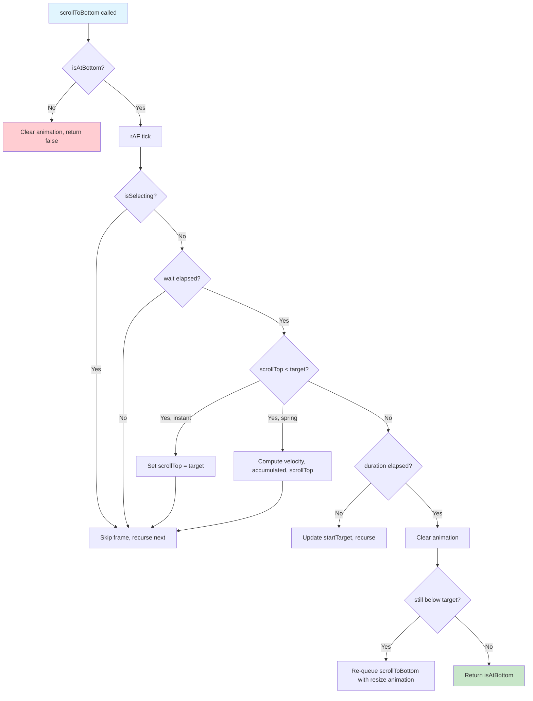

# useStickToBottom: Core Hook Deep Dive

The `useStickToBottom` hook is the engine of the package. It manages scroll state, runs a spring physics animation loop, observes content resizes, detects user escape attempts, and coordinates all of these concerns into a coherent API surface. This document traces every function, type, and state transition.

Source: `src/useStickToBottom.ts` — 666 lines, TypeScript, MIT licensed (StackBlitz copyright).

## The Hook Signature

```typescript
// src/useStickToBottom.ts:149-151
export const useStickToBottom = (
  options: StickToBottomOptions = {},
): StickToBottomInstance => {
```

The hook takes an optional `StickToBottomOptions` object and returns a `StickToBottomInstance`. Both types are fully documented below.

## State Management

### React State Variables

Three `useState` calls track the boolean flags that drive the lock/escape model:

```typescript
// src/useStickToBottom.ts:152-154
const [escapedFromLock, updateEscapedFromLock] = useState(false);
const [isAtBottom, updateIsAtBottom] = useState(options.initial !== false);
const [isNearBottom, setIsNearBottom] = useState(false);
```

The `isAtBottom` initializer is the key: it starts as `true` unless `options.initial` is explicitly set to `false`. This means the hook assumes you want auto-scroll enabled from mount.

### Callback Wrappers

Direct state setters are wrapped in `useCallback` to keep state in sync with the mutable `state` object:

```typescript
// src/useStickToBottom.ts:176-179
const setIsAtBottom = useCallback((isAtBottom: boolean) => {
  state.isAtBottom = isAtBottom;
  updateIsAtBottom(isAtBottom);
}, []);

// src/useStickToBottom.ts:181-184
const setEscapedFromLock = useCallback((escapedFromLock: boolean) => {
  state.escapedFromLock = escapedFromLock;
  updateEscapedFromLock(escapedFromLock);
}, []);
```

**Aha:** These callbacks mutate the `state` object directly AND trigger React re-renders. The `state` object is a `useMemo`-created mutable bag that the animation loop reads synchronously (avoiding React state staleness), while `useState` keeps React in sync for rendering. This dual-write pattern is the secret to having both instant physics-loop reads and reactive UI updates from the same source of truth.

## StickToBottomState: The Mutable State Bag

The `state` object is created via `useMemo` and serves as the single source of truth for all scroll-related values. The animation loop reads from it directly, bypassing React state to avoid stale closures.

```typescript
// src/useStickToBottom.ts:16-39
export interface StickToBottomState {
  scrollTop: number;
  lastScrollTop?: number;
  ignoreScrollToTop?: number;
  targetScrollTop: number;
  calculatedTargetScrollTop: number;
  scrollDifference: number;
  resizeDifference: number;

  animation?: {
    behavior: "instant" | Required<SpringAnimation>;
    ignoreEscapes: boolean;
    promise: Promise<boolean>;
  };
  lastTick?: number;
  velocity: number;
  accumulated: number;

  escapedFromLock: boolean;
  isAtBottom: boolean;
  isNearBottom: boolean;

  resizeObserver?: ResizeObserver;
}
```

### State Fields Explained

| Field | Type | Source | Description |
|-------|------|--------|-------------|
| `scrollTop` | `number` | Getter/setter at `src/useStickToBottom.ts:200-221` | Current scroll position; setter overrides CSS `scroll-behavior` to `auto` |
| `lastScrollTop` | `number?` | Set in `handleScroll` at line 421 | Previous scroll position for direction detection |
| `ignoreScrollToTop` | `number?` | Set in `scrollTop` setter at line 215 | Suppresses false scroll-up detection during programmatic scrolls |
| `targetScrollTop` | `number` | Getter at `src/useStickToBottom.ts:223-231` | Max scroll position: `scrollHeight - 1 - clientHeight` |
| `calculatedTargetScrollTop` | `number` | Getter at `src/useStickToBottom.ts:232-265` | Target after applying custom `targetScrollTop` function (clamped 0 to max) |
| `scrollDifference` | `number` | Getter at `src/useStickToBottom.ts:267-269` | `calculatedTargetScrollTop - scrollTop` |
| `resizeDifference` | `number` | Set in ResizeObserver at line 532 | Height change since last resize event; reset after scroll fires |
| `animation` | `object?` | Set in `scrollToBottom` at line 317 | Current animation state: behavior, ignoreEscapes flag, promise |
| `lastTick` | `number?` | Set in `scrollToBottom` at line 320 | Timestamp of last animation frame (for tick delta calculation) |
| `velocity` | `number` | Computed at line 340-343 | Spring physics velocity |
| `accumulated` | `number` | Computed at line 344 | Spring physics accumulated distance |
| `escapedFromLock` | `boolean` | React state at line 152 | Whether user escaped the bottom lock |
| `isAtBottom` | `boolean` | React state at line 153 | Whether scroll is locked to bottom |
| `isNearBottom` | `boolean` | Getter at line 271-273 | Whether within 70px of bottom |
| `resizeObserver` | `ResizeObserver?` | Created in `contentRef` at line 528 | Observes content element size changes |

### The scrollTop Getter/Setter

The `scrollTop` property is a JavaScript accessor that reads from and writes to the DOM element:

```typescript
// src/useStickToBottom.ts:200-221
get scrollTop() {
  return scrollRef.current?.scrollTop ?? 0;
},
set scrollTop(scrollTop: number) {
  if (scrollRef.current) {
    // Override CSS scroll-behavior so programmatic scrollTop
    // assignments take effect immediately and aren't intercepted
    // by the browser's smooth scrolling.
    const { scrollBehavior } = getComputedStyle(scrollRef.current);

    if (scrollBehavior !== "auto") {
      scrollRef.current.style.scrollBehavior = "auto";
    }

    scrollRef.current.scrollTop = scrollTop;
    state.ignoreScrollToTop = scrollRef.current.scrollTop;

    if (scrollBehavior !== "auto") {
      scrollRef.current.style.scrollBehavior = scrollBehavior;
    }
  }
},
```

The setter temporarily sets `scroll-behavior: auto` to prevent the browser's native smooth scrolling from fighting the custom spring animation. After assigning `scrollTop`, it records the actual value in `ignoreScrollToTop` to suppress false scroll-up detection.

### The targetScrollTop Getter

```typescript
// src/useStickToBottom.ts:223-231
get targetScrollTop() {
  if (!scrollRef.current || !contentRef.current) {
    return 0;
  }

  return (
    scrollRef.current.scrollHeight - 1 - scrollRef.current.clientHeight
  );
},
```

This computes the maximum scroll position. The `-1` accounts for sub-pixel rounding that can cause the browser to report `scrollTop` as slightly less than `scrollHeight - clientHeight` even when fully scrolled to the bottom.

### The calculatedTargetScrollTop Getter

```typescript
// src/useStickToBottom.ts:232-265
get calculatedTargetScrollTop() {
  if (!scrollRef.current || !contentRef.current) {
    return 0;
  }

  const { targetScrollTop } = this;

  if (!options.targetScrollTop) {
    return targetScrollTop;
  }

  if (lastCalculation?.targetScrollTop === targetScrollTop) {
    return lastCalculation.calculatedScrollTop;
  }

  const calculatedScrollTop = Math.max(
    Math.min(
      options.targetScrollTop(targetScrollTop, {
        scrollElement: scrollRef.current,
        contentElement: contentRef.current,
      }),
      targetScrollTop,
    ),
    0,
  );

  lastCalculation = { targetScrollTop, calculatedScrollTop };

  requestAnimationFrame(() => {
    lastCalculation = undefined;
  });

  return calculatedScrollTop;
},
```

This applies the custom `targetScrollTop` function (if provided), clamps the result between 0 and `targetScrollTop`, and caches the result for one animation frame to avoid redundant computation during the tight animation loop.

**Aha:** The calculation cache is cleared via `requestAnimationFrame` — not `setTimeout` or a synchronous reset. This means the cache lives for exactly one frame, which is precisely the duration of one animation step. Any subsequent call within the same rAF cycle gets the cached value; the next frame recomputes. This is a clever micro-optimization that keeps the animation loop hot-path fast without risking stale values across frames.

## Spring Animation System

### DEFAULT_SPRING_ANIMATION

```typescript
// src/useStickToBottom.ts:41-64
const DEFAULT_SPRING_ANIMATION = {
  damping: 0.7,
  stiffness: 0.05,
  mass: 1.25,
};
```

### SpringAnimation Type

```typescript
// src/useStickToBottom.ts:66-67
export interface SpringAnimation
  extends Partial<typeof DEFAULT_SPRING_ANIMATION> {}
```

This is `Partial` of the defaults, so you can override any subset: `{ damping: 0.5 }`, `{ stiffness: 0.1, mass: 2 }`, etc.

### Animation Type

```typescript
// src/useStickToBottom.ts:69
export type Animation = ScrollBehavior | SpringAnimation;
```

`Animation` is either a native `ScrollBehavior` string (`"auto"`, `"smooth"`, `"instant"`) or a custom `SpringAnimation` object. The string `"instant"` is treated as a special case that bypasses the spring loop entirely.

### mergeAnimations

```typescript
// src/useStickToBottom.ts:637-665
function mergeAnimations(...animations: (Animation | boolean | undefined)[]) {
  const result = { ...DEFAULT_SPRING_ANIMATION };
  let instant = false;

  for (const animation of animations) {
    if (animation === "instant") {
      instant = true;
      continue;
    }

    if (typeof animation !== "object") {
      continue;
    }

    instant = false;

    result.damping = animation.damping ?? result.damping;
    result.stiffness = animation.stiffness ?? result.stiffness;
    result.mass = animation.mass ?? result.mass;
  }

  const key = JSON.stringify(result);

  if (!animationCache.has(key)) {
    animationCache.set(key, Object.freeze(result));
  }

  return instant ? "instant" : animationCache.get(key)!;
}
```

This function merges multiple animation specs (from options, resize, initial) into a single resolved animation. Key behaviors:

1. **Instant overrides everything.** If any animation in the chain is `"instant"`, the result is `"instant"` — unless a later animation is a SpringAnimation object, which resets `instant = false`.
2. **Caching.** Results are cached by JSON stringification of the merged parameters. The cached value is `Object.freeze`-d to prevent mutation.
3. **Boolean/undefined skip.** Non-object values other than `"instant"` are silently skipped.

The cache is a module-level `Map`:

```typescript
// src/useStickToBottom.ts:635
const animationCache = new Map<string, Readonly<Required<SpringAnimation>>>();
```

## scrollToBottom: The Animation Loop

The `scrollToBottom` function is the heart of the package. It initiates a `requestAnimationFrame` loop that drives the spring animation until the scroll reaches the target.

```typescript
// src/useStickToBottom.ts:277-405
const scrollToBottom = useCallback<ScrollToBottom>(
  (scrollOptions = {}) => {
```

### ScrollToBottomOptions

```typescript
// src/useStickToBottom.ts:87-124
export type ScrollToBottomOptions =
  | ScrollBehavior
  | {
      animation?: Animation;
      wait?: boolean | number;
      ignoreEscapes?: boolean;
      preserveScrollPosition?: boolean;
      duration?: number | Promise<void>;
    };
```

| Option | Type | Default | Description |
|--------|------|---------|-------------|
| `animation` | `Animation` | Merged from `StickToBottomOptions` | `"instant"`, `"smooth"`, `"auto"`, or `{ damping, stiffness, mass }` |
| `wait` | `boolean \| number` | `false` | Wait for existing scrolls to finish, or wait N milliseconds before starting |
| `ignoreEscapes` | `boolean` | `false` | Prevent user from escaping the scroll by scrolling up |
| `preserveScrollPosition` | `boolean` | `false` | Only scroll if already at the bottom |
| `duration` | `number \| Promise<void>` | `0` | Extra milliseconds the scroll should persist, or a Promise to wait for |

### ScrollToBottom Type

```typescript
// src/useStickToBottom.ts:126-128
export type ScrollToBottom = (
  scrollOptions?: ScrollToBottomOptions,
) => Promise<boolean> | boolean;
```

Returns a `Promise<boolean>` (whether still at bottom after scroll completes) or `boolean` synchronously if an existing animation promise is reused.

### The Animation Loop (next function)

Inside `scrollToBottom`, the `next` async function forms the animation loop:

```typescript
// src/useStickToBottom.ts:305-392
const next = async (): Promise<boolean> => {
  const promise = new Promise(requestAnimationFrame).then(() => {
    // Guard: if user escaped, stop
    if (!state.isAtBottom) {
      state.animation = undefined;
      return false;
    }

    const { scrollTop } = state;
    const tick = performance.now();
    const tickDelta =
      (tick - (state.lastTick ?? tick)) / SIXTY_FPS_INTERVAL_MS;
    state.animation ||= { behavior, promise, ignoreEscapes };

    if (state.animation.behavior === behavior) {
      state.lastTick = tick;
    }

    // Text selection pauses animation
    if (isSelecting()) {
      return next();
    }

    // Wait timer
    if (waitElapsed > Date.now()) {
      return next();
    }

    // Still below target — keep scrolling
    if (scrollTop < Math.min(startTarget, state.calculatedTargetScrollTop)) {
      if (state.animation?.behavior === behavior) {
        if (behavior === "instant") {
          state.scrollTop = state.calculatedTargetScrollTop;
          return next();
        }

        // Spring physics update
        state.velocity =
          (behavior.damping * state.velocity +
            behavior.stiffness * state.scrollDifference) /
          behavior.mass;
        state.accumulated += state.velocity * tickDelta;
        state.scrollTop += state.accumulated;

        if (state.scrollTop !== scrollTop) {
          state.accumulated = 0;
        }
      }

      return next();
    }

    // Duration timer check
    if (durationElapsed > Date.now()) {
      startTarget = state.calculatedTargetScrollTop;
      return next();
    }

    // Animation complete
    state.animation = undefined;

    // If still below target, re-queue with resize animation
    if (state.scrollTop < state.calculatedTargetScrollTop) {
      return scrollToBottom({
        animation: mergeAnimations(
          optionsRef.current,
          optionsRef.current.resize,
        ),
        ignoreEscapes,
        duration: Math.max(0, durationElapsed - Date.now()) || undefined,
      });
    }

    return state.isAtBottom;
  });

  return promise.then((isAtBottom) => {
    requestAnimationFrame(() => {
      if (!state.animation) {
        state.lastTick = undefined;
        state.velocity = 0;
      }
    });

    return isAtBottom;
  });
};
```

### Animation Loop Flow



### Loop Termination Conditions

The animation loop terminates when:

1. **User escaped:** `state.isAtBottom` becomes `false` (user scrolled up).
2. **Target reached AND duration elapsed:** `scrollTop >= target` AND `durationElapsed <= Date.now()`.
3. **Animation type changed:** A new `scrollToBottom` call with a different behavior clears the current animation.

### Spring Physics Detail

The spring update step (source: `src/useStickToBottom.ts:340-349`):

```typescript
state.velocity =
  (behavior.damping * state.velocity +
    behavior.stiffness * state.scrollDifference) /
  behavior.mass;
state.accumulated += state.velocity * tickDelta;
state.scrollTop += state.accumulated;

if (state.scrollTop !== scrollTop) {
  state.accumulated = 0;
}
```

The physics: velocity is computed as a damped spring force toward the target. The accumulated distance is the integral of velocity over normalized frame time. After applying the accumulated distance to `scrollTop`, if the scroll position actually changed (meaning the browser accepted the assignment), `accumulated` is reset to zero. This prevents the accumulator from growing unbounded when the browser rejects scroll assignments (e.g., at the scroll boundary).

## Event Handlers

### handleScroll

The scroll event handler (source: `src/useStickToBottom.ts:412-479`) processes scroll events and manages the lock/escape state:

```typescript
// src/useStickToBottom.ts:412-479
const handleScroll = useCallback(
  ({ target }: Event) => {
    if (target !== scrollRef.current) {
      return;
    }

    const { scrollTop, ignoreScrollToTop } = state;
    let { lastScrollTop = scrollTop } = state;

    state.lastScrollTop = scrollTop;
    state.ignoreScrollToTop = undefined;

    if (ignoreScrollToTop && ignoreScrollToTop > scrollTop) {
      lastScrollTop = ignoreScrollToTop;
    }

    setIsNearBottom(state.isNearBottom);

    setTimeout(() => {
      if (state.resizeDifference || scrollTop === ignoreScrollToTop) {
        return;
      }

      if (isSelecting()) {
        setEscapedFromLock(true);
        setIsAtBottom(false);
        return;
      }

      const isScrollingDown = scrollTop > lastScrollTop;
      const isScrollingUp = scrollTop < lastScrollTop;

      if (state.animation?.ignoreEscapes) {
        state.scrollTop = lastScrollTop;
        return;
      }

      if (isScrollingUp) {
        setEscapedFromLock(true);
        setIsAtBottom(false);
      }

      if (isScrollingDown) {
        setEscapedFromLock(false);
      }

      if (!state.escapedFromLock && state.isNearBottom) {
        setIsAtBottom(true);
      }
    }, 1);
  },
  [setEscapedFromLock, setIsAtBottom, isSelecting, state],
);
```

Key behaviors:

1. **Event target guard:** Only processes events from `scrollRef.current`.
2. **ignoreScrollToTop correction:** If a programmatic scroll set `ignoreScrollToTop` and the current `scrollTop` is less than that value, `lastScrollTop` is corrected to avoid false scroll-up detection.
3. **Resize event suppression (setTimeout):** Uses a 1ms `setTimeout` to defer the escape logic, allowing `ResizeObserver` events (which may fire before scroll events) to set `resizeDifference` first. If `resizeDifference` is set, the scroll event is ignored.
4. **Text selection escape:** If `isSelecting()` returns true during scroll, the lock is escaped.
5. **Scroll direction:** Scrolling up escapes; scrolling down re-locks. If already locked and near bottom, `isAtBottom` stays `true`.

### handleWheel

The wheel event handler (source: `src/useStickToBottom.ts:481-509):

```typescript
// src/useStickToBottom.ts:481-509
const handleWheel = useCallback(
  ({ target, deltaY }: WheelEvent) => {
    let element = target as HTMLElement;

    while (!["scroll", "auto"].includes(getComputedStyle(element).overflow)) {
      if (!element.parentElement) {
        return;
      }
      element = element.parentElement;
    }

    if (
      element === scrollRef.current &&
      deltaY < 0 &&
      scrollRef.current.scrollHeight > scrollRef.current.clientHeight &&
      !state.animation?.ignoreEscapes
    ) {
      setEscapedFromLock(true);
      setIsAtBottom(false);
    }
  },
  [setEscapedFromLock, setIsAtBottom, state],
);
```

Key behaviors:

1. **Ancestor traversal:** Walks up the DOM tree from the wheel target to find the nearest scrollable ancestor (one with `overflow: scroll` or `overflow: auto`). This ensures wheel events on child elements are correctly attributed to the scroll container.
2. **Scroll-up detection:** `deltaY < 0` means scrolling up. Only escapes if the scroll container has scrollable content (`scrollHeight > clientHeight`) and escapes are not ignored.

### isSelecting

```typescript
// src/useStickToBottom.ts:159-174
const isSelecting = useCallback(() => {
  if (!mouseDown) {
    return false;
  }

  const selection = window.getSelection();
  if (!selection || !selection.rangeCount) {
    return false;
  }

  const range = selection.getRangeAt(0);
  return (
    range.commonAncestorContainer.contains(scrollRef.current) ||
    scrollRef.current?.contains(range.commonAncestorContainer)
  );
}, []);
```

Checks if the user has an active text selection that intersects the scroll element. Returns `false` immediately if no mouse button is held.

## useRefCallback: Dual Ref Pattern

```typescript
// src/useStickToBottom.ts:621-633
function useRefCallback<T extends (ref: HTMLElement | null) => any>(
  callback: T,
  deps: DependencyList,
) {
  const result = useCallback((ref: HTMLElement | null) => {
    result.current = ref;
    return callback(ref);
  }, deps) as any as MutableRefObject<HTMLElement | null> &
    RefCallback<HTMLElement>;

  return result;
}
```

**Aha:** `useRefCallback` creates a ref that is simultaneously a `MutableRefObject` (with `.current`) AND a `RefCallback` (callable as `ref={...}`). This dual nature is what allows `scrollRef` and `contentRef` to be used as both `ref={scrollRef}` on JSX elements AND accessed as `scrollRef.current` in imperative code. The trick: the `useCallback` function assigns to `result.current` before invoking the user callback, keeping the `.current` property synchronized.

### scrollRef

```typescript
// src/useStickToBottom.ts:511-516
const scrollRef = useRefCallback((scroll) => {
  scrollRef.current?.removeEventListener("scroll", handleScroll);
  scrollRef.current?.removeEventListener("wheel", handleWheel);
  scroll?.addEventListener("scroll", handleScroll, { passive: true });
  scroll?.addEventListener("wheel", handleWheel, { passive: true });
}, []);
```

Attaches/detaches `scroll` and `wheel` event listeners with `{ passive: true }` for performance.

### contentRef

```typescript
// src/useStickToBottom.ts:518-594
const contentRef = useRefCallback((content) => {
  state.resizeObserver?.disconnect();
  state.resizeObserver = undefined;

  if (!content) {
    return;
  }

  let previousHeight: number | undefined;

  state.resizeObserver = new ResizeObserver(([entry]) => {
    const { height } = entry.contentRect;
    const difference = height - (previousHeight ?? height);

    state.resizeDifference = difference;

    if (state.scrollTop > state.targetScrollTop) {
      state.scrollTop = state.targetScrollTop;
    }

    setIsNearBottom(state.isNearBottom);

    if (difference >= 0) {
      // Positive resize: content grew
      const animation = mergeAnimations(
        optionsRef.current,
        previousHeight
          ? optionsRef.current.resize
          : optionsRef.current.initial,
      );

      scrollToBottom({
        animation,
        wait: true,
        preserveScrollPosition: true,
        duration:
          animation === "instant" ? undefined : RETAIN_ANIMATION_DURATION_MS,
      });
    } else {
      // Negative resize: content shrank
      if (state.isNearBottom) {
        setEscapedFromLock(false);
        setIsAtBottom(true);
      }
    }

    previousHeight = height;

    requestAnimationFrame(() => {
      setTimeout(() => {
        if (state.resizeDifference === difference) {
          state.resizeDifference = 0;
        }
      }, 1);
    });
  });

  state.resizeObserver?.observe(content);
}, []);
```

The ResizeObserver callback:

1. **Computes height difference** from `previousHeight`.
2. **Overscroll correction:** If `scrollTop > targetScrollTop`, clamps it back.
3. **Positive resize (content grew):** Triggers `scrollToBottom` with `wait: true` and `preserveScrollPosition: true`, plus 350ms extra duration (unless animation is `"instant"`). Uses `resize` animation for subsequent resizes, `initial` for the first resize.
4. **Negative resize (content shrank):** If near bottom, re-locks (clears escape, sets `isAtBottom(true)`).
5. **Resets `resizeDifference`:** After one rAF + one 1ms setTimeout, clears the difference if it hasn't been updated again. This timing aligns with the `setTimeout` in `handleScroll` to ensure the scroll event sees the `resizeDifference` flag.

## stopScroll

```typescript
// src/useStickToBottom.ts:407-410
const stopScroll = useCallback((): void => {
  setEscapedFromLock(true);
  setIsAtBottom(false);
}, [setEscapedFromLock, setIsAtBottom]);
```

Manually escapes the lock and clears `isAtBottom`. Useful for "stop scrolling" buttons in the UI.

## Global Mouse State

```typescript
// src/useStickToBottom.ts:135-147
let mouseDown = false;

globalThis.document?.addEventListener("mousedown", () => {
  mouseDown = true;
});

globalThis.document?.addEventListener("mouseup", () => {
  mouseDown = false;
});

globalThis.document?.addEventListener("click", () => {
  mouseDown = false;
});
```

A module-level flag tracks mouse button state for the `isSelecting()` check. The optional chaining on `globalThis.document` ensures this doesn't crash during SSR (when `document` is undefined).

## StickToBottomInstance: Return Type

```typescript
// src/useStickToBottom.ts:608-619
export interface StickToBottomInstance {
  contentRef: React.MutableRefObject<HTMLElement | null> &
    React.RefCallback<HTMLElement>;
  scrollRef: React.MutableRefObject<HTMLElement | null> &
    React.RefCallback<HTMLElement>;
  scrollToBottom: ScrollToBottom;
  stopScroll: StopScroll;
  isAtBottom: boolean;
  isNearBottom: boolean;
  escapedFromLock: boolean;
  state: StickToBottomState;
}
```

The return value (source: `src/useStickToBottom.ts:596-605):

```typescript
return {
  contentRef,
  scrollRef,
  scrollToBottom,
  stopScroll,
  isAtBottom: isAtBottom || isNearBottom,
  isNearBottom,
  escapedFromLock,
  state,
};
```

**Note:** `isAtBottom` in the return is `isAtBottom || isNearBottom` — if either is true, the consumer sees `true`. This means the returned `isAtBottom` is true when either locked at bottom OR within 70px of bottom.

## Options Type

```typescript
// src/useStickToBottom.ts:81-85
export interface StickToBottomOptions extends SpringAnimation {
  resize?: Animation;
  initial?: Animation | boolean;
  targetScrollTop?: GetTargetScrollTop;
}
```

Extends `SpringAnimation`, so `damping`, `stiffness`, and `mass` are all valid options.

| Option | Type | Default | Description |
|--------|------|---------|-------------|
| `damping` | `number` | 0.7 | Spring damping (0-1) |
| `stiffness` | `number` | 0.05 | Spring stiffness |
| `mass` | `number` | 1.25 | Spring mass |
| `resize` | `Animation` | Inherits spring params | Animation for resize-triggered scrolls |
| `initial` | `Animation \| boolean` | `true` | Initial scroll behavior on mount; `false` disables initial scroll |
| `targetScrollTop` | `GetTargetScrollTop` | None | Custom target scroll calculator |

### GetTargetScrollTop

```typescript
// src/useStickToBottom.ts:76-79
export type GetTargetScrollTop = (
  targetScrollTop: number,
  context: ScrollElements,
) => number;
```

A function that receives the default target and can return a modified value. The result is clamped between 0 and the default `targetScrollTop`.

### ScrollElements

```typescript
// src/useStickToBottom.ts:71-74
export interface ScrollElements {
  scrollElement: HTMLElement;
  contentElement: HTMLElement;
}
```

## Error Cases

| Scenario | Behavior | Source |
|----------|----------|--------|
| No `document` (SSR) | Global mouse listeners silently skipped via `?.` | `src/useStickToBottom.ts:137-147` |
| No `scrollRef.current` | `scrollTop` getter returns 0; `targetScrollTop` returns 0 | `src/useStickToBottom.ts:200-201, 224-226` |
| No `contentRef.current` | ResizeObserver not created; `targetScrollTop` returns 0 | `src/useStickToBottom.ts:232-234, 522-524` |

## Cross-References

- [Component wrapper that uses this hook](02-component.md) — `StickToBottom` component, context, Content sub-component
- [Demo app that exercises scroll scenarios](03-demo.md) — `useFakeMessages`, side-by-side panels, test patterns
- [Configuration options and build setup](04-configuration.md) — TypeScript, Vite, Tailwind, Biome
