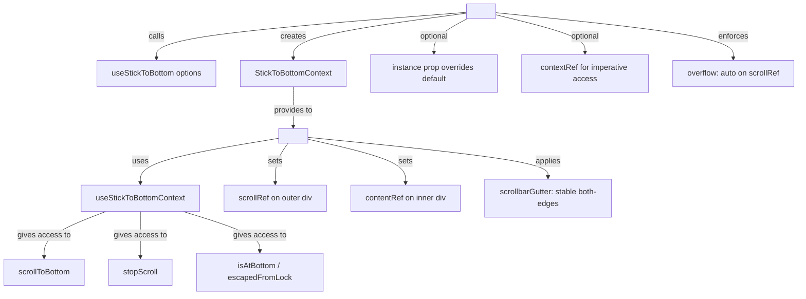
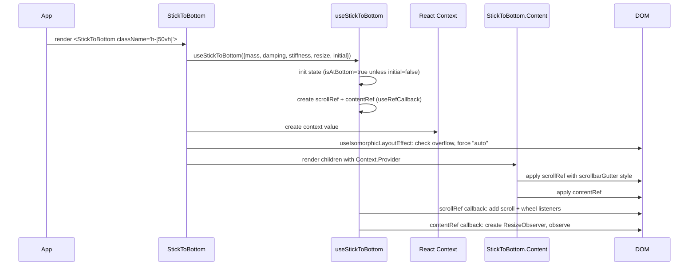

# StickToBottom: Component API

The `StickToBottom` component wraps `useStickToBottom` in a React Context provider, offering a declarative API with a `.Content` sub-component and a render-function pattern. Use it when you want to avoid manual ref wiring.

Source: `src/StickToBottom.tsx` — 189 lines, TypeScript.

## StickToBottom Component

```tsx
// src/StickToBottom.tsx:39-98
export function StickToBottom({
  instance,
  children,
  resize,
  initial,
  mass,
  damping,
  stiffness,
  targetScrollTop: currentTargetScrollTop,
  contextRef,
  ...props
}: StickToBottomProps): ReactElement {
```

The component destructures `StickToBottomOptions` (resize, initial, mass, damping, stiffness, targetScrollTop) from props and passes them to the internal `useStickToBottom` call. All other HTML attributes spread onto the outer `<div>`.

### StickToBottomProps

```tsx
// src/StickToBottom.tsx:27-37
export interface StickToBottomProps
  extends Omit<React.HTMLAttributes<HTMLDivElement>, "children">,
    StickToBottomOptions {
  contextRef?: React.Ref<StickToBottomContext>;
  instance?: StickToBottomInstance;
  children: ((context: StickToBottomContext) => ReactNode) | ReactNode;
}
```

| Prop | Type | Description |
|------|------|-------------|
| `children` | `ReactNode \| (context) => ReactNode` | Content to render. Supports render function for context access. |
| `instance` | `StickToBottomInstance?` | Pre-created hook instance (for sharing state across components). |
| `contextRef` | `React.Ref<StickToBottomContext>?` | Imperative ref to access the context from outside. |
| `resize` | `Animation?` | Animation for resize-triggered scrolls. |
| `initial` | `Animation \| boolean?` | Initial scroll behavior on mount. |
| `mass` | `number?` | Spring mass. |
| `damping` | `number?` | Spring damping. |
| `stiffness` | `number?` | Spring stiffness. |
| `targetScrollTop` | `GetTargetScrollTop?` | Custom target scroll calculator. |

Plus all standard `<div>` HTML attributes (`className`, `style`, `id`, `data-*`, etc.).

### Internal Instance

The component creates its own hook instance unless you provide one:

```tsx
// src/StickToBottom.tsx:53-60
const defaultInstance = useStickToBottom({
  mass,
  damping,
  stiffness,
  resize,
  initial,
  targetScrollTop,
});

const { scrollRef, contentRef, scrollToBottom, stopScroll, isAtBottom, escapedFromLock, state }
  = instance ?? defaultInstance;
```

**Aha:** The `instance` prop lets you create a `useStickToBottom` hook outside the component and pass it in. This is the escape hatch for when you need to call `scrollToBottom` from a sibling component that isn't inside `<StickToBottom>` — create the hook at a common ancestor, pass the instance down, and both the hook's refs and the component's context stay in sync.

### Context Provider

```tsx
// src/StickToBottom.tsx:62-83
const context = useMemo<StickToBottomContext>(() => ({
  scrollToBottom, stopScroll, scrollRef, isAtBottom, escapedFromLock, contentRef, state,
  get targetScrollTop() { return customTargetScrollTop.current; },
  set targetScrollTop(v) { customTargetScrollTop.current = v; },
}), [scrollToBottom, isAtBottom, contentRef, scrollRef, stopScroll, escapedFromLock, state]);

useImperativeHandle(contextRef, () => context, [context]);
```

The context is memoized and exposed via `useImperativeHandle` to `contextRef`. The `targetScrollTop` getter/setter pair allows dynamic override from inside child components.

### Overflow Auto Enforcement

```tsx
// src/StickToBottom.tsx:85-92
useIsomorphicLayoutEffect(() => {
  if (!scrollRef.current) return;
  if (getComputedStyle(scrollRef.current).overflow === "visible") {
    scrollRef.current.style.overflow = "auto";
  }
}, []);
```

If the user doesn't set an overflow style, the component forces `overflow: auto` on the scroll element. Without this, the element can't scroll at all.

### isomorphicLayoutEffect

```tsx
// src/StickToBottom.tsx:38
const useIsomorphicLayoutEffect =
  typeof window !== "undefined" ? useLayoutEffect : useEffect;
```

**Aha:** During SSR, `useLayoutEffect` produces a warning because there's no DOM to layout against. This shim conditionally falls back to `useEffect` on the server, making `<StickToBottom>` SSR-safe without requiring the user to conditionally render it.

## StickToBottom.Content

The `.Content` sub-component renders the scrollable area and content:

```tsx
// src/StickToBottom.tsx:100-132
export function Content({
  children,
  scrollClassName,
  ...props
}: ContentProps): ReactElement {
  const context = useStickToBottomContext();

  return (
    <div
      ref={context.scrollRef}
      style={{ height: "100%", width: "100%", scrollbarGutter: "stable both-edges" }}
      className={scrollClassName}
    >
      <div {...props} ref={context.contentRef}>
        {typeof children === "function" ? children(context) : children}
      </div>
    </div>
  );
}
```

### ContentProps

```tsx
// src/StickToBottom.tsx:100-104
export interface ContentProps
  extends Omit<React.HTMLAttributes<HTMLDivElement>, "children"> {
  children: ((context: StickToBottomContext) => ReactNode) | ReactNode;
  scrollClassName?: string;
}
```

| Prop | Type | Description |
|------|------|-------------|
| `children` | `ReactNode \| (context) => ReactNode` | The scrollable content. |
| `scrollClassName` | `string?` | CSS class for the scroll container `<div>`. |

Plus all standard `<div>` attributes applied to the inner content `<div>`.

### Inline Styles

The scroll container has three inline styles that are always applied:

| Style | Value | Purpose |
|-------|-------|---------|
| `height` | `100%` | Fill parent height |
| `width` | `100%` | Fill parent width |
| `scrollbarGutter` | `stable both-edges` | Reserve space for scrollbar, preventing layout shift when scrollbar appears/disappears |

**Aha:** The `scrollbarGutter: "stable both-edges"` is a subtle but important UX choice. Without it, when content grows and a scrollbar appears, the content width shrinks (by the scrollbar width), causing a reflow. `stable` reserves the space regardless of whether a scrollbar is visible. `both-edges` places it on both sides (visually invisible when not needed). This prevents the "content jumps when scrollbar appears" problem that plagues many chat UIs.

## useStickToBottomContext Hook

```tsx
// src/StickToBottom.tsx:139-147
export function useStickToBottomContext(): StickToBottomContext {
  const context = useContext(StickToBottomContext);
  if (!context) {
    throw new Error(
      "use-stick-to-bottom component context must be used within a StickToBottom component",
    );
  }
  return context;
}
```

Call this inside any child of `<StickToBottom>` to access `scrollToBottom`, `stopScroll`, `isAtBottom`, `escapedFromLock`, `scrollRef`, `contentRef`, and `state`.

### StickToBottomContext

```tsx
// src/StickToBottom.tsx:15-25
export interface StickToBottomContext {
  contentRef: React.MutableRefObject<HTMLElement | null> & React.RefCallback<HTMLElement>;
  scrollRef: React.MutableRefObject<HTMLElement | null> & React.RefCallback<HTMLElement>;
  scrollToBottom: ScrollToBottom;
  stopScroll: StopScroll;
  isAtBottom: boolean;
  escapedFromLock: boolean;
  get targetScrollTop(): GetTargetScrollTop | null;
  set targetScrollTop(targetScrollTop: GetTargetScrollTop | null);
  state: StickToBottomState;
}
```

## Component Architecture Diagram



## Usage Patterns

### Pattern 1: Simple Declarative

```tsx
<StickToBottom className="h-[500px]">
  <StickToBottom.Content>
    {messages.map(m => <Message key={m.id} {...m} />)}
  </StickToBottom.Content>
</StickToBottom>
```

### Pattern 2: Render Function with Context Access

```tsx
<StickToBottom className="h-[500px]">
  {(ctx) => (
    <StickToBottom.Content>
      {messages.map(m => <Message key={m.id} {...m} />)}
      {!ctx.isAtBottom && (
        <button onClick={() => ctx.scrollToBottom()}>↓ New messages</button>
      )}
    </StickToBottom.Content>
  )}
</StickToBottom>
```

### Pattern 3: Custom Scroll Target

```tsx
<StickToBottom
  className="h-[500px]"
  targetScrollTop={(target, { scrollElement, contentElement }) => {
    // Stick to 100px above the actual bottom
    return Math.max(target - 100, 0);
  }}
>
  <StickToBottom.Content>
    {messages.map(m => <Message key={m.id} {...m} />)}
  </StickToBottom.Content>
</StickToBottom>
```

### Pattern 4: Shared Instance

```tsx
function ChatContainer() {
  const instance = useStickToBottom({ mass: 2 });
  
  return (
    <div>
      <StickToBottom instance={instance}>
        <StickToBottom.Content>{messages}</StickToBottom.Content>
      </StickToBottom>
      <button onClick={() => instance.scrollToBottom()}>Scroll</button>
    </div>
  );
}
```

## Sequence Diagram: Component Mount



## Cross-References

- [Core Hook implementation](01-core-hook.md) — useStickToBottom algorithm
- [Demo app usage patterns](03-demo.md) — Real component usage in the demo
- [Configuration options](04-configuration.md) — Build setup, TypeScript config
