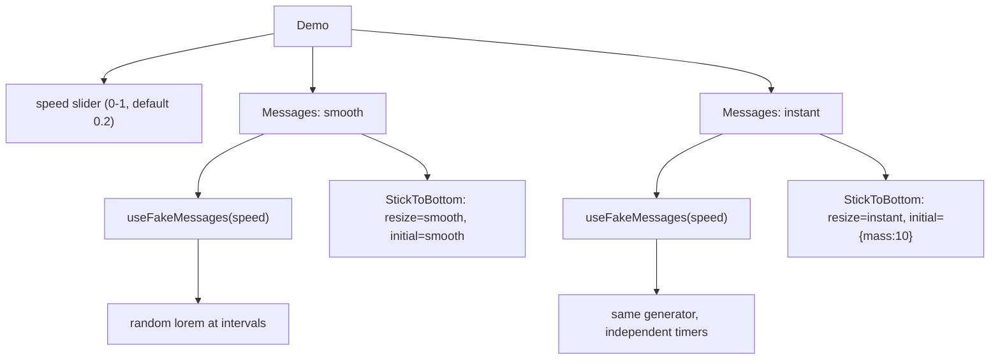
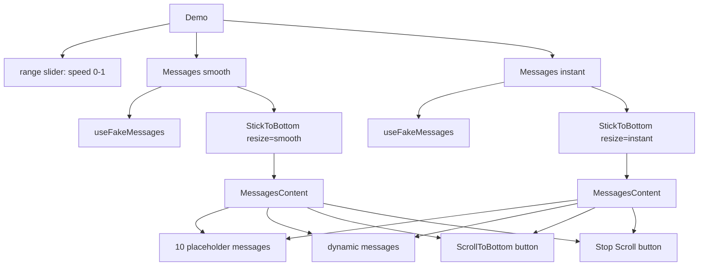

# Demo App

The demo app is a side-by-side comparison tool that exercises the hook under realistic chat-like conditions. It generates fake messages at configurable speed and shows both `smooth` and `instant` animation modes simultaneously.

Source: `demo/Demo.tsx`, `demo/useFakeMessages.tsx`, `demo/index.tsx`, `demo/index.css`.

## Demo Entry Point

```tsx
// demo/index.tsx:1-8
import './index.css';
import React from 'react';
import { createRoot } from 'react-dom/client';
import { Demo } from './Demo.js';

const container = document.getElementById('root')!;
const root = createRoot(container);
root.render(<Demo />);
```

Standard React 18 `createRoot` entry. No SSR, no routing — a single-page Vite app.

## Demo Component

```tsx
// demo/Demo.tsx:70-86
export function Demo() {
  const [speed, setSpeed] = useState(0.2);

  return (
    <div className="flex flex-col gap-10 p-10 items-center w-full">
      <input
        className="w-full max-w-screen-lg"
        type="range"
        value={speed}
        onChange={(e) => setSpeed(+e.target.value)}
        min={0}
        max={1}
        step={0.01}
      />

      <div className="flex gap-6 w-full max-w-screen-lg">
        <Messages speed={speed} animation="smooth" />
        <Messages speed={speed} animation="instant" />
      </div>
    </div>
  );
}
```

The demo has a single state variable: `speed` (0 to 1, default 0.2). A range slider controls it. Two `<Messages>` panels render side-by-side — one with `animation="smooth"`, one with `animation="instant"` — so you can visually compare the scroll behavior.



## Messages Component

```tsx
// demo/Demo.tsx:43-59
function Messages({ animation, speed }: { animation: ScrollBehavior; speed: number }) {
  const messages = useFakeMessages(speed);

  return (
    <div className="prose flex flex-col gap-2 w-full overflow-hidden">
      <h2 className="flex justify-center">{animation}:</h2>

      <StickToBottom
        className="h-[50vh] flex flex-col"
        resize={animation}
        initial={animation === 'instant' ? 'instant' : { mass: 10 }}
      >
        <MessagesContent messages={messages} />
      </StickToBottom>
    </div>
  );
}
```

Key configuration difference between the two panels:

| Panel | `resize` | `initial` | Effect |
|-------|----------|-----------|--------|
| smooth | `"smooth"` | `{ mass: 10 }` | Heavy spring for smooth resize tracking |
| instant | `"instant"` | `"instant"` | Instant jump on mount and resize |

**Aha:** The `smooth` panel uses `mass: 10` for the initial scroll — 8× the default mass of 1.25. This produces a noticeably slower, heavier initial scroll, making the spring animation visible. The `instant` panel uses `"instant"` for both resize and initial, producing no animation at all. The side-by-side comparison makes the difference obvious.

## MessagesContent Component

```tsx
// demo/Demo.tsx:16-41
function MessagesContent({ messages }: { messages: React.ReactNode[][] }) {
  const { stopScroll } = useStickToBottomContext();

  return (
    <>
      <div className="relative w-full flex flex-col overflow-hidden">
        <StickToBottom.Content className="flex flex-col gap-4 p-6">
          {[...Array(10)].map((_, i) => (
            <Message key={i}>
              <h1>This is a test</h1>
              more testing text...
            </Message>
          ))}

          {messages.map((message, i) => (
            <Message key={i}>{message}</Message>
          ))}
        </StickToBottom.Content>
        <ScrollToBottom />
      </div>

      <div className="flex justify-center pt-4">
        <button className="rounded bg-slate-600 text-white px-4 py-2" onClick={() => stopScroll()}>
          Stop Scroll
        </button>
      </div>
    </>
  );
}
```

The component renders:
1. **10 static placeholder messages** at the top (to ensure the container is scrollable from the start)
2. **Dynamic messages** from `useFakeMessages` below
3. **A "Scroll to bottom" button** (via `ScrollToBottom` sub-component) that appears when not at bottom
4. **A "Stop Scroll" button** below the scroll area that calls `stopScroll()`

## ScrollToBottom Button

```tsx
// demo/Demo.tsx:7-14
function ScrollToBottom() {
  const { isAtBottom, scrollToBottom } = useStickToBottomContext();

  return (
    !isAtBottom && (
      <button
        className="absolute i-ph-arrow-circle-down-fill text-4xl rounded-lg left-[50%] translate-x-[-50%] bottom-0"
        onClick={() => scrollToBottom()}
      />
    )
  );
}
```

A floating arrow icon (using the `@iconify/ph` icon font) that appears when `!isAtBottom`. Centered at the bottom of the scroll area. Clicking calls `scrollToBottom()` with default options.

## useFakeMessages Hook

```tsx
// demo/useFakeMessages.tsx:1-47
import { LoremIpsum } from 'lorem-ipsum';
import React, { useEffect, useState, useCallback } from 'react';

const lorem = new LoremIpsum();

export function useFakeMessages(speed = 1) {
  const [messages, setMessages] = useState<React.ReactNode[][]>([]);
```

This hook simulates incoming chat messages. It generates random lorem ipsum text at configurable intervals, simulating multiple messages being typed out over time.

### Message Generation Logic

```tsx
// demo/useFakeMessages.tsx:15-45
useEffect(() => {
  let wordCount = 0;
  let timer: ReturnType<typeof setTimeout>;

  const update = () => {
    if (wordCount <= 0) {
      wordCount = getWordCount();
      setMessages((prevMessages) => [...prevMessages, []]);
    }

    const Tag = Math.random() < 0.1 ? 'h1' : null;

    let words = getWords();
    if (words > wordCount) words = wordCount;

    setMessages((prevMessages) => {
      const newMessages = [...prevMessages];
      const text = lorem.generateWords(words);
      const lastMessage = newMessages[newMessages.length - 1];
      lastMessage.push(Tag ? <Tag key={lastMessage.length}>{text}</Tag> : text);
      return newMessages;
    });

    wordCount -= words;
    timer = setTimeout(update, getInterval());
  };

  timer = setTimeout(update, getInterval());
  return () => clearTimeout(timer);
}, [speed, getInterval, getWordCount, getWords]);
```

### Message Timing

Three random functions control the message generation:

| Function | Formula | Range (at speed=1) | Purpose |
|----------|---------|-------------------|---------|
| `getInterval()` | `randomInt(2*(1-speed), 120*(1-speed))` | 0-0ms | Delay between word batches |
| `getWordCount()` | `randomInt(10, 150)` | 10-150 words | Total words per message |
| `getWords()` | `round(50 * speed)` | 50 words | Words per batch update |

At `speed = 0.2` (default):
- Interval: 1.6-96ms between updates
- Words per batch: 10 words
- Messages: 10-150 words each

### Message Structure

Each message is an array of `React.ReactNode` (text strings or `<h1>` elements). The hook creates a new message when `wordCount` reaches zero, then fills it with words in subsequent updates. 10% of the time, words are wrapped in `<h1>` tags to test rendering with block elements.

**Aha:** The hook returns `React.ReactNode[][]` — a 2D array. Each outer array element is a "message," and each inner array element is a "chunk" of that message (added incrementally as words are generated). This simulates a streaming message that appears word-by-word, exactly like an AI chat response. The `StickToBottom` hook must track this incremental growth and scroll to follow — the demo is a realistic stress test.

## Component Tree



## Tailwind Configuration

```js
// demo/index.css
@tailwind base;
@tailwind components;
@tailwind utilities;
```

```js
// tailwind.config.js
const { iconsPlugin } = require('@egoist/tailwindcss-icons');

export default {
  content: ['./index.html', './demo/**/*.{ts,tsx}'],
  plugins: [require('@tailwindcss/typography'), iconsPlugin()],
};
```

The demo uses:
- **`@tailwindcss/typography`** — for the `prose` class on the Messages container
- **`@egoist/tailwindcss-icons`** with `@iconify/ph` — for the `i-ph-arrow-circle-down-fill` icon class

## Testing Scenarios the Demo Exercises

1. **Continuous content growth** — messages arrive, content grows, scroll follows
2. **User escape** — scroll up in one panel, observe it stops following
3. **Re-lock** — scroll back down, observe it re-engages
4. **Resize** — resize the browser window, observe the resize behavior differs between smooth (animated) and instant (jump)
5. **Text selection** — select text in a message, observe animation pauses
6. **Stop button** — click "Stop Scroll", observe immediate escape

## Cross-References

- [Core Hook](01-core-hook.md) — The hook the demo exercises
- [Component API](02-component.md) — Components used in the demo
- [Configuration](04-configuration.md) — Build setup for the demo
