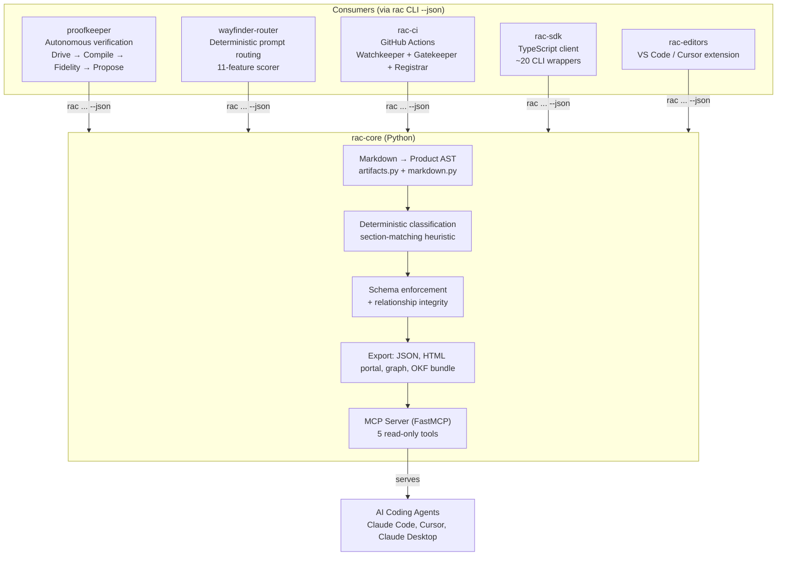
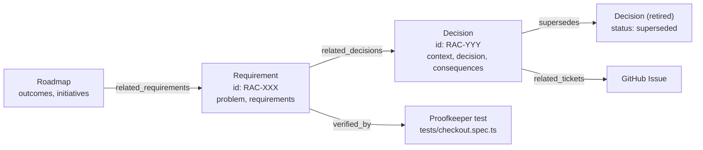
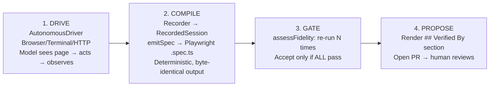

# Wayfinder/RAC — Deterministic Knowledge Management for AI Agents

**RAC (Requirements as Code) is a deterministic knowledge-management engine.** It captures product requirements, architecture decisions, designs, and roadmaps as typed Markdown files with YAML frontmatter — then serves them read-only to AI coding agents over MCP. The ecosystem includes proofkeeper (autonomous verification), wayfinder-router (deterministic prompt routing), CI integrations, and SDKs. Every component is deterministic: no LLM calls in the engine, no randomness, no network. Same inputs produce byte-identical outputs.

Source: `/home/darkvoid/Boxxed/@formulas/src.rust/src.AI/src.Wayfinder/` — 7 projects

## The Core Concept: RAC

**RAC treats knowledge as typed, version-controlled artifacts.** An artifact is a Markdown file with YAML frontmatter containing:
- An **opaque canonical ID** (e.g., `RAC-KTQ63DPSMF19` — repository key + Crockford base32 suffix)
- A **type** (Requirement, Decision/ADR, Roadmap, Prompt, Design)
- **Required sections** per type (e.g., Requirement needs `## Problem` + `## Requirements`)
- **Relationships** to other artifacts: `## Related Decisions`, `## Supersedes`, `## Verified By`
- **Provenance** from git (ADR-045: timestamps never stored in frontmatter)

```
rac/
├── requirements/
│   └── payment-flow.md       ← Requirement artifact
├── decisions/
│   ├── 001-use-postgres.md   ← Decision (ADR)
│   └── 002-event-sourcing.md
└── designs/
    └── checkout-ui.md        ← Design artifact
```

## Architecture



## Artifacts as a Typed Graph



**Aha: Classification is deterministic.** `classify()` scores section presence only — required sections count 1.0 each, recommended 0.5 each. Confidence below 0.5 returns "unknown" rather than forcing a type. No LLM call. This means classification is reproducible across machines and git commits.

**Aha: The MCP server re-reads from disk on every call (ADR-032).** No cache, no file watcher, no session state. Same repository bytes always produce identical output. This means an agent's `get_artifact` call is always current — it sees what's on disk right now.

## The 7 Projects

| Project | What It Does |
|---------|-------------|
| **rac-core** | Engine: CLI (`rac`), MCP server (`lore`), Python library |
| **proofkeeper** | Autonomous verification: drives product (browser/terminal/HTTP), records session, compiles to deterministic Playwright test, gates on stability (N green re-runs), proposes `## Verified By` PR |
| **wayfinder-router** | Deterministic prompt router: 11-feature scorer (word count, headings, code blocks, reasoning terms), sub-millisecond, offline. Routes cheap prompts to local models, complex to cloud |
| **rac-benchmarks** | 8 eval suites consuming `rac` CLI on PATH. Deterministic scoring, no LLM judge |
| **rac-ci** | GitHub Actions: Watchkeeper (PR knowledge review), Gatekeeper (merge gate with SARIF), Registrar (well-formedness check) |
| **rac-sdk** | TypeScript client (`@itsthelore/rac-sdk`): ~20 methods shelling out to `rac ... --json`. Exit codes 0 and 1 both return parsed JSON |
| **rac-editors** | VS Code / Cursor extension consuming the SDK |

## Proofkeeper — The Verification Mojo

**proofkeeper turns agent-driven product exploration into deterministic, re-runnable tests:**



**Aha: The compiler is the "moat."** Faithfully compiling a real drive session into a deterministic Playwright test is the hard problem. The emitter uses exact text/name matching (not Playwright's default substring matching) so the test means the same thing at record time and run time. The start URL is emitted as `process.env.PROOFKEEPER_BASE_URL ?? <recorded>` — so the test runs against any target.

## Wayfinder Router — Sub-Millisecond Prompt Routing

```python
# wayfinder-router/wayfinder_router/complexity.py
def extract_features(text: str) -> dict[str, int]:
    # 11 structural/lexical features
    # Structural: word_count, heading_count, max_heading_depth, list_item_count, 
    #            link_count, code_block_count, table_row_count
    # Lexical: reasoning_term_count, math_symbol_count, constraint_term_count, question_count
    # Lines inside fenced code blocks are excluded from structural scanning

def scalar_score(features, weights) -> float:
    # Weighted, saturating, normalized 0.0-1.0
    # SATURATION caps per feature (e.g., word_count saturates at 400)
    return sum(weight * normalized_feature) / total_weight

def score_complexity(text, config) -> ComplexityScore:
    # → {score, recommendation, mode, features, tiers}
```

**Aha: Lexical features ship at weight 0.0.** Double-blind testing showed curated keyword lexicons caught only ~20% of unseen hard prompts and lost to a length baseline. They're opt-in for users who know their traffic vocabulary.

## Cross-References

- [src.Google](../src.Google/markdown/00-overview.md) — Google's agent ecosystem (ADK, Stitch, Centravity)
- [src.opendesign](../src.opendesign/markdown/00-overview.md) — Open Design ecosystem
- [Goose](../src.block/markdown/00-overview.md) — Block's on-machine AI agent
