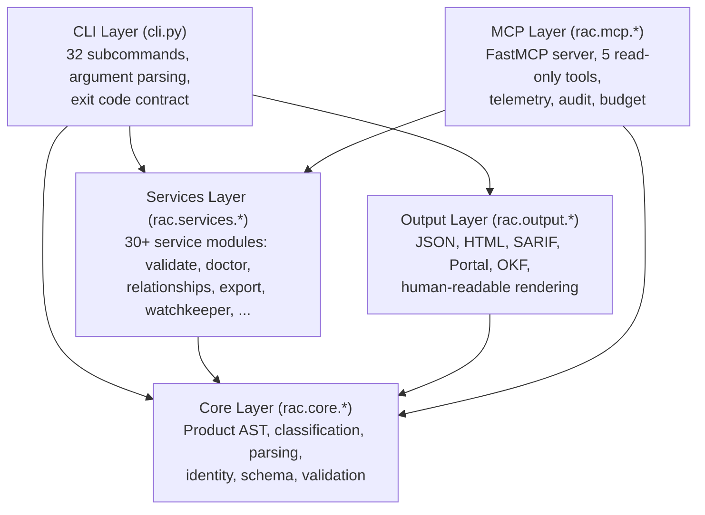
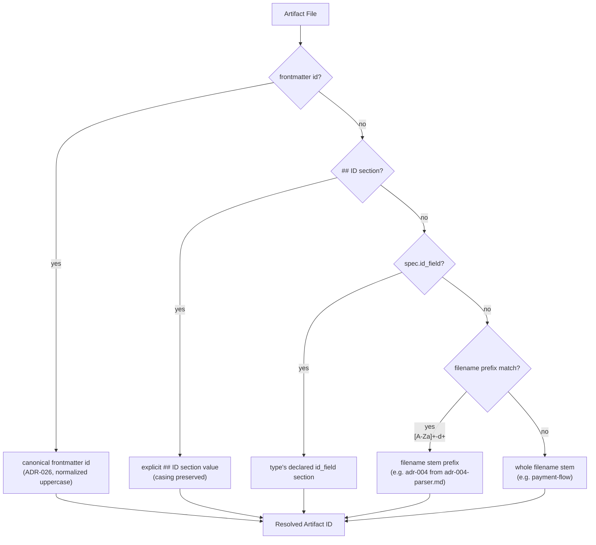

# RAC Architecture — Layers, Modules, and Data Flow

RAC (Requirements As Code) is a deterministic knowledge-management engine implemented in Python. It captures product requirements, architecture decisions, designs, and roadmaps as typed Markdown files with YAML frontmatter, then serves them read-only to AI coding agents over MCP. The entire system is pure and offline: no LLM calls in the engine, no randomness, no network. Same inputs produce byte-identical outputs.

Source: `/home/darkvoid/Boxxed/@formulas/src.rust/src.AI/src.Wayfinder/rac-core/` — 96 Python source files across `src/rac/`

**Aha: RAC is a compiler for product knowledge.** Just as a C compiler transforms source code into machine instructions through parsing, type-checking, optimization, and code generation, RAC transforms Markdown documents into a typed artifact graph through parsing, classification, validation, and export. The deterministic contract means every stage is reproducible — if the corpus changes, the output changes; if it doesn't, the output is byte-identical.

**Aha: The CLI has exactly 3 exit codes with semantic meaning across all 32 subcommands.** Exit 0 means success (including valid outcomes like "no matches found" or "explorer quit by user"), exit 1 means a finding was made (validation errors, broken relationships, gate failures), and exit 2 means a usage/IO error (file not found, not a directory, malformed config). This contract is enforced uniformly — `cmd_validate`, `cmd_doctor`, `cmd_gate` all return `EXIT_OK` or `EXIT_VALIDATION_FAILED`, never a bare `1` or `2`.

Source: `rac-core/src/rac/cli.py:179-181` — exit code constants

```python
EXIT_OK = 0
EXIT_VALIDATION_FAILED = 1
EXIT_USAGE = 2
```

## Layer Architecture

RAC is organized into five layers, each with a clear responsibility boundary. The dependency graph flows strictly downward: CLI depends on services, services depend on core, output depends on core, and MCP depends on services.



## Artifact Identity Precedence



## Module Map

| Module | Files | Responsibility |
|--------|-------|---------------|
| `rac.core.*` | 17 files | Product AST, parsing, classification, identity, schema, validation |
| `rac.services.*` | 30 files | Business logic: validate, diff, ingest, inspect, improve, relationships, doctor, gate, watchkeeper, portfolio, index, export, resolve, find, eval, migrate, init, quickstart, skill, hook, coverage, review, rename, compare, recency, revisions, telemetry, agent_rules |
| `rac.mcp.*` | 6 files | FastMCP server (lore), 5 tools, telemetry, audit, budget, ping |
| `rac.output.*` | 9 files | JSON/human rendering, SARIF, HTML Portal, OKF bundle, templates |
| `rac.explorer.*` | 14 files | Interactive Textual TUI for browsing the corpus |
| `rac.skills.*` | 5 dirs | Bundled Claude Code agent skills (rac-artifacts, rac-capture, rac-import, rac-ingest, rac-review) |
| `rac.hooks.*` | 1 file | Git hook scripts (post-commit advisory, pre-commit validating) |
| `rac.templates.*` | 1 file + templates | Canonical artifact templates shipped via importlib.resources |

## Entry Point and Command Dispatch

Source: `rac-core/src/rac/cli.py:2188-2218` — `main()` function

```python
def main(argv: list[str] | None = None) -> int:
    parser = build_parser()
    args = parser.parse_args(argv)
    command = getattr(args, "command", "") or ""
    start = time.monotonic()
    outcome = usage.OUTCOME_EXCEPTION
    try:
        result = args.func(args)
        outcome = usage.OUTCOME_OK if result == 0 else usage.OUTCOME_ERROR
        return result
    except SystemExit as exc:
        outcome = usage.OUTCOME_OK if exc.code in (0, None) else usage.OUTCOME_ERROR
        raise
    except BrokenPipeError:
        outcome = usage.OUTCOME_ERROR
        devnull = os.open(os.devnull, os.O_WRONLY)
        os.dup2(devnull, sys.stdout.fileno())
        return 1
    finally:
        usage.record_command(command, outcome, int((time.monotonic() - start) * 1000))
```

The `main()` function wraps every command with a `finally` block that records CLI usage telemetry (command name, outcome, duration in ms) — but only if the user has opted in via `rac telemetry on`. The `BrokenPipeError` handler silently absorbs pipe closures from downstream consumers (e.g., `rac export | head`), redirecting stdout to `/dev/null` to prevent the interpreter's exit-time flush from printing "Exception ignored" noise to stderr.

## The Product AST

Source: `rac-core/src/rac/core/models.py:62-147` — `Product` dataclass

The `Product` dataclass is the single source of truth for a parsed Markdown artifact. Every downstream operation — validation, diffing, classification, search — operates on this AST, never on raw text.

```python
@dataclass
class Product:
    title: str | None
    extra_title_lines: list[int] = field(default_factory=list)
    problem: str | None = None
    requirements: list[Requirement] = field(default_factory=list)
    malformed_requirements: list[MalformedRequirement] = field(default_factory=list)
    success_metrics: list[str] = field(default_factory=list)
    risks: list[str] = field(default_factory=list)
    sections: dict[str, str] = field(default_factory=dict)
    search_sections: list[SearchSection] = field(default_factory=list)
    has_problem_section: bool = False
    has_requirements_section: bool = False
    has_metrics_section: bool = False
    has_risks_section: bool = False
    source_path: str = ""
    metadata: ArtifactMetadata | None = None
    metadata_issues: list[Issue] = field(default_factory=list)
    parse_issues: list[Issue] = field(default_factory=list)
```

Key design decisions:

- **`sections`** maps normalized (casefolded) heading names to joined body text. This is the canonical source for all artifact types — classification, inspection, and validation all read from here rather than re-parsing the Markdown.
- **`search_sections`** preserves original heading/body text for search snippet rendering, kept separate from `sections` (which casefolds headings) so search displays the document's own text.
- **`malformed_requirements`** captures non-empty lines under `## Requirements` that don't match the `[REQ-NNN]` pattern. These are reported rather than dropped, so validation can explain *why* a line is invalid.
- **`metadata`** holds parsed YAML frontmatter (canonical ID, status, etc.). `None` for artifacts without frontmatter (legacy form).
- **`parse_issues`** (v0.23.0) captures oversize input, truncated bodies, non-UTF-8 content, or unreadable files — surfaced by validation so degraded artifacts are reported rather than crashing the parse.

## Artifact Type System

Source: `rac-core/src/rac/core/artifacts.py:110-449` — `ARTIFACT_SPECS`

Five artifact types are defined, each with required sections, recommended sections, optional relationship sections, metadata constraints, retired status values, descriptions, guidance, and synonyms:

| Type | Required Sections | Recommended | Status Values | Retired |
|------|------------------|-------------|---------------|---------|
| Requirement | problem, requirements | success metrics, risks, assumptions | Proposed, Accepted, Superseded, Deprecated | Superseded, Deprecated |
| Decision | context, decision, consequences | status, category, alternatives considered | Proposed, Accepted, Superseded, Deprecated | Superseded, Deprecated |
| Roadmap | outcomes, initiatives | success measures, assumptions, risks | Planned, Achieved, Superseded, Abandoned | Superseded, Abandoned |
| Prompt | objective, input, instructions, output | constraints, examples, evaluation | Active, Deprecated | Deprecated |
| Design | context, user need, design, constraints | rationale, alternatives, accessibility, style guidance, open questions | Proposed, Accepted, Superseded, Deprecated | Superseded, Deprecated |

Each type also declares relationship sections (optional, never scored): `related requirements`, `related decisions`, `related roadmaps`, `related prompts`, `related designs`, `related tickets`, `verified by`, and `supersedes` (decisions only).

Source: `rac-core/src/rac/core/artifacts.py:91-102` — relationship descriptions

```python
RELATIONSHIP_DESCRIPTIONS: dict[str, str] = {
    "related requirements": "Requirement artifacts this artifact references",
    "related decisions": "Decision artifacts this artifact references",
    "related roadmaps": "Roadmap artifacts this artifact references",
    "related prompts": "Prompt artifacts this artifact references",
    "related designs": "Design artifacts this artifact references",
    "supersedes": "The artifact this one supersedes",
    "related tickets": "External tickets this artifact traces to; provider set by"
    " .rac/config.yaml ticketing.provider (ADR-087)",
    "verified by": "External tests or traces that verify this capability; targets"
    " are file paths, not in-corpus artifacts (ADR-096)",
}
```

## Classification Algorithm

Source: `rac-core/src/rac/core/classification.py:73-124` — `score_artifacts()` and `classify()`

Classification is a pure, deterministic heuristic over the `Product` AST:

```python
def score_artifacts(product: Product) -> list[TypeScore]:
    scores: list[TypeScore] = []
    for spec in ARTIFACT_SPECS:
        mapped = _mapped(product, spec)  # synonym-aware section matching
        matched_required = [s for s in spec.required if s in mapped]
        matched_recommended = [s for s in spec.recommended if s in mapped]
        missing = [s for s in spec.expected if s not in mapped]
        points = len(matched_required) + 0.5 * len(matched_recommended)
        ceiling = len(spec.required) + 0.5 * len(spec.recommended)
        fit = points / ceiling if ceiling else 0.0
        scores.append(TypeScore(...))
    scores.sort(key=lambda t: (t.fit, len(t.matched_required)), reverse=True)
    return scores

def classify(product: Product) -> Classification:
    scores = score_artifacts(product)
    best = scores[0] if scores else None
    if best is None or best.fit < CONFIDENCE_THRESHOLD or not best.matched_required:
        return Classification(type="unknown", confidence=..., ...)
    return Classification(type=best.name, confidence=round(best.fit, 2), ...)
```

The algorithm scores a document against every artifact type by counting matched required sections (1.0 each) and recommended sections (0.5 each), then normalizes by the ceiling. The best-fit type is chosen if confidence exceeds `CONFIDENCE_THRESHOLD = 0.5` and at least one required section matched.

**Aha: Synonyms are applied before matching.** The `_mapped()` function applies each spec's synonym dictionary to the document's section headings before scoring. For example, "success criteria" maps to "success metrics" for Requirement, and "alternatives" maps to "alternatives considered" for Decision. This means a document written with alternate headings still classifies correctly — the synonym system is a zero-cost robustness mechanism.

Source: `rac-core/src/rac/core/classification.py:50-56`

```python
def _mapped(product: Product, spec: ArtifactSpec) -> set[str]:
    return {spec.synonyms.get(h, h) for h in product.sections}
```

## Identity Resolution

Source: `rac-core/src/rac/core/identity.py:56-82` — `artifact_identifier()`

Artifact identity follows a strict precedence chain (first match wins):

1. **Canonical frontmatter `id`** (ADR-026, v0.7.11) — normalized to uppercase by the frontmatter parser
2. **Explicit `## ID` section** value (casing preserved)
3. **Type's declared `spec.id_field`** section value
4. **Recognized `<letters>-<digits>` prefix** of the filename stem (e.g., `adr-004` from `adr-004-parser-strategy.md`)
5. **Whole filename stem**

```python
def artifact_identifier(product: Product, spec: ArtifactSpec | None, path: str) -> str:
    if product.metadata is not None and product.metadata.id:
        return product.metadata.id
    legacy = _legacy_identifier(product, spec)
    if legacy:
        return legacy
    stem = Path(path).stem
    prefix = _ID_PREFIX_RE.match(stem)
    return prefix.group(0) if prefix else stem
```

**Aha: An artifact answers to multiple identifiers.** The `artifact_identifiers()` function returns a list: canonical first, then legacy aliases (declared `## ID`, filename prefix, filename stem). Reference resolution indexes all of them so existing human-readable references (e.g., `ADR-015`) keep resolving after an artifact adopts canonical frontmatter identity. This is legacy compatibility without breaking existing references.

## Cross-References

- [RAC CLI Commands](01-rac-core.md) — all 32 subcommands, exit codes, argument parsing
- [MCP Server](06-mcp-server.md) — the 5 read-only tools, telemetry, audit
- [Knowledge Graph](07-knowledge-graph.md) — artifact relationships, resolution, traversal
- [Deterministic Search](08-deterministic-search.md) — find, resolve, eval algorithms
- [Data Flow End-to-End](09-data-flow.md) — request lifecycle through all layers
- [Error Handling](10-error-handling.md) — exit codes, error types, recovery strategies

## Next Document

Continue to [RAC CLI Commands](01-rac-core.md) for a detailed walkthrough of every subcommand, its arguments, exit codes, and service delegations.
