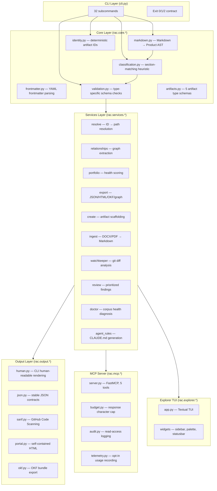
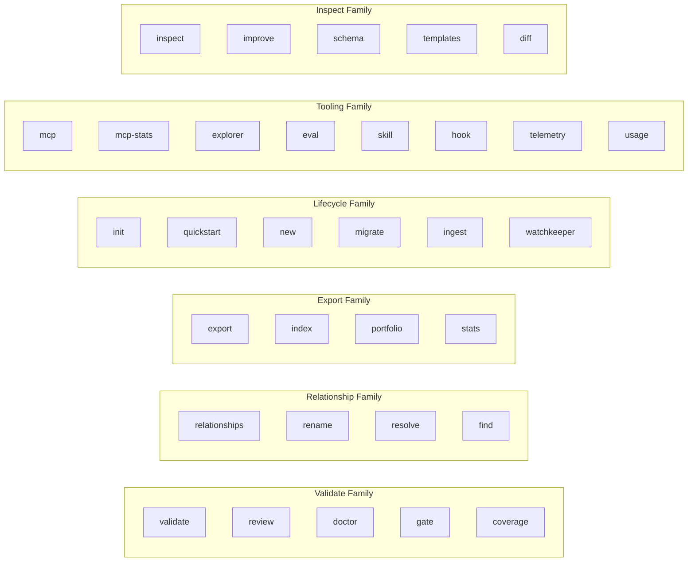

# 01-rac-core — RAC Engine Deep Dive

RAC Core is the heart of the Wayfinder ecosystem: a Python engine that treats product knowledge — requirements, decisions, roadmaps, prompts, and designs — as a typed, version-controlled artifact graph. It provides a CLI (`rac`), an MCP server (`lore`), and a Python SDK, all built on a deterministic parsing and validation pipeline.

Source: `/home/darkvoid/Boxxed/@formulas/src.rust/src.AI/src.Wayfinder/rac-core/` — 211 Python source files

**Aha: RAC never calls an LLM.** Every operation — parsing, classification, validation, diffing, relationship resolution — is a pure, deterministic function of the input Markdown. This means the same corpus always produces byte-identical output, making RAC a reliable foundation for AI agent workflows where reproducibility matters.

**Aha: The MCP server re-reads from disk on every call.** No cache, no file watcher, no session state. The `get_artifact` tool always sees what is on disk right now. This eliminates cache-invalidation bugs and means an agent's view is always current.

## Architecture Layers



## The Product AST

The entire engine operates on a single dataclass: `Product`. Every command, every tool, every export starts by parsing Markdown into this AST.

Source: `src/rac/core/models.py:62`

```python
@dataclass
class Product:
    """The structured representation of a single requirement file."""
    title: str | None
    extra_title_lines: list[int] = field(default_factory=list)
    problem: str | None = None
    requirements: list[Requirement] = field(default_factory=list)
    malformed_requirements: list[MalformedRequirement] = field(default_factory=list)
    success_metrics: list[str] = field(default_factory=list)
    risks: list[str] = field(default_factory=list)
    sections: dict[str, str] = field(default_factory=dict)
    search_sections: list[SearchSection] = field(default_factory=list)
    has_problem_section: bool = False
    has_requirements_section: bool = False
    has_metrics_section: bool = False
    has_risks_section: bool = False
    source_path: str = ""
    metadata: ArtifactMetadata | None = None
    metadata_issues: list[Issue] = field(default_factory=list)
    parse_issues: list[Issue] = field(default_factory=list)
```

Key design: `sections` holds every `##` section as `{normalized_heading: joined_body}`, the canonical source for classification, validation, and inspection. `search_sections` preserves original heading text for snippet rendering.

## The Parsing Pipeline

Source: `src/rac/core/markdown.py:97`

```python
def parse(text: str, source_path: str = "") -> Product:
    """Parse Markdown text into a Product.

    A leading YAML frontmatter block (ADR-025) is split off and parsed into
    product.metadata before the Markdown body is tokenized.
    """
```

The parser uses `markdown-it-py` (CommonMark) with a single shared `_PARSER` instance reused across calls. Constructing a `MarkdownIt` is expensive — it compiles linkify regexes and introspects rule chains — so reusing it roughly halves parse cost.

The token stream walk extracts:
- `#` titles (errors on multiples)
- `##` section headings (case-insensitive matching)
- `[REQ-NNN]` requirement lines under `## Requirements`
- Generic body text for all sections (capped at `MAX_CAPTURED_LINES` lines and `MAX_FIELD_CHARS` chars per section)

**Defensive parsing (WS4, REQ-005):** Files exceeding `RAC_MAX_FILE_BYTES` are rejected before tokenizing. Non-UTF-8 content is decoded lossily with a warning. Unreadable files produce a degraded `Product` with `parse_issues`, never an exception that would crash a corpus walk.

## Artifact Type Schemas

Source: `src/rac/core/artifacts.py:110`

Five artifact types, each with required, recommended, and optional sections:

| Type | Required Sections | Recommended | Status Values | Retired |
|------|------------------|-------------|---------------|---------|
| **requirement** | `problem`, `requirements` | `success metrics`, `risks`, `assumptions` | Proposed, Accepted, Superseded, Deprecated | Superseded, Deprecated |
| **decision** | `context`, `decision`, `consequences` | `status`, `category`, `alternatives considered` | Proposed, Accepted, Superseded, Deprecated | Superseded, Deprecated |
| **roadmap** | `outcomes`, `initiatives` | `success measures`, `assumptions`, `risks` | Planned, Achieved, Superseded, Abandoned | Superseded, Abandoned |
| **prompt** | `objective`, `input`, `instructions`, `output` | `constraints`, `examples`, `evaluation` | Active, Deprecated | Deprecated |
| **design** | `context`, `user need`, `design`, `constraints` | `rationale`, `alternatives`, `accessibility`, `style guidance`, `open questions` | Proposed, Accepted, Superseded, Deprecated | Superseded, Deprecated |

**Aha: Synonyms are artifact-scoped.** `"success criteria"` maps to `"success metrics"` only for Requirements, while `"success metrics"` maps to `"success measures"` only for Roadmaps. This prevents cross-type normalization collisions.

## Classification: Deterministic Type Detection

Source: `src/rac/core/classification.py:106`

```python
CONFIDENCE_THRESHOLD = 0.5

def classify(product: Product) -> Classification:
    """Pick the best-fit artifact type for product (or Unknown)."""
    scores = score_artifacts(product)
    best = scores[0] if scores else None
    if best is None or best.fit < CONFIDENCE_THRESHOLD or not best.matched_required:
        return Classification(type="unknown", confidence=round(best.fit, 2) if best else 0.0, ...)
    return Classification(type=best.name, confidence=round(best.fit, 2), ...)
```

Scoring works by:
1. For each artifact spec, count matched required sections (1.0 each) and recommended sections (0.5 each)
2. `fit = points / ceiling` — same `points/ceiling` shape used throughout RAC
3. Sort by fit descending, tie-break by more required matches
4. Below 0.5 confidence or no required matches matched = `"unknown"`

**Unknown is a valid outcome**, not an error. `rac inspect` exits 0 for Unknown.

## Validation Engine

Source: `src/rac/core/validation.py:90`

```python
def validate(product: Product, *, ticketing_provider: str | None = None) -> list[Issue]:
    """Check product and return all structural and quality findings."""
    issues = _validate_metadata(product)
    issues += _validate_ticketing_references(product, ticketing_provider)
    artifact_type = classify(product).type
    if artifact_type == "decision":    return issues + _validate_decision(product)
    if artifact_type == "roadmap":     return issues + _validate_roadmap(product)
    if artifact_type == "prompt":      return issues + _validate_prompt(product)
    if artifact_type == "design":      return issues + _validate_design(product)
    if artifact_type == "requirement": return issues + _validate_requirement(product) + ...
    return issues + _validate_requirement(product)  # fallback
```

Validation dispatches on classified type. Each type validator checks:
- Exactly one `#` title
- Required sections present
- Constrained metadata values (status, category, horizon)
- Type-specific quality rules

**Requirement quality standards (ADR-056):**
- BCP-14: lowercase `shall`/`must`/`should` is an **error** (only ALL-CAPS carries normative weight per RFC 8174)
- ISO 29148: multiple normative keywords trigger a **warning** (requirements should be singular)
- EARS: `If` without `then` triggers a **warning** (unwanted-behaviour pattern incomplete)
- Ambiguous verbs (`support`, `handle`, `allow`, `enable`): **warning**
- Over 50 requirements: **warning** (suggest splitting)

## Artifact Identity System

Source: `src/rac/core/identity.py:56`

```python
def artifact_identifier(product: Product, spec: ArtifactSpec | None, path: str) -> str:
    """The deterministic identifier for the artifact at path.
    
    Precedence (first match wins):
    1. canonical frontmatter id (ADR-026)
    2. explicit ## ID section value
    3. spec.id_field section value
    4. filename prefix <letters>-<digits> (e.g. adr-004)
    5. whole filename stem
    """
```

The identity system supports migration: `artifact_identifiers()` returns all identifiers (canonical + aliases) so existing references keep resolving after an artifact adopts frontmatter identity. Conflicts between frontmatter and legacy identity are detected by `identity_conflict()` and reported as validation errors — RAC never silently picks one.

## CLI Command Surface

The `rac` CLI exposes 32 subcommands with a stable exit code contract:

| Exit Code | Meaning |
|-----------|---------|
| **0** | Success (validation passes, no errors, empty corpus is valid) |
| **1** | Validation/review failed, or refusal (rename rejected, artifact not found) |
| **2** | Usage/IO error (file not found, bad arguments, missing dependency) |



Key commands:
- `rac validate <file|dir>` — structural validation
- `rac diff <old> <new>` — AST diff of requirement changes
- `rac relationships <dir> --validate` — reference resolution
- `rac review <dir>` — prioritized findings with health score
- `rac doctor <dir>` — corpus health (validation + relationships + hubs + injection)
- `rac watchkeeper <dir>` — git diff knowledge comparison
- `rac gate <dir>` — merge gate under enforcement policy
- `rac export <dir>` — JSON/HTML/OKF/documents/graph/agent-rules
- `rac mcp --root <path>` — serve knowledge over MCP
- `rac explorer <dir>` — interactive TUI (needs `textual` extra)
- `rac eval --check` — CI gate against baseline

## MCP Server (lore)

Source: `src/rac/mcp/server.py:300`

Five read-only tools, with verbatim descriptions pinned by the guide-tool-surface design:

| Tool | Purpose | Key Behavior |
|------|---------|-------------|
| `get_artifact(id)` | Retrieve one artifact by ID | Returns content + metadata + provenance (git-derived) |
| `search_artifacts(query, type?)` | Keyword search | Three-tier search: ID > title > body |
| `find_decisions(topic)` | Live decision query | Accepted, non-retired decisions only (ADR-067) |
| `get_related(id, depth?)` | Relationship graph | Outgoing + incoming, multi-hop neighborhood up to depth 5 |
| `get_summary()` | Repository overview | Artifact counts, health score, guidance for empty repos |

**Response budget (ADR-033):** Every response is capped at `DEFAULT_BUDGET` characters. When truncated, the response carries `truncated: true`, `omitted: N`, and a `hint` field telling the caller what to do next.

**Telemetry (ADR-040):** Opt-in via `--telemetry`. Records tool-call counts and metadata (never arguments or content). Default is off.

**Audit (ADR-084):** Config-driven via `.rac/config.yaml` `audit:` stanza. Records principal, query, returned artifact IDs — never content.

## The 40+ Services Layer

The services layer (`rac/services/`) contains the business logic that CLI commands and MCP tools consume:

| Service | File | Purpose |
|---------|------|---------|
| `validate` | validate.py | Directory-wide validation |
| `relationships` | relationships.py | Graph extraction, reference validation |
| `resolve` | resolve.py | ID resolution, search (3-tier) |
| `portfolio` | portfolio.py | Health scoring, attention items |
| `review` | review.py | Prioritized findings |
| `doctor` | doctor.py | Corpus diagnosis |
| `watchkeeper` | watchkeeper.py | Git diff analysis |
| `gate` | gate.py | Merge gate enforcement |
| `export` | export.py | JSON/HTML/documents/graph export |
| `create` | create.py | Artifact scaffolding |
| `ingest` | ingest.py | DOCX/PDF/HTML → Markdown |
| `init` | init.py | Repository identity setup |
| `quickstart` | quickstart.py | Guided first run |
| `rename` | rename.py | Corpus-wide ID rename |
| `inspect` | inspect.py | Type classification report |
| `improve` | improve.py | Missing section suggestions |
| `stats` | stats.py | Portfolio statistics |
| `index` | index.py | Repository artifact index |
| `recency` | recency.py | Git provenance timestamps |
| `migrate` | migrate.py | Frontmatter identity migration |
| `agent_rules` | agent_rules.py | CLAUDE.md/AGENTS.md generation |
| `skill` | skill.py | Bundled skill installation |
| `hook` | hook.py | Git hook installation |
| `eval` | eval.py | Retrieval benchmark scoring |
| `coverage` | coverage.py | Traceability coverage gaps |
| `compare` | compare.py | Diff between corpora |
| `intent` | intent.py | Intent classification |
| `links` | links.py | Link extraction |

## Output Renderers

Source: `rac/output/` — 7 files

| Renderer | Format | Used By |
|----------|--------|---------|
| `human.py` | Human-readable text | All CLI commands (default) |
| `json.py` | Stable JSON (ADR-007) | `--json` flag |
| `sarif.py` | SARIF 2.1.0 | `--sarif` for GitHub Code Scanning |
| `portal.py` | Self-contained HTML | `rac export --html` |
| `okf.py` | OKF v0.1 bundle | `rac export --okf` |

The JSON contract is additive and `schema_version`-gated (ADR-007): new fields can be added, existing fields never change meaning. Exit codes 0 and 1 both return parsed JSON — `1` means "validation found issues," not "the command failed."

## Cross-References

- [00-overview](00-overview.md) — Architecture overview of all 7 projects
- [02-proofkeeper](02-proofkeeper.md) — Autonomous verification consuming RAC's graph export
- [03-wayfinder-router](03-wayfinder-router.md) — Deterministic prompt routing
- [04-rac-benchmarks](04-rac-benchmarks.md) — 8 eval suites consuming `rac` CLI
- [05-rac-sdk](05-rac-sdk.md) — TypeScript SDK shelling to `rac` CLI
- [06-knowledge-graph](06-knowledge-graph.md) — Relationship graph structure
- [07-data-flow](07-data-flow.md) — End-to-end data flows

## Next

Continue to [02-proofkeeper](02-proofkeeper.md) for the autonomous verification system that drives products and compiles sessions into deterministic Playwright tests.
