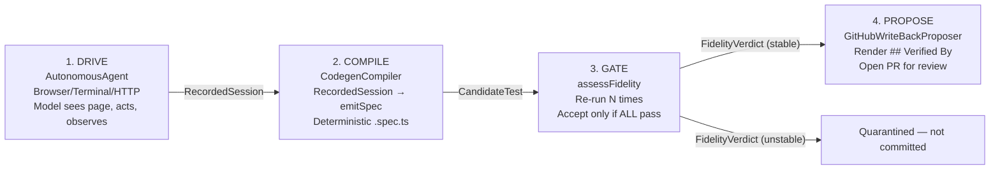
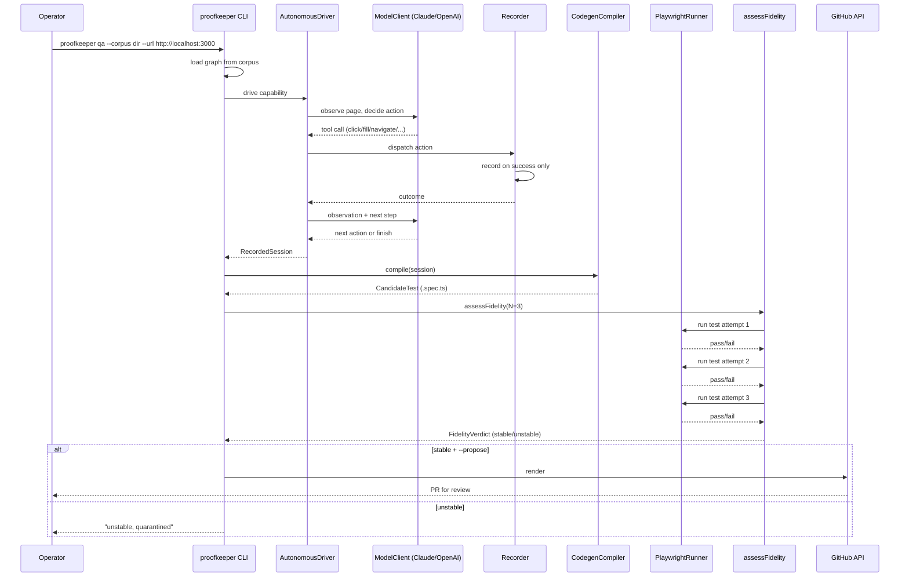

# 02-proofkeeper — Autonomous Verification System

Proofkeeper is Lore's autonomous QA system: it drives a product like a developer, observes what happens, compiles the session into a deterministic Playwright test, gates the test on stability, and optionally proposes a `## Verified By` write-back PR. The entire pipeline — drive, compile, fidelity, propose — is the "verification mojo."

Source: `/home/darkvoid/Boxxed/@formulas/src.rust/src.AI/src.Wayfinder/proofkeeper/` — 91 TypeScript source files

**Aha: The compiler is the moat.** Faithfully compiling a real drive session into a deterministic Playwright test is the hard, differentiating problem. The emitter uses exact text/name matching (`exact: true` in Playwright) — not Playwright's default substring matching — so the test means the same thing at record time and run time. The start URL is emitted as `process.env.PROOFKEEPER_BASE_URL ?? <recorded>` so the compiled test runs against any target (dev, staging, prod) while remaining standalone-runnable.

**Aha: Proofkeeper bundles no model.** The caller supplies a `ModelClient` — either the built-in Claude adapter (`ANTHROPIC_API_KEY`) or the OpenAI-compatible adapter (`OPENAI_API_KEY` + optional `OPENAI_BASE_URL`/`OPENAI_MODEL`). This keeps the QA agent bring-your-own-model, avoiding vendor lock-in.

## The 4-Phase Pipeline





## Phase 1: Autonomous Drive

Source: `src/agent/drive.ts:38`

```typescript
const DEFAULT_MAX_STEPS = 12;
export const DEFAULT_MODEL_TIMEOUT_MS = 120_000;

export interface DriveOptions {
    capabilityId?: string;
    title: string;
    startUrl: string;
    goal: string;
    maxSteps?: number;       // default 12
    priorFailures?: string[];
    plan?: boolean;
    extensionPath?: string;
    allowShell?: boolean;    // OFF by default
    allowedHosts?: string[];
    modelTimeoutMs?: number;
    onStep?: (event: DriveStepEvent) => void;
}
```

The autonomous drive loop:
1. Navigate to `startUrl`
2. Observe the page (`observePage` → render observation for model)
3. Ask the model what to do next
4. Dispatch the model's tool calls through the `Recorder`
5. Record only successful actions
6. Observe the result, repeat until `finish` or step budget

**Security posture:** Page content is untrusted input. Shell access (`run_command`) is OFF by default and requires explicit `--allow-shell`. Egress is restricted to the start URL's origin plus any `--allow-host` entries — everything else is refused.

**Drive stop reasons:**
- `finished` — the model called `finish` (only path to "verified")
- `gave_up` — the model stopped issuing tool calls without finishing
- `step_budget` — the turn cap was hit

**Available tools during drive:**
- Browser: `navigate`, `click`, `fill`, `press`, `expect_text`, `expect_visible`
- Terminal (if allowed): `run_command`, `expect_output`, `expect_exit`
- HTTP: `request`, `expect_status`, `expect_json`
- `finish` — complete the drive

## Phase 2: Compilation

Source: `src/compiler/emit.ts:148`

```typescript
export function emitSpec(session: RecordedSession): string {
    if (session.actions.length === 0)
        throw new Error("refusing to emit a test from a session with no recorded actions");
    if (!sessionAssertsOutcome(session))
        throw new Error("refusing to emit a test from a session with no recorded assertions");
    // ... emit Playwright .spec.ts source
}
```

The compiler is pure: no I/O, no timestamps. Same recording always emits byte-identical code. It generates:
- A Playwright `test()` block
- `goto` with `process.env.PROOFKEEPER_BASE_URL ?? <recorded>` for target flexibility
- Locator expressions with `exact: true` to prevent substring/CI mismatches
- Inlined terminal helper (`spawnSync`) when terminal actions were recorded
- Inlined HTTP helper (`fetch` + `jsonPath`) when HTTP actions were recorded
- Extension URL rewriting for `chrome-extension://` URLs (runtime ID substitution)

**Guardrails:**
- Refuses to emit if no actions were recorded
- Refuses to emit if no assertions exist (a test that asserts nothing verifies nothing)
- Deterministic string escaping in `lit()` function

## Phase 3: Fidelity Gate

Source: `src/fidelity/gate.ts:43`

```typescript
export async function assessFidelity(
    runner: Runner,
    test: CompiledTest,
    options: FidelityOptions,  // { n: number, target: RunTarget }
): Promise<FidelityVerdict>
```

The gate re-runs the candidate test `n` times (default 3) against a single target. It accepts **iff all `n` runs passed**. Anything less is quarantined, not committed.

Runner errors (hung browser, missing report) count as failed attempts with a recorded reason — quarantine, not an abort. This preserves other attempts' results.

**FidelityVerdict:**
```typescript
interface FidelityVerdict {
    testId: string;
    stable: boolean;      // true iff passed === attempts
    attempts: number;
    passed: number;
    runs: boolean[];      // per-attempt pass/fail
    errors?: string[];    // infrastructure failure reasons
}
```

## Phase 4: Write-Back Proposal

Source: `src/writeback/proposer.ts`

When `--propose` is passed and the test is stable, Proofkeeper:
1. Renders a `## Verified By` section with the test path
2. Opens a PR against the target repository
3. Human reviews the PR before merging

Requires `GITHUB_TOKEN` with `contents:write` + `pull_requests:write`.

## CLI Interface

Source: `src/cli.ts:48`

```
proofkeeper coverage (--graph-file <path> | --corpus <dir>) [--json]
proofkeeper init (--graph-file <path> | --corpus <dir>) [--url <url>] [--out <path>]
proofkeeper qa (--graph-file <path> | --corpus <dir>) --url <url> [options]
proofkeeper qa (--graph-file <path> | --corpus <dir>) --config <path>
               (--changed <files> | --base-ref <ref>) [options]
proofkeeper triage (--graph-file <path> | --corpus <dir>) --capability <id>
               --url <url> [options]
```

### Commands

| Command | Purpose |
|---------|---------|
| `coverage` | Report which capabilities have no `verified_by` test |
| `init` | Scaffold `proofkeeper.config.json` from the coverage graph |
| `qa` / `verify` | Drive one capability, compile, gate, optionally propose |
| `qa --config` | Scoped QA: drive capabilities touched by changed files, post PR comment |
| `triage` | Adjudicate a failing `Verified By` test: STALE TEST, PRODUCT REGRESSION, or INCONCLUSIVE |

### Exit Codes

| Code | Meaning |
|------|---------|
| **0** | Success (everything verified, stable test, or stale test found) |
| **1** | Not verified (unverified capabilities, unstable test, or product regression) |
| **2** | Usage/parse error |
| **3** | Triage inconclusive (infrastructure failure or unstable repair) |

### Key QA Options

| Flag | Default | Purpose |
|------|---------|---------|
| `--capability <id>` | First unverified | Which capability to verify |
| `--url <url>` | Required | Product entry point for the drive |
| `--n <count>` | 3 | Fidelity re-runs required |
| `--max-steps <count>` | 12 | Cap on model turns |
| `--allow-shell` | Off | Enable terminal tools |
| `--allow-host <host>` | None | Extra allowed hostnames |
| `--verbose` | Off | Log each drive turn to stderr |
| `--propose` | Off | Open a PR when stable |
| `--plan` | Off | Emit Markdown test plan before driving |
| `--extension <dir>` | None | Load browser extension for drive |

## Scoped QA (PR-Triggered)

Source: `src/cli.ts:610`

The `--config` mode enables change-scoped verification in CI:
1. Parse `proofkeeper.config.json` (path map: which files touch which capabilities)
2. Diff changed files against `--base-ref` or explicit `--changed` list
3. Drive each unverified capability the changed files touch
4. Post an evidence comment on the PR
5. Gate red if any touched-and-unverified capability did not become stable

Concurrency defaults to 3 capabilities driven at once. Each capability gets isolated output directories so concurrent drives never clobber.

## Triage

Source: `src/triage/triage.ts`

When a `Verified By` test fails, triage adjudicates:

| Verdict | Exit Code | Meaning |
|---------|-----------|---------|
| `not_reproducible` | 0 | The spec passes against this target — nothing to triage |
| `stale_test` | 0 | Capability still verifies; committed spec is out of date; repair candidate compiled |
| `product_regression` | 1 | The requirement's outcomes could not be driven |
| `inconclusive` | 3 | No confident adjudication (infrastructure failure or unstable repair) |

## Configuration

Source: `src/scope/config.ts`

`proofkeeper.config.json` structure:
```json
{
    "capabilities": [
        {
            "id": "capability-id",
            "title": "Human title",
            "paths": ["src/**"],
            "startUrl": "http://localhost:3000",
            "allowShell": false,
            "allowedHosts": []
        }
    ],
    "environments": { "local": { "url": "http://localhost:3000" } },
    "failureLearning": "suggest_in_report"
}
```

## Coverage System

Source: `src/coverage/` — 4 files

Coverage is computed from the RAC graph export (`rac export --graph`):
- Requirement nodes with `verified_by` relationships are "verified"
- Requirements without are "unverified"
- Coverage report shows per-capability verification status

The graph can be loaded from:
- `--graph-file <path>`: A pre-exported JSON file
- `--corpus <dir>`: Shell out to `rac export --graph <dir>`

## Learning Store

Source: `src/learning/store.ts`

Proofkeeper tracks failure modes per capability. When a drive fails, the failure reason is recorded. On subsequent drives, `priorFailures` are passed to the model so it avoids repeating failed paths. The `failureLearning` config controls whether failures are just suggested in reports (default) or actively written to a catalog (deferred).

## Cross-References

- [00-overview](00-overview.md) — Architecture overview
- [01-rac-core](01-rac-core.md) — RAC engine that Proofkeeper consumes for graph export
- [06-knowledge-graph](06-knowledge-graph.md) — `verified_by` relationship type
- [07-data-flow](07-data-flow.md) — End-to-end verification flow

## Next

Continue to [03-wayfinder-router](03-wayfinder-router.md) for the deterministic prompt routing system.
