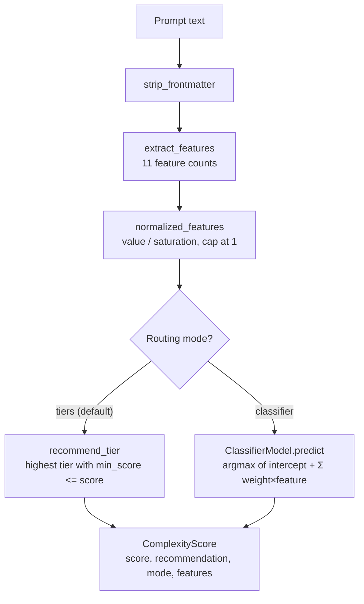
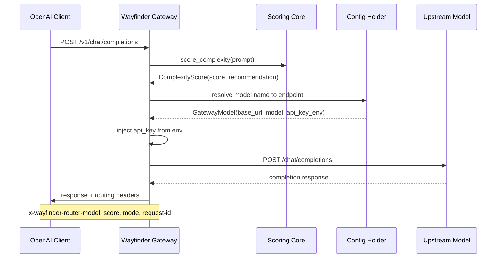

# 03-wayfinder-router — Deterministic Prompt Routing

Wayfinder Router is a sub-millisecond, offline prompt complexity scorer that recommends which model to use. It scans structural and lexical signals from prompt text — length, headings, code blocks, reasoning terms — and maps the result to a model recommendation. It never invokes a model; it recommends, the caller runs inference.

Source: `/home/darkvoid/Boxxed/@formulas/src.rust/src.AI/src.Wayfinder/wayfinder-router/` — 72 Python source files

**Aha: Lexical features ship at weight 0.0 by default.** A curated keyword lexicon detects an author's vocabulary, not difficulty in general. Cross-provider double-blind testing showed it fired on only ~20% of independently-authored hard prompts, false-positived on easy prompts using those words, and lost to a length baseline. Lexical features are opt-in — users who know their traffic's vocabulary can raise weights and calibrate.

**Aha: Score saturation prevents signal domination.** Each feature saturates at a cap (e.g., `word_count` at 400). Beyond saturation, the contribution is maxed so one very large signal cannot overwhelm others. This is also the normalization used by the classifier, keeping all values in 0.0–1.0.

## 11-Feature Scoring System

Source: `wayfinder_router/complexity.py:37`

```python
FEATURE_ORDER = (
    "word_count",           # Structural
    "heading_count",
    "max_heading_depth",
    "list_item_count",
    "link_count",
    "code_block_count",
    "table_row_count",
    "reasoning_term_count", # Lexical (opt-in)
    "math_symbol_count",    # Lexical (opt-in)
    "constraint_term_count",# Lexical (opt-in)
    "question_count",       # Lexical (opt-in)
)
```

Default weights:

| Feature | Weight | Saturation | Category |
|---------|--------|------------|----------|
| `word_count` | 3.0 | 400 | Structural |
| `list_item_count` | 2.0 | 15 | Structural |
| `heading_count` | 1.5 | 8 | Structural |
| `code_block_count` | 1.5 | 4 | Structural |
| `table_row_count` | 1.0 | 12 | Structural |
| `link_count` | 1.0 | 10 | Structural |
| `max_heading_depth` | 1.0 | 4 | Structural |
| `reasoning_term_count` | 0.0 | 2 | Lexical (opt-in) |
| `math_symbol_count` | 0.0 | 6 | Lexical (opt-in) |
| `constraint_term_count` | 0.0 | 3 | Lexical (opt-in) |
| `question_count` | 0.0 | 3 | Lexical (opt-in) |

## Scoring Algorithm

Source: `wayfinder_router/complexity.py:350`

```python
def normalized_features(features: dict[str, int]) -> dict[str, float]:
    """Each feature saturated into 0.0–1.0 (value / saturation, capped at 1)."""
    return {name: min(features[name] / SATURATION[name], 1.0) for name in FEATURE_ORDER}

def scalar_score(features: dict[str, int], weights: dict[str, float]) -> float:
    """The bounded 0.0–1.0 structural score: weighted, saturating, normalized."""
    norm = normalized_features(features)
    total_weight = sum(weights.values())
    if not total_weight:
        return 0.0
    accumulated = sum(weights.get(name, 0.0) * norm[name] for name in FEATURE_ORDER)
    return round(accumulated / total_weight, 2)
```

The formula mirrors RAC's classification normalization: `weighted_sum / total_weight`. This produces a bounded 0.0–1.0 score where:
- Each feature contributes `weight × min(value/saturation, 1.0) / total_weight`
- The `points / ceiling` shape is shared with `rac.core.classification`

## Two Routing Modes



### Tiered Mode (Default)

Score bands map the score to a model. The binary local/cloud router is the two-tier case:

```python
DEFAULT_THRESHOLD = 0.5
DEFAULT_TIERS = (Tier(0.0, "local"), Tier(0.5, "cloud"))
# score < 0.5 → local, score >= 0.5 → cloud
```

Users can define arbitrary tiers:
```python
tiers = (
    Tier(0.0, "tiny-model"),
    Tier(0.2, "small-model"),
    Tier(0.5, "medium-model"),
    Tier(0.8, "large-model"),
)
```

### Classifier Mode

A fitted multinomial-logistic model over the same normalized features:

```python
class ClassifierModel:
    models: tuple[str, ...]          # candidate model names
    weights: dict[str, tuple[float, ...]]  # per-model weight vectors
    intercepts: tuple[float, ...]    # per-model intercepts
    
    def predict(self, features: dict[str, int]) -> str:
        logits = self.logits(features)  # intercept + Σ weight × norm
        return self.models[argmax(logits)]  # stable first-index tie-break
```

Pure linear algebra at inference — no training, no model call. Training is offline via the calibration system.

## Lexical Term Sets

Source: `wayfinder_router/complexity.py:103`

**Reasoning terms** (28 terms): `prove`, `proof`, `derive`, `theorem`, `lemma`, `corollary`, `axiom`, `irrational`, `undecidable`, `asymptotic`, `complexity`, `invariant`, `concurrency`, `deadlock`, `induction`, `contradiction`, `optimal`, `optimize`, `recurrence`, `halting`, `eigenvalue`, `integral`, `derivative`, `polynomial`, `prime`, `modulo`, `isomorphism`, `monotonic`, `bijection`, `injective`, `surjective`, `combinatorial`

**Constraint terms** (10 terms): `must`, `without`, `only`, `ensure`, `exactly`, `guarantee`, `constraint`, `constraints`, `subject`, `preserving`, `preserve`

These are user-tunable via `Lexicon` — users can override with domain-specific vocabularies.

## Explainability

Source: `wayfinder_router/complexity.py:427`

```python
def explain_score(features, weights) -> list[FeatureContribution]:
    """Break the scalar score into one FeatureContribution per feature."""
```

Each feature's contribution is computed as `weight × normalized / total_weight`. This powers both `route --explain` and the dashboard's "why" column.

## Gateway (OpenAI-Compatible Proxy)

Source: `wayfinder_router/gateway.py:1`

The gateway is an optional FastAPI app (`wayfinder-router[gateway]` extra) that acts as an OpenAI-compatible routing proxy:



**Routing decision per call:**
1. Score the prompt with the pure core (sub-millisecond, no network)
2. Map recommended model name to configured upstream endpoint
3. Forward the call with the user's key (read from env at request time)

**Per-call steering (WF-ADR-0011):**
- `model: "auto"` (default) → score and route per config
- `model: <exact endpoint name>` → pin to that endpoint
- `model: "prefer-local"` / `"prefer-hosted"` → pin to low/high end of router
- `X-Wayfinder-Threshold` header → override binary cut for this call

**Response headers (every response):**
- `x-wayfinder-router-model` — chosen endpoint
- `x-wayfinder-router-score` — structural score
- `x-wayfinder-router-mode` — `scored` / `pinned` / `threshold-override`
- `x-wayfinder-router-request-id` — tracing ID

### Streaming Support

Source: `wayfinder_router/gateway.py`

Requests with `stream: true` are relayed as Server-Sent Events. The forward path is async (`httpx.AsyncClient`) so concurrent requests don't block.

### Metrics

Source: `wayfinder_router/gateway.py:192`

`GET /metrics` exposes Prometheus counters and histograms:
- `wayfinder_router_requests_total{model, mode}` — routed requests
- `wayfinder_router_upstream_errors_total{model}` — transport failures
- `wayfinder_router_decision_latency_seconds` — decision latency histogram (sub-millisecond buckets)
- `wayfinder_router_upstream_latency_seconds{model}` — model round-trip histogram
- `wayfinder_router_cache_hits_total` / `cache_misses_total` / `cache_avoided_cost_total`
- `wayfinder_router_rate_limited_total{limit}` — 429s by limit type
- `wayfinder_router_build_info{version}` — build info

### Dashboard

A self-contained HTML dashboard at `GET /router` shows recent routing decisions (model, score, mode, request ID) — no CDN, no build step, system fonts only.

## Configuration

Source: `wayfinder_router/config.py`

Config via `wayfinder-router.toml`:

```toml
[gateway.models.local]
base_url = "http://localhost:11434/v1"
model = "llama3.2"

[gateway.models.cloud]
base_url = "https://api.example.com/v1"
model = "big-model"
api_key_env = "EXAMPLE_API_KEY"  # env var name
```

Keys are read from environment at request time — never stored in config files.

## Calibration System

Source: `wayfinder_router/calibrate.py`

The calibration system fits routing parameters from labeled data:
- `calibrate` — fits tier thresholds or classifier weights from scored prompts
- `recalibrate` — updates existing calibration with new data

Calibration data format:
```json
[
    {"prompt": "...", "label": "local"},
    {"prompt": "...", "label": "cloud"}
]
```

## Other Components

| Module | File | Purpose |
|--------|------|---------|
| `cache.py` | cache.py | Exact-match response cache (WF-ADR-0033) |
| `pricing.py` | pricing.py | Per-model cost tracking (WF-ADR-0017) |
| `ratelimit.py` | ratelimit.py | RPM/TPM caps (WF-ADR-0034) |
| `reliability.py` | reliability.py | Upstream health tracking |
| `vkeys.py` | vkeys.py | Virtual key management (WF-ADR-0035) |
| `profiles.py` | profiles.py | Built-in config profiles |
| `feedback.py` | feedback.py | Feedback loop recording |
| `anthropic_adapter.py` | anthropic_adapter.py | Claude API adapter |
| `bootstrap.py` | bootstrap.py | First-run setup |
| `onboard.py` | onboard.py | Onboarding flow |
| `sufficiency.py` | sufficiency.py | Content sufficiency checks |
| `threads.py` | threads.py | Multi-thread request handling |
| `tui.py` | tui.py | Terminal UI |
| `ui.py` | ui.py | UI components |
| `judge.py` | judge.py | Routing quality evaluation |

## CLI Commands

| Command | Purpose |
|---------|---------|
| `wayfinder-router score <prompt>` | Score a prompt, show recommendation |
| `wayfinder-router score --explain` | Show per-feature contribution breakdown |
| `wayfinder-router route <prompt>` | Score and recommend model |
| `wayfinder-router serve` | Start the OpenAI-compatible gateway |
| `wayfinder-router calibrate` | Fit routing parameters from labeled data |
| `wayfinder-router calibrate --list` | List available calibration presets |

## Cross-References

- [00-overview](00-overview.md) — Architecture overview
- [01-rac-core](01-rac-core.md) — RAC's classification scoring shares the same `points/ceiling` shape
- [04-rac-benchmarks](04-rac-benchmarks.md) — Benchmark suite includes router evals
- [07-data-flow](07-data-flow.md) — Routing data flow

## Next

Continue to [04-rac-benchmarks](04-rac-benchmarks.md) for the 8 eval suites.
