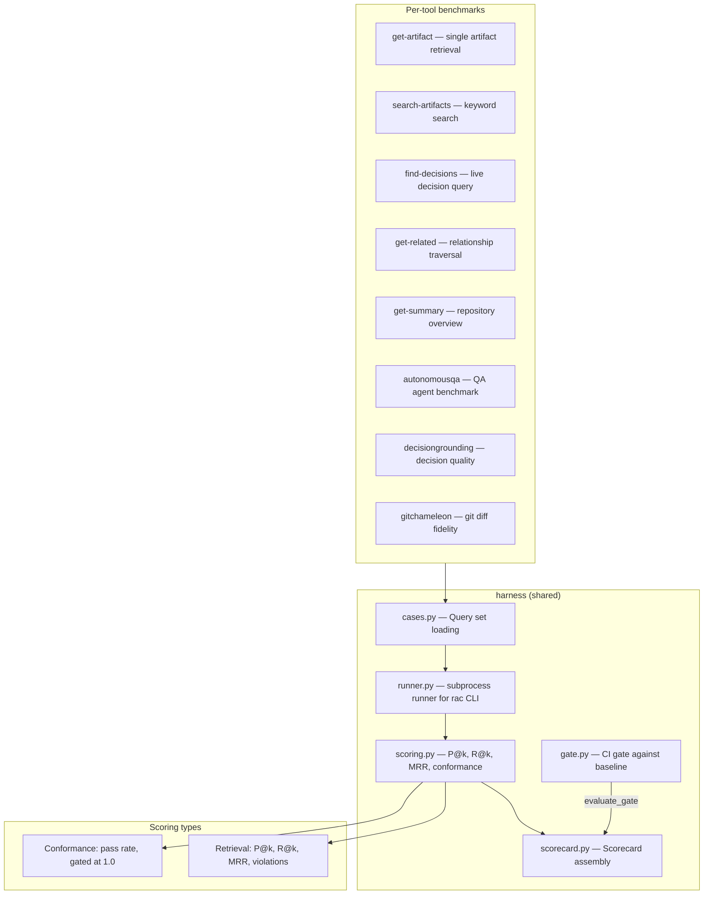
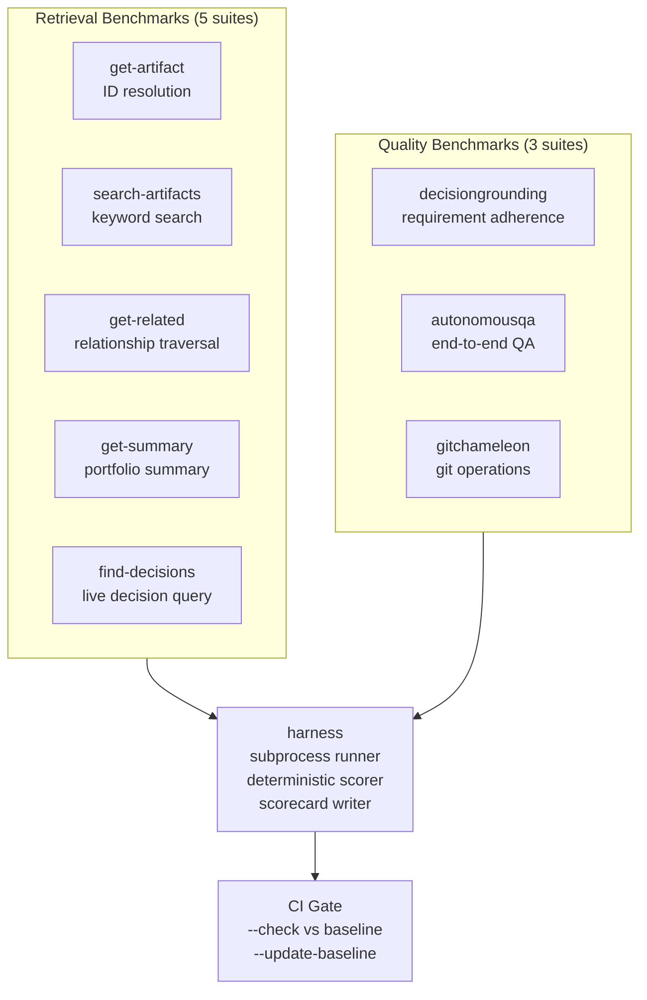

# 04-rac-benchmarks — Deterministic Eval Suite

RAC Benchmarks is a suite of 8+ eval suites that score the `rac` CLI's retrieval and conformance capabilities. Every benchmark is deterministic and offline — no LLM judge, no embeddings, no network. The harness consumes `rac` only as an external CLI on PATH (DG-ADR-0001).

Source: `/home/darkvoid/Boxxed/@formulas/src.rust/src.AI/src.Wayfinder/rac-benchmarks/` — 101 Python source files across autonomousqa, decisiongrounding, find-decisions, get-artifact, get-related, get-summary, gitchameleon, and the shared harness.

**Aha: The harness is stdlib-only.** No engine imports, no embeddings, no network, no third-party runtime dependency. It shells out to `rac` and scores the JSON output deterministically. This means benchmarks can run in any CI environment without special dependencies.

**Aha: Metric floats are rounded to 6 decimal places for byte-stability.** The serialized `metrics` block is byte-identical across runs on an unchanged corpus. The gate compares with tolerance, far coarser than this precision.

## Benchmark Architecture



## The Harness

Source: `harness/cli.py:75`

```python
def run_benchmark(
    benchmark_dir: Path,
    config: case_mod.BenchmarkConfig,
    root: str,
    queries_path: str,
    *, executable: str = "rac",
) -> card_mod.Scorecard:
```

The harness flow:
1. Load the query set (`queries.json`) for the benchmark's tool
2. For each case, invoke `rac <tool> --json` via subprocess
3. Score the returned JSON against expected results
4. Assemble the scorecard with metrics, metadata, and per-query results

### Three Exit Code Modes

| Mode | Flag | Exit 0 | Exit 1 | Exit 2 |
|------|------|--------|--------|--------|
| Report | (default) | Clean report | — | Usage error |
| Gate | `--check` | Gate PASS | Regression found | Usage error |
| Re-baseline | `--update-baseline` | Baseline updated | — | Usage error |

## Retrieval Scoring

Source: `harness/scoring.py:72`

```python
def score_retrieval_case(returned: list[str], case: RetrievalCase) -> RetrievalResult:
    """P@k, R@k, reciprocal rank, and full-list negative violations."""
```

Metrics per query (k ∈ {1, 3, 5}):

| Metric | Formula | What It Catches |
|--------|---------|-----------------|
| **P@k** | `|Rel ∩ top_k| / k` | Precision at cutoff (empty slots count against) |
| **R@k** | `|Rel ∩ top_k| / |Rel|` | Recall at cutoff (`|Rel| ≥ 1` by construction) |
| **MRR** | `1 / rank` of first relevant | Ordering regressions P@1 / R@5 are blind to |
| **Violations** | `must_not_return` anywhere in returned list | Hard negatives — if it reaches an agent, it's a violation |

Aggregate metrics are macro-averaged (equal weight per case):
```python
overall["mrr"] = mean([r.reciprocal_rank for r in results])
overall["negative_violations"] = sum(len(r.violations) for r in results)
```

**Aha: Negative violations are checked over the FULL returned list, not a top-k window.** A `must_not_return` ID anywhere in the returned list reaches an agent, so it's a violation wherever it ranks.

## Conformance Scoring

Source: `harness/scoring.py:179`

```python
def aggregate_conformance(results: list[ConformanceResult]) -> dict[str, Any]:
    """Metrics for a conformance benchmark: pass rate, gated at 1.0."""
    passed = sum(1 for r in results if r.passed)
    overall = {"conformance": round(passed / len(results)), ...}
```

Conformance benchmarks score a pass rate over deterministic contract checks, gated at 1.0 — a contract is either honoured or it is not.

Each case has named `Check` assertions:
```python
@dataclass
class Check:
    name: str
    passed: bool
    detail: str = ""
```

A case passes only if all checks pass AND there are no violations.

## Benchmark Suites



### 1. get-artifact

Tests `rac resolve <id>` — can the engine resolve artifact IDs correctly?

Cases:
- Canonical ID resolution (e.g., `RAC-XXXXX`)
- Legacy alias resolution (e.g., `ADR-001`)
- Not-found cases
- Duplicate ID cases

### 2. search-artifacts

Tests `rac find <query>` — keyword search over the corpus.

Cases test:
- ID match (highest priority)
- Title match
- Body match
- Type filtering
- Must-not-return negatives

### 3. find-decisions

Tests `rac find <query> --decisions` — the live decision query (ADR-067).

Cases test:
- Retrieval of Accepted, non-retired decisions
- Exclusion of Superseded/Deprecated decisions
- Topic relevance

### 4. get-related

Tests `rac relationships` / `get_related` — relationship graph traversal.

Cases test:
- Outgoing references
- Incoming references
- Multi-hop neighborhood (depth > 1)

### 5. get-summary

Tests `rac portfolio` / `get_summary` — repository overview.

Cases test:
- Artifact counts by type
- Health score
- Attention items

### 6. autonomousqa

Source: `autonomousqa/` — tests the proofkeeper autonomous QA agent.

Components:
- `agents/` — Agent implementations (proofkeeper agent)
- `apps/` — Test applications (api-ledger, browser-notes, cli-tally, ext-wordbadge)
- `runner/` — Drive runner, proxy, CLI
- `scoring/` — Aggregate scoring and reporting

Test apps:
| App | Type | Purpose |
|-----|------|---------|
| `browser-notes` | Browser | Note-taking web app |
| `cli-tally` | CLI | Tally CLI tool |
| `api-ledger` | HTTP | Ledger API |
| `ext-wordbadge` | Extension | Browser extension |

### 7. decisiongrounding

Tests whether decisions are properly grounded in their requirements.

### 8. gitchameleon

Tests git diff fidelity — does `rac watchkeeper` correctly detect knowledge changes?

## Gate System

Source: `harness/gate.py`

The gate evaluates metrics against a committed baseline:

```python
def evaluate_gate(metrics, baseline, config) -> list[GateFailure]:
    """Fail on hard-negative violations, metrics below floors, or below baseline - tolerance."""
```

Failure conditions:
1. Any hard-negative violation (non-zero `negative_violations`)
2. Any metric below its floor
3. Any metric below `baseline - tolerance`

The gate config specifies floors and tolerance:
```json
{
    "floors": {"p_at_1": 0.8, "r_at_5": 0.9, "mrr": 0.85},
    "tolerance": 0.02
}
```

## Scorecard Structure

Source: `harness/scorecard.py`

```python
@dataclass
class Scorecard:
    metrics: dict[str, Any]    # Gated metrics (P@k, R@k, MRR, etc.)
    metadata: dict[str, Any]   # rac_version, root, queries_path, n_queries
    per_query: list[dict]      # Per-case results
```

Metadata includes `rac_version`, `root`, `queries_path`, `n_queries`, and optionally `generated_at` (clock only in metadata, never in gated metrics).

## Cross-References

- [01-rac-core](01-rac-core.md) — The `rac` CLI being benchmarked
- [02-proofkeeper](02-proofkeeper.md) — The autonomousqa benchmark suite
- [07-data-flow](07-data-flow.md) — How benchmark results feed into CI gates

## Next

Continue to [05-rac-sdk](05-rac-sdk.md) for the TypeScript SDK.
