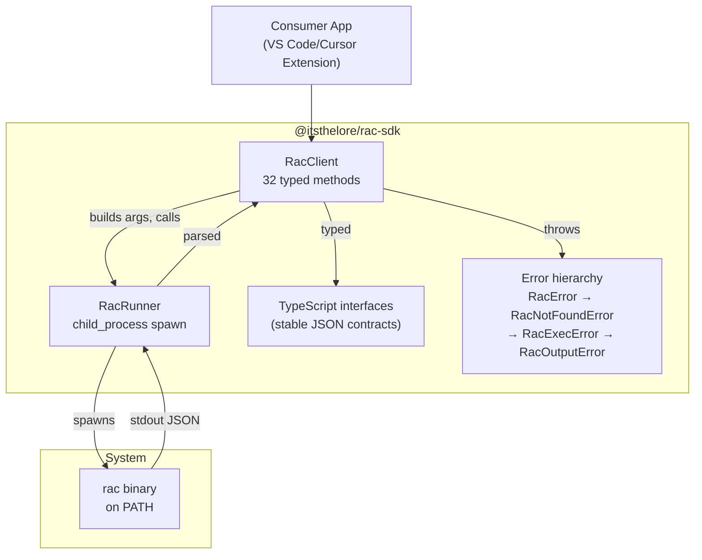
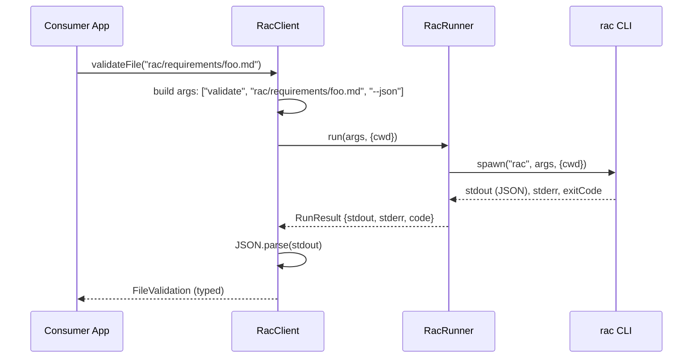

# 05-rac-sdk — TypeScript Client SDK

The RAC SDK (`@itsthelore/rac-sdk`) is a thin TypeScript client that shells out to the installed `rac` binary and deserializes its stable `--json` contracts into typed results. It reimplements none of RAC's engine — the Python side stays the single source of truth (ADR-063).

Source: `/home/darkvoid/Boxxed/@formulas/src.rust/src.AI/src.Wayfinder/rac-sdk/ts/` — 7 TypeScript source files

**Aha: Exit codes 0 and 1 both return parsed JSON.** Exit 1 means "validation found issues," not "the command failed." The SDK's `json()` method returns the parsed result in either case — refusal surfaces through `plan.ok` / `plan.reason`, not a thrown error. This is critical because many RAC commands use exit 1 as a normal finding code.

**Aha: The SDK is purely a shell wrapper.** Every method builds a `rac ... --json` argument list, runs it through a `RacRunner` (which uses `child_process`), and deserializes stdout. No engine logic lives here — if there's a discrepancy between the SDK and CLI, the CLI is always right.

## Architecture





## RacClient

Source: `ts/src/client.ts:49`

```typescript
export class RacClient {
    constructor(options: RacClientOptions = {}) {
        this.racPath = options.racPath ?? process.env.RAC_BIN ?? "rac";
        this.cwd = options.cwd;
        this.runner = options.runner ?? defaultRunner;
    }
```

Configuration:
- `racPath` — Path to `rac` binary (env `RAC_BIN`, or `"rac"` on PATH)
- `cwd` — Working directory for every call (set to workspace root)
- `runner` — Injectable runner for testing (defaults to `child_process`)

## SDK Methods (20+)

| Method | CLI Command | Returns |
|--------|-------------|---------|
| `validateFile(file)` | `rac validate <file> --json` | `FileValidation` |
| `validateText(text)` | `rac validate - --json` (stdin) | `FileValidation` |
| `validateDirectory(dir, opts?)` | `rac validate <dir> --json` | `DirectoryValidation` |
| `resolve(id, dir?)` | `rac resolve <id> [dir] --json` | `ResolveResult` |
| `find(query, opts?)` | `rac find <query> [dir] [--type T] --json` | `FindResult` |
| `findDecisions(topic, dir?)` | `rac find <topic> [dir] --decisions --json` | `FindResult` |
| `validateRelationships(dir, opts?)` | `rac relationships <dir> --validate --json` | `RelationshipValidation` |
| `review(dir, opts?)` | `rac review <dir> --json` | `ReviewReport` |
| `stats(dir)` | `rac stats <dir> --json` | `PortfolioStats` |
| `exportCorpus(dir, opts?)` | `rac export <dir> --json` | `CorpusExport` |
| `schema(artifactType)` | `rac schema <type> --json` | `SchemaReference` |
| `rename(oldId, newId, dir, opts?)` | `rac rename <old-id> <new-id> <dir> --json [--apply]` | `RenamePlan | RenameResult` |
| `createArtifact(type, path)` | `rac new <type> <path> --json` | `CreatedArtifact` |
| `init(dir, key?)` | `rac init <dir> [--key K] --json` | `InitResult` |
| `quickstart(dir, opts?)` | `rac quickstart <dir> [--key K] [--type T] --json` | `QuickstartResult` |
| `exportHtml(dir, outPath)` | `rac export <dir> --html --out <path>` | `void` |
| `agentRules(dir, opts?)` | `rac export <dir> --agent-rules [--check] --json` | `AgentRulesResult` |
| `version()` | `rac --version` | `string` |

## Key Methods

### validateText

```typescript
validateText(text: string): Promise<FileValidation> {
    return this.json<FileValidation>(["validate", "-", "--json"], { input: text });
}
```

Validates in-memory artifact text (e.g., unsaved editor buffer) by piping to `rac` on stdin. The result's `file` is `"-"`; the caller knows the real path.

### rename

```typescript
rename(oldId: string, newId: string, directory: string, options: { apply?: boolean } = {}): Promise<RenamePlan | RenameResult> {
    const args = ["rename", oldId, newId, directory, "--json"];
    if (options.apply) args.push("--apply");
    return this.json<RenamePlan | RenameResult>(args);
}
```

Without `apply` this is a dry run returning a `RenamePlan` (the full edit set), or `ok: false` with a `reason` on refusal. With `apply: true` the plan is written and a `RenameResult` is returned. A refusal exits non-zero (1) but `json()` returns the parsed plan — it surfaces through `plan.ok` / `plan.reason`, not a thrown error.

### findDecisions

```typescript
findDecisions(topic: string, dir?: string): Promise<FindResult> {
    const args = ["find", topic];
    if (dir !== undefined) args.push(dir);
    args.push("--decisions", "--json");
    return this.json<FindResult>(args);
}
```

The live decision query (ADR-067): ranked *live* (Accepted, non-retired) decisions binding a topic. Structural only — the engine returns which decisions bind, never a verdict.

### agentRules

```typescript
agentRules(directory: string, options: { out?: string; check?: boolean; clients?: string[] } = {}): Promise<AgentRulesResult>
```

Generates (or, with `check`, verifies) the drift-guarded per-client agent-context files (`CLAUDE.md`, `AGENTS.md`, `.cursor/rules`, `.github/copilot-instructions.md`) distilled from the live corpus (ADR-067). Under `check`, a non-zero exit (drift) is expected and surfaced through `result.files[].state` ("stale" / "missing").

## Error Hierarchy

Source: `ts/src/errors.ts`

```
RacError (base)
├── RacNotFoundError    // rac binary not found on PATH
├── RacExecError        // Non-zero exit with stderr output
└── RacOutputError      // Clean exit but stdout isn't parseable JSON
```

```typescript
class RacExecError {
    constructor(
        public readonly args: readonly string[],
        public readonly code: number,
        public readonly stderr: string,
    ) {}
}
```

## Type Contracts

Source: `ts/src/types.ts`

The SDK exports 30+ TypeScript interfaces matching the `--json` contracts:

```typescript
interface FileValidation { ok: boolean; file: string; errors: Issue[]; warnings: Issue[]; }
interface Issue { severity: Severity; code: string; message: string; line?: number; }
interface ResolveResult { outcome: "resolved" | "not_found" | "duplicate"; ... }
interface FindResult { matches: FindMatch[]; filter?: string; }
interface RenamePlan { ok: boolean; edits: RenameEdit[]; reason?: string; }
interface ReviewReport { ok: boolean; score: number; issues: ReviewIssue[]; }
interface PortfolioStats { total_artifacts: number; by_type: Record<string, number>; ... }
interface CorpusExport { artifacts: ExportArtifact[]; relationships: ExportRelationship[]; ... }
interface AgentRulesResult { files: AgentRulesFile[]; drifted: boolean; }
```

The `isResolved()` type guard checks if a `ResolveResult` has `outcome === "resolved"`.

## Runner

Source: `ts/src/runner.ts`

```typescript
export interface RacRunner {
    (bin: string, args: readonly string[], opts: RunOptions): Promise<RunResult>;
}
export interface RunResult {
    stdout: string;
    stderr: string;
    code: number;
}
```

The default runner uses `child_process.spawn`:
```typescript
export const defaultRunner: RacRunner = async (bin, args, opts) => {
    // ... spawn, collect stdout/stderr, return RunResult
};
```

The runner is injectable for testing — mock it to avoid spawning real `rac` processes.

## Cross-References

- [01-rac-core](01-rac-core.md) — The Python engine the SDK wraps
- [00-overview](00-overview.md) — Architecture overview
- [07-data-flow](07-data-flow.md) — End-to-end data flows through the SDK

## Next

Continue to [06-knowledge-graph](06-knowledge-graph.md) for the knowledge graph structure and relationship system.
