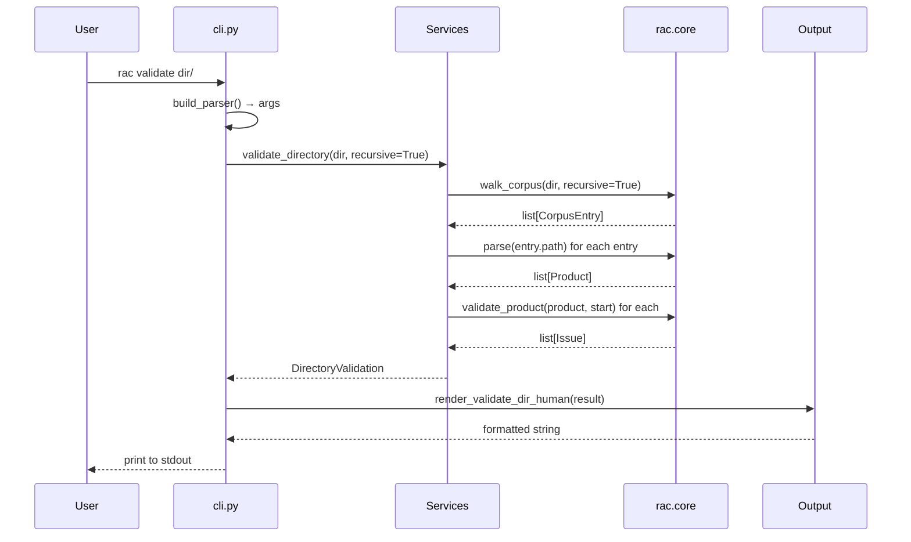
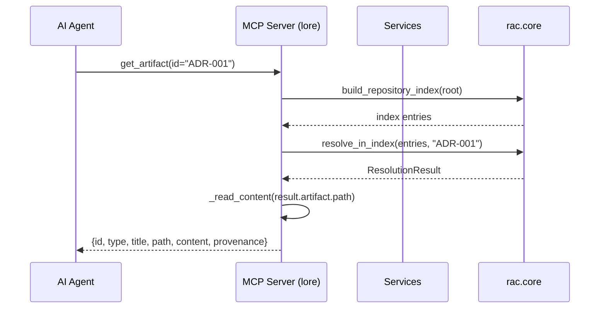
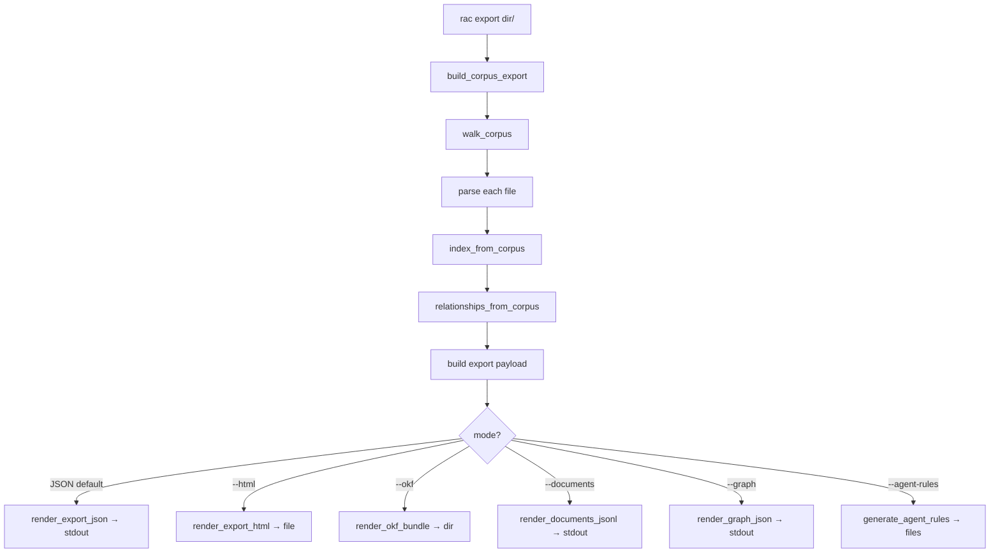
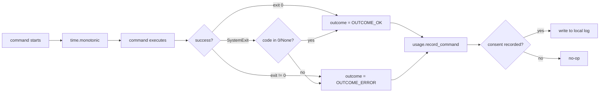
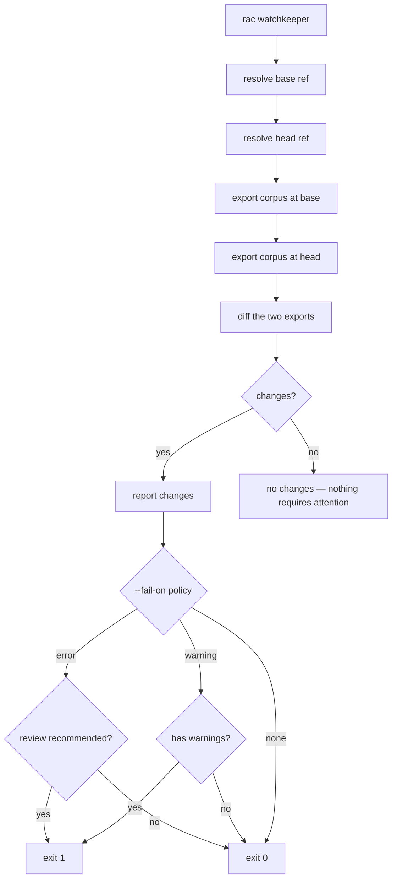

# Data Flow End-to-End — Request Lifecycle

This document traces a request through the entire RAC system, from CLI invocation to output rendering. Understanding the full data flow is essential for debugging, extending, or integrating with RAC.

Source: `/home/darkvoid/Boxxed/@formulas/src.rust/src.AI/src.Wayfinder/rac-core/` — `rac/cli.py`, `rac/services/*.py`, `rac/output/*.py`, `rac/mcp/server.py`

**Aha: Every tool call re-reads from disk.** The MCP server (and all CLI commands) have no persistent state between calls. Each invocation walks the corpus, parses every file, and builds the index from scratch. This eliminates cache-invalidation bugs and means the system always reflects the current state of the repository — but at the cost of re-parsing on every request. For a typical corpus of 50-200 files, this takes 10-100ms.

**Aha: The output layer is a pure rendering function over the service result.** Services return typed dataclasses (`DirectoryValidation`, `RelationshipReport`, `PortfolioSummary`, etc.), and the output layer renders these to JSON or human-readable text. This separation means the service contract is stable — JSON consumers depend on the service return types, not on how the CLI formats them for humans.

## Command Execution Flow



## Validation Flow

The most common operation is validating a corpus. Here is the complete flow:

1. **CLI layer** (`cli.py:cmd_validate`): Parse arguments, determine corpus path, check for `--corpus` flag (single-file mode vs. directory mode).

2. **Service layer** (`services/validate.py:validate_directory`): Walk the corpus, parse each file, run `validate_product` on each, aggregate results.

3. **Core layer** (`core/validation.py:validate_product`): Check required sections, validate metadata, check for malformed requirements, verify relationship references.

4. **Output layer** (`output/human.py:render_validate_dir_human`): Format the results as a human-readable table with error/warning counts per file.

Source: `rac-core/src/rac/services/validate.py` — `validate_directory()`

```python
def validate_directory(root: str, *, recursive: bool = True) -> DirectoryValidation:
    """Validate every recognized artifact beneath root."""
    entries = list(walk_corpus(root, recursive=recursive))
    results: dict[str, FileValidation] = {}
    for entry in entries:
        product = entry.product
        issues = validate_product(product, root)
        results[entry.path] = FileValidation(
            path=entry.path,
            type=classify(product).type,
            issues=issues,
            ok=not has_errors(issues),
        )
    return DirectoryValidation(results=results, ok=all(r.ok for r in results.values()))
```

## MCP Tool Call Flow

The MCP server follows a different flow — it serves read-only tools over the MCP protocol:



Source: `rac-core/src/rac/mcp/server.py:162-189` — `_get_artifact()`

```python
def _get_artifact(root: str, artifact_id: str, budget: int) -> str:
    result = _resolve(root, artifact_id)
    if result.outcome != OUTCOME_RESOLVED or result.artifact is None:
        return serialize(errors.from_resolution(result), budget)
    try:
        content = _read_content(result.artifact.path)
    except (OSError, UnicodeDecodeError):
        return serialize(errors.unreadable(result.artifact.id, result.artifact.path), budget)
    payload = {
        "schema_version": "1",
        **result.artifact.to_dict(),
        "content": content,
        "provenance": {
            "status": artifact_status(parse(content)),
            **artifact_provenance(root, result.artifact.path).to_dict(),
        },
    }
    return serialize(payload, budget)
```

The `budget` parameter (default `DEFAULT_BUDGET`) caps the response size. If the payload exceeds the budget, it is truncated with markers (`MARKER_TRUNCATED`, `MARKER_OMITTED`, `MARKER_HINT`) so the caller knows the response is incomplete.

## Export Flow

The `rac export` command builds a complete corpus export:



Source: `rac-core/src/rac/cli.py:682-761` — `cmd_export()`

The export command has multiple mutually exclusive modes:

| Mode | Output | Destination |
|------|--------|-------------|
| Default (none) | JSON corpus payload | stdout |
| `--html` | Self-contained HTML Portal | file (default: `lore-export.html`) |
| `--okf` | OKF v0.1 bundle (one Markdown per artifact + index.md + log.md) | directory (default: `okf-bundle`) |
| `--documents` | JSONL stream (one Markdown-bodied record per artifact) | stdout |
| `--graph` | Typed node+edge JSON graph | stdout |
| `--agent-rules` | Per-client agent-context files (CLAUDE.md, AGENTS.md, etc.) | files |

## Telemetry Flow

Opt-in telemetry runs in the `finally` block of every command:



Source: `rac-core/src/rac/cli.py:2188-2214` — `main()` finally block

```python
finally:
    usage.record_command(command, outcome, int((time.monotonic() - start) * 1000))
```

The `record_command` function writes one content-free event per completed command: command name, outcome, duration. No arguments, no file contents, no queries. The log is written to a local file and never transmitted without explicit consent.

## Watchkeeper Flow

The `rac watchkeeper` command compares two repository states (base and head git refs):



Source: `rac-core/src/rac/cli.py:603-637` — `cmd_watchkeeper()`

```python
def cmd_watchkeeper(args: argparse.Namespace) -> int:
    if args.directory is None:
        args.directory = "rac" if Path("rac").is_dir() else "."
    report = build_watchkeeper_report(args.directory, base=args.base, head=args.head)
    # Output format: human, json, or github
    if args.fail_on == "none":
        return EXIT_OK
    if report.review_recommended:
        return EXIT_VALIDATION_FAILED
    if args.fail_on == "warning" and report.has_warnings:
        return EXIT_VALIDATION_FAILED
    return EXIT_OK
```

## Cross-References

- [RAC Architecture](01-architecture.md) — layer diagram, module map
- [MCP Server](06-rac-sdk.md) — the 5 read-only tools and their data flows
- [Error Handling](10-error-handling.md) — how errors propagate through each layer

## Next Document

Continue to [Error Handling](10-error-handling.md) for the complete error handling strategy across all layers, exit codes, and recovery mechanisms.
