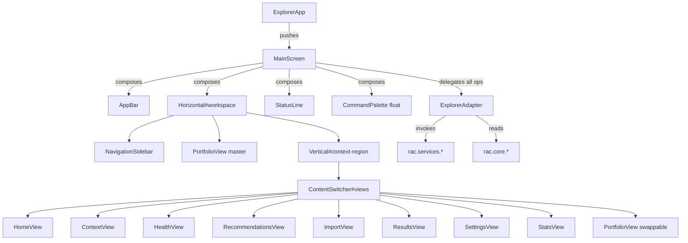
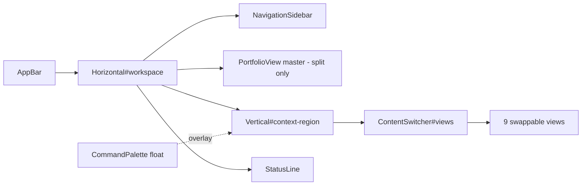
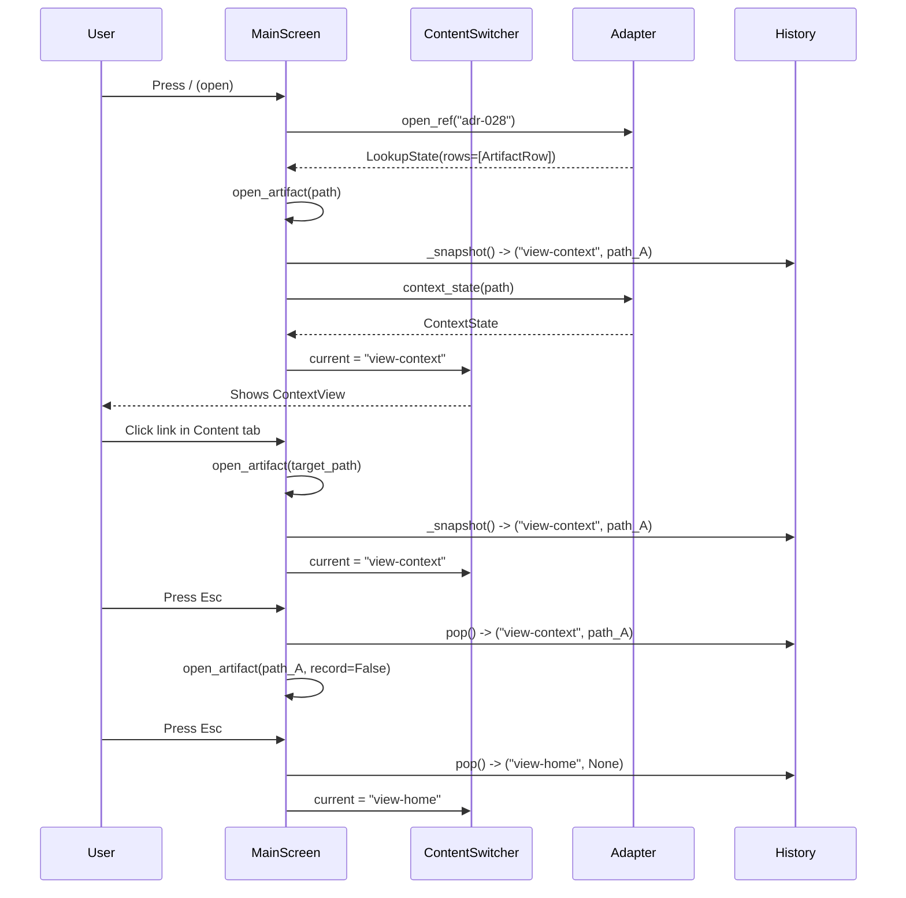

# 11 - Explorer TUI: Textual-Based Terminal UI

The RAC Explorer TUI is a keyboard-first, terminal-native application built on the [Textual](https://textual.textualize.io/) framework. It provides a persistent workspace frame for browsing, reading, and managing RAC repositories -- one screen that composes once and swaps views internally via `ContentSwitcher`, never rebuilding the layout during navigation.

Source: `rac-core/src/rac/explorer/app.py:1` -- module docstring

---

## Table of Contents

1. [Architecture Overview](#architecture-overview)
2. [ExplorerApp: The Application Shell](#explorerapp-the-application-shell)
3. [MainScreen: The Persistent Workspace Frame](#mainscreen-the-persistent-workspace-frame)
4. [Frame Composition](#frame-composition)
5. [Loading Flow and Worker Lifecycle](#loading-flow-and-worker-lifecycle)
6. [Live Reload Watcher](#live-reload-watcher)
7. [Command Palette](#command-palette)
8. [Navigation and History Stack](#navigation-and-history-stack)
9. [Split Layout (v0.26.3)](#split-layout-v0263)
10. [Workspace Continuity](#workspace-continuity)
11. [Editor Integration](#editor-integration)
12. [View Regions and Views](#view-regions-and-views)
13. [Themes](#themes)
14. [UI State Types](#ui-state-types)
15. [Cross-References](#cross-references)

---

## Architecture Overview

The Explorer follows a strict adapter boundary (ADR-015). The TUI layer owns no repository intelligence -- it renders state, handles keyboard input, and delegates every data operation to `ExplorerAdapter`, which in turn invokes RAC core services.



The data flow is unidirectional: `ExplorerAdapter` loads a `Repository` from core, translates it into frozen `*State` dataclasses in `state.py`, and the widgets render those state objects. Widgets never import core models.

**Cross-reference:** See [02-rac-core.md](02-rac-core.md) for the core service layer that `ExplorerAdapter` invokes, [07-knowledge-graph.md](07-knowledge-graph.md) for the relationship model that powers the Links tab, and [09-data-flow.md](09-data-flow.md) for end-to-end data flows.

---

## ExplorerApp: The Application Shell

Source: `rac-core/src/rac/explorer/app.py:21-57`

`ExplorerApp` is the Textual `App[None]` entry point. It is the first module on the import path that requires Textual; `rac.explorer.launch` imports it lazily so the base install works without the `explorer` extra.

```python
# rac-core/src/rac/explorer/app.py:21-36
class ExplorerApp(App[None]):
    """Application shell over one repository: one frame, swappable views, `/`."""

    TITLE = "RAC Explorer"
    CSS_PATH = "explorer.tcss"
    BINDINGS = [
        Binding("q", "quit", "Quit"),
        Binding("slash", "command_surface", "Commands"),
    ]

    def __init__(self, directory: str, recursive: bool = True) -> None:
        super().__init__()
        self.adapter = ExplorerAdapter(directory, recursive=recursive)
        self.sub_title = directory
```

The `on_mount` hook registers the curated themes, applies the saved theme preference (falling back to `THEME_NAME = "rac-lantern"` on failure), records the open for workspace continuity, and pushes `MainScreen`:

```python
# rac-core/src/rac/explorer/app.py:38-49
def on_mount(self) -> None:
    for theme in RAC_THEMES:
        self.register_theme(theme)
    try:
        self.theme = self.adapter.preferences.theme
    except Exception:  # noqa: BLE001
        self.theme = THEME_NAME
    self.adapter.record_open()
    self.push_screen(MainScreen(self.adapter))
```

The `action_command_surface` summons the palette. The `/` binding is deliberately not a priority binding -- a typed `/` must keep working inside the palette's input rather than re-triggering this action.

---

## MainScreen: The Persistent Workspace Frame

Source: `rac-core/src/rac/explorer/screens/main.py:90-749`

`MainScreen` is the workspace frame. Every view swap happens inside the context region via `ContentSwitcher`. The screen stack survives only for the confirm-write modal (ADR-024).

Key constants:

| Constant | Value | Purpose |
|----------|-------|---------|
| `_SIDEBAR_MIN_WIDTH` | `80` | Sidebar hides below this width |
| `_SPLIT_MIN_WIDTH` | `100` | Master pane hides below this in split mode |
| `_WATCH_INTERVAL` | `2.0` | Seconds between live-reload fingerprint comparisons |

```python
# rac-core/src/rac/explorer/screens/main.py:56-63
_SIDEBAR_MIN_WIDTH = 80
_SPLIT_MIN_WIDTH = 100
_WATCH_INTERVAL = 2.0
```

The `_WorkerCancelToken` bridges Textual's worker cancellation into the core `CancelToken` protocol:

```python
# rac-core/src/rac/explorer/screens/main.py:79-87
class _WorkerCancelToken:
    """Bridges Textual's worker cancellation into the Core CancelToken protocol."""

    def __init__(self, worker: Worker[object]) -> None:
        self._worker = worker

    @property
    def cancelled(self) -> bool:
        return self._worker.is_cancelled
```

---

## Frame Composition

The frame composes once on `compose()` and never rebuilds during navigation. Views swap inside the `ContentSwitcher`.



**AppBar** (`widgets/appbar.py`): One plain line -- `RAC Explorer <version>` left, repository path right (with `~` contraction for home). Replaces the stock Textual Header.

```python
# rac-core/src/rac/explorer/widgets/appbar.py:29-38
class AppBar(Horizontal):
    """Application identity left, repository path right."""

    def __init__(self, directory: str) -> None:
        super().__init__(id="appbar")
        self._directory = directory

    def compose(self) -> ComposeResult:
        yield Static(f"RAC Explorer {_SHORT_VERSION}", id="appbar-title")
        yield Static(_tilde(self._directory), id="appbar-path")
```

**NavigationSidebar** (`widgets/sidebar.py`): A `Tree[str]` titled "Artifacts" that mirrors the repository directory structure (default, v0.8.10), or groups by type with counts, or lists flat -- per the `artifact_grouping` preference. Type tags are colour-coded and theme-aware:

```python
# rac-core/src/rac/explorer/widgets/sidebar.py:26-33
_TYPE_TAGS = {
    "requirement": ("REQ", "#46A758", "#2F6B22"),
    "decision": ("ADR", "#3B82F6", "#2457B8"),
    "roadmap": ("RMP", "#A855F7", "#7A35A8"),
    "prompt": ("PRM", "#06B6D4", "#0E6E7D"),
    "design": ("DSG", "#EC4899", "#B83275"),
}
_UNKNOWN_TAG = ("UNK", "bright_black", "#6B6253")
```

**StatusLine** (`widgets/statusline.py`): Replaces the stock Footer. Compact inverse-video key chips on the left, context-sensitive to the focused panel (LazyGit UX). Health chip and link count right-aligned. Every chip carries a text label so nothing depends on chip styling alone (ADR-028).

```python
# rac-core/src/rac/explorer/widgets/statusline.py:19-65
_HINTS: dict[str, tuple[tuple[str, ...], ...]] = {
    "home": (("⏎", "Browse"), ("h", "Health"), (".", "Resume"), ("/", "Commands"), ("q", "Quit")),
    "sidebar": (("⏎", "Open"), ("⇥", "Panel"), ("/", "Commands"), ("q", "Quit")),
    "context": (("e", "Edit"), ("g", "Links"), ("Esc", "Back"), ("/", "Commands"), ("q", "Quit")),
    "health": (("⏎", "Open"), ("r", "Recommendations"), ("Esc", "Back"), ("/", "Commands")),
    "recommendations": (("⏎", "Open"), ("x", "Export"), ("Esc", "Back"), ("/", "Commands")),
    "import": (("y", "Confirm"), ("Esc", "Back")),
    "stats": (("Esc", "Back"), ("/", "Commands")),
    "portfolio": (("⏎", "Open"), ("s", "Sort"), ("f", "Filter"), ("^f", "Search"), ("Esc", "Back")),
    "results": (("⏎", "Open"), ("f", "Filter"), ("Esc", "Back"), ("/", "Commands")),
    "settings": (("⏎", "Change"), ("Esc", "Back"), ("/", "Commands")),
    "command": (("⏎", "Run"), ("↑↓", "Choose"), ("Esc", "Close")),
}
```

**Aha:** The status line hints are region-aware, not global. When focus moves from the sidebar to the context view, the chips swap from `⏎ Open / ⇥ Panel` to `e Edit / g Links / Esc Back`. This is the LazyGit UX adapted to a Textual app -- the user always sees the keys that matter for the panel they are focused on, never a static footer.

---

## Loading Flow and Worker Lifecycle

Loading runs in a thread worker (`@work(thread=True, exclusive=True, group="repository-load")`). The adapter invokes `load_repository` from core with progress callbacks and cancellation support.

```python
# rac-core/src/rac/explorer/screens/main.py:282-296
@work(thread=True, exclusive=True, group="repository-load")
def _load_repository(self) -> RepositorySummaryState | LoadErrorState | None:
    worker = get_current_worker()
    token = _WorkerCancelToken(worker)

    def relay(progress: LoadProgressState) -> None:
        if not worker.is_cancelled:
            self.app.call_from_thread(self.query_one(HomeView).show_progress, progress)

    baseline = self.adapter.fingerprint()
    result = self.adapter.load(on_progress=relay, cancel=token)
    self._watch_baseline = baseline if isinstance(result, RepositorySummaryState) else None
    return result
```

**LoadProgressState phases** (from `adapter.py:84-89`):

| Phase | Label |
|-------|-------|
| `scan` | "Scanning artifacts (N/M)" |
| `index` | "Indexing artifacts" |
| `validate` | "Validating artifacts" |
| `relationships` | "Analyzing relationships" |
| `portfolio` | "Calculating portfolio" |

The worker result is handled in `on_worker_state_changed`:

```python
# rac-core/src/rac/explorer/screens/main.py:298-332
def on_worker_state_changed(self, event: Worker.StateChanged) -> None:
    if event.worker.group == "watch-scan":
        if event.state == WorkerState.SUCCESS:
            self._on_scan_result(event.worker.result)
        return
    if event.worker.group != "repository-load":
        return
    # ... handles SUCCESS (summary/error/None), ERROR, and cancellation
```

Three possible outcomes:
- **`RepositorySummaryState`**: success. The sidebar populates, status line shows summary, master pane fills (split mode), current view refreshes.
- **`LoadErrorState`**: recoverable failure. Home view shows the error with a retry option.
- **`None`**: the load was cancelled. A fresh worker is taking over.

**Aha:** A fingerprint snapshot is taken *before* loading starts (`self.adapter.fingerprint()`). If a file save lands mid-load, the new fingerprint will differ from the baseline, so the next watch tick reloads again and converges. This prevents the race where a save during load gets missed.

---

## Live Reload Watcher

Source: `rac-core/src/rac/explorer/screens/main.py:334-363`

The live watcher compares corpus fingerprints every 2.0 seconds. A mismatch triggers an automatic reload.

```python
# rac-core/src/rac/explorer/screens/main.py:345-362
def _watch_tick(self) -> None:
    if self._watch_paused or self._watch_baseline is None:
        return
    if any(w.group == "repository-load" and w.is_running for w in self.workers):
        return
    self._scan_corpus()

@work(thread=True, exclusive=True, group="watch-scan")
def _scan_corpus(self) -> tuple[tuple[str, int], ...] | None:
    return self.adapter.fingerprint()

def _on_scan_result(self, snapshot: tuple[tuple[str, int], ...] | None) -> None:
    if snapshot is None or self._watch_baseline is None:
        return
    if snapshot != self._watch_baseline:
        self.action_reload()
```

The fingerprint is a tuple of `(path, st_mtime_ns)` pairs from `find_markdown_files` -- no parsing, so a scan stays cheap enough to repeat on a timer:

```python
# rac-core/src/rac/explorer/adapter.py:305-323
def fingerprint(self) -> tuple[tuple[str, int], ...] | None:
    try:
        paths = find_markdown_files(self.directory, recursive=self.recursive)
    except OSError:
        return None
    entries: list[tuple[str, int]] = []
    for path in paths:
        try:
            entries.append((str(path), path.stat().st_mtime_ns))
        except OSError:
            continue
    return tuple(entries)
```

Watcher lifecycle:
- **Paused** during editor suspension (`pause_watching()` / `resume_watching()`)
- **Inactive** before the first successful load (`_watch_baseline` is `None`)
- **Cleared** on load error (prevents false triggers)
- **Rescans immediately** on editor resume (the edit loop closes itself)

The `_refresh_current_view` method (line 364-398) re-renders the active view after a live reload -- context view refreshes in place preserving scroll position, health and recommendations refresh from the new state, disappeared artifacts fall back to home.

---

## Command Palette

Source: `rac-core/src/rac/explorer/widgets/palette.py:51-209` and `rac-core/src/rac/explorer/commands.py:1-94`

The command palette is summoned by `/` from anywhere on the main screen. It is a `Vertical` widget with an `Input` on top and an `OptionList` below.

**Command registry** (`commands.py`): 15 discoverable commands, plus an implicit `search` route for unrecognized input.

```python
# rac-core/src/rac/explorer/commands.py:38-59
REGISTRY: tuple[CommandSpec, ...] = (
    CommandSpec("open", "open <ref>", "Open an artifact by ID or alias"),
    CommandSpec("find", "find <query> [type]", "Search artifacts by ID, title, or path"),
    CommandSpec("browse", "browse [type]", "Browse the sidebar; a type lists results"),
    CommandSpec("list", "list [type|text]", "List artifacts; a type scopes, other text searches names"),
    CommandSpec("health", "health", "Show repository health and attention items"),
    CommandSpec("stats", "stats", "Show portfolio statistics"),
    CommandSpec("recommendations", "recommendations", "Show recommendations with impact and actions"),
    CommandSpec("new", "new <type> <path>", "Create an artifact from its template"),
    CommandSpec("import", "import <source> [target]", "Convert a document into Markdown"),
    CommandSpec("relationships", "relationships <ref>", "Traverse an artifact's relationships"),
    CommandSpec("resume", "resume", "Reopen the last artifact in this repository"),
    CommandSpec("schema", "schema [type]", "Show an artifact type's expected structure"),
    CommandSpec("settings", "settings", "View and change Explorer settings"),
    CommandSpec("home", "home", "Return to the repository home"),
    CommandSpec("help", "help", "List available commands"),
    CommandSpec("quit", "quit", "Quit the Explorer"),
)
```

**Aha:** Input whose first word is *not* a registered command name is automatically treated as a search. Users never have to decide whether they are searching or running a command -- they just type. The `parse()` function at line 75 routes on the first word: if it matches a registry name (or an alias like `preferences` -> `settings`), it returns an `Invocation`; otherwise it returns `Invocation(command=SEARCH, args=...)`.

The palette's menu refreshes on every keystroke (`on_input_changed`):

```python
# rac-core/src/rac/explorer/widgets/palette.py:116-147
def _refresh_menu(self, text: str) -> None:
    menu = self._menu()
    menu.clear_options()
    stripped = text.strip().lstrip("/").strip()
    dark = self._tag_dark()
    options: list[Option] = []
    if not stripped:
        # Recent artifacts first, then the full registry
        recents = self.adapter.recent_rows()
        if recents:
            options.append(Option(Text("Recent", style="dim"), disabled=True))
            options.extend(_artifact_option(row, dark=dark) for row in recents)
            options.append(Option(Text("Commands", style="dim"), disabled=True))
        options.extend(_command_option(spec) for spec in commands.REGISTRY)
    else:
        matched = commands.suggestions(stripped)
        if matched:
            options = [_command_option(spec) for spec in matched]
        else:
            lookup = self.adapter.search_rows(stripped)
            options.extend(_artifact_option(row, dark=dark) for row in lookup.rows[:_MATCH_LIMIT])
            options.append(Option(f"Search all results for '{stripped}'", id="route:search"))
    menu.add_options(options)
```

Quick-open caps artifact matches at `_MATCH_LIMIT = 8` (line 28). The palette posts three message types: `Dismissed`, `Routed`, and `ArtifactChosen` -- the screen handles each.

Commands that take arguments (`<` or `[` in usage) complete into the input Claude Code style rather than executing immediately, letting the user continue typing:

```python
# rac-core/src/rac/explorer/widgets/palette.py:186-191
elif _takes_args(spec):
    # Complete into the input, Claude Code style, and keep typing.
    field = self.query_one(Input)
    field.value = f"{spec.name} "
    field.cursor_position = len(field.value)
    field.focus()
```

---

## Navigation and History Stack

The main screen maintains a history stack for `Esc` back navigation:

```python
# rac-core/src/rac/explorer/screens/main.py:101-113
def __init__(self, adapter: ExplorerAdapter) -> None:
    super().__init__()
    self.adapter = adapter
    self._history: list[tuple[str, str | None]] = []  # (view_id, artifact_path)
    self._last_focus: Widget | None = None
    self._watch_baseline: tuple[tuple[str, int], ...] | None = None
    self._watch_paused = False
    self._open_after_load: str | None = None
```

The `_snapshot` method captures the current state:

```python
# rac-core/src/rac/explorer/screens/main.py:190-196
def _snapshot(self) -> tuple[str, str | None]:
    """The current view as a history entry: (view id, open artifact path)."""
    current = self.current_view
    if current == "view-context":
        context = self.query_one(ContextView).context
        return (current, context.path if context is not None else None)
    return (current, None)
```

The `show_view` method records history when the view changes (artifact-to-artifact traversal always records, so Esc can unwind across the graph):

```python
# rac-core/src/rac/explorer/screens/main.py:198-217
def show_view(self, view_id: str, *, focus: bool = True, record: bool | None = None) -> None:
    switcher = self.query_one(ContentSwitcher)
    if record is None:
        record = switcher.current != view_id
    if record and switcher.current is not None:
        self._history.append(self._snapshot())
    switcher.current = view_id
    self._set_region_title(view_id)
    self.query_one(StatusLine).show_hints(_VIEW_REGIONS[view_id][0])
    if view_id in ("view-health", "view-recommendations", "view-context"):
        self.adapter.record_view(view_id)
    if focus:
        self._focus_view(view_id)
```

**Esc back** (`action_back`) unwinds the stack. With nothing to unwind, it returns home -- never a dead-end:

```python
# rac-core/src/rac/explorer/screens/main.py:259-269
def action_back(self) -> None:
    if not self._history:
        if self.current_view != "view-home":
            self.show_view("view-home", record=False)
        return
    view_id, path = self._history.pop()
    if view_id == "view-context" and path is not None:
        self.open_artifact(path, record=False)
        return
    self.show_view(view_id, record=False)
```

**Aha:** Artifact-to-artifact traversal (e.g., clicking a link in the Content tab or selecting a connected artifact in the Links tab) stays on the context view but *still* records to the history stack. This means Esc can unwind across the graph: from `ContextView(B)` back to `ContextView(A)` back to `HomeView`, even though the visible view never changed. The `record` parameter defaults to "when the view changes," but `open_artifact` explicitly passes `record=True` when navigating between different artifacts.

The navigation sequence:



---

## Split Layout (v0.26.3)

Source: `rac-core/src/rac/explorer/screens/main.py:117-175` and `_make_workspace` at line 489

The split layout is a master-detail view: `PortfolioView` as the master pane on the left, driving a persistent reading pane (the context region) on the right.

```python
# rac-core/src/rac/explorer/screens/main.py:117-119
def _split(self) -> bool:
    """Whether the master-detail split layout is active (v0.26.3)."""
    return self.adapter.preferences.layout == LAYOUT_SPLIT
```

**Two compose paths** (line 121-146):

- **Frame layout** (default): `NavigationSidebar` + `Vertical#context-region` with `ContentSwitcher`
- **Split layout**: `PortfolioView` (master) + `Vertical#context-region` with `ContentSwitcher`. Sidebar is hidden.

The `_apply_layout_visibility` method (line 165-174) responds to terminal resize:

```python
def _apply_layout_visibility(self) -> None:
    width = self.app.size.width
    if self._split():
        self.query_one(NavigationSidebar).display = False
        self.query_one(PortfolioView).display = width >= _SPLIT_MIN_WIDTH  # 100
    else:
        self.query_one(NavigationSidebar).display = width >= _SIDEBAR_MIN_WIDTH  # 80
```

The `_switch_layout` async worker (line 513-527) remounts the workspace when the layout preference changes:

```python
@work(exclusive=True, group="layout-switch")
async def _switch_layout(self) -> None:
    await self.query_one("#workspace").remove()
    await self.mount(self._make_workspace(), after=self.query_one(AppBar))
    self._apply_layout_visibility()
    self._set_region_title("view-home")
    self.query_one(StatusLine).show_hints("home")
    if self._split():
        self.query_one(PortfolioView).take_focus()
    else:
        self.query_one(HomeView).focus()
    self.action_reload()
```

The `PortfolioView.Followed` message (line 449-453) drives the detail pane in split mode -- when the user arrows through the master list, the context view updates in place without swapping views or losing focus:

```python
def on_portfolio_view_followed(self, message: PortfolioView.Followed) -> None:
    message.stop()
    self.open_artifact(message.path, record=False, focus=False)
```

---

## Workspace Continuity

Source: `rac-core/src/rac/explorer/workspace.py:1-108`

Workspace continuity persists recently opened repositories, the last artifact per repository, the last active view per repository, and the 8 most-recently-opened artifacts per repository (v0.8.9).

```python
# rac-core/src/rac/explorer/workspace.py:21-30
@dataclass
class Workspace:
    """Recently opened repositories, plus the last artifact and view in each."""

    recent: list[str] = field(default_factory=list)  # up to _RECENT_LIMIT = 10
    last_artifact: dict[str, str] = field(default_factory=dict)
    last_view: dict[str, str] = field(default_factory=dict)
    recent_artifacts: dict[str, list[str]] = field(default_factory=dict)  # up to _RECENT_ARTIFACT_LIMIT = 8
```

Persistence location: `$XDG_STATE_HOME/rac/explorer-workspace.json` (falls back to `~/.local/state/rac/explorer-workspace.json`).

**Four recording methods** on `ExplorerAdapter`:

| Method | Source Line | Purpose |
|--------|-------------|---------|
| `record_open(directory)` | adapter.py:237-240 | Move directory to front of recent list |
| `record_artifact(directory, path)` | adapter.py:242-245 | Remember last artifact + add to recent list |
| `record_view(directory, view)` | adapter.py:247-250 | Remember active view for resume |
| `record_open()` | adapter.py:237-240 | Called in `ExplorerApp.on_mount` |

**Resume methods**:

```python
# rac-core/src/rac/explorer/adapter.py:252-274
def resume_view(self) -> str | None:
    """The last recorded view for this repository, if any."""
    return self.workspace.resume_view(self.directory)

def resume_path(self) -> str | None:
    """The last artifact opened here, if it still exists in the load."""
    path = self.workspace.resume_artifact(self.directory)
    if path is None or self.repository is None:
        return None
    return path if any(a.path == path for a in self.repository.artifacts) else None
```

The `action_resume` binding (`.` key, line 550-564) reopens the last view -- health and recommendations included. It checks `resume_view()` first: if it was `view-health`, it shows health; if `view-recommendations`, it shows recommendations; otherwise it falls back to `resume_path()` to reopen the last artifact.

**Aha:** The workspace is additive and backward-compatible. State files written before `recent_artifacts` (v0.8.9) load without error -- the `load_workspace` function uses defensive dict/list comprehensions that simply return empty collections for missing keys. Resuming is a convenience, never a requirement; every write tolerates filesystem trouble silently.

---

## Editor Integration

Source: `rac-core/src/rac/explorer/editor.py:1-96` and `widgets/views.py:87-116`

Explorer is not an editor (ADR-024). It locates an artifact and hands it to the user's own editor via `launch_editor()`.

```python
# rac-core/src/rac/explorer/editor.py:46-48
_TERMINAL_EDITORS = frozenset(
    {"vi", "vim", "nvim", "emacs", "nano", "helix", "hx", "micro", "kak", "pico"}
)
```

Editor resolution: `editor` preference (from `/settings`) beats `$VISUAL`, which beats `$EDITOR`. When nothing is set, guidance is returned rather than guessing.

```python
# rac-core/src/rac/explorer/widgets/views.py:87-116
def launch_editor(widget: Widget, adapter: ExplorerAdapter, path: str) -> editor_mod.EditorOutcome:
    """Open ``path`` in the configured editor from any widget (ADR-024)."""
    editor = adapter.resolved_editor()
    if editor is not None and editor_mod.is_terminal_editor(editor):
        # The live watcher holds while the editor owns the terminal
        screen = widget.screen
        pause = getattr(screen, "pause_watching", lambda: None)
        resume = getattr(screen, "resume_watching", lambda: None)
        try:
            pause()
            with widget.app.suspend():
                return adapter.open_in_editor(path, blocking=True)
        except SuspendNotSupported:
            return editor_mod.EditorOutcome(
                launched=False,
                message=f"'{editor}' needs the terminal, and this session cannot suspend.",
            )
        finally:
            resume()
    return adapter.open_in_editor(path)
```

The terminal-editor path:
1. Detects if the editor needs the terminal (`is_terminal_editor`)
2. Pauses the live reload watcher
3. Suspends the Textual application (`widget.app.suspend()`)
4. Runs the editor in blocking mode (`subprocess.run`)
5. Resumes the watcher -- which immediately triggers a `_watch_tick`, so the saved edit shows at once

If the session cannot suspend (e.g., running in a non-terminal environment), the user gets guidance to configure a GUI editor instead.

---

## View Regions and Views

Source: `rac-core/src/rac/explorer/screens/main.py:66-76` and `widgets/views.py`

Nine views swap inside the `ContentSwitcher`. Each has a view ID, a status-line hint key, and a panel title:

| View ID | Status Hint | Panel Title | Widget Class |
|---------|-------------|-------------|--------------|
| `view-home` | `home` | Home | `HomeView` |
| `view-context` | `context` | Artifact | `ContextView` |
| `view-health` | `health` | Health | `HealthView` |
| `view-recommendations` | `recommendations` | Recommendations | `RecommendationsView` |
| `view-import` | `import` | Import | `ImportView` |
| `view-results` | `results` | Results | `ResultsView` |
| `view-settings` | `settings` | Settings | `SettingsView` |
| `view-stats` | `stats` | Portfolio Stats | `StatsView` |
| `view-portfolio` | `portfolio` | Portfolio | `PortfolioView` |

```python
# rac-core/src/rac/explorer/screens/main.py:66-76
_VIEW_REGIONS = {
    "view-home": ("home", "Home"),
    "view-context": ("context", "Artifact"),
    "view-health": ("health", "Health"),
    "view-recommendations": ("recommendations", "Recommendations"),
    "view-import": ("import", "Import"),
    "view-results": ("results", "Results"),
    "view-settings": ("settings", "Settings"),
    "view-stats": ("stats", "Portfolio Stats"),
    "view-portfolio": ("portfolio", "Portfolio"),
}
```

### ContextView (Artifact Detail)

The most complex view -- one artifact in full with four tabs:

| Tab | ID | Content |
|-----|----|---------|
| Content | `tab-content` | Markdown rendering of the artifact body (read-only) |
| Inspection | `tab-inspection` | ID, type, path, status, aliases, completeness, relationships, diagnostics |
| Links | `tab-links` | Knowledge graph: outgoing edges, impact, lineage |
| Findings | `tab-findings` | Review findings + improvement suggestions for this artifact |

```python
# rac-core/src/rac/explorer/widgets/views.py:468-505
class ContextView(Vertical):
    """One artifact in full: Content | Inspection | Links | Findings."""

    BINDINGS = [
        Binding("e", "open_in_editor", "Open in editor"),
        Binding("g", "links", "Links"),
        Binding("j", "scroll_content(1)", "Scroll", show=False),
        Binding("k", "scroll_content(-1)", "Scroll", show=False),
        Binding("left", "switch_tab(-1)", "Tab", show=False),
        Binding("right", "switch_tab(1)", "Tab", show=False),
    ]
```

Tab badges show counts before visiting: `Inspection (3)`, `Links (5)`, `Findings (2)` -- so the user knows which tabs have content.

**Markdown link navigation** (line 592-602): Clickable links inside the Content tab resolve through the adapter's `resolve_link` method. If resolved to another artifact, an `OpenArtifact` message navigates in place with full history tracking. External URLs and unresolvable links show a warning notification.

### PortfolioView

A sortable `DataTable` with zebra stripes (v0.26.2). Columns: Type, ID, Status, Links, Recency, Title.

```python
# rac-core/src/rac/explorer/widgets/views.py:907-923
def compose(self) -> ComposeResult:
    yield Static(id="portfolio-header")
    yield Input(placeholder="Search by name...  (fuzzy)", id="portfolio-search")
    yield DataTable(id="portfolio-table", cursor_type="row", zebra_stripes=True)
```

Sort modes (cycled with `s`): `type`, `recency`, `links`, `status`, `id`.
Status filters (cycled with `f`): `all`, `invalid`, `valid`.
Search (`ctrl+f` or `/list <text>`): fuzzy name search within visible rows.

Recency arrives asynchronously from a git worker after the table is on screen (git is too slow for the load path -- ADR-045).

### ImportView

The guided write workflow: preview with `y` to confirm, then result. One confirm path for both document import (conversion runs off the UI thread via `@work`) and `/new` template creation (rendered instantly). Nothing is written until the user confirms, and writes never overwrite.

```python
# rac-core/src/rac/explorer/widgets/views.py:740-741
class ImportView(Vertical):
    can_focus = True
    BINDINGS = [Binding("y", "confirm", "Confirm write")]
```

### HomeView

The repository summary with onboarding support. Shows a loading progress bar, then either first-run onboarding (with optional editor prompt) or the repository summary. The mascot animates during loading (`SEARCHING` state) and shows in the empty state (`EMPTY`) or discovery state (`DISCOVERY`).

### HealthView

Score out of 100 with four areas (Completeness, Relationships, Validation, Coverage) and a selectable attention list. `r` jumps to Recommendations.

### RecommendationsView

Category-grouped recommendations (Validation, Relationships, Repository Health, Quality, Improvement). Enter opens the affected artifact on its Findings tab. `x` exports to Markdown.

### StatsView

Portfolio statistics dashboard. Collection re-walks the corpus in a worker on request -- never during the repository load.

### ResultsView

Generic results display for command output, search results, and lookup states.

### SettingsView

Preference editor for theme, grouping, layout, editor, mascot, and animations settings.

---

## Themes

Source: `rac-core/src/rac/explorer/theme.py:1-73`

Three curated themes, all deriving from the mascot asset's lantern amber accent:

```python
# rac-core/src/rac/explorer/theme.py:20-22
THEME_NAME = "rac-lantern"
PARCHMENT_NAME = "rac-parchment"
HIGH_CONTRAST_NAME = "rac-high-contrast"

RAC_THEMES = (RAC_LANTERN, RAC_PARCHMENT, RAC_HIGH_CONTRAST)
```

| Theme | Background | Primary | Foreground | Dark |
|-------|-----------|---------|------------|------|
| `rac-lantern` | `#121110` near-black | `#F5A800` lantern amber | `#E8E2D5` | Yes |
| `rac-parchment` | `#F4EEE1` warm paper | `#B6770A` deepened amber | `#2A2520` dark ink | No |
| `rac-high-contrast` | `#000000` true black | `#FFB224` brighter amber | `#FFFFFF` pure white | Yes |

The `theme` preference can select any of these, or any other registered Textual theme. Type tags in the sidebar and palette adapt their hue to the active theme (v0.26.1) -- the dark set on near-black, a deepened set on light so every tag stays legible.

---

## UI State Types

Source: `rac-core/src/rac/explorer/state.py:1-266`

All UI state types are frozen dataclasses -- snapshots translated from Core models by the adapter. Widgets consume these types only; they never import Core models.

| Type | Purpose |
|------|---------|
| `LoadProgressState` | One progress update while the repository loads (phase, completed, total, label) |
| `LoadErrorState` | A recoverable failure (title, detail, can_retry) |
| `RepositorySummaryState` | Repository summary for the home screen (totals, by_type, health_score, attention) |
| `ArtifactRow` | One artifact line (path, id, type, title, status_label) |
| `PortfolioRow` | Portfolio list row (adds link_count, recency_label) |
| `PortfolioState` | Every artifact as PortfolioRow |
| `DirectoryNode` | Recursive directory tree for folders grouping |
| `BrowserState` | Artifact browser: groups + optional tree |
| `LookupState` | /open or /find outcome: rows to pick from, or a message |
| `ContextState` | Full artifact context for ContextView |
| `HealthState` | Repository health: score, areas, attention items |
| `HealthAreaState` | One health area (name, status_label, detail) |
| `AttentionRow` | One attention item (path, identifier, severity_label, message) |
| `RecommendationRow` | One recommendation with impact and action |
| `RecommendationsState` | Grouped recommendations |
| `RelationshipLink` | One graph edge (kind, label, target_path, navigable) |
| `RelationshipsView` | Artifact's relationships (outgoing, impact, lineage) |
| `StatsState` | Portfolio statistics (sections) |
| `ImportPreview` | Converted document awaiting confirmation |

The `health_label` function maps scores to text:

```python
# rac-core/src/rac/explorer/state.py:31-41
def health_label(score: int) -> str:
    if score >= 80:
        return "✓ Healthy"
    if score >= 50:
        return "! Needs Attention"
    return "✗ Unhealthy"
```

The `relative_age` function produces compact time-ago labels:

```python
# rac-core/src/rac/explorer/state.py:14-28
def relative_age(then: datetime, now: datetime | None = None) -> str:
    now = now or datetime.now(UTC)
    days = (now - then).days
    if days <= 0: return "today"
    if days < 7: return f"{days}d"
    if days < 30: return f"{days // 7}w"
    if days < 365: return f"{days // 30}mo"
    return f"{days // 365}y"
```

---

## Cross-References

- [00-overview.md](00-overview.md) -- What RAC is, why the Explorer exists in the ecosystem
- [01-architecture.md](01-architecture.md) -- Full module dependency graph, the Explorer's place in the RAC layer stack
- [02-rac-core.md](02-rac-core.md) -- The core service layer (`load_repository`, `ingest`, `resolve_in_index`, `search_index`, `review_from_portfolio`, `collect_stats`) that `ExplorerAdapter` invokes
- [07-knowledge-graph.md](07-knowledge-graph.md) -- The relationship model that powers the Links tab, outgoing edges, impact analysis, and lineage
- [09-data-flow.md](09-data-flow.md) -- End-to-end data flows including the adapter-to-core boundary, worker lifecycle, and state translation
- [10-error-handling.md](10-error-handling.md) -- Initiative 6: recoverable boundaries, LoadErrorState, and the "never crash" principle

---

**Aha (summary):** The Explorer's core design insight is the *persistent frame*. Rather than stacking screens (the Textual default), the main screen composes its layout once -- AppBar, Sidebar, ContentSwitcher, StatusLine, CommandPalette -- and swaps views inside the context region. Navigation history is maintained on top of ContentSwitcher's native mechanism, so Esc unwinds across artifact-to-artifact traversal even when the visible view never changes. The adapter boundary (ADR-015) is absolute: the TUI renders state and handles input, but owns zero repository intelligence. This makes the Explorer testable without a terminal (the adapter module imports neither Textual nor Core in its tests) and the widgets testable against frozen state objects.
