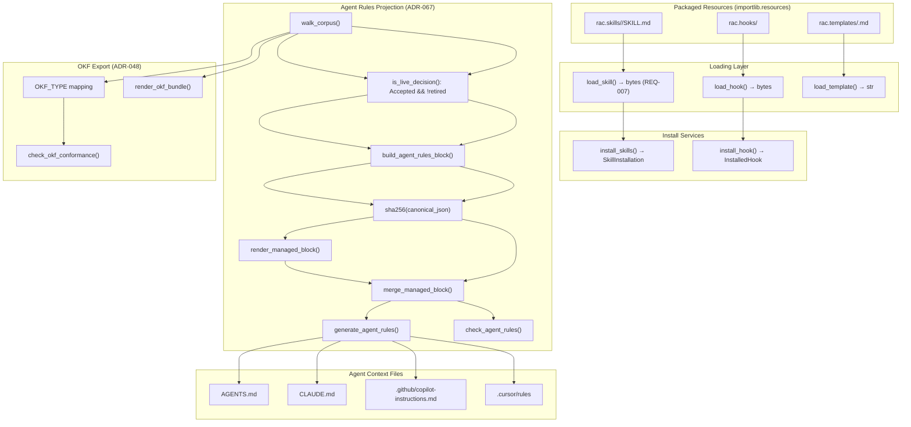
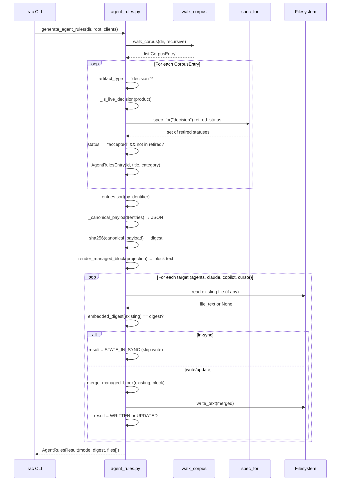

# 12-skills-agent-rules — RAC Skills System & Agent Rules Projection

RAC ships two complementary surfaces for AI agents: a **bundled skill system** that teaches agents how to use the RAC CLI, and an **agent rules projection** that distills live corpus decisions into managed blocks inside the agent's own context files. Together, they close the loop: skills tell the agent *how* to operate RAC, and agent rules tell the agent *what* the team has already decided.

Source: `/home/darkvoid/Boxxed/@formulas/src.rust/src.AI/src.Wayfinder/rac-core/src/rac/`

**Aha: The skills and agent rules share the same `importlib.resources` loading pattern as templates, creating a uniform packaging contract.** Skills ship under `rac.skills/<name>/SKILL.md`, templates ship under `rac.templates/<type>.md`, and hooks ship under `rac.hooks/<style>`. All three use the same `importlib.resources.files(...).joinpath(...)` loading mechanism, meaning installation works from an installed wheel without the dogfood repository, AI access, or network connectivity (ADR-021). This is a deliberate design choice: RAC is self-contained.

**Aha: The agent rules digest is a sha256 over the *canonical JSON* serialization of entries, not over the rendered Markdown block.** This means the same corpus state produces the same digest regardless of which target file the block is rendered into (AGENTS.md vs CLAUDE.md vs .cursor/rules). The digest depends only on corpus content, not on formatting. Two generations of the same corpus are byte-identical (ADR-002), so `--check` can compare digests without re-hashing file content.

## Bundled Skills System

### Registry: 5 Bundled Skills

Source: `rac-core/src/rac/core/skills.py:35-56`

The skills registry is a static tuple of `SkillSpec` dataclass instances, each carrying a `name` and one-line `description`. The registry order is deterministic and defines the install order.

```python
@dataclass(frozen=True)
class SkillSpec:
    """One bundled skill: its name and a one-line description."""
    name: str
    description: str

BUNDLED_SKILLS = (
    SkillSpec(
        name="rac-artifacts",
        description="Author and maintain Lore (RAC) Markdown artifacts with the rac CLI.",
    ),
    SkillSpec(
        name="rac-review",
        description="Review a Lore (RAC) corpus and work findings worst-first.",
    ),
    SkillSpec(
        name="rac-ingest",
        description="Convert legacy documents into valid, linked Lore (RAC) artifacts.",
    ),
    SkillSpec(
        name="rac-import",
        description="Reformat one document into one valid Lore (RAC) artifact, with human review.",
    ),
    SkillSpec(
        name="rac-capture",
        description="Capture a new decision or requirement into a valid Lore (RAC) artifact.",
    ),
)
```

Each skill has a corresponding directory under `rac.skills/` containing a `SKILL.md` file:

```
rac/skills/
  rac-artifacts/SKILL.md
  rac-review/SKILL.md
  rac-ingest/SKILL.md
  rac-import/SKILL.md
  rac-capture/SKILL.md
```

The skills cover the full RAC lifecycle:

| Skill | Purpose | Lifecycle Phase |
|-------|---------|-----------------|
| `rac-artifacts` | Author and maintain RAC Markdown artifacts | Creation & maintenance |
| `rac-review` | Review corpus, work findings worst-first | Quality assurance |
| `rac-ingest` | Convert legacy documents (DOCX/PDF) into linked RAC artifacts | Migration |
| `rac-import` | Reformat one document into one valid RAC artifact with human review | Migration |
| `rac-capture` | Capture a new decision or requirement into a valid RAC artifact | Creation |

### Loading via `importlib.resources`

Source: `rac-core/src/rac/core/skills.py:89-103`

```python
def load_skill(skill_name: str) -> bytes:
    """Return the packaged ``SKILL.md`` content for ``skill_name``.

    Bytes, not text: the installed file must be byte-identical to the
    packaged resource (REQ-007). Raises :class:`SkillNotFound` for
    unregistered names and :class:`SkillResourceMissing` when the packaged
    resource is absent.
    """
    if skill_name not in available_skills():
        raise SkillNotFound(skill_name)
    resource = resources.files("rac.skills").joinpath(skill_name, "SKILL.md")
    try:
        return resource.read_bytes()
    except FileNotFoundError as exc:
        raise SkillResourceMissing(skill_name) from exc
```

The return type is `bytes` (not `str`) because **REQ-007** mandates byte-identical installation: the file written to disk must match the packaged resource exactly. This is enforced by `dest.write_bytes(contents[name])` in the install service.

### Two Failure Modes

The skill system deliberately separates two failure modes, mirroring the template system in `rac.core.templates`:

| Exception | Trigger | Severity | Exit Code | Meaning |
|-----------|---------|----------|-----------|---------|
| `SkillNotFound` | Unregistered skill name | Caller error | Exit 2 | Usage error — skill name not in registry |
| `SkillResourceMissing` | Registered skill, missing resource file | Operational | Exit 1 | Broken RAC installation — registry entry exists but package file is absent |

Source: `rac-core/src/rac/core/skills.py:59-76`

```python
class SkillNotFound(RACError):
    """The requested skill is not in the bundled registry (usage error)."""

    def __init__(self, skill_name: str):
        self.skill_name = skill_name
        super().__init__(
            f"unknown skill: {skill_name} (available: {', '.join(available_skills())})"
        )


class SkillResourceMissing(RACError):
    """A registered skill's packaged resource is absent (operational error)."""

    def __init__(self, skill_name: str):
        self.skill_name = skill_name
        super().__init__(
            f"packaged skill missing: {skill_name}; the RAC installation appears to be broken"
        )
```

The error message for `SkillNotFound` helpfully lists available skills — a usability feature for the CLI. The `SkillResourceMissing` message tells the user the installation is broken, pointing them toward re-installation.

This mirrors the template system exactly (`TemplateNotFound` vs `TemplateResourceMissing` in `rac.core.templates:24-43`), establishing a consistent pattern across all three resource types: skills, templates, and hooks. See [10-error-handling.md](10-error-handling.md) for the full exit code contract.

### Skill Installation Service

Source: `rac-core/src/rac/services/skill.py:78-115`

```python
def install_skills(target_dir: str, skill_name: str | None = None) -> SkillInstallation:
    """Write bundled skills into ``target_dir``'s Claude Code skill path.

    With ``skill_name`` ``None`` every bundled skill is installed,
    all-or-nothing: every target path is checked first, and if any exists the
    whole installation is refused with nothing written. With a name exactly
    that skill is installed. Parent directories are created as needed; an
    existing skill file is never overwritten.
    """
```

The installation follows a **load-first, check-second, write-third** pattern that guarantees all-or-nothing semantics:

1. **Load phase**: Every resource is loaded first (validates the installation cheaply)
2. **Check phase**: Every target path is checked for existence
3. **Write phase**: Only if all checks pass are files written

If any target file already exists, `SkillFileExists` is raised with all existing paths reported and nothing written. RAC never overwrites existing skill files — the user must manually remove them first.

Target layout: `<target_dir>/.claude/skills/<skill-name>/SKILL.md` (the Claude Code project-level discovery path).

```python
destinations = {
    name: Path(target_dir) / ".claude" / "skills" / name / "SKILL.md" for name in names
}
```

The `SkillInstallation` result carries a stable JSON contract (ADR-007):

```python
@dataclass
class SkillInstallation:
    """Result of a `rac skill install` run (stable JSON contract, ADR-007)."""
    skills: list[InstalledSkill]

    def to_dict(self) -> dict:
        return {
            "schema_version": "1",
            "installed": True,
            "skills": [skill.to_dict() for skill in self.skills],
        }
```

## Agent Rules Projection

The agent rules projection (`rac export --agent-rules [--check]`) distills the live corpus into a small, stable "managed block" embedded in per-client agent-context files. Governed by **ADR-067**.

### Core Design Principles (ADR-067)

1. **Distilled, not whole corpus**: One pointer line per live decision (identifier + title, optional category) — the "what did we already decide / what is ruled out" digest. Decision bodies are never inlined; the agent reaches the `lore` MCP tools for ground truth.

2. **"Live" is structural**: A decision is live when its `## Status` is *Accepted* and it is not retired (Superseded/Deprecated). Retired states come from the type spec (`spec.retired_status`), so the rule is spec-driven, never a hard-coded set.

3. **Drift-guarded**: The block embeds a provenance digest (sha256 over the canonical projection). `--check` re-derives the digest from the live corpus and fails when a committed file's embedded digest differs or is absent.

### Liveness Detection

Source: `rac-core/src/rac/services/agent_rules.py:186-209`

```python
def _is_live_decision(entry_product: Product) -> bool:
    """True when a decision is Accepted and not retired (Superseded/Deprecated).

    Spec-driven retirement (ADR-051): retired states come from the decision
    spec, so the rule honours every retired status the type declares rather than
    a hard-coded pair. Structural only — no semantics.
    """
    status = _first_status_line(entry_product)
    if status != _LIVE_STATUS:
        return False
    spec = spec_for(_DECISION_TYPE)
    retired = {s.casefold() for s in (spec.retired_status if spec else ())}
    return status not in retired


def is_live_decision(product: Product) -> bool:
    """Public liveness predicate — Accepted and not retired (ADR-067, ADR-051)."""
    return _is_live_decision(product)
```

The liveness check is the single source of truth shared between the agent-rules projection and the live decision query (`find_decisions`), so the two surfaces can never disagree on what is settled. Status reading is structural: it reads the first non-empty line of `## Status` and does a casefolded string match against `"accepted"`. No semantic judgment enters the engine.

### Managed Block Markers

Source: `rac-core/src/rac/services/agent_rules.py:61-63`

```python
_BEGIN_PREFIX = "<!-- BEGIN RAC MANAGED BLOCK (digest: "
_BEGIN_SUFFIX = ") -->"
_END_MARKER = "<!-- END RAC MANAGED BLOCK -->"
```

HTML comments are used because they survive Markdown rendering — the block stays invisible in a rendered CLAUDE.md while remaining machine-locatable. The BEGIN marker carries the provenance digest so `--check` can read it without re-deriving the file's own content hash.

A rendered block looks like:

```markdown
<!-- BEGIN RAC MANAGED BLOCK (digest: a1b2c3d4e5f6...) -->
<!-- Managed by `rac export --agent-rules`. Edit decisions in rac/, not here;
 content outside this block is preserved. -->
## Settled decisions (RAC)

These decisions are already accepted. Do not re-open or contradict them;
 ask the `lore` MCP tools (`get_artifact`, `search_artifacts`) for the
 full text before proposing a change that touches one.

- **DEC-001** — Use PostgreSQL over SQLite for production
- **DEC-003** — API versioning via URL path _(architecture)_
<!-- END RAC MANAGED BLOCK -->
```

### Four Target Files

Source: `rac-core/src/rac/services/agent_rules.py:91-96`

```python
TARGETS: tuple[AgentRulesTarget, ...] = (
    AgentRulesTarget("agents", "AGENTS.md"),
    AgentRulesTarget("claude", "CLAUDE.md"),
    AgentRulesTarget("copilot", ".github/copilot-instructions.md"),
    AgentRulesTarget("cursor", ".cursor/rules"),
)
```

| Client Selector | Target Path | Format |
|-----------------|-------------|--------|
| `agents` | `AGENTS.md` | Markdown |
| `claude` | `CLAUDE.md` | Markdown |
| `copilot` | `.github/copilot-instructions.md` | Markdown |
| `cursor` | `.cursor/rules` | Plain rules file |

The order is deterministic (by selector), so output never depends on argument order. `targets_for(clients)` resolves `--client` selectors to targets; unknown selectors are caught by `unknown_clients()` and turned into usage errors.

### Drift-Guarded Mechanism: `--check` vs Generate

Source: `rac-core/src/rac/services/agent_rules.py:283-296`

```python
def embedded_digest(file_text: str) -> str | None:
    """The digest carried in a file's BEGIN marker, or ``None`` when no block.

    Reads only the marker, never re-hashes the file — the cheap comparison the
    ``--check`` drift gate relies on.
    """
    start = file_text.find(_BEGIN_PREFIX)
    if start == -1:
        return None
    after = start + len(_BEGIN_PREFIX)
    end = file_text.find(_BEGIN_SUFFIX, after)
    if end == -1:
        return None
    return file_text[after:end].strip() or None
```

The `--check` mode never writes. It reads the digest from the file's BEGIN marker, derives the fresh projection digest from the live corpus, and compares the two. This is a cheap string comparison — no file re-hashing.

**Generate mode** (`generate_agent_rules`): Writes the managed block if the embedded digest differs from the fresh projection. Skips writes when the file is already in sync (idempotent, byte-stable).

**Check mode** (`check_agent_rules`): Only compares. Returns `result.drifted = True` when any target is stale or missing — the caller exits non-zero to fail CI.

### File Result States

Source: `rac-core/src/rac/services/agent_rules.py:329-333`

```python
STATE_WRITTEN = "written"  # the file did not exist; created with the block
STATE_UPDATED = "updated"  # the file existed; its managed block changed
STATE_IN_SYNC = "in-sync"  # the file's embedded digest already matches
STATE_STALE = "stale"  # (--check) embedded digest differs from the corpus
STATE_MISSING = "missing"  # (--check) the file or its managed block is absent
```

| State | Generate | Check | Meaning |
|-------|----------|-------|---------|
| `written` | File created | N/A | Target did not exist; block written |
| `updated` | Block replaced | N/A | Target existed; embedded digest differed |
| `in-sync` | No write | Pass | Embedded digest matches live projection |
| `stale` | N/A | Fail | Embedded digest differs from live corpus |
| `missing` | N/A | Fail | Target file or managed block absent |

`AgentRulesFileResult` carries per-file outcomes in deterministic order; `AgentRulesResult` carries the overall run result with `drifted` property for the CI gate.

### `merge_managed_block`: Preserving User Content

Source: `rac-core/src/rac/services/agent_rules.py:299-323`

```python
def merge_managed_block(existing: str | None, block: str) -> str:
    """Splice ``block`` into ``existing``, preserving everything outside the markers.

    When the file already has a managed block, only that span is replaced — the
    user's own prose before and after is kept byte-for-byte. When there is no
    block, the new one is appended after the existing content (or stands alone in
    a fresh file). The result always ends with a single trailing newline.
    """
```

The merge algorithm:

1. **Empty or missing existing**: Return the block with a trailing newline.
2. **Existing block found**: Replace only the span between BEGIN and END markers. Content before BEGIN and after END is preserved byte-for-byte.
3. **No existing block**: Append the block after existing content, separated by a blank line.

This ensures that user-written instructions in CLAUDE.md (like "always use TypeScript" or "never use eval") outside the managed block remain untouched.

### Canonical Payload and Digest

Source: `rac-core/src/rac/services/agent_rules.py:212-223`

```python
def _canonical_payload(entries: list[AgentRulesEntry]) -> str:
    """Canonical, formatting-independent serialization the digest hashes.

    ``sort_keys`` + ``separators`` pin byte-for-byte stability; the entries are
    already ordered by identifier, so the digest depends only on corpus content.
    """
    return json.dumps(
        [entry.to_dict() for entry in entries],
        sort_keys=True,
        separators=(",", ":"),
        ensure_ascii=False,
    )
```

The digest is `sha256(canonical_payload).hexdigest()` — compact JSON with no whitespace, sorted keys, and `ensure_ascii=False`. This guarantees that the same corpus state produces the same digest bytes, regardless of rendering target or environment.

## OKF (Open Knowledge Format) Integration

The agent rules projection and OKF bundle export are complementary outputs from the same corpus. OKF is the full export format; agent rules are the lightweight distilled view for AI agents.

### Type Mapping

Source: `rac-core/src/rac/core/okf.py:15-21`

```python
OKF_TYPE = {
    "requirement": "Requirement",
    "decision": "ADR",
    "design": "Design",
    "roadmap": "Roadmap",
    "prompt": "Prompt",
}
```

Five enumerated RAC types map one-to-one to OKF types. A registered RAC type absent from this mapping is an OKF conformance error, never a silent drop from the bundle.

### Reserved Filenames

Source: `rac-core/src/rac/core/okf.py:28`

```python
RESERVED_FILENAMES = ("index.md", "log.md")
```

OKF reserves `index.md` for progressive disclosure and `log.md` for chronological history. A typed artifact at one of these paths collides with the generated bundle file (conformance error); an untyped document at these paths is a legitimate reserved entry point and is left alone (ADR-010).

### OKF Conformance Gate

Source: `rac-core/src/rac/services/okf_conformance.py:79-127`

The write-time conformance check (`check_okf_conformance`) runs over an already-walked corpus and produces two finding codes:

- **`okf-unmapped-type`**: A typed RAC artifact whose `type` has no OKF mapping. Guards future type additions — a new type without an OKF mapping fails here instead of being silently excluded from the bundle.
- **`okf-reserved-filename-collision`**: A typed artifact whose filename is `index.md` or `log.md`, colliding with generated bundle entry points.

Severity overrides (ADR-053) may downgrade findings to warning or suppress them entirely during onboarding, so a team can incrementally achieve conformance.

### OKF Bundle Structure

Source: `rac-core/src/rac/output/okf.py:150-171`

```python
def render_okf_bundle(export: CorpusExport, recency: RecencyReport, root: str) -> dict[str, str]:
    """Project a corpus export as an OKF bundle (``{relative path: contents}``).

    One file per typed artifact at its path relative to ``root`` (the exported
    corpus directory), plus ``index.md`` and ``log.md`` at the bundle root. Pure
    and deterministic given the same ``export`` and ``recency``.
    """
```

The OKF bundle is a `{relative path: file contents}` mapping:

```
bundle/
  index.md          # Generated progressive disclosure index
  log.md            # Generated chronological history (git-derived dates)
  decisions/DEC-001.md   # Projected artifact with OKF front matter
  requirements/REQ-001.md
  ...
```

Each artifact file gets OKF-reserved front matter (`type`, `id`), optionally `created`/`updated` from git (ADR-045), `tags` from source frontmatter, the body (with frontmatter stripped), and a derived `# Citations` section from resolved relationships.

The bundle is deterministic (ADR-002): artifacts in sorted-path order, citations ordered explicitly, `log.md` grouped by commit date (newest first) then path.

## Skill/Hook Installation Parallelism

The skill installation and hook installation services share the same architectural pattern, establishing a uniform resource-loading posture across RAC.

| Aspect | Skills | Hooks | Templates |
|--------|--------|-------|-----------|
| Package path | `rac.skills/<name>/SKILL.md` | `rac.hooks/<style>` | `rac.templates/<type>.md` |
| Load function | `load_skill(name)` → `bytes` | `load_hook(style)` → `bytes` | `load_template(type)` → `str` |
| Not-found error | `SkillNotFound` (exit 2) | `HookNotFound` (exit 2) | `TemplateNotFound` (exit 2) |
| Missing-resource error | `SkillResourceMissing` | `HookResourceMissing` | `TemplateResourceMissing` |
| Exists error | `SkillFileExists` | `HookFileExists` | N/A (templates render to stdout) |
| Load mechanism | `importlib.resources` | `importlib.resources` | `importlib.resources` |
| Never overwrites | Yes | Yes | N/A |

This parallelism is a deliberate ADR-021 design: all three resource types use the same `importlib.resources.files(...).joinpath(...).read_bytes()` loading, the same "check before write" posture, and the same "never overwrite" rule. The hook service additionally sets the executable bit via `stat.S_IXUSR | stat.S_IXGRP | stat.S_IXOTH` (see `rac-core/src/rac/services/hook.py:87`).

## System Architecture Diagram



## Agent Rules Generation and Check Flow



## Key Cross-References

- **[00-overview.md](00-overview.md)** — Wayfinder/RAC architecture at a glance, all 7 sub-projects
- **[01-architecture.md](01-architecture.md)** — Layers, modules, Product AST, artifact types
- **[02-rac-core.md](02-rac-core.md)** — CLI, services, validation, relationships, watchkeeper (agent_rules listed in Services layer)
- **[09-data-flow.md](09-data-flow.md)** — Full request lifecycle, export pipeline, OKF bundle generation
- **[10-error-handling.md](10-error-handling.md)** — Exit code contract (exit 0/1/2), error types, `SkillNotFound` maps to exit 2

## Aha Moments

**The agent rules block is a read-only projection, not a source of truth.** When an AI agent sees a settled decision in its CLAUDE.md, the actual ground truth lives in the RAC corpus. The block is a distilled pointer — the agent is instructed to use the `lore` MCP tools (`get_artifact`, `search_artifacts`) for full text before proposing changes. This keeps the context file small while maintaining access to the full decision record.

**Drift detection uses the projection digest, not a file hash.** If the corpus hasn't changed, the digest hasn't changed, regardless of what else might have been edited in CLAUDE.md. This means `--check` only fails when the corpus has evolved and the agent context file hasn't been updated — not when the user edited their own instructions outside the managed block. The merge algorithm preserves user content byte-for-byte, so drift only captures corpus-corpus divergence.

**The retirement set is spec-driven, not hard-coded.** Instead of writing `retired = {"superseded", "deprecated"}`, the code asks `spec_for("decision").retired_status`. This means if a new artifact type declares its own retired statuses, the same liveness predicate works automatically. The same relationship validation already uses this pattern (ADR-051), so there is one source of truth for what "retired" means per type.
