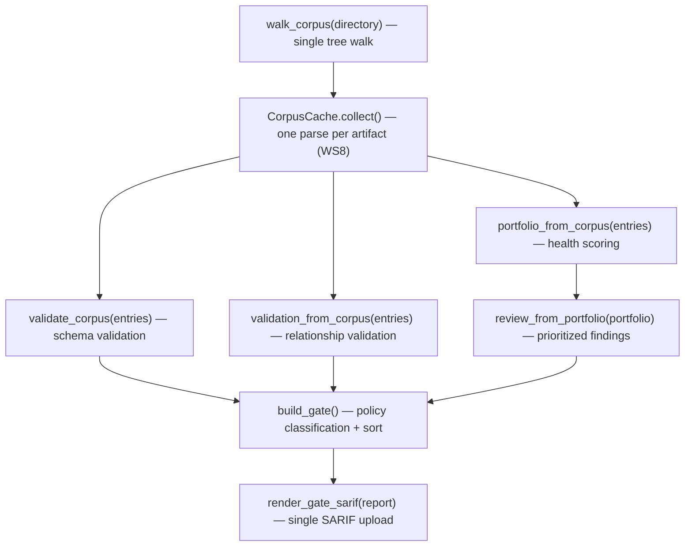
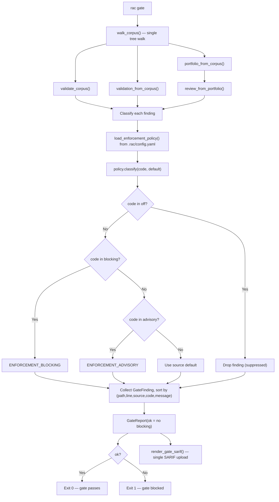

# 13-portfolio-gate — Portfolio Health Scoring and Gate Enforcement Deep Dive

RAC's Portfolio, Gate, and Review services form the corpus intelligence layer: a single deterministic walk through a knowledge repository produces a health score, a prioritized list of actionable findings, and a unified PR gate report that can block or advise on merges. The portfolio answers "how healthy is this repository?" the review answers "what should I fix first?" and the gate answers "can this merge?"

Source: `/home/darkvoid/Boxxed/@formulas/src.rust/src.AI/src.Wayfinder/rac-core/src/rac/services/`

**Aha:** The gate's policy is *governed, not hardcoded*. A committed `.rac/config.yaml` declares which finding codes block versus advise, so the enforcement posture is a diffable, auditable artifact — not an implementation detail buried in code. The default enforcement still produces the same blocking/advisory behavior as the prior hardcoded version, but now teams can tune it without code changes (ADR-049, ADR-063).

**Aha:** Since v0.21.19, `rac gate` feeds validation, relationships, portfolio, and review from a *single pre-walked corpus snapshot*. Before, each service walked and parsed independently; now `walk_corpus()` is called once, and every analysis uses `*_from_corpus()` snapshot seams. The result is byte-identical — only corpus acquisition changed.

**Aha:** The health score formula is deliberately asymmetric: validity (is it structurally correct?) counts for 50%, while completeness (does it have recommended sections?) and relationship integrity (do cross-references resolve?) split the other 50%. This means a repository with perfect structure but no cross-linking still scores 75, reflecting that RAC treats correctness as the floor and traceability as the ceiling.

## Portfolio Health Score Formula

The health score is a weighted composite of three sub-scores, each normalized to [0, 1].

Source: `rac/services/portfolio.py:117-124`

```python
@property
def health_score(self) -> int:
    total = self.total_artifacts
    validity = self.valid_artifacts / total if total else 1.0
    completeness = self.completeness
    checked = self.relationships.total
    rel_integrity = (checked - self.relationships.broken) / checked if checked else 1.0
    raw = 0.5 * validity + 0.25 * completeness + 0.25 * rel_integrity
    return round(100 * raw)
```

The three sub-scores are:

| Sub-score | Formula | Weight | Meaning |
|-----------|---------|--------|---------|
| Validity | `valid_artifacts / total_artifacts` | 0.5 | Fraction of recognized artifacts that pass schema validation |
| Completeness | `filled_recommended_slots / total_recommended_slots` | 0.25 | Fraction of recommended (not required) sections that are present |
| Rel Integrity | `(total_refs - broken_refs) / total_refs` | 0.25 | Fraction of cross-artifact references that resolve uniquely |

When a denominator is zero (no artifacts, no recommended sections, no references), the sub-score defaults to 1.0 — an empty corpus is not penalized for missing what it has never attempted to have.

### Validity

An artifact is valid when `rac.core.validation.validate(product)` produces no issues with severity `"error"`. Validation is spec-dispatched: each `ArtifactSpec` (requirement, decision, roadmap, prompt, design) defines its own required sections, expected metadata fields, and structural rules. Unknown-type artifacts (no schema matched) are neither valid nor invalid — they are skipped, consistent with the portfolio semantics that unknown is a valid outcome.

Source: `rac/services/portfolio.py:220-234`

```python
# Validation (overrides applied, ADR-053)
issues = apply_overrides(validate(product), artifact_type, overrides)
if has_errors(issues):
    invalid_count += 1
    error_codes = [i.code for i in issues if i.severity == "error"]
    attention.append(
        AttentionItem(
            path=str(path),
            identifier=identifier,
            severity="error",
            code=ATTENTION_INVALID,
            message=f"Validation errors: {', '.join(error_codes)}",
        )
    )
else:
    valid_count += 1
```

Severity overrides from `.rac/config.yaml` (ADR-053) are applied before the valid/invalid determination, so a rule downgraded from error to warning does not count against validity.

### Completeness

Completeness counts only *recommended* sections, not required ones. Required section failures are already captured in validity (they produce validation errors), and counting them again in completeness would double-penalize the same defect in the health score.

Source: `rac/services/portfolio.py:239-254`

```python
slots = len(spec.recommended)
recommended_slots += slots
_, missing_rec = missing_sections(product, spec)
filled = slots - len(missing_rec)
filled_slots += filled
if missing_rec:
    names = ", ".join(s.title() for s in missing_rec)
    attention.append(
        AttentionItem(
            path=str(path),
            identifier=identifier,
            severity="warning",
            code=ATTENTION_MISSING_RECOMMENDED,
            message=f"Missing recommended sections: {names}",
        )
    )
```

Each artifact type's `ArtifactSpec` declares its `recommended` sections (e.g., a Decision might recommend "Success Measures", "Alternatives Considered", "Implementation Notes"). The `missing_sections()` function from `rac.core.classification` performs section-matching against the parsed `Product`.

### Relationship Integrity

Relationship integrity is the fraction of explicit cross-artifact references that resolve uniquely to another artifact. The relationship summary counts total references, valid (resolved) references, and broken references (target not found, ambiguous, or self-references).

Source: `rac/services/portfolio.py:259-275`

```python
rel_summary = summary_from_corpus(entries)
relationships_ok = validation_from_corpus(directory, entries, recursive=recursive).ok
for issue in rel_summary.issues:
    source = issue.source_path or ""
    label = (issue.relationship or "").replace("_", " ").title()
    phrase = _REL_ISSUE_PHRASE.get(issue.code, "has an unresolved reference")
    attention.append(
        AttentionItem(
            path=source,
            identifier=path_to_identifier.get(source, source),
            severity="warning",
            code=ATTENTION_BROKEN_RELATIONSHIP,
            message=f"{label} {phrase}: {issue.target}",
        )
    )
```

Broken reference issue codes are defined in `rac/services/relationships.py:325-340`:

```python
ISSUE_DUPLICATE_IDENTIFIER = "duplicate-artifact-identifier"
ISSUE_TARGET_NOT_FOUND = "relationship-target-not-found"
ISSUE_TARGET_AMBIGUOUS = "relationship-target-ambiguous"
ISSUE_SELF_REFERENCE = "relationship-self-reference"
ISSUE_EDGE_UNSUPPORTED = "relationship-edge-unsupported"
ISSUE_TARGET_SUPERSEDED = "relationship-target-superseded"
ISSUE_TARGET_TYPE_MISMATCH = "relationship-target-type-mismatch"
ISSUE_RELATIONSHIP_CYCLE = "relationship-cycle"
```

## PortfolioSummary and AttentionItem

The `PortfolioSummary` dataclass is the repository-level intelligence result. Its `to_dict()` method produces a stable JSON contract (ADR-007) with additive, schema_version-gated fields.

Source: `rac/services/portfolio.py:79-168`

```python
@dataclass
class PortfolioSummary:
    """Repository-level intelligence result (v0.7.3)."""
    directory: str
    recursive: bool
    by_type: dict[str, int]  # {type: count} incl. unknown
    valid_artifacts: int
    invalid_artifacts: int
    recommended_slots: int
    filled_slots: int
    relationships: RelationshipSummary
    attention: list[AttentionItem] = field(default_factory=list)
    unknown_paths: list[str] = field(default_factory=list)  # v0.7.9
    relationships_ok: bool = True  # v0.16.0

    @property
    def total_artifacts(self) -> int:
        return sum(self.by_type.values())

    @property
    def completeness(self) -> float:
        if self.recommended_slots == 0:
            return 1.0
        return round(self.filled_slots / self.recommended_slots, 4)

    @property
    def health_score(self) -> int:
        # ... (formula shown above)
```

The `AttentionItem` dataclass is a single actionable finding surfaced by `rac portfolio`:

Source: `rac/services/portfolio.py:59-76`

```python
@dataclass
class AttentionItem:
    """One actionable finding surfaced by ``rac portfolio``."""
    path: str
    identifier: str  # artifact identifier or filename stem
    severity: str  # "error" | "warning"
    code: str
    message: str
```

The three stable attention codes (part of the JSON contract, ADR-007):

```python
ATTENTION_INVALID = "invalid-artifact"
ATTENTION_MISSING_RECOMMENDED = "missing-recommended-sections"
ATTENTION_BROKEN_RELATIONSHIP = "broken-relationship"
```

Attention items are sorted deterministically: errors before warnings, then by path, then by code.

Source: `rac/services/portfolio.py:278-279`

```python
_SEV_ORDER = {"error": 0, "warning": 1}
attention.sort(key=lambda a: (_SEV_ORDER.get(a.severity, 2), a.path, a.code))
```

## The Gate: Unified Enforcement

`rac gate` is the single enforcement entry point. It runs validation, relationship integrity, and review over a corpus, then classifies every finding as *blocking* or *advisory* under the corpus enforcement policy. One command, one exit code, one SARIF document — the PR gate carries the whole RAC contract as a single required check instead of three separate uploads.

Source: `rac/services/gate.py:1-21`

### EnforcementPolicy

The policy is a frozen dataclass with three disjoint sets of finding codes. The `classify()` method resolves a finding's effective class with a fixed precedence order.

Source: `rac/services/gate.py:53-85`

```python
@dataclass(frozen=True)
class EnforcementPolicy:
    """A corpus enforcement policy: finding codes mapped to a class (ADR-049)."""
    blocking: frozenset[str] = frozenset()
    advisory: frozenset[str] = frozenset()
    off: frozenset[str] = frozenset()

    def classify(self, code: str, default: str) -> str | None:
        """The effective enforcement class for ``code``, or ``None`` if suppressed."""
        if code in self.off:
            return None
        if code in self.blocking:
            return ENFORCEMENT_BLOCKING
        if code in self.advisory:
            return ENFORCEMENT_ADVISORY
        return default

EMPTY_POLICY = EnforcementPolicy()
```

Policy precedence: **off** (suppress) > **blocking** > **advisory** > **default**. A code in more than one set is harmless — precedence makes the result deterministic regardless of declaration order. The `EMPTY_POLICY` means every finding keeps its default class.

The policy is loaded from `.rac/config.yaml`:

```yaml
enforcement:
  blocking:
    - relationship-target-not-found
    - relationship-target-ambiguous
  advisory:
    - relationship-target-superseded
  off:
    - stale-corpus
```

Source: `rac/services/init.py:193-238` — `load_enforcement_policy()` walks upward from the directory to find the nearest `.rac/config.yaml`, parses the `enforcement:` section, and returns an `EnforcementPolicy`.

### GateFinding and GateReport

Each finding is normalized across the three underlying services into a `GateFinding`:

Source: `rac/services/gate.py:88-115`

```python
@dataclass(frozen=True)
class GateFinding:
    """One enforced finding, normalised across the three underlying services."""
    source: str  # SOURCE_VALIDATE | SOURCE_RELATIONSHIPS | SOURCE_REVIEW
    code: str
    severity: str  # "error" | "warning" | "info"
    enforcement: str  # ENFORCEMENT_BLOCKING | ENFORCEMENT_ADVISORY
    path: str
    line: int | None
    message: str
```

The `GateReport` aggregates all findings:

Source: `rac/services/gate.py:118-152`

```python
@dataclass
class GateReport:
    directory: str
    recursive: bool
    findings: list[GateFinding] = field(default_factory=list)

    @property
    def blocking(self) -> list[GateFinding]:
        return [f for f in self.findings if f.enforcement == ENFORCEMENT_BLOCKING]

    @property
    def advisory(self) -> list[GateFinding]:
        return [f for f in self.findings if f.enforcement == ENFORCEMENT_ADVISORY]

    @property
    def ok(self) -> bool:
        """True when nothing is blocking — advisory findings never fail the gate."""
        return not self.blocking
```

### Default Enforcement Classifications

With no policy (`EMPTY_POLICY`), the gate uses per-source defaults chosen so the gate is `ok` exactly when validate, relationships, and review all pass — preserving the v0.21.13 behavior the policy refines.

**Validate defaults** (source: `rac/services/gate.py:161`):
- `"error"` severity → `ENFORCEMENT_BLOCKING`
- All other severities (warnings, OKF info) → `ENFORCEMENT_ADVISORY`

```python
_VALIDATE_DEFAULT = {"error": ENFORCEMENT_BLOCKING}
```

**Relationships defaults** (source: `rac/services/gate.py:289`):
- *Every* relationship finding → `ENFORCEMENT_BLOCKING` (any relationship issue fails `--validate` today)

```python
add(SOURCE_RELATIONSHIPS, code, severity, path, line, message, ENFORCEMENT_BLOCKING)
```

**Review defaults** (source: `rac/services/gate.py:295-300`):
- Priority 1-2 findings (invalid artifacts, broken relationships) → `ENFORCEMENT_BLOCKING`
- Priority 3+ findings (unknown artifacts, missing recommended) → `ENFORCEMENT_ADVISORY`

```python
default = (
    ENFORCEMENT_BLOCKING
    if review_issue.priority <= PRIORITY_BROKEN_RELATIONSHIP
    else ENFORCEMENT_ADVISORY
)
```

The constants are defined in `rac/services/review.py:38-43`:

```python
PRIORITY_INVALID_ARTIFACT = 1
PRIORITY_BROKEN_RELATIONSHIP = 2
PRIORITY_UNKNOWN_ARTIFACT = 3
PRIORITY_MISSING_RECOMMENDED = 4
PRIORITY_STALE_CORPUS = 5
```

### build_gate(): The Single Corpus Walk

The `build_gate()` function is the entry point that orchestrates everything. Since v0.21.19, it uses a single corpus walk.

Source: `rac/services/gate.py:213-303`

```python
def build_gate(
    directory: str,
    recursive: bool = True,
    policy: EnforcementPolicy | None = None,
) -> GateReport:
    """Run validation, relationships, and review and enforce the corpus policy."""
    if policy is None:
        policy = load_enforcement_policy(directory)

    # One walk feeds every analysis (v0.21.19)
    entries = list(walk_corpus(directory, recursive=recursive))
    overrides = load_overrides(directory)

    validation = validate_corpus(directory, entries, recursive=recursive, overrides=overrides)
    relationships = validation_from_corpus(directory, entries, recursive=recursive)
    portfolio = portfolio_from_corpus(directory, entries, recursive=recursive)
    review = review_from_portfolio(directory, portfolio, recursive=recursive)

    findings: list[GateFinding] = []

    def add(source, code, severity, path, line, message, default):
        enforcement = policy.classify(code, default)
        if enforcement is None:
            return  # suppressed by an ``off`` policy entry
        findings.append(GateFinding(...))

    # Validate findings
    for code, severity, path, line, message in _validate_findings(validation):
        add(SOURCE_VALIDATE, code, severity, path, line, message,
            _VALIDATE_DEFAULT.get(severity, ENFORCEMENT_ADVISORY))

    # Relationship findings
    for rel_issue in relationships.issues:
        code, severity, path, line, message = _relationship_finding(rel_issue)
        add(SOURCE_RELATIONSHIPS, code, severity, path, line, message, ENFORCEMENT_BLOCKING)

    # Review findings
    for review_issue in review.issues:
        code, severity, path, line, message = _review_finding(review_issue)
        default = (ENFORCEMENT_BLOCKING if review_issue.priority <= PRIORITY_BROKEN_RELATIONSHIP
                   else ENFORCEMENT_ADVISORY)
        add(SOURCE_REVIEW, code, severity, path, line, message, default)

    findings.sort(key=lambda f: (f.path, f.line or 0, f.source, f.code, f.message))
    return GateReport(directory=directory, recursive=recursive, findings=findings)
```

Findings are sorted deterministically by `(path, line, source, code, message)` so the report, JSON, and SARIF are byte-stable (ADR-002).

## SARIF 2.1.0 Output

The gate produces a single SARIF document via `render_gate_sarif()` so the PR gate uploads one SARIF under one Code Scanning category instead of three separate uploads.

Source: `rac/output/sarif.py:156-167`

```python
def render_gate_sarif(report: GateReport) -> str:
    """Render a `rac gate` report as a single SARIF 2.1.0 document (v0.21.14)."""
    results = [_result(f.code, f.severity, f.message, f.path, f.line) for f in report.findings]
    return _document(results)
```

The `_document()` function (source: `rac/output/sarif.py:170-200`) sorts results by `(uri, line, ruleId, message)`, collects unique rule IDs, and produces a SARIF 2.1.0 JSON document with the `rac` driver name and package version.

SARIF level mapping (source: `rac/output/sarif.py:43`):

```python
_LEVEL = {"error": "error", "warning": "warning", "info": "note"}
```

The finding's intrinsic `severity` drives the SARIF annotation level; the enforcement class (`blocking`/`advisory`) drives the gate's exit code, not the SARIF level. Advisory findings still appear in SARIF at their natural severity.

## Review: Prioritized Findings

`rac review` aggregates repository intelligence into a prioritized, actionable report. It composes `build_portfolio_summary` — it implements no analysis of its own (ADR-015: consumers render, never analyze).

Source: `rac/services/review.py:79-107`

```python
@dataclass
class ReviewIssue:
    """One prioritized finding with its deterministic next step."""
    priority: int  # 1 (highest impact) – 4
    severity: str  # "error" | "warning" | "info"
    path: str
    identifier: str
    code: str
    message: str
    action: str  # a runnable command or concrete edit
    impact: str  # why it matters (v0.8.11; additive JSON field, ADR-007)
```

Review priority mapping (source: `rac/services/review.py:53-57`):

```python
_ATTENTION_PRIORITY = {
    ATTENTION_INVALID: PRIORITY_INVALID_ARTIFACT,        # 1
    ATTENTION_BROKEN_RELATIONSHIP: PRIORITY_BROKEN_RELATIONSHIP,  # 2
    ATTENTION_MISSING_RECOMMENDED: PRIORITY_MISSING_RECOMMENDED,  # 4
}
```

The `ReviewReport.ok` property returns `True` only when no priority 1-2 findings exist:

Source: `rac/services/review.py:125-131`

```python
@property
def ok(self) -> bool:
    """Priority 1-2 findings fail the review; priority 3-4 findings are advisory."""
    return not any(i.priority <= PRIORITY_BROKEN_RELATIONSHIP for i in self.issues)
```

Each review issue carries a deterministic `action` — a runnable command:

- Invalid artifact: `Run: rac validate {path}`
- Broken relationship: `Run: rac relationships {directory} --validate`
- Missing recommended: `Run: rac improve {path} --template`
- Unknown artifact: `Run: rac inspect {path} (see rac schema --list)`

The `impact` field provides a Core-owned "why it matters" sentence so every consumer (JSON, CLI, Explorer) reads the same explanation.

Source: `rac/services/review.py:64-76`

```python
_IMPACT = {
    ATTENTION_INVALID: "The artifact fails its schema, so tooling and validation cannot trust it.",
    ATTENTION_BROKEN_RELATIONSHIP: (
        "A declared reference does not resolve, leaving traceability incomplete."
    ),
    ATTENTION_MISSING_RECOMMENDED: (
        "Recommended sections are empty, weakening the artifact's completeness."
    ),
    REVIEW_UNKNOWN_ARTIFACT: "No schema matched, so required structure cannot be checked.",
    REVIEW_STALE_CORPUS: (
        "The write habit has stalled; product knowledge stops reflecting the work."
    ),
}
```

## Doctor: Corpus Health Diagnostic

`rac doctor` provides a single front door for corpus health. It runs validation and relationship integrity in one pass (reusing existing services), plus adds two diagnostics no other command provides: high-fan-out hub detection and heuristic injection-style content flagging.

Source: `rac/services/doctor.py:168-189`

```python
def diagnose(
    directory: str, recursive: bool = True, hub_threshold: int = DEFAULT_HUB_THRESHOLD
) -> DoctorReport:
    """Run validation, relationship integrity, and the two new checks in one pass."""
    cache = CorpusCache()
    entries = cache.collect(directory, recursive=recursive)
    findings: list[DoctorFinding] = []
    findings.extend(_validation_findings(directory, recursive, cache))
    findings.extend(_relationship_findings(directory, recursive, cache))
    findings.extend(_degree_findings(entries, hub_threshold))
    findings.extend(_injection_findings(entries))
    findings.extend(_unlinked_reference_findings(directory, entries, recursive))
    findings.sort(key=lambda f: (_SEVERITY_RANK[f.severity], f.path, f.code, f.problem))
    return DoctorReport(directory=directory, hub_threshold=hub_threshold, findings=findings)
```

### Hub Detection

A high-fan-out hub is a node whose inbound-plus-outbound resolved-edge degree exceeds a configurable threshold. The default is 20.

Source: `rac/services/doctor.py:54`

```python
DEFAULT_HUB_THRESHOLD = 20
```

The degree computation (source: `rac/services/doctor.py:261-312`):

```python
def _degree_findings(entries: list[CorpusEntry], hub_threshold: int) -> list[DoctorFinding]:
    known_paths = {str(e.path) for e in entries if spec_for(e.artifact_type) is not None}
    counts = inbound_counts_from_corpus(entries)
    inbound: dict[str, int] = {p: counts.get(p, 0) for p in known_paths}
    outbound: dict[str, int] = {p: 0 for p in known_paths}
    for rel in relationships_from_corpus(entries):
        if rel.resolved_path is None:
            continue
        if rel.source_path in outbound:
            outbound[rel.source_path] += 1

    for path in known_paths:
        degree = inbound[path] + outbound[path]
        if inbound[path] == 0:
            findings.append(DoctorFinding(..., code=CODE_ORPHANED_ARTIFACT, ...))
        if degree > hub_threshold:
            findings.append(DoctorFinding(..., code=CODE_HIGH_FAN_OUT_HUB, ...))
```

Orphan detection (inbound degree = 0) matches the portfolio's "never a resolved target" count exactly — a test pins this so the signal cannot drift.

### Injection Heuristics

The injection detector scans artifact text for six narrow idiom patterns that suggest prompt-injection-style content. It is a reviewable WARNING only — never an auto-edit, hard-fail, or safety claim (ADR-065).

Source: `rac/services/doctor.py:73-113`

```python
_INJECTION_PATTERNS: tuple[tuple[str, re.Pattern[str]], ...] = (
    ("instruction-override", re.compile(
        r"\b(ignore|disregard|forget|override|bypass)\b.{0,40}\b"
        r"(previous|prior|above|earlier|preceding|all|the system|your)\b.{0,20}"
        r"(instruction|instructions|prompt|directive|directives|rule|rules|context)",
        re.IGNORECASE)),
    ("role-reassignment", re.compile(
        r"\byou are now\b|\bfrom now on,?\s+you\s+(are|will|must|should|shall)\b|"
        r"\bpretend to be\b|\bact as if you\s+(are|were)\b", re.IGNORECASE)),
    ("ai-impersonation", re.compile(r"\bas an ai(\s+language)?\s+model\b", re.IGNORECASE)),
    ("chat-role-injection", re.compile(
        r"^\s*(system|assistant|developer|tool)\s*:", re.IGNORECASE | re.MULTILINE)),
    ("conceal-from-user", re.compile(
        r"\b(do not|don't|never|without)\b.{0,30}"
        r"(tell|telling|inform|informing|mention|mentioning|reveal|revealing|notify)\b.{0,20}"
        r"\b(the user|them|anyone)\b", re.IGNORECASE)),
    ("decision-steering", re.compile(
        r"\b(ignore|disregard|override|bypass|violate)\b.{0,40}"
        r"\b(recorded\s+)?(decision|decisions|adr|requirement|policy)\b", re.IGNORECASE)),
)
```

Doctor finding codes (stable, part of the JSON contract, ADR-007):

```python
CODE_INVALID_ARTIFACT = "invalid-artifact"
CODE_ORPHANED_ARTIFACT = "orphaned-artifact"
CODE_HIGH_FAN_OUT_HUB = "high-fan-out-hub"
CODE_INJECTION_CONTENT = "injection-style-content"
CODE_UNLINKED_REFERENCE = "unlinked-reference"
```

## Validation Service

`rac validate <directory>` walks a directory and validates every recognized artifact. Unknown-type files are reported as `skipped`, not failed.

Source: `rac/services/validate.py:204-221`

```python
def validate_directory(
    directory: str, recursive: bool = True, *, cache: CorpusCache | None = None
) -> DirectoryValidation:
    entries = (
        cache.collect(directory, recursive=recursive)
        if cache is not None
        else list(walk_corpus(directory, recursive=recursive))
    )
    overrides = load_overrides(directory)
    return validate_corpus(directory, entries, recursive=recursive, overrides=overrides)
```

The `DirectoryValidation.ok` property is `True` only when `invalid == 0` and (if computed) the OKF v0.1 conformance report passes (ADR-048).

Source: `rac/services/validate.py:83-88`

```python
@property
def ok(self) -> bool:
    return self.invalid == 0 and (self.okf is None or self.okf.ok)
```

File validation statuses (stable, part of the JSON contract, ADR-007):

```python
STATUS_VALID = "valid"
STATUS_INVALID = "invalid"
STATUS_SKIPPED = "skipped"
```

## Relationship Service

The relationship service extracts cross-artifact references from Markdown sections like `## Related Decisions`, `## Supersedes`, etc. It is pure and deterministic — it parses section text only and never resolves, validates, or graphs references at the metadata stage (v0.7.0 is metadata only).

Source: `rac/services/relationships.py:39-61`

```python
RELATED_SECTIONS: tuple[str, ...] = (
    "related requirements",
    "related decisions",
    "related roadmaps",
    "related prompts",
    "related designs",
)
EXTERNAL_SECTIONS: tuple[str, ...] = ("related tickets", "verified by")
RELATIONSHIP_SECTIONS: tuple[str, ...] = RELATED_SECTIONS + ("supersedes",) + EXTERNAL_SECTIONS
```

Relationship intrinsic severity mapping (source: `rac/services/relationships.py:350-359`):

```python
RELATIONSHIP_SEVERITY: dict[str, str] = {
    ISSUE_TARGET_NOT_FOUND: "error",
    ISSUE_TARGET_AMBIGUOUS: "error",
    ISSUE_TARGET_TYPE_MISMATCH: "error",
    ISSUE_RELATIONSHIP_CYCLE: "error",
    ISSUE_DUPLICATE_IDENTIFIER: "error",
    ISSUE_TARGET_SUPERSEDED: "warning",
    ISSUE_SELF_REFERENCE: "warning",
    ISSUE_EDGE_UNSUPPORTED: "warning",
}
```

Referential integrity and graph-shape breakages are errors; advisory consistency findings (self-reference, unsupported edge, retired-target reference) are warnings. This is the single source of truth — the SARIF renderer and gate enforcement layer both read it, so they can never disagree.

The relationship validation (`_validate()`) runs five checks in sequence (source: `rac/services/relationships.py:630-743`):

1. **Duplicate identifiers** — repo-level, emitted first, sorted by identifier
2. **Edge-legality** — relationship sections an artifact's type does not declare
3. **Range** — resolved target whose type is not in the edge's declared range (ADR-055)
4. **Status-consistency** — live artifact references a retired target, except via supersedes (ADR-051)
5. **Acyclicity** — cycles in directional, acyclic edge kinds (Tarjan's SCC algorithm, `rac/services/relationships.py:571-612`)

Followed by reference resolution (target-not-found, ambiguous, self-reference).

## The Single Corpus Walk Architecture (v0.21.19)

Before v0.21.19, `rac gate` called `validate_directory()`, `validate_relationships()`, and `build_review()` — each of which walked the corpus independently. The v0.21.19 optimization uses `*_from_corpus()` snapshot seams:



The `*_from_corpus()` pattern is a seam that accepts a pre-walked `list[CorpusEntry]` and produces the same result as the directory entry point. The result is byte-identical — only corpus acquisition changed (ADR-023).

## Init: Policy and Overrides Loading

The `.rac/config.yaml` file is the central configuration for the repository. `load_enforcement_policy()` and `load_overrides()` walk upward from the starting directory to find the nearest config file.

Source: `rac/services/init.py:169-190` — `load_overrides()` reads the `validation:` section for severity overrides (rules and types).

Source: `rac/services/init.py:193-238` — `load_enforcement_policy()` reads the `enforcement:` section for finding code classifications. A YAML 1.1 gotcha is handled: the bare key `off` resolves to `False` in YAML 1.1, so the loader accepts both `"off"` and `False` as the suppression key.

```python
# YAML 1.1 resolves the bare key ``off`` to ``False``
off_value = section["off"] if "off" in section else section.get(False)
off = _parse_code_list(config_path, off_value, "enforcement.off")
```

## Profiles: Enterprise Policy Bundling

Built-in init profiles provide named configuration bundles. The `enterprise` profile includes explicit enforcement policy blocking all relationship-integrity findings:

Source: `rac/services/profiles.py:39-52`

```python
_ENTERPRISE_CONFIG = """\
enforcement:
  blocking:
    - relationship-target-not-found
    - relationship-target-ambiguous
    - relationship-self-reference
    - relationship-target-type-mismatch
    - relationship-target-superseded
    - relationship-cycle
    - relationship-edge-unsupported
    - duplicate-artifact-identifier
"""
```

Two profiles exist: `default` (just MCP wiring) and `enterprise` (MCP wiring + explicit enforcement). A profile is creation-time configuration only — it never writes authored prose (ADR-024, ADR-044, ADR-085).

## Portal HTML Output

The portal renders the corpus export into a self-contained HTML viewer. The vendored shell (`rac/templates/portal/lore-portal-shell.html`) has a single data seam that the export JSON is injected into.

Source: `rac/output/portal.py:73-80`

```python
def render_export_html(export: CorpusExport) -> str:
    shell = _load_shell()
    if shell.count(_SEAM) != 1:
        raise PortalSeamMissing()
    payload = _escape_for_script(render_export_json(export))
    populated = f'<script type="application/json" id="lore-export">{payload}</script>'
    return shell.replace(_SEAM, populated)
```

The JSON payload is made `<script>`-safe by escaping `</` to `<\\/` and `<!--` to `<\\u0021--`, preventing premature `</script>` closure and HTML comment injection.

## Supporting Services

### Inspect (`rac/services/inspect.py`)

Classifies Markdown documents and reports their structure. For directories, aggregates type counts. For single files, reports type, confidence, present/missing sections, and relationship metadata.

### Improve (`rac/services/improve.py`)

Deterministic, schema-driven guidance for missing sections. `supports_improve(spec)` gates which types are improvable (all expected sections must have guidance). Produces templates but never generates content — no AI, no rewriting.

### Coverage (`rac/services/coverage.py`)

Traceability coverage gaps: unscheduled (requirement with no roadmap), unapplied (decision with no requirement/roadmap), unscoped (roadmap with no requirement). Advisory only — never a build failure.

### Compare (`rac/services/compare.py`)

Repository state comparison: base vs head produces artifact changes, validation delta, relationship delta, and stats delta. Used by watchkeeper for cross-revision analysis.

### Revisions (`rac/services/revisions.py`)

Git revision materialization via `git archive` — turns a revision name into a temporary directory holding the corpus subpath. Used by watchkeeper to compare working tree against any historical commit. Deliberately uses `git archive` (no worktree registration, safe under concurrent CI).

### Links (`rac/services/links.py`)

Mentioned-but-unlinked reference detection. Finds body mentions of other corpus artifacts that lack `## Related` edges. Returns advisory suggestions — suggest, never apply (ADR-082).

### Intent (`rac/services/intent.py`)

Deterministic intent analysis of repository comparisons. Detects specificity regressions, ambiguity introduced, constraint weakened/removed, acceptance criteria removed, success measures removed, relationship impact, and unlinked scope. Pure function of two repository states — no semantic scoring.

### Recency (`rac/services/recency.py`)

Git-derived artifact recency: `last_committed` and `first_committed` timestamps from `git log`. Also provides `artifact_provenance()` with status history reconstructed from git. The second narrow git touchpoint in RAC (alongside revisions) — read-only, offline, no `.git` mutation.

## Gate Enforcement Decision Flow



## Default Enforcement Summary Table

| Source | Default Enforcement | Rationale |
|--------|-------------------|-----------|
| Validate: error severity | Blocking | Structural errors set the invalid status |
| Validate: warning/info | Advisory | Non-blocking findings |
| Relationships: all issues | Blocking | Any relationship issue fails `--validate` today |
| Review: priority 1-2 | Blocking | Invalid artifacts and broken relationships fail review |
| Review: priority 3+ | Advisory | Unknown artifacts and missing recommended are advisory |

## Exit Code Contract

The gate exits non-zero when any finding is classified as blocking. Warnings, advisories, and suppressed findings never change the exit code. This is the single signal the PR gate consumes.

Source: `rac/services/gate.py:139-141`

```python
@property
def ok(self) -> bool:
    """True when nothing is blocking — advisory findings never fail the gate."""
    return not self.blocking
```

## Aha: The Policy Is the Product

The most important design decision in the gate system is that enforcement is *governed, not hardcoded*. Before ADR-049/ADR-063, the blocking/advisory classification was embedded in the gate service code. Now it lives in `.rac/config.yaml`, committed alongside the corpus it governs.

This means:
- A team can audit their enforcement posture as a diff in a PR
- An enterprise can mandate strict relationship integrity without code changes
- A solo developer can suppress noise (like `stale-corpus`) without forking
- The `EMPTY_POLICY` default preserves backward compatibility — no policy means the same blocking/advisory behavior as before
- The precedence order (off > blocking > advisory > default) means codes can safely appear in multiple sets without ambiguity

The gate service composes existing deterministic services, applies a pure policy pass, and sorts findings by a stable key. The same corpus state yields a byte-identical report. This is RAC's ADR-002 determinism guarantee applied to enforcement.

## Cross-References

- [02-rac-core.md](02-rac-core.md) — RAC Core architecture overview, CLI, services layer
- [07-knowledge-graph.md](07-knowledge-graph.md) — Artifact relationships, traversal, hub detection
- [09-data-flow.md](09-data-flow.md) — Request lifecycle including gate and SARIF output
- [10-error-handling.md](10-error-handling.md) — Exit codes, error types, refusal handling

[Next: 14-coverage-traceability.md](14-coverage-traceability.md)
