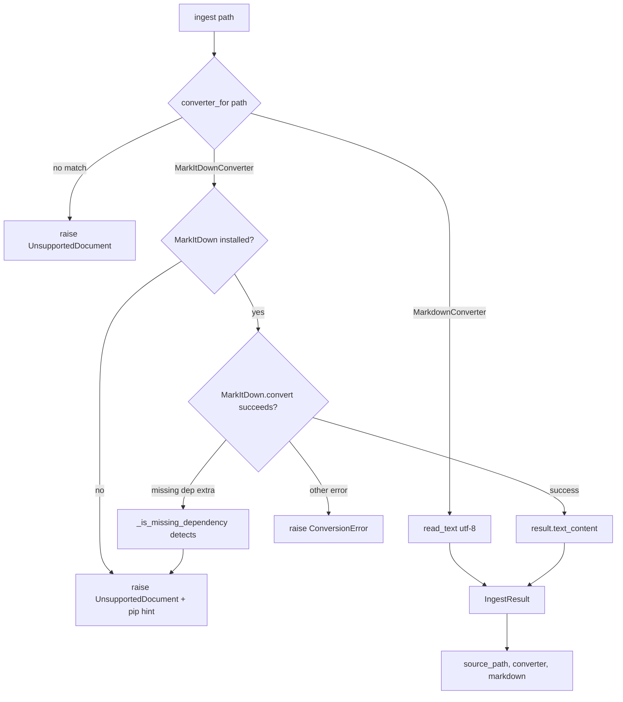
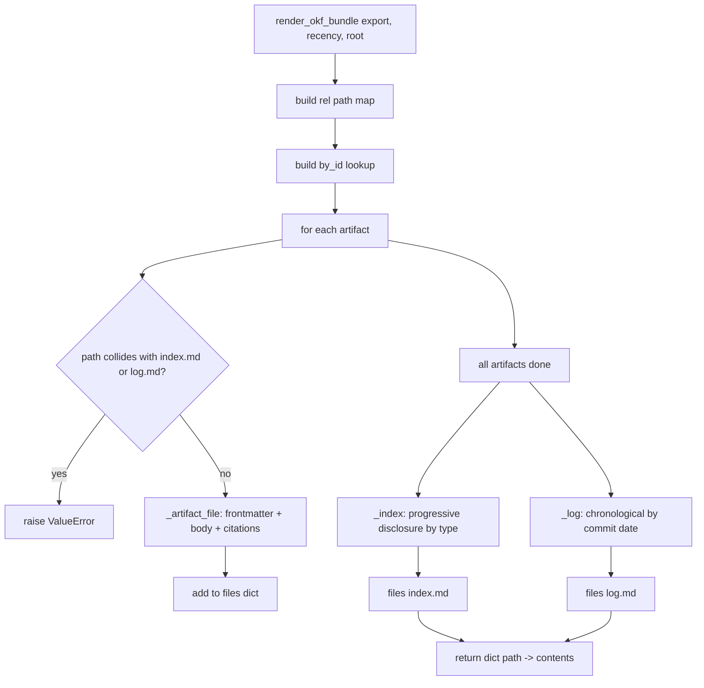
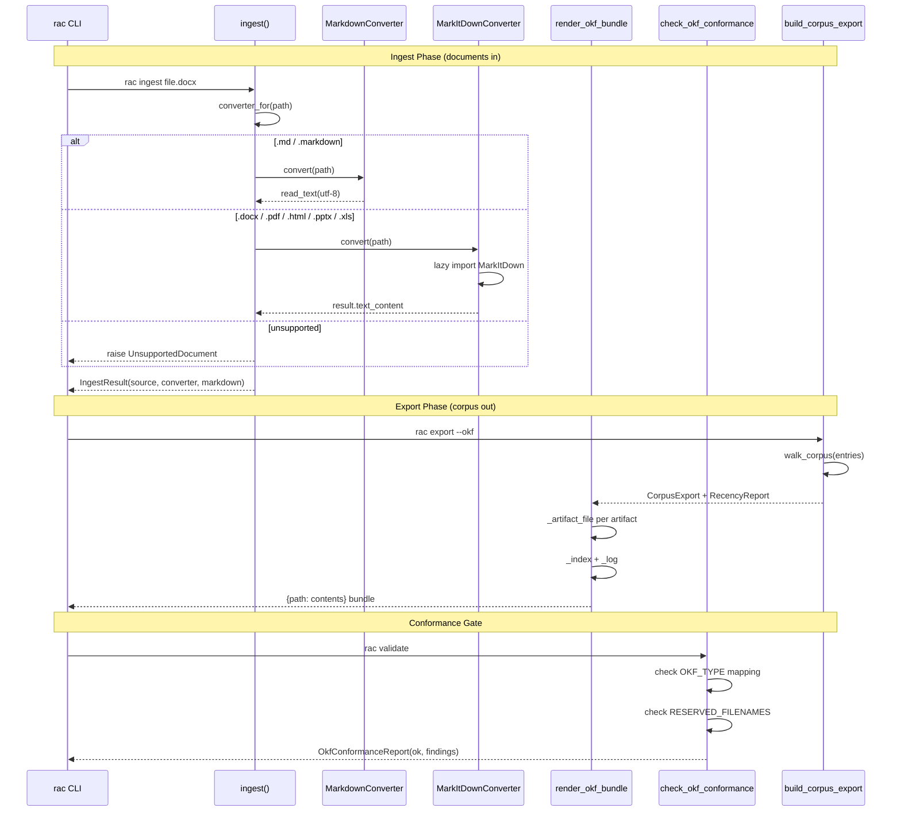

# RAC Ingest Pipeline and OKF (Open Knowledge Format)

The ingest pipeline converts source documents (DOCX, PDF, HTML, PPTX, XLS, Markdown) into Markdown that enters the RAC workflow. OKF (Open Knowledge Format) is the carrier profile (ADR-048) that defines how a RAC corpus is exported as a portable bundle of Markdown files with `index.md` and `log.md` entry points. Together they form the input and output faces of RAC's knowledge management: ingest brings external documents in, OKF carries the authoritative corpus out.

Source: `rac-core/src/rac/services/ingest.py`, `rac-core/src/rac/core/okf.py`, `rac-core/src/rac/output/okf.py`, `rac-core/src/rac/services/okf_conformance.py`, `rac-core/src/rac/services/export.py`

---

## Ingest Pipeline: DocumentConverter Protocol Pattern

The ingest pipeline uses a **Protocol-based registry** pattern. Converters declare the file extensions they handle, and `converter_for()` returns the first match. Per ADR-008 (agent-ready architecture), the CLI is a thin wrapper; new sources are added by registering another converter without changing the CLI.

**Source:** `rac-core/src/rac/services/ingest.py:40-52`

```python
@runtime_checkable
class DocumentConverter(Protocol):
    """Turns a source document into Markdown.

    Implementations declare the file extensions they handle and convert a path
    to a Markdown string. They should raise :class:`ConversionError` on failure.
    """

    name: str
    extensions: tuple[str, ...]

    def convert(self, path: Path) -> str: ...
```

The protocol requires three things: a `name` string (used in `IngestResult.converter`), an `extensions` tuple (used for matching), and a `convert(path)` method that returns Markdown text. The `@runtime_checkable` decorator enables `isinstance()` checks at runtime.

The registry is a simple ordered list, explicit even though extension sets are currently disjoint:

**Source:** `rac-core/src/rac/services/ingest.py:125-136`

```python
# Registry — first converter whose extensions match wins. Order is not currently
# significant since extension sets are disjoint, but kept explicit for clarity.
_CONVERTERS: list[DocumentConverter] = [MarkdownConverter(), MarkItDownConverter()]


def converter_for(path: Path) -> DocumentConverter | None:
    """Return the converter that handles ``path``'s extension, or None."""
    suffix = path.suffix.lower()
    for converter in _CONVERTERS:
        if suffix in converter.extensions:
            return converter
    return None


def supported_extensions() -> list[str]:
    """All file extensions any registered converter can handle."""
    return sorted({ext for c in _CONVERTERS for ext in c.extensions})
```

**Aha:** The registry order is preserved explicitly even though the current extension sets are disjoint (`.md`/`.markdown` vs `.docx`/`.pdf`/`.html`/`.htm`/`.pptx`/`.xls`/`.xlsx`). This is forward-proofing: when a third converter is added (e.g., a Notion converter), the order will matter for any overlapping extensions. The pattern avoids the `match/case` or `if-elif` sprawl that plagues format dispatch code -- adding a converter is one class and one list append.

The ingestion entry point ties everything together:

**Source:** `rac-core/src/rac/services/ingest.py:144-158`

```python
def ingest(path: str) -> IngestResult:
    """Convert ``path`` to Markdown, preserving its structure.

    Raises :class:`UnsupportedDocument` for unhandled file types and
    :class:`ConversionError` when a recognized document fails to convert.
    """
    p = Path(path)
    converter = converter_for(p)
    if converter is None:
        raise UnsupportedDocument(
            f"unsupported file type '{p.suffix or p.name}'. "
            f"Supported: {', '.join(supported_extensions())}"
        )
    markdown = converter.convert(p)
    return IngestResult(source_path=str(p), converter=converter.name, markdown=markdown)
```

The result is a typed dataclass (ADR-003: structured outputs):

**Source:** `rac-core/src/rac/services/ingest.py:31-38`

```python
@dataclass
class IngestResult:
    """Typed result of an ingestion (ADR-003: structured outputs)."""

    source_path: str
    converter: str  # name of the converter that produced the Markdown
    markdown: str
```

The error hierarchy is two-level:

**Source:** `rac-core/src/rac/services/ingest.py:23-29`

```python
class ConversionError(RACError):
    """A document was recognized but could not be converted."""


class UnsupportedDocument(ConversionError):
    """The file type has no registered converter (or a needed extra is missing)."""
```

`ConversionError` is the base: the file type was recognized, but conversion failed (e.g., a corrupted DOCX). `UnsupportedDocument` is the subtype: no converter handles this extension, or the required optional dependency is missing. Both inherit from `RACError`.

---

## MarkdownConverter: Zero-Dependency Pass-Through

**Source:** `rac-core/src/rac/services/ingest.py:54-61`

```python
class MarkdownConverter:
    """Pass-through for files already in Markdown — needs no extra dependency."""

    name = "markdown"
    extensions: tuple[str, ...] = (".md", ".markdown")

    def convert(self, path: Path) -> str:
        return path.read_text(encoding="utf-8")
```

This is the simplest converter in the registry. It reads the file as UTF-8 text and returns it unchanged. No parsing, no transformation, no dependency. This matters because `rac ingest file.md` works with the core install -- no optional extras needed. It also means the ingest pipeline handles the case where a team already has Markdown artifacts and wants to normalize or validate them through RAC.

---

## MarkItDownConverter: Lazy Import for Optional Dependency

**Source:** `rac-core/src/rac/services/ingest.py:64-89`

```python
class MarkItDownConverter:
    """Convert rich documents to Markdown via MarkItDown (optional dependency).

    Imported lazily so the core install (and `rac ingest file.md`) works without
    the `ingest` extra installed.
    """

    name = "markitdown"
    # HTML needs no extra (built into MarkItDown); the others come from the
    # corresponding markitdown extras, exposed as our granular ingest extras.
    extensions: tuple[str, ...] = (".docx", ".pdf", ".html", ".htm", ".pptx", ".xls", ".xlsx")

    def convert(self, path: Path) -> str:
        try:
            from markitdown import MarkItDown
        except ModuleNotFoundError as exc:
            raise UnsupportedDocument(_missing_extra_message(path.suffix)) from exc

        try:
            result = MarkItDown().convert(str(path))
        except Exception as exc:  # MarkItDown raises a variety of errors
            if _is_missing_dependency(exc):
                # MarkItDown is installed but this format's reader extra isn't.
                raise UnsupportedDocument(_missing_extra_message(path.suffix)) from exc
            raise ConversionError(f"could not convert {path.name}: {exc}") from exc
        return result.text_content
```

MarkItDown is an **optional dependency**. The import is deferred to `convert()` time rather than module load time. This means `rac ingest file.md` never touches MarkItDown at all -- the `MarkdownConverter` handles it first.

The supported extensions map to granular pip extras:

**Source:** `rac-core/src/rac/services/ingest.py:92-105`

```python
# Which optional extra provides the reader for a given file type. HTML/HTM need
# no extra (built into MarkItDown), so they fall back to the base `ingest`.
_EXTRA_FOR_SUFFIX = {
    ".docx": "ingest",
    ".pdf": "ingest-pdf",
    ".pptx": "ingest-office",
    ".xls": "ingest-office",
    ".xlsx": "ingest-office",
}


def _missing_extra_message(suffix: str) -> str:
    extra = _EXTRA_FOR_SUFFIX.get(suffix.lower(), "ingest")
    return f"converting '{suffix}' needs the {extra} extra: pip install 'rac-core[{extra}]'"
```

HTML and HTM are the only extensions that need no extra -- they are built into MarkItDown's base install. DOCX needs `ingest`, PDF needs `ingest-pdf`, and the Office formats (PPTX, XLS, XLSX) need `ingest-office`.

---

## Missing Dependency Detection

**Source:** `rac-core/src/rac/services/ingest.py:108-122`

```python
def _is_missing_dependency(exc: Exception) -> bool:
    """True if ``exc`` is (or wraps) a MarkItDown missing-dependency error."""
    try:
        from markitdown._exceptions import MissingDependencyException
    except Exception:  # pragma: no cover - defensive
        return False
    if isinstance(exc, MissingDependencyException):
        return True
    # MarkItDown wraps converter failures in FileConversionException(attempts=...),
    # each attempt carrying the original error in .exc_info = (type, value, tb).
    for attempt in getattr(exc, "attempts", None) or []:
        info = getattr(attempt, "exc_info", None)
        if info and isinstance(info[1], MissingDependencyException):
            return True
    return False
```

**Aha:** MarkItDown has a two-layer error model that must be navigated. The base `MissingDependencyException` catches the direct case (MarkItDown is not installed at all). But when MarkItDown *is* installed and a specific format's reader extra is missing, it wraps the error in a `FileConversionException` with an `attempts` list, where each attempt carries `exc_info = (type, value, tb)`. The detection function unpacks this wrapper by iterating `attempts` and checking `info[1]` (the `value` from the exception info tuple). Without this unwrapping, a missing `ingest-pdf` extra would surface as a generic `ConversionError` instead of the actionable `UnsupportedDocument` with a pip install hint.

---

## Ingest Pipeline Flow



---

## OKF v0.1: Open Knowledge Format Carrier Profile

OKF (ADR-048) is an **informative carrier profile** -- it defines how a RAC corpus is exported as a portable bundle, but OKF is never a source format. The RAC corpus stays authoritative; the OKF bundle is a derived, deterministic view.

The core constants live in `rac.core.okf` so all consumers share one definition:

**Source:** `rac-core/src/rac/core/okf.py:1-28`

```python
"""OKF v0.1 carrier-profile constants (ADR-048).

The RAC ``type`` -> OKF ``type`` mapping and OKF's reserved filenames live here,
in core, so the OKF bundle export (``output/okf.py``) and the write-time OKF
conformance check (``services/okf_conformance.py``) share one definition
(ADR-002: a single deterministic source of truth). ADR-048 makes OKF an
informative carrier profile; these constants are the checkable part of it.
"""

# RAC ``type`` -> OKF ``type`` (ADR-048; docs/okf-profile.md is the normative
# statement). The five enumerated RAC types map one-to-one. A registered RAC type
# absent here is an OKF conformance error, never a silent drop from the bundle.
OKF_TYPE = {
    "requirement": "Requirement",
    "decision": "ADR",
    "design": "Design",
    "roadmap": "Roadmap",
    "prompt": "Prompt",
}

# OKF reserves these filenames for generated entry points: ``index.md`` for
# progressive disclosure and ``log.md`` for chronological history. A *typed
# artifact* at one of these paths would collide with the generated bundle file
# (a conformance error); an *untyped* document at index.md/log.md is a legitimate
# reserved entry point and is left alone (ADR-010).
RESERVED_FILENAMES = ("index.md", "log.md")
```

The mapping is one-to-one and uppercase. A RAC `requirement` becomes an OKF `Requirement`, a `decision` becomes an `ADR`, and so on. The design explicitly guards against future type additions: if a new RAC type is added to the system but forgotten from `OKF_TYPE`, the conformance check will catch it as an `okf-unmapped-type` error rather than silently excluding the artifact from the bundle.

---

## Reserved Filenames: index.md and log.md

OKF reserves two filenames for generated entry points:

| Filename | Purpose | Typed artifact collision | Untyped document |
|----------|---------|-------------------------|------------------|
| `index.md` | Progressive disclosure: overview, then artifacts grouped by type | `okf-reserved-filename-collision` error | Legitimate reserved entry point, left alone (ADR-010) |
| `log.md` | Chronological history grouped by commit date, newest first | `okf-reserved-filename-collision` error | Legitimate reserved entry point, left alone (ADR-010) |

The distinction matters: a typed artifact named `index.md` would collide with the generated index and produce a conformance error. But an untyped document at `index.md` is exactly what the reserved entry point is -- it's the generated file itself, not a collision.

---

## OKF Bundle Structure

An OKF bundle is a `{relative path: file contents}` mapping. Each typed artifact becomes one Markdown file at its corpus-relative path, plus two generated files:

```
bundle/
  index.md          <- generated: knowledge index with artifacts by type
  log.md            <- generated: chronological history by commit date
  decisions/
    DEC-001.md      <- one OKF artifact file per typed artifact
  requirements/
    REQ-001.md
  designs/
    DES-001.md
```

Each artifact file projects the RAC frontmatter to OKF type and appends a derived `# Citations` section from resolved relationships:

**Source:** `rac-core/src/rac/output/okf.py:58-81`

```python
def _artifact_file(
    art: ExportArtifact,
    citations: list[tuple[str, str]],
    created: str | None,
    updated: str | None,
) -> str:
    """One OKF artifact file: projected front matter, body, derived citations.

    OKF-reserved descriptive fields (ADR-050), projected present-only so the
    bundle stays minimal and deterministic: ``tags`` from the source frontmatter,
    ``created``/``updated`` derived from git (never stored in source, ADR-045).
    """
    front = ["---", f"type: {OKF_TYPE[art.type]}", f"id: {art.id}"]
    if created is not None:
        front.append(f"created: {created}")
    if updated is not None:
        front.append(f"updated: {created}")
    if art.tags:
        front.append(f"tags: [{', '.join(art.tags)}]")
    lines = [*front, "---", "", _body(art.path)]
    if citations:
        lines += ["", "# Citations", ""]
        lines += [f"- [{title}]({path})" for title, path in citations]
    return "\n".join(lines) + "\n"
```

The frontmatter carries the OKF-projected `type`, the canonical `id`, git-derived `created`/`updated` timestamps (never stored in source per ADR-045), and `tags` from the source frontmatter. The body is the artifact's Markdown with frontmatter stripped. Resolved relationships become links in a `# Citations` section.

The `index.md` provides progressive disclosure:

**Source:** `rac-core/src/rac/output/okf.py:106-125`

```python
_INDEX_SECTIONS: tuple[tuple[str, str], ...] = (
    ("requirement", "Requirements"),
    ("decision", "Decisions"),
    ("design", "Designs"),
    ("roadmap", "Roadmaps"),
    ("prompt", "Prompts"),
)

def _index(export: CorpusExport, rel: dict[str, str]) -> str:
    """``index.md`` -- progressive disclosure: overview, then artifacts by type."""
    count = export.artifact_count
    noun = "artifact" if count == 1 else "artifacts"
    lines = [
        f"# {export.corpus_name} -- Knowledge Index",
        "",
        f"A derived OKF bundle of {count} {noun}. The RAC corpus is authoritative;"
        " this index is a generated entry point.",
    ]
    by_type: dict[str, list[ExportArtifact]] = {}
    for art in export.artifacts:
        by_type.setdefault(art.type, []).append(art)
    for type_name, heading in _INDEX_SECTIONS:
        members = by_type.get(type_name)
        if not members:
            continue
        lines += ["", f"## {heading}", ""]
        lines += [f"- [{art.title}]({rel[art.path]})" for art in members]
    return "\n".join(lines) + "\n"
```

The `log.md` groups artifacts by commit date, newest first:

**Source:** `rac-core/src/rac/output/okf.py:128-147`

```python
def _log(export: CorpusExport, recency: RecencyReport, rel: dict[str, str]) -> str:
    """``log.md`` -- corpus history grouped by commit date, newest first."""
    last_by_path = {a.path: a.last_committed for a in recency.artifacts}
    title_by_path = {art.path: art.title for art in export.artifacts}

    dated: dict[str, list[str]] = {}
    for path, committed in last_by_path.items():
        if committed is None or path not in title_by_path:
            continue
        dated.setdefault(committed.date().isoformat(), []).append(path)

    if not dated:
        return "# Log\n\n_No commit history available._\n"

    lines = ["# Log"]
    for day in sorted(dated, reverse=True):
        lines += ["", f"## {day}", ""]
        for path in sorted(dated[day]):
            lines.append(f"- [{title_by_path[path]}]({rel[path]})")
    return "\n".join(lines) + "\n"
```

When git cannot answer (no git history), `log.md` degrades to `"_No commit history available._"` rather than failing.

---

## OKF Bundle Rendering Pipeline



---

## OKF Conformance Checking

OKF conformance is a write-time gate (ADR-048, ADR-049). It runs during `rac validate` over a corpus and reports two finding codes:

**Source:** `rac-core/src/rac/services/okf_conformance.py:34-35`

```python
CODE_UNMAPPED_TYPE = "okf-unmapped-type"
CODE_RESERVED_FILENAME = "okf-reserved-filename-collision"
```

The check function is deterministic, per-artifact (Layer 0):

**Source:** `rac-core/src/rac/services/okf_conformance.py:79-127`

```python
def check_okf_conformance(
    directory: str,
    entries: list[CorpusEntry],
    recursive: bool = True,
    overrides: SeverityOverrides = EMPTY,
) -> OkfConformanceReport:
    """Check OKF v0.1 conformance over an already-walked corpus snapshot.

    Deterministic: entries arrive in sorted path order, so findings do too. Only
    typed artifacts are checked; untyped documents are excluded (ADR-010), which
    also exempts untyped ``index.md``/``log.md`` reserved entry points. Severity
    overrides (ADR-053) may downgrade or suppress a finding by code or type.
    """
    findings: list[OkfFinding] = []
    checked = 0
    for entry in entries:
        artifact_type = entry.artifact_type
        if spec_for(artifact_type) is None:
            continue  # untyped documents skipped (ADR-010)
        checked += 1
        path = str(entry.path)
        if artifact_type not in OKF_TYPE:
            _add(findings, CODE_UNMAPPED_TYPE, path,
                 f"artifact type {artifact_type!r} has no OKF type mapping; add "
                 f"it to rac.core.okf.OKF_TYPE so the artifact is carried in the "
                 f"OKF bundle (ADR-048)",
                 artifact_type, overrides)
        if entry.path.name in RESERVED_FILENAMES:
            _add(findings, CODE_RESERVED_FILENAME, path,
                 f"a typed artifact named {entry.path.name!r} collides with the "
                 f"generated OKF bundle entry point; rename the file -- OKF "
                 f"reserves index.md and log.md (ADR-048)",
                 artifact_type, overrides)
    return OkfConformanceReport(
        directory=directory, recursive=recursive,
        artifacts_checked=checked, findings=findings)
```

The `OkfFinding` dataclass carries a stable code, path, message, and severity (default `"error"`, subject to overrides per ADR-053):

```python
@dataclass
class OkfFinding:
    code: str
    path: str
    message: str
    severity: str = "error"

    def to_dict(self) -> dict:
        return asdict(self)
```

The conformance report considers the corpus conformant when no finding remains at error severity (overrides may downgrade to warning or suppress):

```python
@property
def ok(self) -> bool:
    return not any(f.severity == "error" for f in self.findings)
```

---

## Export Modes: Full Comparison

The `export` service provides six output modes, each a deterministic projection of the same corpus walk:

**Source:** `rac-core/src/rac/services/export.py`

| Mode | Dataclass | Purpose | Shape | Key Characteristics |
|------|-----------|---------|-------|---------------------|
| `--json` | `CorpusExport` | Viewer contract (Portal, external viewers) | Single JSON object | `body_html` via markdown-it-py CommonMark with raw HTML disabled, `relates-to` edges, `schema_version: "1"` |
| `--documents` | `DocumentsExport` | RAG/memory backend ingestion | JSON Lines (one per line) | Markdown body as `text` (not HTML), per-record `metadata.path/aliases/tags/source`, `ensure_ascii=False` for UTF-8 |
| `--okf` | OKF bundle via `render_okf_bundle` | Portable OKF v0.1 bundle | `{path: contents}` dict | One Markdown per artifact + `index.md` + `log.md`, OKF type projection, git-derived `created`/`updated` |
| `--html` / `--portal` | N/A | Self-contained HTML viewer | Single HTML string | Vendored Portal shell with data seam injection, `<script>`-safe escaping (`</` to `<\\/`, `<!--` to `<\\u0021--`) |
| `--graph` | `GraphExport` | Graph backend ingestion | Single JSON object | Typed nodes + edges (`supersedes`, `related_decisions`), `directed`/`resolved`/`external` flags, sorted by `(source, type, target)` |
| `--agent-rules` | `AgentRulesResult` | Editor/CI agent rule generation | Per-target `files` with `state` | Corpus `digest`, `mode` (generate/check), states: `in_sync`, `stale`, `missing`, `written`, `updated` |

**Determinism guarantee (ADR-002):** All export modes produce byte-identical output for the same corpus state. No timestamps in the payload (except `rac_version` captured at build time), artifacts in sorted-path order, relationships sorted explicitly.

---

## Output Renderers: Six Format Families

Each export mode has renderers for different output formats:

| Renderer | Module | Commands | Purpose |
|----------|--------|----------|---------|
| **Human** | `rac/output/human.py` | All CLI commands | Terminal-colored output (auto-disabled when not writing to a TTY), `EMPTY_CORPUS_HINT` for zero-artifact corpora |
| **JSON** | `rac/output/json.py` | `--json` on all commands | Stable, versioned contracts (ADR-007), `schema_version: "1"`, `json.dumps(indent=2)` |
| **SARIF** | `rac/output/sarif.py` | `--sarif` on validate/review/gate/relationships | SARIF 2.1.0 for GitHub Code Scanning, RFC 3986 URI percent-encoding, deterministic sort by `(uri, line, ruleId)` |
| **Portal** | `rac/output/portal.py` | `--html` / `--portal` | Self-contained HTML via vendored shell + data seam injection, `file://` compatible, zero network requests |
| **OKF** | `rac/output/okf.py` | `--okf` | OKF v0.1 bundle as `{path: contents}` dict |
| **GitHub** | `rac/output/github.py` | `watchkeeper --format github` | GitHub-flavored Markdown for `$GITHUB_STEP_SUMMARY`, `::error`/`::warning`/`::notice` workflow command annotations |

The Portal renderer uses a single data seam pattern:

**Source:** `rac-core/src/rac/output/portal.py:37-80`

```python
_SEAM = '<script type="application/json" id="lore-export"></script>'

def _escape_for_script(payload: str) -> str:
    """Make a serialized JSON document safe inside a ``<script>`` element."""
    return payload.replace("</", "<\\/").replace("<!--", "<\\u0021--")

def render_export_html(export: CorpusExport) -> str:
    """The vendored Portal shell with ``export`` injected into its data seam."""
    shell = _load_shell()
    if shell.count(_SEAM) != 1:
        raise PortalSeamMissing()
    payload = _escape_for_script(render_export_json(export))
    populated = f'<script type="application/json" id="lore-export">{payload}</script>'
    return shell.replace(_SEAM, populated)
```

Two distinct failure modes are separate exceptions: `PortalShellMissing` (broken installation) vs `PortalSeamMissing` (corrupt vendoring). Neither is a caller error -- the shell ships with the distribution.

---

## Robustness Limits

**Source:** `rac-core/src/rac/core/limits.py`

The MCP server sits in an agent's critical path (ADR-032/ADR-033). These caps bound work ahead of the response budget:

| Constant | Value | Purpose | Override |
|----------|-------|---------|----------|
| `DEFAULT_MAX_FILE_BYTES` | `1 << 20` (1 MiB) | Per-file byte cap (REQ-001) | `RAC_MAX_FILE_BYTES` env var; non-positive falls back to default |
| `MAX_FRONTMATTER_BYTES` | `64 << 10` (64 KiB) | Raw front-matter block cap before PyYAML (REQ-002) | Fixed |
| `MAX_FRONTMATTER_DEPTH` | `32` | Max YAML nesting depth (REQ-002) | Fixed |
| `MAX_FIELD_CHARS` | `256 << 10` (256 KiB) | Per captured body section cap (REQ-003) | Fixed |
| `MAX_CAPTURED_LINES` | `50_000` | Total non-blank body lines per document (REQ-003) | Fixed |
| `MAX_RELATED_EDGES` | `1_000` | Per-call edge cap for `get_related` (REQ-007) | Fixed |
| `MAX_TRAVERSAL_DEPTH` | `5` | Max BFS hop depth for multi-hop traversal | Fixed |
| `MAX_TRAVERSAL_FRONTIER` | `1_000` | Max nodes per BFS level | Fixed |
| `MAX_TRAVERSAL_WORK` | `10_000` | Max edges examined across whole walk | Fixed |

The `max_file_bytes()` function honors the environment override with safe fallback:

```python
def max_file_bytes() -> int:
    """The per-file byte cap, honoring ``RAC_MAX_FILE_BYTES`` (REQ-001)."""
    raw = os.environ.get(_MAX_FILE_BYTES_ENV)
    if raw is not None:
        try:
            value = int(raw)
        except ValueError:
            return DEFAULT_MAX_FILE_BYTES
        if value > 0:
            return value
    return DEFAULT_MAX_FILE_BYTES
```

The `exceeds_byte_cap()` function uses a character-count shortcut to avoid expensive encoding for small inputs:

```python
def exceeds_byte_cap(text: str, cap: int) -> bool:
    """True when ``text`` exceeds ``cap`` UTF-8 bytes, encoding only if needed."""
    length = len(text)
    if length > cap:
        return True       # chars > cap => bytes definitely > cap
    if length <= cap // 4:
        return False      # max UTF-8 is 4 bytes/char, so safe
    return len(text.encode("utf-8")) > cap   # only encode for borderline cases
```

---

## Complete Architecture: Ingest to OKF Bundle



---

## Aha Moments

**Aha: Lazy import is the right dependency boundary.** MarkItDown is imported inside `convert()`, not at module top. This means `rac ingest file.md` never loads MarkItDown at all -- the `MarkdownConverter` handles it with zero extra dependencies. The core install is clean; optional extras are truly optional. If the team later adds a pure-Python converter for a new format, it can be added without bloating the base install.

**Aha: OKF is a derived view, never a source.** The OKF bundle is explicitly a projection of the RAC corpus -- it carries the OKF type, git-derived timestamps, and resolved relationship links. But it is never read back as input. The RAC corpus stays authoritative. This unidirectional flow (corpus -> OKF, never OKF -> corpus) prevents round-trip corruption and keeps the system simple.

**Aha: The missing dependency detection digs into exception internals.** MarkItDown wraps format-specific failures in a `FileConversionException(attempts=...)` where each attempt carries `exc_info = (type, value, tb)`. The `_is_missing_dependency()` function unpacks `info[1]` to check for `MissingDependencyException`. Without this, a missing `ingest-pdf` extra would surface as an unhelpful generic error instead of the actionable "pip install 'rac-core[ingest-pdf]'" hint.

---

## Cross-References

- [00-overview.md](00-overview.md) -- Wayfinder/RAC ecosystem overview, all 7 sub-projects
- [01-architecture.md](01-architecture.md) -- RAC Core architecture, layers, Product AST
- [02-rac-core.md](02-rac-core.md) -- CLI, services, validation, relationships, watchkeeper
- [07-knowledge-graph.md](07-knowledge-graph.md) -- Artifact relationships and graph export (`--graph` mode)
- [09-data-flow.md](09-data-flow.md) -- Request lifecycle including export paths
- [10-error-handling.md](10-error-handling.md) -- Exit codes, error types, `RACError` hierarchy
