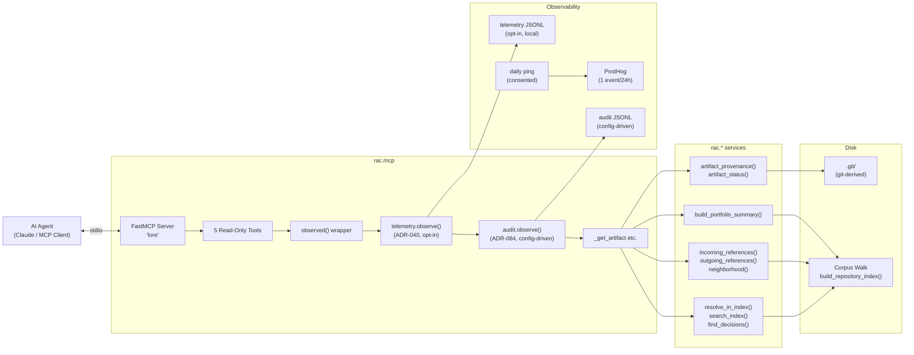
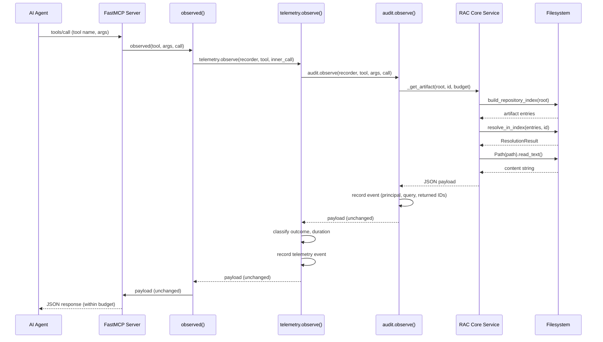

# RAC MCP Server (Lore)

The read-only tool surface that exposes a RAC repository's product knowledge to AI agents over the MCP protocol. Every call re-reads from disk, returns structured JSON, and stays within a per-response character budget. Telemetry and audit are opt-in, local, and content-free or content-bearing respectively -- both designed so they cannot alter the tool response.

## Server Identity and FastMCP Bootstrap

The server is a FastMCP application named `"lore"` (`server.py:84`). It runs over stdio transport and registers five read-only tools. The server is a *consumer* of RAC Core -- it imports no write-capable service and re-implements no parsing, resolution, relationship extraction, or scoring. This isolation is enforced by `tests/test_mcp_isolation.py`.

```python
# rac-core/src/rac/mcp/server.py:84
SERVER_NAME = "lore"
```

The entry point is `run_server()` (`server.py:410-445`), which performs startup diagnostics, builds the server, and runs it over stdio until the client disconnects:

```python
# rac-core/src/rac/mcp/server.py:410-445
def run_server(root: str, budget: int = DEFAULT_BUDGET, telemetry_enabled: bool = False) -> int:
    """Run the Guide server over stdio until the client disconnects."""
    _check_corpus(root)
    recorder: TelemetryRecorder | None = None
    if telemetry_enabled:
        recorder = telemetry.create_recorder()
        print("rac mcp: telemetry on ...", file=sys.stderr)
    audit_recorder = audit.create_recorder(audit.load_audit_config(root), root)
    if audit_recorder is not None:
        print("rac mcp: audit on ...", file=sys.stderr)
    _maybe_start_sharing(root)
    build_server(root, budget=budget, recorder=recorder, audit_recorder=audit_recorder).run(
        transport="stdio"
    )
    return 0
```

Startup performs four checks before the server begins serving:

1. **Corpus check** (`_check_corpus`, `server.py:358-380`): walks the repository index and writes a one-line stderr notice when no recognized artifacts exist. stdout belongs to the MCP protocol; only stderr carries diagnostics.
2. **Telemetry recorder** (`server.py:422-429`): created only when `--telemetry` is passed. Announced on stderr.
3. **Audit recorder** (`server.py:433-440`): driven by the `audit:` stanza in `.rac/config.yaml`. Configured path or XDG default (`~/.local/state/rac/audit.jsonl`). Announced on stderr.
4. **Daily ping** (`_maybe_start_sharing`, `server.py:383-407`): starts the consented anonymous usage sharing thread. Independent of `--telemetry`.

## Architecture: MCP Server as Consumer



The server sits cleanly between the agent and RAC Core. Every tool call follows the same pattern: observed by telemetry (if enabled), observed by audit (if configured), executed against Core services which re-read the repository from disk. No cache exists between calls.

## The Five Read-Only Tools

Tool descriptions are pinned verbatim from the `guide-tool-surface` design document (`server.py:86-140`). Editing them is a contract change under ADR-030.

### 1. get_artifact

```python
# rac-core/src/rac/mcp/server.py:327-329
@server.tool(name="get_artifact", description=DESC_GET_ARTIFACT)
def get_artifact(id: str) -> str:
    return observed("get_artifact", {"id": id}, lambda: _get_artifact(root, id, budget))
```

**Parameters:**

| Parameter | Type | Required | Description |
|-----------|------|----------|-------------|
| `id` | `str` | Yes | Artifact identifier (e.g., `REQ-001`, `ADR-012`, or a RAC-prefixed ID) |

**Return shape:** A JSON object with `schema_version: "1"`, the resolved artifact's metadata (`id`, `type`, `title`, `path`, `status`), full Markdown `content`, and a `provenance` object containing git-derived authorship and status history.

**Key behavior** (`_get_artifact`, `server.py:162-189`):

1. Resolves the ID via `_resolve()` which calls `build_repository_index()` + `resolve_in_index()`.
2. If resolution fails, returns a structured error from `errors.from_resolution()`.
3. Reads the file content via `_read_content()` (`server.py:143-149`): `Path(path).read_text(encoding="utf-8")`.
4. On `OSError` or `UnicodeDecodeError`, returns `errors.unreadable(id, path)` -- never raises.
5. Builds the payload with `artifact.to_dict()`, raw content, and provenance from `artifact_status()` + `artifact_provenance()`.

### 2. search_artifacts

```python
# rac-core/src/rac/mcp/server.py:331-337
@server.tool(name="search_artifacts", description=DESC_SEARCH_ARTIFACTS)
def search_artifacts(query: str, type: str | None = None) -> str:
    return observed(
        "search_artifacts",
        {"query": query, "type": type},
        lambda: _search_artifacts(root, query, type, budget),
    )
```

**Parameters:**

| Parameter | Type | Required | Description |
|-----------|------|----------|-------------|
| `query` | `str` | Yes | Keyword search string |
| `type` | `str \| None` | No | Filter by artifact type (e.g., `requirement`, `decision`, `design`) |

**Return shape:** A search result with `matches` array containing artifact IDs, types, titles, and paths. See [`search_index()`](08-deterministic-search.md) for the deterministic search contract.

**Key behavior** (`_search_artifacts`, `server.py:192-195`): builds a fresh index, calls `search_index(entries, query, artifact_type=artifact_type)`, returns `result.to_dict()`. No content is fetched -- only metadata.

### 3. find_decisions

```python
# rac-core/src/rac/mcp/server.py:339-343
@server.tool(name="find_decisions", description=DESC_FIND_DECISIONS)
def find_decisions_tool(topic: str) -> str:
    return observed(
        "find_decisions", {"topic": topic}, lambda: _find_decisions(root, topic, budget)
    )
```

**Parameters:**

| Parameter | Type | Required | Description |
|-----------|------|----------|-------------|
| `topic` | `str` | Yes | The topic to search for settled decisions about |

**Return shape:** A decision search result with `matches` array, each with identifier, title, path, category, and relevance snippet. An additive `filter: "live-decisions"` field is injected to make the live-decision intent explicit on the wire.

**Key behavior** (`_find_decisions`, `server.py:198-212`): calls the same `find_decisions()` service the CLI `--decisions` face uses -- one source of truth. Results are filtered to Accepted, non-retired decisions only and ranked by relevance. The `filter` field is additive (ADR-007).

### 4. get_related

```python
# rac-core/src/rac/mcp/server.py:345-349
@server.tool(name="get_related", description=DESC_GET_RELATED)
def get_related(id: str, depth: int = 1) -> str:
    return observed(
        "get_related", {"id": id, "depth": depth}, lambda: _get_related(root, id, budget, depth)
    )
```

**Parameters:**

| Parameter | Type | Required | Default | Description |
|-----------|------|----------|---------|-------------|
| `id` | `str` | Yes | -- | Artifact identifier |
| `depth` | `int` | No | `1` | Traversal depth (1-5, capped at `MAX_TRAVERSAL_DEPTH`) |

**Return shape:** A JSON object with the artifact's metadata, `outgoing` references grouped by section, `incoming` references with edge evidence, and optionally a `neighborhood` array for `depth > 1`.

**Key behavior** (`_get_related`, `server.py:215-281`):

1. Single corpus walk feeds resolution, outgoing, and incoming -- the whole response reflects one atomic snapshot (ADR-032).
2. Resolves the artifact; returns structured error on failure.
3. Builds relationships via `relationships_from_corpus()`.
4. Constructs `outgoing` via `outgoing_references()` and `incoming` via `incoming_references()`.
5. Incoming entries carry **edge evidence** (WS2): `{"direction": "incoming", "relationship": ref.section, "target": ref.target}`.
6. When `depth > 1`, adds `neighborhood` via `neighborhood()` -- artifacts two or more hops out, each tagged with `hops` distance.
7. Edge overflow detection: if `incoming_result.total - len(incoming_result.items)` or `outgoing.total - outgoing.kept` is positive, or neighborhood was truncated, sets `truncated: true`, `omitted: <count>`, and `hint: "Request the artifact directly, or narrow what you are changing."`.

### 5. get_summary

```python
# rac-core/src/rac/mcp/server.py:351-353
@server.tool(name="get_summary", description=DESC_GET_SUMMARY)
def get_summary() -> str:
    return observed("get_summary", {}, lambda: _get_summary(root, budget))
```

**Parameters:** None.

**Return shape:** A portfolio summary with artifact counts by type, validation state, relationship health, and attention items. When `total_artifacts == 0`, an additive `guidance` field tells the agent how the user begins authoring.

**Key behavior** (`_get_summary`, `server.py:284-297`): calls `build_portfolio_summary(root, recursive=True)`. The empty-repository guidance field is additive (v0.13.1, ADR-007): a cold agent session against a fresh repository is told how to begin.

## Budget Enforcement (ADR-033)

Every tool response passes through `serialize()` in `budget.py` before reaching the agent. The budget is measured in characters of the serialized JSON, not tokens -- character counts are stable across models and tokenizer versions.

```python
# rac-core/src/rac/mcp/budget.py:37
DEFAULT_BUDGET = 10_000
```

**Configurable once at server startup** via `build_server(..., budget=...)`. No CLI flag, no per-call override.

### Truncation Markers

When a response exceeds the budget, three pinned marker fields are added:

| Field | Type | Description |
|-------|------|-------------|
| `truncated` | `bool` | `true` when truncation occurred; **absent** (not `false`) on complete responses |
| `omitted` | `int` | How many items were dropped (entries for lists, characters for content) |
| `hint` | `str` | Prose guidance on how to narrow the request |

```python
# rac-core/src/rac/mcp/budget.py:40-48
MARKER_TRUNCATED = "truncated"
MARKER_OMITTED = "omitted"
MARKER_HINT = "hint"

HINT_SEARCH = "Narrow the query or request a specific artifact ID."
HINT_RELATED = "Request the artifact directly, or narrow what you are changing."
HINT_CONTENT = "Request a more specific artifact, or read the file directly for the full content."
HINT_SUMMARY = (
    "The repository summary exceeds the response budget; raise the server "
    "budget to see the full overview."
)
```

### Truncation Strategy

Truncation happens at **whole-item boundaries** -- never mid-element, never mid-JSON:

- **search_artifacts**: drops whole `matches` entries from the tail (`_truncate_list`).
- **get_related**: drops whole `incoming` entries from the tail (`_truncate_list`).
- **get_artifact**: binary search for the largest content prefix that fits (`_truncate_content`, `budget.py:143-165`).
- **get_summary**: has no truncatable field; if it ever exceeds budget, markers are added without dropping data (its shape is fixed and small in practice).
- **find_decisions**: inherits the search behavior via `matches` field.

The `serialize()` function (`budget.py:69-83`) checks the length first -- if the payload fits, it serializes unchanged with no markers. Otherwise it calls `_truncate()` which identifies the truncatable field and reduces it deterministically (dropping from the tail only, so identical input always produces identical output -- ADR-032 determinism).

## Audit System (ADR-084)

The audit recorder is the **deliberate inversion** of telemetry: where telemetry is content-free and silently self-disabling, audit is content-bearing by design and fail-loud. It answers who consulted which decision, when, and which artifact IDs came back.

### Configuration

Audit is driven by the `audit:` stanza in `.rac/config.yaml`. Default-absent -- no stanza means no recorder, no file, and byte-identical responses:

```yaml
audit:
  enabled: true
  path: ""                    # optional; defaults to XDG state dir
  on_write_error: "warn"      # "warn" | "block"
```

**Config loading** (`audit.py:109-146`):

```python
# rac-core/src/rac/mcp/audit.py:75-81
@dataclass(frozen=True)
class AuditConfig:
    """The audit: stanza from .rac/config.yaml (ADR-084)."""
    enabled: bool
    path: str          # the configured path, or "" to use the default
    on_write_error: str  # "warn" | "block"
    config_path: str | None = None
```

Config discovery walks upward from the root to find `.rac/config.yaml` (`audit.py:84-91`). A malformed shape raises `MalformedAuditConfig` -- the audit posture is never silently misconfigured.

### Principal Resolution

```python
# rac-core/src/rac/mcp/audit.py:174-182
def resolve_principal(root: str) -> str:
    """The audit principal: RAC_AUDIT_PRINCIPAL > git identity > unattributed."""
    override = os.environ.get(PRINCIPAL_ENV)
    if override and override.strip():
        return override.strip()
    return _git_identity(root) or UNATTRIBUTED
```

The principal is **attributable, not authenticated** (ADR-065, ADR-077): records who *claimed* to query, resolved from `RAC_AUDIT_PRINCIPAL` env var, then git config (`user.name` + `user.email`), then falls back to `"unattributed"`.

### Event Schema

```python
# rac-core/src/rac/mcp/audit.py:258-276
def _event(recorder, tool, args, returned, outcome, started) -> dict:
    return {
        "schema_version": SCHEMA_VERSION,  # "1"
        "ts": datetime.now(UTC).isoformat(timespec="milliseconds").replace("+00:00", "Z"),
        "session": recorder.session,       # 16-char random hex
        "principal": recorder.principal,
        "tool": tool,
        "query": dict(args),
        "returned": returned,              # list of artifact IDs only, never content
        "outcome": outcome,                # "ok" | "error" | "exception"
        "duration_ms": int(...),
    }
```

**Critical privacy constraint**: the `returned` list contains artifact IDs only, **never content**. Extracted by `_returned()` (`audit.py:290-323`) which parses the payload JSON and collects IDs from `id`, `matches`, `incoming`, and `neighborhood` fields. The queried artifact's own outgoing references are raw declared target text (not resolved IDs), so they are not recorded as returned access.

### Write Error Modes

| Mode | Behavior |
|------|----------|
| `warn` | Logs failure once on stderr, continues serving |
| `block` | Returns structured `{"error": "audit-unavailable"}` -- refuses un-audited content |

## Telemetry (ADR-040)

Opt-in usage recording that answers one product question: is Guide actually used, and which tools matter -- without spending the trust Guide asks for.

### Event Schema

```python
# rac-core/src/rac/mcp/telemetry.py:153-167
def _event(session, tool, outcome, error, started, truncated) -> dict:
    event = {
        "schema_version": "1",
        "ts": datetime.now(UTC).isoformat(timespec="milliseconds").replace("+00:00", "Z"),
        "session": session,        # 8-char random hex
        "tool": tool,
        "outcome": outcome,        # "ok" | "error" | "exception"
    }
    if error is not None:
        event["error"] = error
    event["duration_ms"] = int((time.perf_counter() - started) * 1000)
    event["truncated"] = truncated
    return event
```

**Never recorded**: tool arguments, artifact IDs, query strings, paths, or repository content. Only counts and metadata.

### TelemetryRecorder

```python
# rac-core/src/rac/mcp/telemetry.py:71-94
class TelemetryRecorder:
    """Append-only event writer with a never-raise posture."""

    def __init__(self, path: Path) -> None:
        self.path = path
        self.session = secrets.token_hex(4)
        self._disabled = False

    def record(self, event: dict) -> None:
        """Append one event line; never raises."""
        if self._disabled:
            return
        try:
            with open(self.path, "a", encoding="utf-8") as handle:
                handle.write(json.dumps(event, ensure_ascii=False) + "\n")
        except OSError:
            self._disabled = True
```

Log path: `XDG_STATE_HOME/rac/guide-telemetry.jsonl` (default `~/.local/state/rac/guide-telemetry.jsonl`). Rotation at `MAX_LOG_BYTES = 1_000_000` (~8,000 events, ~2 MB with `.1` keep). First write failure disables the recorder silently -- telemetry failure never breaks a tool call.

### Summary and Sharing

`summarize()` (`telemetry.py:243-272`) aggregates events into `TelemetrySummary` with per-tool breakdown: calls, errors, truncations, average duration. `share_url()` (`telemetry.py:282-294`) formats the summary into a prefilled GitHub issue URL -- the user reviews and submits it in their browser. RAC contains no network code for sharing.

## Error Handling (ADR-034)

Failed lookups return structured error data in the JSON body, **never protocol exceptions**. An agent recovers from a JSON body, not from a transport error. This keeps the reasoning boundary stable -- the agent stays in control of recovery.

### Error Types

```python
# rac-core/src/rac/mcp/errors.py:20-26
ERROR_NOT_FOUND = "not-found"
ERROR_DUPLICATE = "duplicate"
ERROR_UNREADABLE = "unreadable"
```

| Error | Constructor | When |
|-------|------------|------|
| `not-found` | `not_found(artifact_id)` | ID does not match any artifact |
| `duplicate` | `duplicate(artifact_id, paths)` | ID resolves to multiple files |
| `unreadable` | `unreadable(artifact_id, path)` | File exists in index but cannot be read (deleted, permissions, non-UTF-8) |

### Error Shapes

```python
# rac-core/src/rac/mcp/errors.py:29-57
def not_found(artifact_id: str) -> dict:
    return {"schema_version": "1", "error": ERROR_NOT_FOUND, "id": artifact_id}

def duplicate(artifact_id: str, paths: list[str]) -> dict:
    return {"schema_version": "1", "error": ERROR_DUPLICATE, "id": artifact_id, "paths": list(paths)}

def unreadable(artifact_id: str, path: str) -> dict:
    return {"schema_version": "1", "error": ERROR_UNREADABLE, "id": artifact_id, "path": path}

def from_resolution(result: ResolutionResult) -> dict:
    """Render a non-resolved ResolutionResult as a structured error."""
    return result.to_dict()
```

The output from `from_resolution()` is exactly `ResolutionResult.to_dict()` -- the same body the CLI emits, so tool errors cannot drift from CLI errors.

## Health Check: Ping

The ping module (`ping.py`) implements RAC's entire network surface. The daily ping is a daemon thread that sends at most one event per 24 hours to PostHog, carrying only a random install ID, the RAC version, and an active-repo count.

```python
# rac-core/src/rac/mcp/ping.py:138-157
def build_payload(install_id: str, active_repos: int, now: datetime) -> dict:
    return {
        "api_key": consent_record.POSTHOG_API_KEY,
        "event": PING_EVENT,                    # "lore-daily-ping"
        "timestamp": _iso(now),
        "properties": {
            "distinct_id": install_id,
            "$process_person_profile": False,    # anonymous in PostHog
            "schema_version": PING_SCHEMA_VERSION,
            "rac_version": __version__,
            "active_repos": active_repos,
        },
    }
```

**Never transmitted**: repository contents, paths, artifact text, queries, or tool arguments. Adding a field is a new recorded decision.

Active repos are counted via salted digests (`repo_digest()`, `ping.py:57-59`) stored locally with a 30-day window. The digest uses `hashlib.sha256(salt + resolved_root)` -- the salt never transmits.

## Tool Call Flow

Every tool call follows the same observed path through the wrapping layers:



The wrapper nesting is deliberate: audit runs innermost so its duration is the pure call time; telemetry wraps it and still sees the unchanged payload. Each is a no-op when its recorder is `None`, so the default response stays byte-identical (`server.py:318-325`):

```python
# rac-core/src/rac/mcp/server.py:318-325
def observed(tool: str, args: dict, call: Callable[[], str]) -> str:
    return telemetry.observe(
        recorder, tool, lambda: audit.observe(audit_recorder, tool, args, call)
    )
```

## Response Serialization with Budget Capping

The complete serialization chain for any tool response:

1. Tool function builds a `dict` payload (artifact metadata, content, relationships, etc.).
2. `serialize(payload, budget)` is called (`budget.py:69-83`).
3. `_length(payload)` computes `len(json.dumps(payload, ensure_ascii=False))`.
4. If within budget: return the JSON string, no markers.
5. If over budget: `_truncate(payload, budget)` identifies the truncatable field and reduces it.
6. The truncated payload gains `truncated: true`, `omitted: <count>`, `hint: "..."`.
7. The serialized JSON always fits the budget (or is the best-effort minimal marked payload).

## Provenance: Git-Derived Timestamps (ADR-045)

The `get_artifact` tool includes a `provenance` object in every response. Provenance is **git-derived, not stored in frontmatter** (ADR-045):

```python
# rac-core/src/rac/mcp/server.py:184-188
"provenance": {
    "status": artifact_status(parse(content)),
    **artifact_provenance(root, result.artifact.path).to_dict(),
},
```

`artifact_status()` reads the `## Status` heading from parsed Markdown. `artifact_provenance()` extracts git-derived authorship and reconstructed status history. All values are `null` or `[]` when git cannot answer. All reported facts are sourced from the repository, never a trust verdict or score (ADR-034).

## Aha Moments

**Aha: The audit is the deliberate inversion of telemetry.** Telemetry (ADR-040) is content-free, silently self-disabling on write failure, and records only metadata. Audit (ADR-084) is content-bearing by design, fail-loud, and records exactly the artifact IDs that were consulted. Together they form a two-axis observability matrix: telemetry answers "is this used and how," audit answers "who looked at what and when." Both are designed so their recording cannot alter the tool response -- `observe()` returns the payload unchanged in both cases. This means agents see byte-identical responses regardless of observability state, which preserves determinism (ADR-032) while giving teams the compliance answer they need.

**Aha: Failed lookups are data, not exceptions.** The server catches `OSError` and `UnicodeDecodeError` on file reads (`server.py:168-172`) and returns `errors.unreadable(id, path)` as structured JSON. The agent recovers from a JSON body, not from a protocol exception. This keeps the reasoning boundary stable -- the agent decides whether to retry, warn the user, or proceed. A transport-layer exception would force the agent into error-recovery mode; a JSON error body lets the agent stay in reasoning mode.

**Aha: Single corpus walk per `get_related` call for atomic snapshot.** The `get_related` tool builds `entries = list(walk_corpus(...))` once and feeds resolution, outgoing, and incoming from that single list (`server.py:221`). There is no window in which the relationship view drifts mid-call. The snapshot lives and dies inside the call -- no cache, no session state, but also no race between "what we resolved" and "what relationships exist."

**Aha: Character budget, not token budget.** The budget is measured in serialized JSON characters (`len(json.dumps(...))`), not tokens. Token counts vary across models and tokenizer versions, which would break determinism (ADR-032). Character counts are stable -- the same repository bytes and same input always produce the same output, regardless of which model the agent uses.

## Cross-References

- [00-overview.md](00-overview.md) -- RAC system overview and philosophy
- [01-architecture.md](01-architecture.md) -- Full dependency graph and layer architecture
- [02-rac-core.md](02-rac-core.md) -- RAC Core services (resolve, index, relationships, portfolio)
- [09-data-flow.md](09-data-flow.md) -- End-to-end data flow through the RAC system
- [10-error-handling.md](10-error-handling.md) -- Structured error handling contract and ADR-034 reasoning boundary
