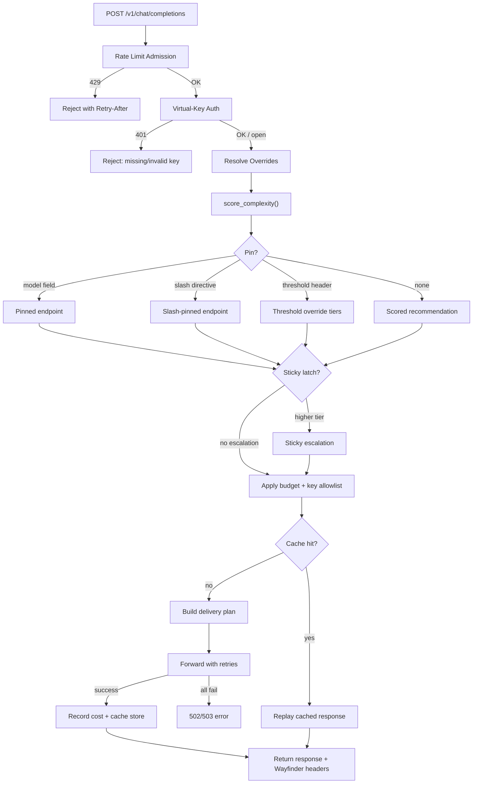
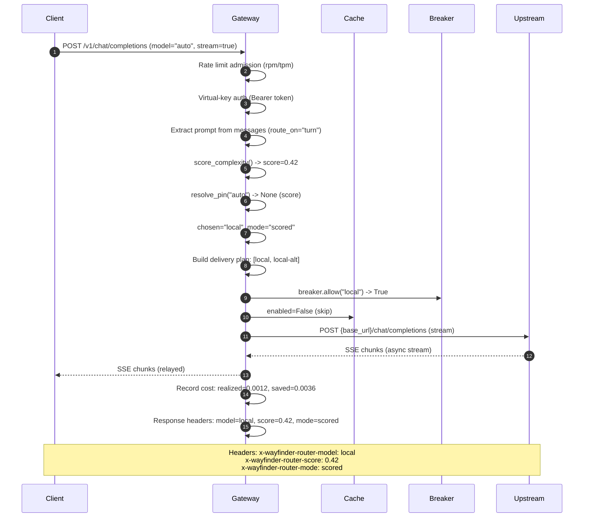

# 17. Wayfinder Router Gateway — Deep-Dive

> **Gateway**: FastAPI OpenAI-compatible proxy, deterministic scoring, streaming support, reliability, and observability.
> **Source**: `wayfinder_router/gateway.py` (+ calibrate, judge, cache, pricing, reliability, vkeys, feedback)

---

## Table of Contents

- [1. Gateway Architecture](#1-gateway-architecture)
- [2. Per-Call Steering](#2-per-call-steering)
- [3. Response Headers](#3-response-headers)
- [4. Streaming: SSE Relay](#4-streaming-sse-relay)
- [5. Metrics Endpoint](#5-metrics-endpoint)
- [6. Dashboard: GET /router](#6-dashboard-get-router)
- [7. Cache: Exact-Match Response Cache](#7-cache-exact-match-response-cache)
- [8. Pricing: Per-Model Cost Tracking](#8-pricing-per-model-cost-tracking)
- [9. Rate Limiting](#9-rate-limiting)
- [10. Reliability: Circuit Breaker and Failover](#10-reliability-circuit-breaker-and-failover)
- [11. Virtual Keys](#11-virtual-keys)
- [12. Calibration](#12-calibration)
- [13. Judge: Routing Quality Evaluation](#13-judge-routing-quality-evaluation)
- [14. Feedback Loop](#14-feedback-loop)
- [15. Anthropic Adapter](#15-anthropic-adapter)
- [16. Config Hot-Reload](#16-config-hot-reload)
- [Cross-References](#cross-references)

---

## 1. Gateway Architecture

The Wayfinder Gateway is a **FastAPI** application that acts as an **OpenAI-compatible proxy**. Clients point their `base_url` at the gateway and send standard `POST /v1/chat/completions` requests. The gateway scores the prompt using the deterministic `complexity.py` core, maps the recommended model to a configured upstream endpoint, and forwards the call with the user's own API key. Keys are read from the environment at request time and never stored in `wayfinder-router.toml` ([WF-ADR-0004](../04-wayfinder-router.md#wf-adr-0004)).

### Core Data Types

**`GatewayModel`** (`gateway.py:383`): Maps a routing name to an upstream.

```python
@dataclass(frozen=True)
class GatewayModel:
    base_url: str          # OpenAI-compatible base, e.g. http://localhost:11434/v1
    model: str             # the upstream model id to send in the forwarded request
    api_key_env: str | None = None      # env var holding the key
    api_key_cmd: str | None = None      # command that fills api_key_env when unset
    cost_per_1k: float | None = None    # optional cost metadata (WF-ADR-0017)
    fallbacks: tuple[str, ...] = ()     # same-tier endpoints to try if this one fails
    context_window: int | None = None   # optional token limit for pre-call check
```

**`GatewayConfig`** (`gateway.py:460`): Holds the full gateway configuration.

```python
@dataclass(frozen=True)
class GatewayConfig:
    models: dict[str, GatewayModel]
    route_on: str = "turn"             # which part of chat to score: turn|last_user|user|all
    sticky: bool = False               # conversation latch
    sticky_cooldown: int = 0           # calm turns before latch decays
    slash_directives: bool = False     # in-message /directive routing
    retries: int = 2
    breaker_threshold: int = 5
    breaker_cooldown: float = 30.0
    failover: str = "same-tier"        # same-tier|degrade|escalate
    offline: bool = False              # offline-first mode
    budget: Budget | None = None
    cache: CacheConfig | None = None
    rate_limit: RateLimit | None = None
    keys: dict[str, VirtualKey] = field(default_factory=dict)
```

### Request Lifecycle

Each request flows through a sequence of guardrails, scoring, and delivery:

1. **Rate limit admission** (gateway-wide, then per-key)
2. **Virtual-key auth** (if keys are configured)
3. **Per-call override resolution** (headers, slash directives, scoring tuning)
4. **Scoring** — `score_complexity()` runs once, ~sub-millisecond
5. **Pin/override resolution** — `model` field, threshold header, sticky latch, budget, key allowlist
6. **Cache lookup** (if enabled and cacheable)
7. **Delivery plan** — primary + fallbacks filtered by circuit breaker + context-window precheck
8. **Forward** — buffered or streaming, with retries
9. **Cost recording** — token counts x price table
10. **Cache store** (on cache miss + storable response)

### Gateway Flowchart



---

## 2. Per-Call Steering

A request can steer routing **without changing application code** ([WF-ADR-0011](../04-wayfinder-router.md#wf-adr-0011)). This only moves which threshold/decision applies; it never adds inference.

### `model` Field Directives

The OpenAI `model` field doubles as a routing directive:

| Value | Behavior |
|---|---|
| `"auto"` (or empty/unrecognized) | Score per config, let Wayfinder decide |
| Configured endpoint name (e.g. `"local"`) | Pin to that exact endpoint |
| `"prefer-local"` | Pin to the lowest tier's model |
| `"prefer-hosted"` | Pin to the highest tier's model |
| `"prefer-cloud"` | Back-compat alias of `prefer-hosted` |

Resolved by `resolve_pin()` (`gateway.py:965`):

```python
def resolve_pin(model_field: object, routing: RoutingConfig, gateway: GatewayConfig) -> str | None:
    """Resolve an explicit endpoint pin from the OpenAI model field, or None."""
    if not isinstance(model_field, str):
        return None
    name = model_field.strip()
    if not name or name == _AUTO:
        return None
    if routing.classifier is None and routing.tiers:
        if name == _PREFER_LOW:
            return routing.tiers[0].model
        if name == _PREFER_HIGH or name in _PREFER_HIGH_ALIASES:
            return routing.tiers[-1].model
    return name if name in gateway.models else None
```

### `X-Wayfinder-Threshold` Header

A number in `0.0`-`1.0` that re-decides the call at that binary cut, reusing configured scoring weights. Only valid for a binary (two-tier) router. Parsed by `parse_threshold_header()` (`gateway.py:1037`).

### Slash Directives (WF-ADR-0036)

When `gateway.slash_directives = true`, a recognized `/directive` at the start of the latest user message pins the route and is **stripped** before forwarding. `resolve_slash_directive()` (`gateway.py:990`) returns `(pin, cleaned_messages)` — unrecognized tokens like `/help` are left untouched.

### Conversation Latch / Sticky (WF-ADR-0022)

`conversation_high_water()` (`gateway.py:1189`) scores each user turn independently and latches to the highest tier any turn reached. With `sticky_cooldown > 0`, the latch decays after N consecutive calm turns below the current tier.

### Scoring Tuning (WF-ADR-0023)

The `wayfinder_tuning` request body field allows per-request weight/lexicon overrides (for the demo only). `apply_scoring_overrides()` (`gateway.py:1136`) returns a `RoutingConfig` variant with merged weights and replaced lexicon terms.

---

## 3. Response Headers

Every response carries the decision signal:

| Header | Value |
|---|---|
| `x-wayfinder-router-model` | The chosen endpoint name |
| `x-wayfinder-router-score` | The structural score (0.00-1.00) |
| `x-wayfinder-router-mode` | `scored` / `pinned` / `threshold-override` / `sticky` / `slash-pinned` / `budget-degraded` / `key-scoped` |
| `x-wayfinder-router-request-id` | 12-char hex UUID |
| `x-wayfinder-router-served-by` | The actual upstream that served (may differ from `model` on failover) |
| `x-wayfinder-router-cache` | `hit` / `miss` (when cache is enabled) |
| `x-wayfinder-router-offline` | `true` (when offline-first is active) |
| `x-wayfinder-router-failover` | `true` (when served_by != chosen) |
| `x-wayfinder-router-budget` | `blocked` / `degraded` |
| `X-RateLimit-Limit` / `Remaining` / `Reset` | Informational RPM headroom |

Set at `gateway.py:2029`:

```python
wf_headers = {
    "x-wayfinder-router-model": chosen,
    "x-wayfinder-router-score": f"{decision.score:.2f}",
    "x-wayfinder-router-mode": mode,
    "x-wayfinder-router-request-id": request_id,
}
```

### Debug Mode

`X-Wayfinder-Debug: true` surfaces the full decision payload in the response body: score, features, feature contributions, tiers, and cost block. Built by `_explain_payload()` (`gateway.py:2109`), which calls `explain_score()` from the complexity core.

---

## 4. Streaming: SSE Relay

A request with `stream: true` is relayed as a Server-Sent-Events stream so chat clients render tokens progressively ([WF-ADR-0013](../04-wayfinder-router.md#wf-adr-0013)). The forward path uses `httpx.AsyncClient`.

### Streaming Functions

- **`aforward_stream()`** (`gateway.py:1271`): Async generator relaying upstream SSE chunk by chunk.
- **`parse_sse_deltas()`** (`gateway.py:1329`): Pure function yielding assistant text deltas from `data:` lines.
- **Stream handler** (`gateway.py:2233-2272`): Creates a `StreamingResponse` that relays upstream SSE, collects streamed text for token estimation, records cost, and optionally emits a `wayfinder` debug event.

```python
async def aforward_stream(
    url: str, headers: dict[str, str], json_body: dict, timeout: float = _DEFAULT_TIMEOUT
) -> AsyncIterator[bytes]:
    """Async generator relaying an upstream Server-Sent-Events stream chunk by chunk."""
    try:
        async with httpx.AsyncClient(timeout=timeout) as client:
            async with client.stream("POST", url, headers=headers, json=json_body) as response:
                async for chunk in response.aiter_bytes():
                    yield chunk
    except httpx.HTTPError as exc:
        raise UpstreamError(str(exc) or exc.__class__.__name__) from exc
```

Streaming skips the response cache (non-deterministic), and uses a single delivery attempt (no retry on stream, per WF-ADR-0031).

---

## 5. Metrics Endpoint

`GET /metrics` exposes Prometheus text-format counters and histograms ([WF-ADR-0018](../04-wayfinder-router.md#wf-adr-0018)). Metadata only — model/mode labels, never prompt text. The `Metrics` class (`gateway.py:192`) is a hand-rolled, zero-dependency implementation.

### Counters

| Metric | Labels |
|---|---|
| `wayfinder_router_requests_total` | `model`, `mode` |
| `wayfinder_router_upstream_errors_total` | `model` |
| `wayfinder_router_cache_hits_total` | — |
| `wayfinder_router_cache_misses_total` | — |
| `wayfinder_router_cache_avoided_cost_total` | — |
| `wayfinder_router_rate_limited_total` | `limit` ("rpm"/"tpm") |
| `wayfinder_router_key_requests_total` | `key` (WF-ADR-0035) |
| `wayfinder_router_config_reload_failures_total` | — |
| `wayfinder_router_realized_cost_total` | — |
| `wayfinder_router_baseline_cost_total` | — |
| `wayfinder_router_savings_cost_total` | — |

### Gauges

| Metric | Labels |
|---|---|
| `wayfinder_router_build_info` | `version` |
| `wayfinder_router_model_cost_per_1k` | `model` |

### Histograms

| Metric | Buckets | Labels |
|---|---|---|
| `wayfinder_router_decision_latency_seconds` | 0.0001 - 0.05s | — |
| `wayfinder_router_upstream_latency_seconds` | 0.05 - 60s | `model` |

Histogram buckets are defined at `gateway.py:160-161`:

```python
_DECISION_BUCKETS = (0.0001, 0.00025, 0.0005, 0.001, 0.0025, 0.005, 0.01, 0.025, 0.05)
_UPSTREAM_BUCKETS = (0.05, 0.1, 0.25, 0.5, 1.0, 2.5, 5.0, 10.0, 30.0, 60.0)
```

---

## 6. Dashboard: GET /router

A self-contained HTML dashboard at `GET /router` (`gateway.py:1733`) polls `/router/recent` every 2 seconds and shows recent routing decisions. No CDN, no build step, no prompt text — just decision metadata.

```html
<!-- polls /router/recent?limit=50, shows: when, model, score, mode, request_id -->
```

The `/router/recent` endpoint (`gateway.py:1718`) returns the last 200 decisions stored in an in-memory `deque`:

```python
recent: deque[dict] = deque(maxlen=_RECENT_MAX)  # 200 entries
```

---

## 7. Cache: Exact-Match Response Cache

The response cache ([WF-ADR-0033](../04-wayfinder-router.md#wf-adr-0033)) is an in-memory LRU exact-match cache, **off by default**. An identical request replays a stored completion — instant, free, no upstream call.

### Key Generation

`cache_key()` (`cache.py:38`) hashes `SHA-256(served_model + canonical_body)`:

```python
def cache_key(served_model: str, body: Mapping) -> str:
    projected = {k: v for k, v in body.items() if k not in EXCLUDED_KEY_FIELDS}
    # EXCLUDED_KEY_FIELDS = frozenset({"model", "stream"})
    blob = json.dumps(
        {"m": served_model, "b": projected},
        sort_keys=True, separators=(",", ":"), ensure_ascii=False, default=str,
    ).encode("utf-8")
    return hashlib.sha256(blob).hexdigest()
```

The raw prompt is **never stored** — only its SHA-256 digest.

### Cacheability Rules

`is_cacheable()` (`cache.py:57`) is conservative. Only contractually deterministic requests qualify:

- Excludes: `stream=true`, `temperature != 0`, `top_p != 1`, `n != 1`, `seed` set, tool calls, `logit_bias`, multimodal content
- Requires: text-only messages list

`is_storable()` (`cache.py:89`) guards against caching error-shaped or empty 200 responses (a common upstream behavior under overload).

### Cache Configuration

```python
@dataclass(frozen=True)
class CacheConfig:
    enabled: bool = False
    ttl: float = cache.DEFAULT_TTL           # 300 seconds
    max_entries: int = cache.DEFAULT_MAX_ENTRIES  # 1024
    max_bytes: int = cache.DEFAULT_MAX_BYTES      # 64 MiB
```

`ResponseCache` (`cache.py:130`) is bounded by **both** entry count and byte ceiling, with dual eviction. On disable, all retained bodies are **purged immediately** (privacy guarantee).

### Cache Hit Flow in Handler

At `gateway.py:2162-2188`: cache lookup happens before delivery, after budget enforcement. A hit returns the cached body verbatim with `x-wayfinder-router-cache: hit` and `x-wayfinder-router-served-by` headers. No breaker effect, no budget spend.

---

## 8. Pricing: Per-Model Cost Tracking

Per-model cost tracking ([WF-ADR-0017](../04-wayfinder-router.md#wf-adr-0017), [WF-DESIGN-0007](../04-wayfinder-router.md#wf-design-0007)) turns routing decisions into a persisted **savings** report: realized cost vs. "always-frontier" counterfactual.

### Price Table

`price_table()` (`pricing.py:34`) builds `{model: cost_per_1k}` from configured metadata, or falls back to relative units (0.2 to 1.0 across the tier ladder) when no real costs are set.

### Turn Cost

`turn_cost()` (`pricing.py:94`):

```python
def turn_cost(
    route: str, prompt_tokens: int, completion_tokens: int,
    costs: Mapping[str, float], *, estimated: bool, baseline: str | None = None,
) -> TurnCost:
    total_k = (max(0, prompt_tokens) + max(0, completion_tokens)) / 1000.0
    dearest = max(costs.values()) if costs else 0.0
    baseline_per1k = costs.get(baseline, dearest) if baseline is not None else dearest
    chosen_per1k = costs.get(route, dearest)
    realized = round(chosen_per1k * total_k, 6)
    base = round(baseline_per1k * total_k, 6)
    return TurnCost(route, realized, base, round(base - realized, 6), ...)
```

### Savings Ledger

`SavingsLedger` (`pricing.py:180`) is a daily-bucket accumulator persisted to `wayfinder-savings.json`. Debounced saves every 5 seconds (`_SAVINGS_SAVE_INTERVAL`). Periodic reports at `GET /v1/savings` support `today`, `7d`, `30d`, `all`.

---

## 9. Rate Limiting

Fixed-window RPM/TPM caps ([WF-ADR-0034](../04-wayfinder-router.md#wf-adr-0034)). Returns HTTP 429 on breach with `Retry-After` header.

```python
@dataclass
class RateLimiter:
    rpm: int | None = None
    tpm: int | None = None
    window: float = DEFAULT_WINDOW  # 60 seconds
```

`admit()` (`ratelimit.py:56`) checks and increments in one atomic operation. `add_tokens()` records served turn tokens against the TPM window. Windows are keyed by `floor(now / window)` so they roll deterministically.

On breach: `RateResult(allowed=False, limit="rpm"/"tpm", retry_after=N)`.

---

## 10. Reliability: Circuit Breaker and Failover

Reliability primitives ([WF-ADR-0031](../04-wayfinder-router.md#wf-adr-0031), [WF-DESIGN-0010](../04-wayfinder-router.md#wf-design-0010)) change **how a request is delivered**, never **what was decided**.

### Retryable Statuses

```python
RETRYABLE_STATUS = frozenset({429, 500, 502, 503, 504})
AUTH_FAILURE_STATUS = frozenset({401, 403, 407})
```

Auth failures (401/403/407) are not retried but **do** count as breaker failures (a stale key must eventually open the breaker).

### Circuit Breaker

```python
@dataclass
class CircuitBreaker:
    threshold: int = 5      # consecutive failures to trip
    cooldown: float = 30.0  # seconds before half-open probe
```

`allow(target)` returns True if closed or cooldown elapsed. `record(target, ok)` — success closes, failures may open. Half-open mode: after cooldown, one probe attempt is allowed.

### Delivery Plan

`delivery_plan()` (`reliability.py:100`) builds an ordered, de-duplicated target list: primary, then same-tier fallbacks. Targets with open breakers or failing the context-window precheck are dropped.

### Failover Policies

| Policy | Behavior |
|---|---|
| `same-tier` (default) | Only configured alternate endpoints; never changes cost |
| `degrade` | Walks to cheaper tiers (nearest-cheaper first) |
| `escalate` | Walks to dearer tiers (nearest-dearer first) |

`failover_candidates()` (`reliability.py:130`) generates the cross-tier targets after same-tier exhaustion.

### Delivery Function

`_deliver()` (`gateway.py:1591`) tries each target in the plan with bounded retries (`gateway.retries`, default 2). Backoff via `retry_delays()` — exponential, capped at 5s, full-jitter. On all-target exhaustion, returns 502 with `wayfinder_router_upstream_error`.

---

## 11. Virtual Keys

Gateway-issued bearer tokens ([WF-ADR-0035](../04-wayfinder-router.md#wf-adr-0035)) that authenticate callers and attribute spend. **Not provider keys** — those still come from the environment (WF-ADR-0004).

### Key Management (`vkeys.py`)

```python
def hash_key(presented: str) -> str:
    """SHA-256 hex digest — what the gateway stores."""
    return hashlib.sha256(presented.encode("utf-8")).hexdigest()

def verify(presented: str, expected_hash: str) -> bool:
    """Constant-time check."""
    return hmac.compare_digest(hash_key(presented), expected_hash.strip().lower())

def generate(prefix: str = "wf") -> tuple[str, str]:
    """Mint a new key: (plaintext, hash). Uses secrets.token_urlsafe(32)."""
    token = secrets.token_urlsafe(32)
    plaintext = f"{prefix}-{token}"
    return plaintext, hash_key(plaintext)
```

Minted keys look like `wf-<token>`, easy to spot in logs. Matching is constant-time against all configured hashes (`vkeys.match()`).

### VirtualKey Dataclass

```python
@dataclass(frozen=True)
class VirtualKey:
    hash: str                          # SHA-256 hex (never plaintext)
    tags: tuple[str, ...] = ()         # attribution labels
    budget: Budget | None = None       # per-key spend cap
    rate_limit: RateLimit | None = None  # per-key RPM/TPM
    models: tuple[str, ...] = ()       # allowlist; empty = unrestricted
```

### Per-Key Scope

- **Budget**: Stricter of gateway-wide vs. key budget wins. Block beats degrade.
- **Rate limit**: Checked after gateway-wide rate limit (so a token flood can't bypass the limiter).
- **Model allowlist**: `_clamp_to_allowed()` clamps to the nearest allowed tier rather than rejecting.
- **Attribution**: Spend is tracked per-key in the savings ledger's `by_key` breakdown.

---

## 12. Calibration

Calibration is the **offline** empirical step that maps the structural proxy onto a real decision ([WF-ADR-0003](../04-wayfinder-router.md#wf-adr-0003)). It runs on a labeled dataset and emits a `wayfinder-router.toml` fragment. No model is touched.

### Three Modes

**Threshold** (`calibrate_threshold()`, `calibrate.py:175`): Binary sweep. Finds the cut that best separates two labels. Supports three objectives:

| Objective | What it optimizes |
|---|---|
| `accuracy` (default) | Most accurate cut |
| `knee` | Maximizes quality-recovered x cost-saved |
| `cost-quality` | Most accurate cut reaching `target_savings` |

The knee objective (`_sweep_cut_knee()`, `calibrate.py:316`) mirrors the benchmark knee from [05-rac-benchmarks](../05-rac-benchmarks.md): quality recovered is the recall of the high arm, cost saved is savings vs. always-high.

**Tiers** (`calibrate_tiers()`, `calibrate.py:350`): Ordinal multi-class. Orders models by mean score, sweeps each adjacent breakpoint.

**Classifier** (`fit_classifier()`, `calibrate.py:387`): Multinomial logistic regression via L2-regularized Newton/IRLS. Deterministic: zero initialization, exact Newton steps, Gaussian elimination with partial pivoting, stopped on tolerance.

```python
def fit_classifier(
    samples: list[Sample], models_order: list[str] | None = None,
    *, iterations: int = 100, l2: float = 0.01, tol: float = 1e-8,
) -> CalibrationResult:
```

### Sweep Curve

`sweep_curve()` (`calibrate.py:147`) returns the full (threshold, accuracy) curve for visualization — the chart behind threshold calibration.

---

## 13. Judge: Routing Quality Evaluation

Automated sufficiency judges for offline calibration ([WF-ADR-0037](../04-wayfinder-router.md#wf-adr-0037)). The onboarding loop (`onboard.py`) collects per-prompt sufficiency labels through an injected `Judge` callable.

### Judge Protocol

```python
@runtime_checkable
class Judge(Protocol):
    @property
    def version(self) -> str: ...
    def judge(self, prompt: str, cheap: str, expensive: str) -> Verdict: ...
```

### Verdict (Tri-State)

```python
@dataclass(frozen=True)
class Verdict:
    sufficient: bool | None   # True = cheap good enough, False = need dearer, None = abstain
    reason: str
    comparator: str
```

**Abstain** (`sufficient is None`) means the judge has no grounds — the prompt is skipped and **no label is recorded**, preserving the two-label contract of threshold calibration.

### HeuristicJudge

`HeuristicJudge` (`judge.py:98`) is a pure, deterministic ensemble of text comparators running in fixed order:

1. **Refusal/stub** — empty, too-short, or refusal-shaped answers. If cheap refused but dear answered: insufficient. If both refused: abstain.
2. **Agreement** — identical after normalization: sufficient.
3. **Similarity** — difflib ratio >= 0.8: sufficient.
4. **Divergence** — abstain (heuristic cannot adjudicate genuinely divergent prose).

```python
@dataclass(frozen=True)
class HeuristicJudge:
    similarity_sufficient: float = 0.8
    min_answer_chars: int = 16
    refusal_markers: tuple[str, ...] = DEFAULT_REFUSAL_MARKERS  # 12 markers
    version: str = "heuristic-1"
```

The abstention posture is deliberate — this is strongest on verifiable/structured prompts and silent on open-ended prose. Labels are only trusted after the sufficiency gates (agreement vs. human gold set, out-of-fold lift) clear.

---

## 14. Feedback Loop

The feedback faucet ([WF-ADR-0006](../04-wayfinder-router.md#wf-adr-0006)) that feeds calibration. `POST /v1/feedback` records a `{"text", "label"}` JSON line — exactly what `calibrate` consumes.

### Recording

`record_label()` (`feedback.py:21`):

```python
def record_label(log_path: str, text: str, label: str) -> None:
    line = json.dumps({"text": text, "label": label}, ensure_ascii=False)
    with open(log_path, "a", encoding="utf-8") as handle:
        handle.write(line + "\n")
```

Default log: `wayfinder-router-feedback.jsonl`.

### Authentication

Guarded by an optional bearer token (`WAYFINDER_ROUTER_FEEDBACK_TOKEN` env var) to prevent log poisoning. Without it, the endpoint is unauthenticated.

### Recalibration

`recalibrate()` (`recalibrate.py:37`): Reads the feedback log, runs `calibrate()`, writes the routing section of `wayfinder-router.toml` while preserving the `[gateway]` section. The gateway hot-reloads the new file automatically. Skips when fewer than `min_labels` (default 2) labels exist.

---

## 15. Anthropic Adapter

`POST /v1/messages` ([WF-DESIGN-0011](../04-wayfinder-router.md#wf-design-0011)) lets Anthropic-Messages-native clients (notably Claude Code) use the gateway. Pure format translation — scores nothing, calls no model.

### Request Translation

`anthropic_to_openai_request()` reshapes the inbound Anthropic body: system messages, content blocks (text/tool_use/tool_result), tools, tool_choice. Model passed through so `resolve_pin` decides.

### Response Translation

`openai_to_anthropic_response()` maps OpenAI choices back to Anthropic message objects with content blocks.

### Streaming Translation

`MessagesStreamTranslator` (`anthropic_adapter.py:260`) is a state machine that turns OpenAI SSE chunks into the Anthropic event sequence: `message_start` -> `content_block_start`/`content_block_delta`/`content_block_stop` -> `message_delta` -> `message_stop`. Tool calls are buffered by OpenAI index and emitted as complete blocks in `finish()` to handle interleaved parallel tool-call deltas.

---

## 16. Config Hot-Reload

`_ConfigHolder` (`gateway.py:1398`) caches routing + gateway config and reloads when `wayfinder-router.toml` changes. Each request checks the file's mtime and re-reads only when it moved.

```python
class _ConfigHolder:
    def current(self) -> tuple[RoutingConfig, GatewayConfig]:
        mtime = self._mtime_now()
        if mtime != self._mtime:
            self._mtime = mtime
            try:
                self._routing = load_routing_config(self.start_dir)
                self._gateway = load_gateway_config(self.start_dir)
            except WayfinderConfigError as exc:
                # Keep last-good config; increment reload-failure metric
                logger.warning("config reload failed, keeping last-good config: %s", exc)
        return self._routing, self._gateway
```

A malformed mid-flight write keeps the last-good config (marker advances so it is not retried), is logged, and increments the `wayfinder_router_config_reload_failures_total` metric.

### Long-Lived State Sync

The breaker, cache, and rate limiter are created once at startup (their state survives config hot-reloads) and reconfigured on each request to match the current config values.

---

## Sequence Diagram: A Routed Request



---

## Aha Moment

**Aha: The gateway's scoring path is 100% offline and dependency-free.** The `complexity.py` core has zero imports beyond the standard library — no `httpx`, no `fastapi`, no network. The gateway is the impure layer (`gateway.py` imports `fastapi`/`httpx` lazily via `build_app()`), and the scored core never imports the gateway. This means:

- Calibration (`calibrate.py`) runs without any gateway installed
- The CLI `wayfinder-router score` needs no server
- The `complexity.py` module is golden-testable, golden-replayable, and has a stable JSON contract (`schema_version: "3"`)
- The gateway's `score_complexity()` call is ~sub-millisecond even with all 11 features — it's regex scans and arithmetic over a string
- Per-request steering (threshold header, model pin, sticky) only changes **which decision boundary applies**, never how the score is computed

The boundary between "what to route" (scored decision) and "how to deliver" (retries, failover, cache, budget) is the architectural spine of the entire system. The scored decision is immutable once made; everything downstream only changes delivery mechanics.

---

## Cross-References

| Document | Relationship |
|---|---|
| [00-overview](../00-overview.md) | RAC system overview; Wayfinder as the routing layer |
| [04-wayfinder-router](../04-wayfinder-router.md) | Wayfinder router architecture, all WF-ADR design decisions referenced throughout this document |
| [05-rac-benchmarks](../05-rac-benchmarks.md) | Benchmark knee methodology that the calibration `knee` objective mirrors |
| [09-data-flow](../09-data-flow.md) | How routing decisions flow through the system; feedback log feeding recalibration |
