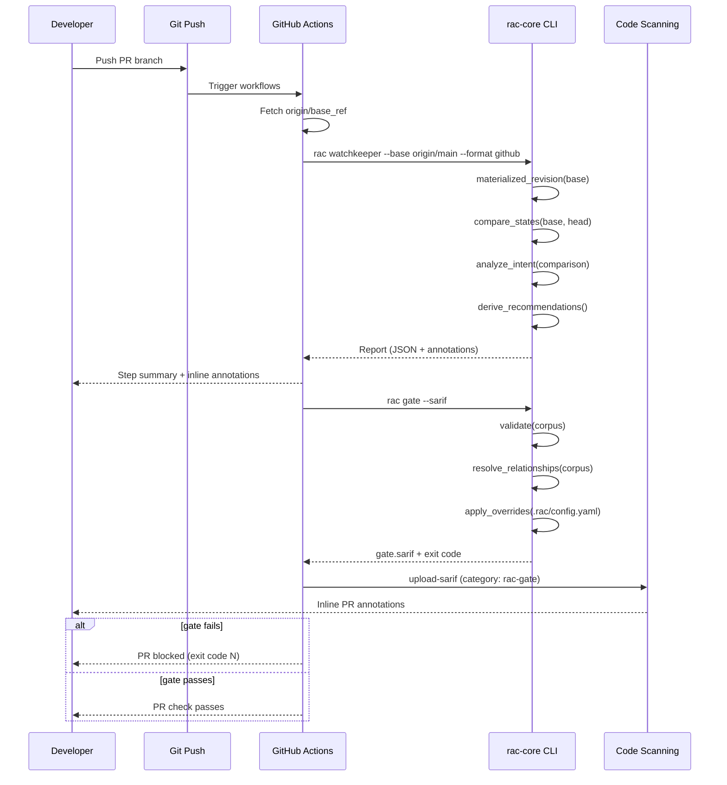

# RAC Diff Service, Intent Classification, and CI Integration

**Document:** 18-diff-intent-ci.md
**Series:** src.Wayfinder Deep-Dive
**Source:** `rac-core/src/rac/services/` and `rac-ci/`

This document traces the complete change-analysis pipeline in RAC -- from AST-based diffing through deterministic intent classification to GitHub CI integration. Every component is pure, explainable, and contract-stable under ADR-007 (JSON schema) and ADR-015 (CLI is the source of truth).

---

## Table of Contents

1. [Diff Service: AST-Based Comparison](#1-diff-service-ast-based-comparison)
2. [Ordered Difference: Preserving Document Order](#2-ordered-difference-preserving-document-order)
3. [Intent Classification: Deterministic Findings](#3-intent-classification-deterministic-findings)
4. [Watchkeeper: Git Diff Knowledge Review](#4-watchkeeper-git-diff-knowledge-review)
5. [Revision Tracking: Materializing Git Revisions](#5-revision-tracking-materializing-git-revisions)
6. [ID Generation: Crockford Base32](#6-id-generation-crockford-base32)
7. [Identity Resolution: 5-Level Precedence Chain](#7-identity-resolution-5-level-precedence-chain)
8. [Frontmatter Parsing: YAML Metadata Extraction](#8-frontmatter-parsing-yaml-metadata-extraction)
9. [Severity Overrides (ADR-053)](#9-severity-overrides-adr-053)
10. [Consent Management: Telemetry Opt-In](#10-consent-management-telemetry-opt-in)
11. [CI Integration: Three GitHub Actions](#11-ci-integration-three-github-actions)
12. [Aha Moment](#aha-moment)

---

## 1. Diff Service: AST-Based Comparison

**File:** `rac-core/src/rac/services/diff.py`

The diff service operates purely on the `Product` AST, never on raw Markdown text. This is the foundational design decision that makes RAC's diffing semantic rather than syntactic -- it understands requirements as structured entities with IDs, not as lines of text.

### Core Data Structures

```python
# rac-core/src/rac/services/diff.py, lines 1-63

@dataclass
class Requirement:
    id: str    # canonical ID, e.g. "REQ-001"
    text: str  # description following the ID
    line: int  # 1-based source line

@dataclass
class RequirementChange:
    id: str
    old_text: str
    new_text: str

@dataclass
class Diff:
    added_requirements: list[Requirement] = field(default_factory=list)
    removed_requirements: list[Requirement] = field(default_factory=list)
    modified_requirements: list[RequirementChange] = field(default_factory=list)
    added_metrics: list[str] = field(default_factory=list)
    removed_metrics: list[str] = field(default_factory=list)
    added_risks: list[str] = field(default_factory=list)
    removed_risks: list[str] = field(default_factory=list)
```

### Requirement Matching by ID

Requirements are matched exclusively by their canonical `REQ-NNN` ID:

| Condition | Classification |
|-----------|---------------|
| Same ID, same text | Unchanged (omitted from result) |
| Same ID, different text | `modified_requirements` |
| ID only in new | `added_requirements` |
| ID only in old | `removed_requirements` |

```python
def _by_id(requirements: list[Requirement]) -> dict[str, Requirement]:
    # On a duplicate ID (a validation error) the last occurrence wins; the diff
    # is still well-defined.
    return {r.id: r for r in requirements}
```

The duplicate-ID tolerance is deliberate: a document with duplicate requirement IDs is already a validation error, but the diff remains well-defined by letting the last occurrence win. This keeps the diff resilient against invalid input.

### Metrics and Risks: Exact String Matching

Unlike requirements (matched by ID), metrics and risks use **exact string set difference**:

```python
def diff(old: Product, new: Product) -> Diff:
    old_reqs = _by_id(old.requirements)
    new_reqs = _by_id(new.requirements)
    result = Diff()

    # Added / modified: iterate new (preserves new-file order).
    for req_id, new_req in new_reqs.items():
        old_req = old_reqs.get(req_id)
        if old_req is None:
            result.added_requirements.append(new_req)
        elif old_req.text != new_req.text:
            result.modified_requirements.append(
                RequirementChange(id=req_id, old_text=old_req.text, new_text=new_req.text)
            )

    # Removed: in old but not new (preserves old-file order).
    for req_id, old_req in old_reqs.items():
        if req_id not in new_reqs:
            result.removed_requirements.append(old_req)

    result.added_metrics = _ordered_difference(new.success_metrics, old.success_metrics)
    result.removed_metrics = _ordered_difference(old.success_metrics, new.success_metrics)
    result.added_risks = _ordered_difference(new.risks, old.risks)
    result.removed_risks = _ordered_difference(old.risks, new.risks)
    return result
```

The rationale for different matching strategies is clear: requirements have stable IDs (`REQ-001`) that persist across edits, while metrics and risks are free-form strings with no identity token. Exact string matching is the simplest correct approach for unstructured text.

---

## 2. Ordered Difference: Preserving Document Order

**File:** `rac-core/src/rac/services/diff.py`, lines 24-33

```python
def _ordered_difference(a: list[str], b: list[str]) -> list[str]:
    """Items in ``a`` not present in ``b``, preserving ``a``'s order, de-duped."""
    b_set = set(b)
    seen: set[str] = ()
    out: list[str] = []
    for item in a:
        if item not in b_set and item not in seen:
            seen.add(item)
            out.append(item)
    return out
```

This function is deceptively simple but carries important guarantees:

1. **Order preservation**: Items appear in the same order as in the source list (`a`), not sorted or reordered.
2. **De-duplication**: If `a` contains duplicates, they appear only once in the output.
3. **O(1) lookup**: `b_set` provides constant-time membership checks.

The iteration order in `diff()` is also intentional: added/modified requirements iterate the **new** file (preserving new-file order), while removed requirements iterate the **old** file (preserving old-file order). This means the diff output reads like a natural document -- the order a human would encounter changes while reading.

---

## 3. Intent Classification: Deterministic Findings

**File:** `rac-core/src/rac/services/intent.py`

The intent classification service (`analyze_intent`) consumes a `RepositoryComparison` and reports changes that reduce product clarity. Every check is a **pure, explainable function** of the two repository states -- no semantic scoring, no LLM involvement (ADR-015).

### Finding Codes and Severity

```python
# Stable finding codes (part of the watchkeeper JSON contract, ADR-007).
SPECIFICITY_REGRESSION = "specificity_regression"      # warning
AMBIGUITY_INTRODUCED = "ambiguity_introduced"          # warning
CONSTRAINT_WEAKENED = "constraint_weakened"            # warning
CONSTRAINT_REMOVED = "constraint_removed"              # warning
ACCEPTANCE_CRITERIA_REMOVED = "acceptance_criteria_removed"  # warning
SUCCESS_MEASURES_REMOVED = "success_measures_removed"  # warning
RELATIONSHIP_IMPACT = "relationship_impact"            # info
UNLINKED_SCOPE = "unlinked_scope"                      # warning
```

### The `IntentFinding` Dataclass

```python
@dataclass(frozen=True)
class IntentFinding:
    code: str           # stable finding code
    severity: str       # SEVERITY_WARNING | SEVERITY_INFO
    path: str           # corpus-relative artifact path
    identifier: str | None  # artifact id
    detail: str         # one deterministic human sentence
    evidence: tuple[str, ...]  # triggering text, diff-style
```

### Detection Rules

The intent service implements eight deterministic checks:

| Check | Trigger | Severity |
|-------|---------|----------|
| **Specificity regression** | A modified requirement loses digits (measurable becomes vague) | warning |
| **Ambiguity introduced** | New ambiguous terms appear in modified/added text | warning |
| **Constraint weakened** | `must`/`shall` replaced by `should`/`may`/`could` | warning |
| **Constraint removed** | A requirement with mandatory wording is deleted | warning |
| **Acceptance criteria removed** | `## Acceptance Criteria` section emptied | warning |
| **Success measures removed** | `## Success Measures/Metrics` section emptied | warning |
| **Relationship impact** | Modified/removed artifact is referenced by others | info |
| **Unlinked scope** | New artifact has no relationships and nothing references it | warning |

### Ambiguity Lexicon

The ambiguous term set is **pinned by the v0.12.1 implementation contract** -- changing it is a corpus edit, not a code tweak:

```python
AMBIGUITY_TERMS = frozenset({
    "easy", "intuitive", "simple", "seamless", "user-friendly",
    "scalable", "fast", "quickly", "robust", "flexible",
})
MANDATORY_TERMS = ("must", "shall")
HEDGE_TERMS = ("should", "may", "could")
```

### Specificity Regression Detection

```python
def _has_digit(text: str) -> bool:
    return re.search(r"\d", text) is not None

# In _modified_findings:
if _has_digit(req_change.old_text) and not _has_digit(req_change.new_text):
    # Specificity regression: measurable became vague
```

This elegantly detects when a concrete, measurable requirement (containing numbers like "within 200ms" or "99.9% uptime") is rewritten without any numeric values -- a common pattern where precision is accidentally lost during refactoring.

### Stable Output Ordering

```python
findings.sort(key=lambda f: (f.severity != SEVERITY_WARNING, f.code, f.path, f.detail))
```

Findings are sorted by severity (warnings first), then code, path, and detail -- guaranteeing deterministic, reproducible output across runs.

---

## 4. Watchkeeper: Git Diff Knowledge Review

**File:** `rac-core/src/rac/services/watchkeeper.py`

Watchkeeper is RAC's product knowledge review surface. It compares a corpus between two states (base and head), loads both, and assembles a report that the `rac watchkeeper` CLI renders.

### The `WatchkeeperReport` Dataclass

```python
@dataclass
class WatchkeeperReport:
    directory: str
    base: str  # base label: revision name or directory path
    head: str  # head label: revision name or directory path (working tree)
    comparison: RepositoryComparison
    findings: list[IntentFinding] = field(default_factory=list)  # v0.12.1
    recommendations: list[ReviewRecommendation] = field(default_factory=list)  # v0.12.2

    @property
    def has_changes(self) -> bool: ...
    @property
    def review_recommended(self) -> bool: ...
    @property
    def has_warnings(self) -> bool: ...

    def to_dict(self) -> dict:  # stable JSON contract (ADR-007)
```

### `to_dict()` -- The Stable JSON Contract

The `to_dict()` method produces a schema-versioned JSON object:

```python
{
    "schema_version": "1",
    "directory": "...",
    "base": "...",
    "head": "...",
    "changes": [...],
    "validation": {
        "base": {"valid": ..., "invalid": ...},
        "head": {"valid": ..., "invalid": ...},
        "newly_invalid": [...],
        "newly_valid": [...]
    },
    "relationships": {
        "base": {...},
        "head": {...},
        "new_issues": [...],
        "resolved_issues": [...]
    },
    "stats": {
        "total": {"base": N, "head": M},
        "by_type": {...}
    },
    "findings": [...],         # additive in v0.12.1
    "review": {                # additive in v0.12.2
        "recommended": bool,
        "reasons": [...]
    }
}
```

### Deriving Recommendations

```python
def derive_recommendations(
    comparison: RepositoryComparison,
    findings: list[IntentFinding]
) -> list[ReviewRecommendation]:
    """The deterministic finding/delta -> reason mapping (v0.12.2)."""
    codes: list[str] = []
    if comparison.validation.newly_invalid:
        codes.append(REASON_VALIDATION_REGRESSION)
    if comparison.relationships.new_issues:
        codes.append(REASON_BROKEN_RELATIONSHIP)
    for finding in findings:
        if finding.code in RECOMMENDING_FINDINGS and finding.code not in codes:
            codes.append(finding.code)
    return [ReviewRecommendation(code=code, reason=_REASONS[code]) for code in codes]
```

Recommendations are deduplicated by code and ordered: validation regressions first, broken relationships second, then finding-driven reasons in finding order.

### Recommendation Reason Codes

```python
REASON_VALIDATION_REGRESSION = "validation_regression"
REASON_BROKEN_RELATIONSHIP = "broken_relationship"

_REASONS = {
    REASON_VALIDATION_REGRESSION: "One or more artifacts became invalid.",
    REASON_BROKEN_RELATIONSHIP: "One or more relationship references broke.",
    SPECIFICITY_REGRESSION: "A measurable requirement became vague.",
    CONSTRAINT_WEAKENED: "A mandatory requirement was weakened.",
    CONSTRAINT_REMOVED: "A requirement with mandatory wording was removed.",
    ACCEPTANCE_CRITERIA_REMOVED: "An acceptance criteria section was removed.",
    SUCCESS_MEASURES_REMOVED: "A success measures section was removed.",
}
```

### The `build_watchkeeper_report()` Function

```python
def build_watchkeeper_report(
    directory: str, *, base: str, head: str | None = None
) -> WatchkeeperReport:
    """Compare ``directory``'s corpus between ``base`` and ``head``."""
    head_label = head if head is not None else directory
    with ExitStack() as stack:
        base_dir = _resolve_side(stack, directory, base)
        head_dir = _resolve_side(stack, directory, head) if head else directory
        base_state = load_state(base_dir, label=base)
        head_state = load_state(head_dir, label=head_label)
        comparison = compare_states(base_state, head_state)
        findings = analyze_intent(comparison)
    return WatchkeeperReport(
        directory=directory,
        base=base,
        head=head_label,
        comparison=comparison,
        findings=findings,
        recommendations=derive_recommendations(comparison, findings),
    )
```

The `ExitStack` pattern ensures temporary directories (created when materializing git revisions) are cleaned up automatically, even if an error occurs during comparison.

---

## 5. Revision Tracking: Materializing Git Revisions

**File:** `rac-core/src/rac/services/revisions.py`

This is the **only git-aware module** in RAC (ADR-042). Watchkeeper compares directories; git enters exactly once here, to turn a revision name into a temporary directory.

### Design Decisions

- Uses `git archive` deliberately: it never mutates `.git` state (no worktree registration, no locks, safe under concurrent CI runs).
- Extracts only the corpus subpath.
- Works offline (no network required).
- A revision that exists but doesn't contain the subpath materializes an empty directory -- an empty base corpus is a valid "everything added" comparison (the fresh-adoption case).

### Key Functions

```python
def repository_root(directory: str) -> str:
    """The work-tree root of the git repository containing ``directory``."""
    result = _run_git(["rev-parse", "--show-toplevel"], cwd=directory)
    if result.returncode != 0:
        raise NotAGitRepository(f"not a git repository: {directory}")
    return result.stdout.decode("utf-8").strip()

@contextmanager
def materialized_revision(repo_root: str, rev: str, subpath: str) -> Iterator[Path]:
    """Yield a temporary directory holding ``subpath`` as of ``rev``."""
    verify = _run_git(["rev-parse", "--verify", "--quiet", f"{rev}^{{commit}}"], cwd=repo_root)
    if verify.returncode != 0:
        raise RevisionNotFound(f"unknown revision: {rev}")

    pathspec = subpath if subpath not in ("", ".") else "."
    archive = _run_git(["archive", "--format=tar", rev, "--", pathspec], cwd=repo_root)

    with tempfile.TemporaryDirectory(prefix="rac-watchkeeper-") as tmp:
        target = Path(tmp)
        if archive.returncode == 0:
            with tarfile.open(fileobj=io.BytesIO(archive.stdout)) as tar:
                tar.extractall(target, filter="data")
        # A nonzero archive exit means the subpath does not exist at ``rev``:
        corpus = target if pathspec == "." else target / subpath
        corpus.mkdir(parents=True, exist_ok=True)
        yield corpus
```

The `filter="data"` parameter in `tar.extractall` is a security measure (Python 3.12+) that prevents path traversal attacks from malicious tar archives.

---

## 6. ID Generation: Crockford Base32

**File:** `rac-core/src/rac/core/idgen.py`

RAC generates branch-safe, offline artifact IDs with no shared allocation state, no network, and no git dependency (ADR-026).

### ID Format

An ID is `<REPOSITORY_KEY>-<SUFFIX>` where the suffix is 12 characters of Crockford base32:

- **8 characters**: millisecond timestamp (time-sortable, ULID-style) -- 40 bits, wraps every ~34 years
- **4 characters**: CSPRNG entropy -- 20 bits

Two artifacts created in the same millisecond collide with probability 2^-20.

```python
ALPHABET = "0123456789ABCDEFGHJKMNPQRSTVWXYZ"  # no I, L, O, U (visually ambiguous)

_TIME_CHARS = 8   # 40 bits of millisecond timestamp
_RANDOM_CHARS = 4 # 20 bits of CSPRNG entropy per millisecond tick
SUFFIX_LENGTH = 12

def generate_id(
    repository_key: str,
    *,
    clock: Callable[[], float] = time.time,
    entropy: Callable[[int], int] = secrets.randbits,
) -> str:
    millis = int(clock() * 1000) & ((1 << (_TIME_CHARS * 5)) - 1)
    random_bits = entropy(_RANDOM_CHARS * 5)
    return f"{repository_key}-{_encode(millis, _TIME_CHARS)}{_encode(random_bits, _RANDOM_CHARS)}"
```

The `clock` and `entropy` parameters are injectable for deterministic testing. The `_encode` function converts integer values to Crockford base32:

```python
def _encode(value: int, chars: int) -> str:
    out = []
    for _ in range(chars):
        out.append(ALPHABET[value & 0x1F])
        value >>= 5
    return "".join(reversed(out))
```

### Example ID

For repository key `RAC`, a generated ID looks like `RAC-01JY4M8X2QZ7` -- the first 8 characters (`01JY4M8X`) encode the timestamp, the last 4 (`2QZ7`) are random entropy.

---

## 7. Identity Resolution: 5-Level Precedence Chain

**File:** `rac-core/src/rac/core/identity.py`

Artifact identity is a core RAC concept -- a stable, content-derived identifier shared by repository indexing, relationship resolution, and portfolio analysis. It is pure and deterministic (ADR-002).

### The 5-Level Precedence Chain

```python
def artifact_identifier(product: Product, spec: ArtifactSpec | None, path: str) -> str:
    """The deterministic identifier for the artifact at ``path``.

    Precedence (first match wins):
    1. canonical frontmatter ``id`` (ADR-026) -- already normalized to uppercase
    2. explicit ``## ID`` section value (casing preserved)
    3. artifact type's declared ``spec.id_field`` section value
    4. recognized ``<letters>-<digits>`` prefix of filename stem
       (e.g. ``adr-004`` from ``adr-004-parser-strategy.md``)
    5. whole filename stem
    """
    if product.metadata is not None and product.metadata.id:
        return product.metadata.id
    legacy = _legacy_identifier(product, spec)
    if legacy:
        return legacy
    stem = Path(path).stem
    prefix = _ID_PREFIX_RE.match(stem)
    return prefix.group(0) if prefix else stem
```

### `artifact_identifiers()` -- All Identifiers

```python
def artifact_identifiers(product: Product, spec: ArtifactSpec | None, path: str) -> list[str]:
    """Every identifier this artifact answers to, canonical first (v0.7.11)."""
```

This returns the canonical identifier plus all legacy aliases, so reference resolution indexes all of them. Existing human-readable references (e.g., `ADR-015`) keep resolving after an artifact adopts canonical frontmatter identity.

### Identity Conflict Detection

```python
def identity_conflict(product: Product, spec: ArtifactSpec | None) -> tuple[str, str] | None:
    """Detect conflicting frontmatter and legacy declared identity (v0.7.11)."""
```

Returns `(frontmatter_id, legacy_id)` when both are declared and differ (compared case-insensitively). RAC **never silently picks one identity** -- conflicts are reported as validation errors.

---

## 8. Frontmatter Parsing: YAML Metadata Extraction

**File:** `rac-core/src/rac/core/frontmatter.py`

YAML frontmatter parsing implements the artifact metadata envelope (ADR-025). The parser is strict: malformed YAML, duplicate keys, unknown fields, wrong types, and unsupported schema versions are all actionable errors.

### Supported Fields

```python
_SUPPORTED_FIELDS = ("schema_version", "id", "type", "relationships", "tags")
```

### Security Hardening

The `_BoundedLoader` class defends against adversarial input (WS4, REQ-002):

```python
class _BoundedLoader(_StrictLoader):
    """Strict loading plus WS4 adversarial-input bounds (REQ-002).

    Forbids YAML aliases -- which kills the "billion laughs" alias-expansion bomb
    at its source -- and caps nesting depth.
    """
    _depth = 0

    def compose_node(self, parent: Node | None, index: int) -> Node | None:
        if self.check_event(yaml.events.AliasEvent):
            raise yaml.MarkedYAMLError(
                problem="YAML aliases are not permitted in frontmatter",
                problem_mark=event.start_mark,
            )
        self._depth += 1
        if self._depth > MAX_FRONTMATTER_DEPTH:
            # ... reject
        try:
            return super().compose_node(parent, index)
        finally:
            self._depth -= 1
```

### Duplicate Key Rejection

```python
class _StrictLoader(yaml.SafeLoader):
    """SafeLoader that rejects duplicate mapping keys (ADR-025)."""

def _no_duplicates(loader: _StrictLoader, node: yaml.MappingNode) -> dict:
    seen: set = set()
    for key_node, _ in node.value:
        key = loader.construct_object(key_node, deep=True)
        if key in seen:
            raise yaml.MarkedYAMLError(
                problem=f"duplicate frontmatter key: {key!r}",
                problem_mark=key_node.start_mark,
            )
        seen.add(key)
    return loader.construct_mapping(node, deep=True)
```

### The `FrontmatterSplit` Dataclass

```python
@dataclass
class FrontmatterSplit:
    raw: str | None        # YAML text between delimiters, or None when absent
    body: str              # the Markdown body (whole text when no frontmatter)
    line_offset: int       # body line N is file line N + line_offset
    unterminated: bool = False  # opened with --- but never closed
```

The `line_offset` is critical: every line number reported downstream is offset back to the original file so diagnostics stay file-accurate.

### No Timestamps in Frontmatter

Timestamps are deliberately **absent** from frontmatter -- recency is git-derived, never stored in frontmatter (ADR-045). This keeps the frontmatter focused on identity and structure, not temporal metadata.

---

## 9. Severity Overrides (ADR-053)

**File:** `rac-core/src/rac/core/overrides.py`

A team adopting RAC on a legacy repository should not have CI fail on hundreds of pre-existing findings. A repository may declare an optional `validation` section in the committed `.rac/config.yaml` to downgrade or silence specific findings.

### Config Shape

```yaml
validation:
  rules:                          # rule code -> error | warning | off
    ambiguous-verb: off
    too-many-requirements: warning
  types:                          # artifact type -> error | warning (a ceiling)
    roadmap: warning
```

### Resolution Logic

```python
def resolve_severity(base: str, code: str, artifact_type: str, overrides: SeverityOverrides) -> str:
    """The effective severity of a finding after overrides: error|warning|off.

    Pure. ``base`` is the finding's intrinsic severity; the per-type ceiling is
    applied first, then the more specific per-rule-code entry wins.
    """
    sev = base
    if overrides.types.get(artifact_type) == "warning" and sev == "error":
        sev = "warning"
    rule = overrides.rules.get(code)
    if rule is not None:
        sev = rule
    return sev
```

**Precedence**: per-rule-code entry > per-type ceiling > base severity. `off` suppresses the finding entirely.

### Application

```python
def apply_overrides(
    issues: list[Issue], artifact_type: str, overrides: SeverityOverrides
) -> list[Issue]:
    """Return ``issues`` with overridden severities; ``off`` findings dropped."""
    if overrides.is_empty:
        return issues
    out: list[Issue] = []
    for issue in issues:
        sev = resolve_severity(issue.severity, issue.code, artifact_type, overrides)
        if sev == "off":
            continue
        out.append(issue if sev == issue.severity else replace(issue, severity=sev))
    return out
```

Determinism (ADR-002) is preserved: the overrides live in a committed, versioned file, so the same repository state yields the same findings and exit code.

---

## 10. Consent Management: Telemetry Opt-In

**File:** `rac/consent.py`

RAC allows one anonymous daily ping, only with explicit consent (ADR-041). The consent record lives as JSON under `$XDG_CONFIG_HOME/rac/telemetry.json`.

### The `Consent` Dataclass

```python
@dataclass(frozen=True)
class Consent:
    share_usage: bool = False
    install_id: str = ""
    salt: str = ""
    consented_at: str = ""
    enterprise_locked: bool = False  # ADR-086: enterprise hard-lock
```

### Key Design Principles

1. **Opt-in twice over**: both `rac init` prompt and explicit `rac telemetry on`
2. **Anonymous by construction**: random install ID (`secrets.token_hex(16)`), minted at opt-in
3. **Continuous identity**: IDs preserved across off-and-on toggles
4. **Silent failure tolerance**: missing or corrupt file means no consent; saving tolerates filesystem trouble
5. **Enterprise hard-lock** (ADR-086): `enterprise_locked` forces the ping off regardless of consent

### PostHog Integration

```python
POSTHOG_ENDPOINT = "https://eu.i.posthog.com/capture/"
POSTHOG_API_KEY = "phc_whK4Ndn7Pae3ZtgNRJWswiafYEyPc9d3eVoFihxzDysZ"
```

The key is write-only by design. Emptying it is the kill switch -- nothing sends even with consent recorded.

---

## 11. CI Integration: Three GitHub Actions

**Source:** `rac-ci/`

The RAC CI package provides three composite GitHub Actions, each a thin wrapper over the `rac` CLI (ADR-015, ADR-063). All analysis and enforcement policy live in the Python package; the actions never reinterpret findings.

### 11.1 Watchkeeper (`watchkeeper/github/action.yml`)

**Purpose**: Review product knowledge changes on pull requests.

```yaml
# RAC Watchkeeper composite action (v0.12.3).
name: "RAC Watchkeeper"
description: >-
  Review product knowledge changes (requirements, decisions, roadmaps,
  designs, prompts) on pull requests: changed artifacts, validation and
  relationship deltas, deterministic intent findings, and a review verdict.
```

**Inputs**:

| Input | Default | Description |
|-------|---------|-------------|
| `path` | `rac` | Corpus directory to compare |
| `base` | `""` | Base state (git revision or directory); defaults to `origin/<base branch>` |
| `fail-on` | `error` | Failure policy: `error`, `warning`, or `none` |
| `annotate` | `true` | Emit inline GitHub workflow annotations |
| `rac-version` | `""` | Exact rac-core version (empty = latest) |

**Pipeline**:

1. Install RAC from PyPI
2. Resolve base revision (fetch `origin/<base_ref>` if needed)
3. Run `rac watchkeeper --format github --fail-on <policy>`
4. stdout -> step summary, stderr -> live log with annotations
5. Exit code propagates based on `--fail-on`

### 11.2 Gatekeeper (`gatekeeper/github/action.yml`)

**Purpose**: Enforce RAC corpus as a required PR check.

```yaml
# RAC PR-gate composite action (v0.21.14, ADR-049 / ADR-063).
name: "RAC PR gate"
description: >-
  Enforce a requirements-as-code (RAC) corpus on a pull request with a single
  `rac gate` command -- validation, relationship integrity, and review under
  the corpus enforcement policy (`.rac/config.yaml`), surfaced inline via
  GitHub Code Scanning (SARIF) as a required status check.
```

**Inputs**:

| Input | Default | Description |
|-------|---------|-------------|
| `path` | `rac` | Corpus directory |
| `upload-sarif` | `true` | Upload SARIF to GitHub Code Scanning |
| `sarif-dir` | `rac-sarif` | Directory for `gate.sarif` |
| `rac-version` | `""` | Exact rac-core version |

**Pipeline**:

1. Install RAC
2. Run `rac gate --sarif > gate.sarif` (with `set +e` to ensure SARIF is produced even on failure)
3. Upload SARIF to GitHub Code Scanning (`category: rac-gate`)
4. Re-surface the exit code

The `set +e` pattern is critical: a non-zero exit still produces SARIF for upload, and the exit code is re-surfaced in the final step. This ensures findings are visible in Code Scanning even when the gate fails.

### 11.3 Registrar (`registrar/github/action.yml`)

**Purpose**: Validate RAC corpus and surface findings via GitHub Code Scanning.

```yaml
# RAC validate composite action (v0.17.2, ADR-058).
name: "RAC Registrar"
description: >-
  Validate a requirements-as-code (RAC) corpus and surface findings on the pull
  request via GitHub Code Scanning (SARIF).
```

**Inputs**:

| Input | Default | Description |
|-------|---------|-------------|
| `path` | `rac` | Corpus directory |
| `upload-sarif` | `true` | Upload SARIF |
| `sarif-file` | `rac.sarif` | SARIF output file |
| `rac-version` | `""` | Exact rac-core version |

**Pipeline**:

1. Install RAC
2. Run `rac validate --sarif > rac.sarif`
3. Upload SARIF to GitHub Code Scanning
4. Exit code 0 = pass; non-zero = fail with error annotation

### CI Architecture Diagram

```mermaid
flowchart LR
    subgraph "GitHub PR"
        PR["Pull Request"]
    end

    subgraph "rac-ci (Composite Actions)"
        W[Watchkeeper<br/>watchkeeper/github/action.yml]
        G[Gatekeeper<br/>gatekeeper/github/action.yml]
        R[Registrar<br/>registrar/github/action.yml]
    end

    subgraph "rac-core (Python Package)"
        WK[watchkeeper service<br/>build_watchkeeper_report]
        IC[intent service<br/>analyze_intent]
        DF[diff service<br/>diff(old, new)]
        VT[validation<br/>validate(product)]
        RL[relationships<br/>resolve + validate]
    end

    subgraph "GitHub Code Scanning"
        SARIF[SARIF Upload<br/>category: rac-gate]
    end

    PR --> W
    PR --> G
    PR --> R

    W -->|"base vs head"| WK
    WK --> IC
    WK --> DF

    G -->|"--sarif"| VT
    G -->|"--sarif"| RL
    VT --> SARIF
    RL --> SARIF

    R -->|"--sarif"| VT
    VT --> SARIF
```

### CI Pipeline Integration



---

## Aha Moment

**Aha: The diff service is purely structural -- it has no opinion on whether changes are good or bad.** `diff(old, new)` returns a classified `Diff` object with added, removed, and modified requirements, plus metrics and risks. The **intent classification layer** (`analyze_intent`) sits *on top* of the diff, consuming a `RepositoryComparison` and producing `IntentFinding` objects that flag potential regressions in product clarity. This separation means:

1. The diff is **always correct** -- it just reports what changed.
2. The intent findings are **opinions with evidence** -- they flag things for human attention but never judge correctness.
3. The watchkeeper **orchestrates both** -- loading base/head states, running the comparison, running intent analysis, deriving recommendations, and producing the report.

Each layer is independently testable, and the contracts between them are stable dataclasses (`Diff`, `IntentFinding`, `WatchkeeperReport`). This is a textbook example of the **separation of mechanism from policy**: the mechanism (diffing) is pure and deterministic; the policy (what constitutes a regression) is declarative and explainable.

---

## Cross-References

| Document | Relevance |
|----------|-----------|
| [00-overview.md](00-overview.md) | Full Wayfinder/RAC ecosystem overview |
| [01-architecture.md](01-architecture.md) | Product AST, artifact types, layer architecture |
| [02-rac-core.md](02-rac-core.md) | CLI commands, validation pipeline, relationship system |
| [07-knowledge-graph.md](07-knowledge-graph.md) | Artifact relationships, EdgeSpec registry, graph traversal |
| [09-data-flow.md](09-data-flow.md) | Request lifecycle including watchkeeper |
| [10-error-handling.md](10-error-handling.md) | Exit codes, SARIF output, error types |

---

## Appendix: Key Constants and Types

### Diff Service Constants

| Symbol | Value | File |
|--------|-------|------|
| `ALPHABET` | `"0123456789ABCDEFGHJKMNPQRSTVWXYZ"` | `idgen.py:22` |
| `_TIME_CHARS` | `8` (40 bits) | `idgen.py:24` |
| `_RANDOM_CHARS` | `4` (20 bits) | `idgen.py:25` |
| `SUFFIX_LENGTH` | `12` | `idgen.py:26` |

### Intent Service Constants

| Symbol | Value | File |
|--------|-------|------|
| `AMBIGUITY_TERMS` | 10-term frozenset | `intent.py:47-60` |
| `MANDATORY_TERMS` | `("must", "shall")` | `intent.py:61` |
| `HEDGE_TERMS` | `("should", "may", "could")` | `intent.py:62` |
| `SEVERITY_WARNING` | `"warning"` | `intent.py:42` |
| `SEVERITY_INFO` | `"info"` | `intent.py:43` |

### Watchkeeper Constants

| Symbol | Value | File |
|--------|-------|------|
| `RECOMMENDING_FINDINGS` | 5-code frozenset | `watchkeeper.py:50-57` |
| `_REASONS` | 7 reason sentences | `watchkeeper.py:62-70` |
| `SCHEMA_VERSION` | `"1"` | `watchkeeper.py:109` |

### Override Values

| Symbol | Values | File |
|--------|--------|------|
| `RULE_VALUES` | `("error", "warning", "off")` | `overrides.py:38` |
| `TYPE_VALUES` | `("error", "warning")` | `overrides.py:40` |
