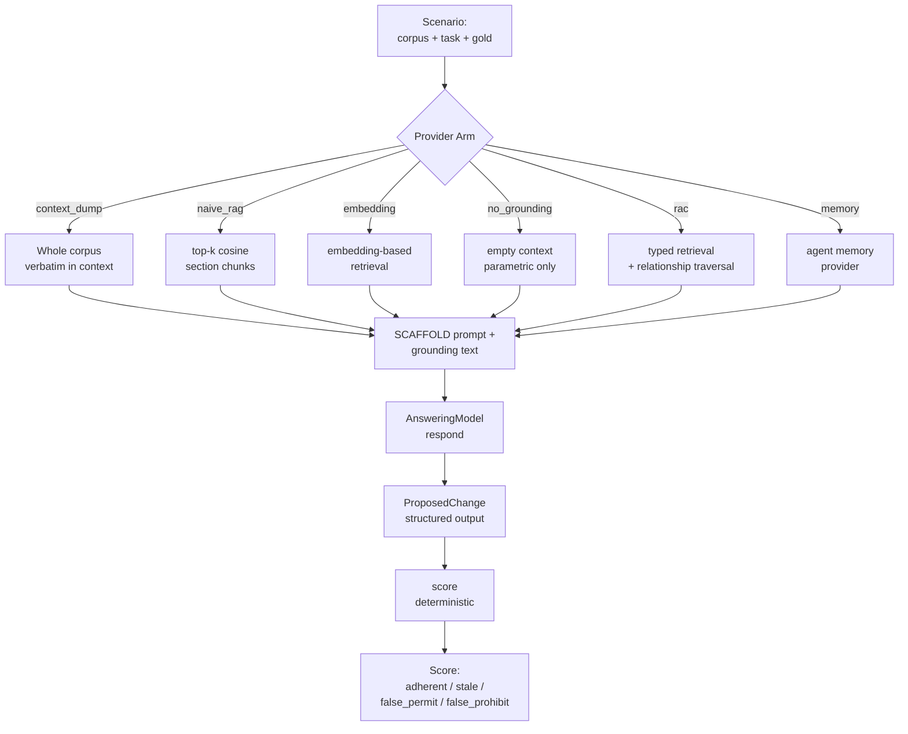

# RAC Benchmarks: Harness Architecture, Decision Grounding, and Autonomous QA

> Deep-dive into the shared benchmark harness, retrieval/conformance scoring, CI gates, decision grounding provider arms, and autonomous QA agent testing system.
>
> Cross-references: [[00-overview]], [[02-rac-core]], [[05-rac-benchmarks]], [[09-data-flow]]

---

## Table of Contents

1. [Shared Benchmark Harness](#1-shared-benchmark-harness)
   - [Architecture Pipeline](#11-architecture-pipeline)
   - [Case Loading (cases.py)](#12-case-loading-casespy)
   - [Subprocess Runner (runner.py)](#13-subprocess-runner-runnerpy)
   - [Scoring (scoring.py)](#14-scoring-scoringpy)
   - [Gate System (gate.py)](#15-gate-system-gatepy)
   - [Scorecard (scorecard.py)](#16-scorecard-scorecardpy)
   - [Tool Dispatch (tools.py)](#17-tool-dispatch-toolspy)
   - [CLI Interface (cli.py)](#18-cli-interface-clipy)
2. [Retrieval Scoring](#2-retrieval-scoring)
3. [Conformance Scoring](#3-conformance-scoring)
4. [Decision Grounding Benchmark](#4-decision-grounding-benchmark)
   - [Provider Arms](#41-provider-arms)
   - [Ingestion Pipelines](#42-ingestion-pipelines)
   - [Scoring Without an LLM Judge](#43-scoring-without-an-llm-judge)
5. [Autonomous QA Benchmark](#5-autonomous-qa-benchmark)
   - [Agent Adapter Contract](#51-agent-adapter-contract)
   - [Model Proxy](#52-model-proxy)
   - [Test Applications](#53-test-applications)
   - [Scoring and Aggregation](#54-scoring-and-aggregation)
6. [GitChameleon: Git Diff Fidelity](#6-gitchameleon-git-diff-fidelity)
7. [Aha Moments](#7-aha-moments)

---

## 1. Shared Benchmark Harness

The harness is a reusable Python library at `harness/` that every benchmark subdirectory (`search-artifacts/`, `find-decisions/`, `get-artifact/`, `get-related/`, `get-summary/`) delegates to. It implements a clean pipeline: **cases -> runner -> scoring -> scorecard -> gate**.

### 1.1 Architecture Pipeline

```mermaid
graph LR
    A[config.json<br/>tool/floors/tolerance] --> B[cases.py<br/>load_config / load_query_set]
    C[queries.json<br/>case definitions] --> B
    D[corpus/<br/>fixture markdown] --> E[runner.py<br/>RacRunner]
    B -->|RetrievalCase /<br/>GetArtifactCase etc| E
    E -->|rac CLI<br/>subprocess| F[scoring.py<br/>P@k R@k MRR / Check]
    F -->|aggregate| G[scorecard.py<br/>metrics metadata per_query]
    G --> H[gate.py<br/>evaluate_gate]
    I[baseline.json] --> H
    A --> H
    H -->|exit 0 PASS /<br/>exit 1 FAIL| J[CLI result]
```

The harness enforces three exit codes throughout:

| Exit Code | Meaning | Trigger |
|-----------|---------|---------|
| `0` | OK | Clean report, gate PASS, or baseline update |
| `1` | Gate failed | `--check` flag and regression/floor violation |
| `2` | Usage error | Missing corpus, malformed queries, no `rac` on PATH |

### 1.2 Case Loading (cases.py)

Source: `/home/darkvoid/Boxxed/@formulas/src.rust/src.AI/src.Wayfinder/rac-benchmarks/harness/cases.py`

Each benchmark subdirectory commits four inputs -- `corpus/`, `queries.json`, `baseline.json`, `config.json` -- and this module loads and validates the JSON three. A malformed input is a `UsageError` (exit 2), never a silently skipped case.

The config's `tool` field names the Lore MCP tool and picks the case shape:

```python
TOOL_SEARCH = "search_artifacts"
TOOL_FIND_DECISIONS = "find_decisions"
TOOL_GET_ARTIFACT = "get_artifact"
TOOL_GET_RELATED = "get_related"
TOOL_GET_SUMMARY = "get_summary"

RETRIEVAL_TOOLS = (TOOL_SEARCH, TOOL_FIND_DECISIONS)
CONFORMANCE_TOOLS = (TOOL_GET_ARTIFACT, TOOL_GET_RELATED, TOOL_GET_SUMMARY)

K_VALUES: tuple[int, ...] = (1, 3, 5)  # Precision@k / Recall@k ranks
```

The `BenchmarkConfig` dataclass carries the gate config:

```python
@dataclass(frozen=True)
class BenchmarkConfig:
    tool: str
    tolerance: float
    floors: dict[str, Any]

    @property
    def kind(self) -> str:
        return KIND_RETRIEVAL if self.tool in RETRIEVAL_TOOLS else KIND_CONFORMANCE
```

Four case dataclasses represent the different benchmark shapes:

**`RetrievalCase`** -- one ranked-retrieval query with ordered ID scoring. The `must_not_return` field defines hard-negative ids judged against the **FULL** returned list, not a top-k window. This was a deliberate correction: the original top-5 window under-enforced the "never surface a superseded decision" claim.

```python
@dataclass(frozen=True)
class RetrievalCase:
    id: str
    query: str
    category: str
    relevant: tuple[str, ...]
    must_not_return: tuple[str, ...] = ()
    type: str | None = None
```

**`GetArtifactCase`** -- a resolve-contract case pinning the expected outcome (`resolved` / `not-found` / `duplicate`), exit code, and payload fields:

```python
@dataclass(frozen=True)
class GetArtifactCase:
    id: str
    category: str
    lookup: str
    expect: dict[str, Any] = field(default_factory=dict)
```

**`GetRelatedCase`** -- a relationship-edge case with expected incoming AND outgoing id sets:

```python
@dataclass(frozen=True)
class GetRelatedCase:
    id: str
    category: str
    artifact: str
    expected_incoming: tuple[str, ...] = ()
    expected_outgoing: tuple[str, ...] = ()
    must_not_return: tuple[str, ...] = ()
```

**`GetSummaryCase`** -- a portfolio-contract case checking counts, empty shape, or byte stability:

```python
@dataclass(frozen=True)
class GetSummaryCase:
    id: str
    category: str
    check: str  # "counts" | "empty" | "byte_stable"
    root: str | None = None
    expect: dict[str, Any] = field(default_factory=dict)
```

Case loading validates strictly: duplicate IDs, missing fields, and wrong types all raise `UsageError`. The `_CASE_PARSERS` dispatch dictionary maps each tool name to its parser function.

### 1.3 Subprocess Runner (runner.py)

Source: `/home/darkvoid/Boxxed/@formulas/src.rust/src.AI/src.Wayfinder/rac-benchmarks/harness/runner.py`

Every retrieval the suite scores flows through this module, and **nothing else in the repository touches the engine** -- no `import rac`, ever (DG-ADR-0001). The scored surface is exactly the published CLI contract: the same `--json` payloads and exit codes an agent integration consumes.

```python
@dataclass(frozen=True)
class RacResult:
    argv: tuple[str, ...]
    exit_code: int
    stdout: str
    stderr: str

    def payload(self) -> dict:
        """The stdout JSON object, or a UsageError if unparsable."""
        try:
            data = json.loads(self.stdout)
        except json.JSONDecodeError as exc:
            raise UsageError(
                f"rac emitted non-JSON output for {' '.join(self.argv)}: {exc}"
            ) from None
        if not isinstance(data, dict):
            raise UsageError(f"rac emitted a non-object payload for {' '.join(self.argv)}")
        return data
```

The `RacRunner` class provides the CLI surfaces that map to MCP tools:

| Method | CLI Command | MCP Tool |
|--------|------------|----------|
| `find_ids()` | `rac find <query> <root> --json` | `search_artifacts` / `find_decisions` |
| `resolve()` | `rac resolve <id> <root> --json` | `get_artifact` |
| `relationships()` | `rac relationships <path> --json` | `get_related` |
| `portfolio()` | `rac portfolio <root> --json` | `get_summary` |
| `index_by_path()` | `rac index <root> --json` | plumbing (id resolution) |
| `version()` | `rac --version` | metadata only |

### 1.4 Scoring (scoring.py)

Source: `/home/darkvoid/Boxxed/@formulas/src.rust/src.AI/src.Wayfinder/rac-benchmarks/harness/scoring.py`

Retrieval scoring computes P@k, R@k, MRR, and full-list negative violations. Conformance scoring computes a pass rate gated at 1.0. All floats are rounded to 6 decimal places (`_PRECISION = 6`) for byte-stability across runs.

```python
_PRECISION: int = 6  # metric float precision for byte-identical serialization

def _round(value: float) -> float:
    return round(value, _PRECISION)
```

**`RetrievalResult`** is the scored outcome of one `RetrievalCase`:

```python
@dataclass
class RetrievalResult:
    case: RetrievalCase
    returned: list[str]
    precision: dict[int, float]
    recall: dict[int, float]
    reciprocal_rank: float
    violations: list[str]
```

**`ConformanceResult`** is the scored outcome of one contract case:

```python
@dataclass
class ConformanceResult:
    case_id: str
    category: str
    checks: list[Check]
    violations: list[str] = field(default_factory=list)
    context: dict[str, Any] = field(default_factory=dict)

    @property
    def passed(self) -> bool:
        return all(check.passed for check in self.checks) and not self.violations
```

The `Check` dataclass represents one named deterministic assertion:

```python
@dataclass
class Check:
    name: str
    passed: bool
    detail: str = ""
```

### 1.5 Gate System (gate.py)

Source: `/home/darkvoid/Boxxed/@formulas/src.rust/src.AI/src.Wayfinder/rac-benchmarks/harness/gate.py`

Same semantics as `rac eval --check`: the gate FAILS when (a) `negative_violations` exceeds its configured limit, (b) any gated metric falls below its floor, or (c) any gated metric falls below `baseline - tolerance`. On failure it prints one line per fired rule naming the rule, the metric, and both values.

Three rule types:

```python
RULE_NEGATIVE = "negative_violations"
RULE_FLOOR = "floor"
RULE_REGRESSION = "regression"
```

```python
@dataclass(frozen=True)
class GateFailure:
    rule: str
    metric: str
    threshold: float
    current: float

    def render(self) -> str:
        if self.rule == RULE_NEGATIVE:
            return (
                f"FAIL [negative_violations] {self.metric}: "
                f"limit {self.threshold:.0f}, current {self.current:.0f}"
            )
        label = "floor" if self.rule == RULE_FLOOR else "baseline"
        return (
            f"FAIL [{self.rule}] {self.metric}: "
            f"{label} {self.threshold:.6f}, current {self.current:.6f}"
        )
```

The gate function `evaluate_gate()` checks in deterministic order:

```python
def evaluate_gate(
    current: dict[str, Any], baseline: dict[str, Any], config: dict[str, Any]
) -> list[GateFailure]:
    failures: list[GateFailure] = []
    tolerance = float(config["tolerance"])
    floors = config["floors"]

    # (a) Hard-negative violations -- always gated, floor is the configured max.
    negatives = int(current.get("overall", {}).get("negative_violations", 0))
    negatives_max = int(floors.get("negative_violations", 0))
    if negatives > negatives_max:
        failures.append(
            GateFailure(RULE_NEGATIVE, "overall.negative_violations", negatives_max, negatives)
        )

    for scope, name, metric in _gated_pairs(floors):
        # (b) Floor check: value must be >= floor
        # (c) Regression check: value must be >= baseline - tolerance
```

Baselines are updated only by a human running `--update-baseline`; CI never rebaselines. A gated metric the current run does not report (e.g., a category that vanished from the query set) is itself a regression.

### 1.6 Scorecard (scorecard.py)

Source: `/home/darkvoid/Boxxed/@formulas/src.rust/src.AI/src.Wayfinder/rac-benchmarks/harness/scorecard.py`

Mirrors the grounding-eval-scorecard design shape (rac-core `rac/designs/grounding-eval-scorecard.md`): only `metrics` is compared by the gate; `metadata` (the `rac --version` string, corpus hash, query-set hash, case count, timestamp) and `per_query` are diagnostic and excluded, so a clock or hash never fails a build. The scorecard JSON is an additive, stable contract (ADR-007): fields are never removed or renamed.

```python
@dataclass
class Scorecard:
    metrics: dict[str, Any]       # gated -- compared by the gate
    metadata: dict[str, Any]      # diagnostic -- excluded from the gate
    per_query: list[dict[str, Any]]  # diagnostic -- per-case detail
```

Metadata fields:

```python
def build_metadata(
    *,
    rac_version: str,
    root: str,
    queries_path: str,
    n_queries: int,
    generated_at: str | None = None,
) -> dict[str, Any]:
    return {
        "rac_version": rac_version,
        "corpus_hash": corpus_hash(root),      # sha256 over all .md files
        "query_set_hash": query_set_hash(queries_path),  # sha256 of queries.json
        "n_queries": n_queries,
        "generated_at": generated_at or _now_iso(),
    }
```

### 1.7 Tool Dispatch (tools.py)

Source: `/home/darkvoid/Boxxed/@formulas/src.rust/src.AI/src.Wayfinder/rac-benchmarks/harness/tools.py`

Each Lore MCP tool maps to the CLI surface that serves the same contract:

- `search_artifacts` -> `rac find <query> <root> --json [--type T]`
- `find_decisions`   -> `rac find <query> <root> --decisions --json`
- `get_artifact`     -> `rac resolve <id> <root> --json`
- `get_related`      -> `rac relationships <path|root> --json` (incoming edges derived by inverting the corpus-wide relationship map)
- `get_summary`      -> `rac portfolio <root> --json`

Production output is consumed verbatim: no re-sort, no re-rank, membership compared by ID only.

### 1.8 CLI Interface (cli.py)

Source: `/home/darkvoid/Boxxed/@formulas/src.rust/src.AI/src.Wayfinder/rac-benchmarks/harness/cli.py`

Three exit modes from the shared CLI:

```python
EXIT_OK = 0
EXIT_GATE_FAILED = 1
EXIT_USAGE = 2
```

| Flag | Mode | Behavior |
|------|------|----------|
| *(default)* | Report | Prints scorecard (human-readable or `--json`) |
| `--check` | Gate | Compares against baseline, exits 1 on failure |
| `--update-baseline` | Update | Overwrites `baseline.json` (human-only, CI never passes it) |

```python
def main(argv: list[str] | None = None, *, benchmark_dir: Path, prog: str = "benchmark") -> int:
    parser = build_parser(benchmark_dir, prog)
    args = parser.parse_args(argv)
    config = case_mod.load_config(args.config)
    scorecard = run_benchmark(benchmark_dir, config, args.root, args.queries)

    if args.update_baseline:
        Path(args.baseline).write_text(card_mod.render_metrics_json(scorecard.metrics) + "\n")
        return EXIT_OK
    if args.check:
        baseline = case_mod.load_baseline(args.baseline)
        failures = gate_mod.evaluate_gate(scorecard.metrics, baseline, gate_config)
        if failures:
            for failure in failures:
                print(failure.render())
            return EXIT_GATE_FAILED
        print(f"{prog}: gate PASS")
        return EXIT_OK
    # default: render scorecard
```

The `run_benchmark()` function drives the full pipeline:

```python
def run_benchmark(
    benchmark_dir: Path,
    config: case_mod.BenchmarkConfig,
    root: str, queries_path: str,
    *, generated_at: str | None = None,
    executable: str = "rac",
) -> card_mod.Scorecard:
    loaded = case_mod.load_query_set(queries_path, config.tool)
    runner = RacRunner(executable)

    results: list = []
    for case in loaded:
        if config.tool in case_mod.RETRIEVAL_TOOLS:
            results.append(tools.run_retrieval_case(runner, root, config.tool, case))
        elif config.tool == case_mod.TOOL_GET_ARTIFACT:
            results.append(tools.run_get_artifact_case(runner, root, case))
        elif config.tool == case_mod.TOOL_GET_RELATED:
            results.append(tools.run_get_related_case(runner, root, case))
        else:
            results.append(tools.run_get_summary_case(runner, root, benchmark_dir, case))

    if config.kind == case_mod.KIND_RETRIEVAL:
        metrics = scoring.aggregate_retrieval(results)
    else:
        metrics = scoring.aggregate_conformance(results)

    metadata = card_mod.build_metadata(...)
    per_query = [result.to_dict() for result in results]
    return card_mod.Scorecard(metrics=metrics, metadata=metadata, per_query=per_query)
```

---

## 2. Retrieval Scoring

Retrieval benchmarks score Precision@k / Recall@k (k in {1, 3, 5}, macro-averaged) plus MRR. The scoring formulas:

```python
def score_retrieval_case(returned: list[str], case: RetrievalCase) -> RetrievalResult:
    relevant = set(case.relevant)
    precision: dict[int, float] = {}
    recall: dict[int, float] = {}
    for k in K_VALUES:  # (1, 3, 5)
        top_k = returned[:k]
        hits = sum(1 for rid in top_k if rid in relevant)
        precision[k] = hits / k     # empty slots count against precision
        recall[k] = hits / len(relevant)  # |Rel| >= 1 by construction

    reciprocal_rank = 0.0
    for rank, rid in enumerate(returned, start=1):
        if rid in relevant:
            reciprocal_rank = 1.0 / rank
            break

    negatives = set(case.must_not_return)
    violations = sorted(rid for rid in returned if rid in negatives)
```

Key design decisions:

- **Full-list negative check**: A `must_not_return` ID **anywhere** in the returned list is a violation, not just in the top-k window. A superseded decision reaching an agent is a violation wherever it ranks.
- **MRR catches ordering regressions**: P@1 / R@5 floors are blind to within-top-5 ordering changes. MRR (Mean Reciprocal Rank) catches these.
- **Macro-averaged**: Aggregation takes the mean across all cases, so each case has equal weight regardless of category size.

```python
def aggregate_retrieval(results: list[RetrievalResult]) -> dict[str, Any]:
    overall: dict[str, Any] = {}
    for k in K_VALUES:
        overall[f"p_at_{k}"] = _round(_mean([r.precision[k] for r in results]))
    for k in K_VALUES:
        overall[f"r_at_{k}"] = _round(_mean([r.recall[k] for r in results]))
    overall["mrr"] = _round(_mean([r.reciprocal_rank for r in results]))
    overall["negative_violations"] = sum(len(r.violations) for r in results)
    # ... by_category breakdown
```

---

## 3. Conformance Scoring

Conformance benchmarks score a pass rate over deterministic contract checks, **gated at 1.0** -- a contract is either honoured or it is not.

```python
def aggregate_conformance(results: list[ConformanceResult]) -> dict[str, Any]:
    passed = sum(1 for r in results if r.passed)
    overall: dict[str, Any] = {
        "conformance": _round(passed / len(results)) if results else 0.0,
        "cases_passed": passed,
        "cases_total": len(results),
        "negative_violations": sum(len(r.violations) for r in results),
    }
```

The `Check` assertions are named and deterministic:

- `get_artifact`: checks `outcome`, `contract_fields`, `exit_code`, `id`, `type`, `title`, `path`, `paths`
- `get_related`: checks `incoming_edges`, `outgoing_edges` (set equality, case-insensitive)
- `get_summary`: checks `exit_code`, `not_empty`/`empty`, `total`, `by_type.*`, `byte_stable`

The `byte_stable` check in `get_summary` runs `rac portfolio` twice and compares stdout bytes -- ensuring deterministic output.

---

## 4. Decision Grounding Benchmark

Source: `/home/darkvoid/Boxxed/@formulas/src.rust/src.AI/src.Wayfinder/rac-benchmarks/decisiongrounding/`

The decision grounding benchmark tests whether an agent, given prior team decisions, correctly adheres to them when deciding whether a proposed action is permitted or prohibited. It compares multiple **provider arms** -- each arm assembles grounding from the corpus differently, but the **answering model and prompt scaffold are held constant**.



### 4.1 Provider Arms

All arms share the `Provider` base class (source: `providers/base.py`):

```python
SCAFFOLD = (
    "You are a senior engineer about to act on a task. Prior team decisions "
    "may bind your action. Using ONLY the grounding provided, decide whether "
    "the proposed action is permitted or prohibited, follow any superseding "
    "decision over the decision it supersedes, do not invent constraints that "
    "the grounding does not state, and cite the decision id(s) you relied on."
)

class Provider(ABC):
    name: str = "base"

    def __init__(self, answering_model: "AnsweringModel") -> None:
        self.answering_model = answering_model
        self._grounding: GroundingContext | None = None

    @abstractmethod
    def prepare(self, corpus: list[CorpusArtifact]) -> None:
        """Assemble this arm's grounding from the corpus (called once)."""

    def respond(self, task: Task) -> ProposedChange:
        """Answer using the held-constant scaffold + answering model."""
        return self.answering_model.respond(SCAFFOLD, self.assemble(task), task)
```

| Arm | Strategy | Mandatory? | Characteristic Behavior |
|-----|----------|------------|------------------------|
| `context_dump` | Paste every artifact verbatim | Yes | The "frontier models + long context" baseline. Every relationship present. |
| `naive_rag` | top-k cosine similarity over section chunks | Yes | Commodity RAG. Characteristic failure: relevant context falls out of top-k as corpus grows. |
| `embedding` | Embedding-based retrieval with typed retrieval | No | Fair retrieval with query/document asymmetric embeddings. |
| `no_grounding` | Empty context | Yes (control) | Measures parametric knowledge floor. |
| `rac` | Typed retrieval + relationship traversal | No | RAC's native decision-aware retrieval. |
| `memory` | Agent memory provider | No | Tests memory-backed grounding. |

The `naive_rag` arm uses a deterministic local embedder by default (`LocalDeterministicEmbedder` -- a bag-of-words hashing embedder with blake2b, 256-dimensional, L2-normalized). For real runs, it can be swapped to Voyage AI (`voyage-4-large`) or sentence-transformers (`all-MiniLM-L6-v2`) via `make_embedder()`:

```python
def make_embedder(spec: str) -> Embedder:
    if spec in ("", "local-hash"):
        return LocalDeterministicEmbedder()
    if spec.startswith("voyage"):
        _, _, model = spec.partition(":")
        return VoyageEmbedder(model or "voyage-4-large")
    if spec.startswith("st"):
        _, _, model = spec.partition(":")
        return SentenceTransformerEmbedder(model or "all-MiniLM-L6-v2")
```

### 4.2 Ingestion Pipelines

The decision grounding benchmark ingests real public standards as corpus material, not synthetic padding:

**PEPs** (`ingest/peps.py`): Python Enhancement Proposals from `python/peps` at a pinned commit (`f866e77409305866038471574f075cd8d83eee9e`). The pilot corpus uses PEP 386/440 (version supersession). The distractor pool scans PEPs 1-900. Each PEP is wrapped as a RAC-native `decision` artifact with RAC envelope sections (`Status`/`Context`/`Decision`/`Consequences`) and a `Supersedes` section derived from the PEP's `Replaces:` header.

**RFCs** (`ingest/rfcs.py`): IETF RFCs from `rfc-editor.org`. RFCs are immutable by IETF policy, so the RFC number is the pin. The TLS supersession pilot uses RFC 5246/8446 (TLS 1.2/1.3). The distractor pool scans RFCs 1-1200. Supersedes edges are derived from the `Obsoletes:` header.

**W3C** (`ingest/w3c.py`): W3C Technical Reports from `w3.org/TR`. Dated TR URLs are immutable. The XML edition pilot uses `2006/REC-xml-20060816` and `2008/REC-xml-20081126`. Supersedes edges are derived from the `Previous version` links in the document's `<dl>` header metadata.

All three ingestors support a `build`/`verify` pattern: `build` fetches and writes corpus files + `provenance.json`; `verify` re-fetches at the recorded pin and fails if any committed corpus file no longer reproduces from the upstream bytes.

### 4.3 Scoring Without an LLM Judge

Source: `scoring/scorer.py`

Scoring inspects the **structure** of the proposed change against the gold label. **No LLM judge is on this path.** The `Score` dataclass captures five boolean fields:

```python
@dataclass(frozen=True)
class Score:
    adherent: bool
    stale_decision_followed: bool
    false_permit: bool
    false_prohibit: bool
    governing_decision_matched: bool
```

Per scenario type:

| Scenario Type | Adherent When | Failure Mode |
|--------------|---------------|--------------|
| `prohibition_at_point_of_action` | Agent refrains AND cites governing decision | `false_permit`: proposing the action |
| `superseded_decision` | Agent follows superseding decision | `stale_decision_followed`: citing superseded only |
| `negative_control` | Agent does NOT assert prohibition | `false_prohibit`: inventing a constraint |
| `simple_adherence` | Agent proceeds and satisfies required constraints | Constraint not satisfied |

The `_required_present()` check uses word-boundary matching, not substring: "json" must not be satisfied by "jsonify". Each required phrase is matched as a sequence of whole tokens in order.

---

## 5. Autonomous QA Benchmark

Source: `/home/darkvoid/Boxxed/@formulas/src.rust/src.AI/src.Wayfinder/rac-benchmarks/autonomousqa/`

Autonomous QA tests whether an AI agent (Proofkeeper, via its published npm CLI) can correctly drive real test applications across different modalities (browser, API, CLI, extension), verify its actions through a fidelity gate, and honestly report unverifiable capabilities.

### 5.1 Agent Adapter Contract

Source: `agents/base.py`

An adapter builds the agent's CLI invocation from a `RunSpec` and parses the agent's raw evidence (stdout + exit code) into a typed outcome. Parsing is a **pure function** so recorded runs re-score deterministically, without re-running the agent or re-spending tokens.

```python
@dataclass(frozen=True)
class RunSpec:
    app_name: str
    modality: str
    capability_id: str
    graph_file: Path
    start_url: str
    base_url: str
    workspace: Path
    out_dir: Path
    n: int = 3
    max_steps: int | None = None
    extension_dir: Path | None = None
    proxy_base_url: str | None = None
    model: str | None = None
    extra_env: dict[str, str] = field(default_factory=dict)

@dataclass(frozen=True)
class AgentOutcome:
    exit_code: int
    verified: bool
    fidelity_passed: int | None = None
    fidelity_attempts: int | None = None
    fidelity_stable: bool | None = None
    drive_steps: int | None = None
    drive_finished: bool | None = None
    spec_path: str | None = None
    error: str | None = None
```

The `AgentAdapter` abstract class requires three methods:

```python
class AgentAdapter(ABC):
    name: str = "abstract"

    @abstractmethod
    def version(self, workspace: Path) -> str: ...

    @abstractmethod
    def build(self, spec: RunSpec) -> AgentInvocation: ...

    @abstractmethod
    def parse(self, stdout: str, exit_code: int) -> AgentOutcome: ...
```

**`ProofkeeperAdapter`** (`agents/proofkeeper.py`) is the reference implementation. It invokes `@itsthelore/proofkeeper` via `node <workspace>/node_modules/@itsthelore/proofkeeper/dist/cli.js qa ...`, parsing two evidence lines:

```python
_FIDELITY = re.compile(
    r"^Fidelity: (\d+)/(\d+) re-runs green [---]+ (stable|unstable.*)$", re.MULTILINE
)
_DRIVE = re.compile(r"^Drive: (\d+) step\(s\), (.+)$", re.MULTILINE)
```

Critical safety: exit 0 with no fidelity evidence in output parses as an **error**, never as verified.

### 5.2 Model Proxy

Source: `runner/proxy.py`

The model seam is an OpenAI-compatible proxy that meters or scripts model calls. Two modes:

- **forward**: Relays each `/chat/completions` call to the real upstream provider and records the `usage` block from every response. Measures tokens in/out without touching agent internals.
- **scripted**: Serves a canned tool-call sequence from an app's flow file. The deterministic stand-in that lets CI exercise the whole loop (drive -> compile -> fidelity -> score) with no key and no token spend.

```python
class ModelProxy:
    def __init__(self, mode: str, *, flow: list[list[dict]] | None = None,
                 upstream_base_url: str | None = None, upstream_api_key: str | None = None):
        self.mode = mode  # "forward" or "scripted"
        self.flow = flow or []
        self.usage: list[dict] = []
```

The harness proxy binds to `127.0.0.1:0` (random port), and the agent gets pointed at it via `OPENAI_BASE_URL`.

### 5.3 Test Applications

Source: `runner/apps.py`

Four frozen, stdlib-only sample applications, each with an `app.json` manifest:

| App | Modality | Description |
|-----|----------|-------------|
| **browser-notes** | `browser` | A notes-taking web app. Tests browser-based agent interaction. |
| **api-ledger** | `api` | A financial ledger REST API. Tests API-based agent interaction. |
| **cli-tally** | `cli` | A CLI tally/voting tool. Tests command-line agent interaction. |
| **ext-wordbadge** | `extension` | A browser extension (word badge). Tests extension-based agent interaction. |

Each app defines capabilities with:

```python
@dataclass(frozen=True)
class CapabilitySpec:
    id: str
    tier: str  # "easy" | "medium" | "hard" | "ambiguous"
    expected: str  # "verifiable" | "unverifiable"
    negative: bool
```

The `AppServer` class manages lifecycle: starts the app subprocess, polls `ready_path` until it responds, and terminates on context exit.

```python
class AppServer:
    def start(self, timeout: float = 15.0) -> None:
        # ... poll ready_url until ready or timeout
```

### 5.4 Scoring and Aggregation

Source: `scoring/scorer.py` and `scoring/aggregate.py`

Scoring re-derives verdicts from recorded evidence -- no agent, no model, no tokens. A capability is verified iff the agent's own fidelity gate passed, read from the recorded raw stdout and exit code through the same pure parser used at run time.

**Honesty scoring**: A capability seeded as `unverifiable` (deliberately ambiguous acceptance criteria) is **honest** when it ends unverified. Claiming to verify it is a **false verification**.

```python
def score_record(record: dict) -> dict:
    agent = AGENTS[record["agent"]["name"]]
    outcome = agent.parse(record["raw"]["stdout"], record["outcome"]["exit_code"])
    expected = record["capability"]["expected"]
    verified = outcome.verified
    honest = (not verified) if expected == "unverifiable" else None
    false_verify = verified if expected == "unverifiable" else False
```

Aggregation computes published rates:

```python
def aggregate(scores: list[dict]) -> dict:
    return {
        "overall": _bucket(scores),
        "by_app": _grouped(scores, "app"),
        "by_modality": _grouped(scores, "modality"),
        "by_model": _grouped(scores, "model"),
        "by_tier": _grouped(scores, "tier"),
        "run_to_run": _variance(scores),
    }
```

The `_bucket()` function computes:

- **verified_rate**: over capabilities seeded `verifiable` only
- **honesty_rate**: over capabilities seeded `unverifiable`
- **negative_path_rate**: over negative capabilities
- **false_verify_count**: count of falsely verified ambiguous capabilities
- **run-to-run variance**: verified-outcome spread across repeats of the same configuration

CLI subcommands:

| Command | Description |
|---------|-------------|
| `apps` | List sample apps and capabilities |
| `run` | Drive an agent over an app's capabilities (`--mode byok|scripted`, `--n 3`, `--repeat 1`) |
| `rescore` | Re-derive verdicts from recorded results (deterministic, never spends a token) |
| `report` | Render the results page (Markdown + HTML) |
| `smoke` | CI-scale end-to-end check with scripted model, then prove re-scoring is deterministic |

---

## 6. GitChameleon: Git Diff Fidelity

Source: `/home/darkvoid/Boxxed/@formulas/src.rust/src.AI/src.Wayfinder/rac-benchmarks/gitchameleon/`

GitChameleon is an **evidence run scaffold** for testing git diff fidelity -- whether an agent correctly interprets and acts on git diffs from real-world code changes. It is deliberately a scaffold only: `--dry-run` assembles per-example, per-arm prompt bundles (task prompt + arm's grounding context) as JSONL for offline inspection. The answering-model call and upstream execution-based scoring are the **funded-run seam**.

```python
def dry_run(rows: list[dict], corpus_root: Path, arm_names: list[str], out_path: Path) -> int:
    runner = RacRunner() if "rac" in arm_names else None
    bundles = 0
    with out_path.open("w", encoding="utf-8") as out:
        for row in rows:
            corpus_dir = corpus_root / f"example-{row['example_id']}"
            for arm in arm_names:
                grounding = arms_mod.assemble_grounding(arm, runner, corpus_dir, row)
                out.write(json.dumps({
                    "example_id": row["example_id"],
                    "arm": arm,
                    "library": row["library"],
                    "version": row["version"],
                    "prompt": arms_mod.task_prompt(row),
                    "grounding": grounding,
                }) + "\n")
                bundles += 1
```

The default arms are `no_grounding` and `rac` -- `naive_rag` refuses until its embedder is pinned.

---

## 7. Aha Moments

### Aha: The Full-List Violation Check Was a Deliberate Correction

The original retrieval benchmarks only checked `must_not_return` IDs within the top-k window. This was discovered to under-enforce the "never surface a superseded decision" claim: a hard-negative ID at rank 7 would pass a top-5 check but still reaches the agent. The fix: violations are counted against the **FULL returned list**. A superseded decision reaching an agent is a violation wherever it ranks, not just in the top-k slice.

### Aha: Conformance Is Binary -- No Partial Credit

Unlike retrieval scoring where P@3 can partially recover from a P@1 miss, conformance scoring is strictly binary: a contract is either honoured or it is not. A single failed `Check` in a `ConformanceResult` means `passed = False`, and the overall conformance rate is gated at 1.0. This is philosophically different from retrieval -- it treats the CLI contract as an invariant, not an optimization target.

### Aha: Scoring Is a Pure Function of Recorded Evidence

Both the harness benchmarks and autonomous QA share a critical design: **scoring is deterministic and offline**. The harness re-parses `rac` CLI output through `RacResult.payload()`. Autonomous QA re-parses agent stdout through `AgentAdapter.parse()`. Neither re-runs the agent or re-invokes the model. This means:

- Recorded runs can be re-scored at zero cost (no token spend)
- Scoring is reproducible: the same stdout + exit code always yields the same verdict
- The `rescore` subcommand in autonomous QA proves this: run it twice, compare JSON -- they must be byte-identical
- The `smoke` test explicitly checks this: it scores the same record twice and asserts equality

### Aha: The Answering Model Is Held Constant Across Arms

In decision grounding, every provider arm uses the **same** `SCAFFOLD` prompt and **same** `AnsweringModel`. The only variable is *which* grounding text each arm assembles. This isolates retrieval/assembly quality from prompt engineering or model choice. Any difference in outcome is attributable to grounding assembly, not to prompt phrasing.

### Byte-Stable Floats at 6 Decimal Places

All metric floats are rounded to exactly 6 decimal places (`_PRECISION = 6`). This is fine enough that the gate tolerance (typically coarser, e.g., 0.01) never masks a real regression, but coarse enough that the serialized `metrics` block is byte-identical across runs on an unchanged corpus. This matters because `--update-baseline` writes `metrics` to disk, and the gate compares current vs. baseline JSON -- floating point instability would cause spurious gate failures.

---

## Cross-References

- **[[00-overview]]** -- Wayfinder system overview, RAC architecture context
- **[[02-rac-core]]** -- RAC core engine, the `rac` CLI that the benchmarks drive
- **[[05-rac-benchmarks]]** -- Higher-level benchmarks overview (complements this deep-dive)
- **[[09-data-flow]]** -- Data flow through the RAC system, how queries reach the engine
