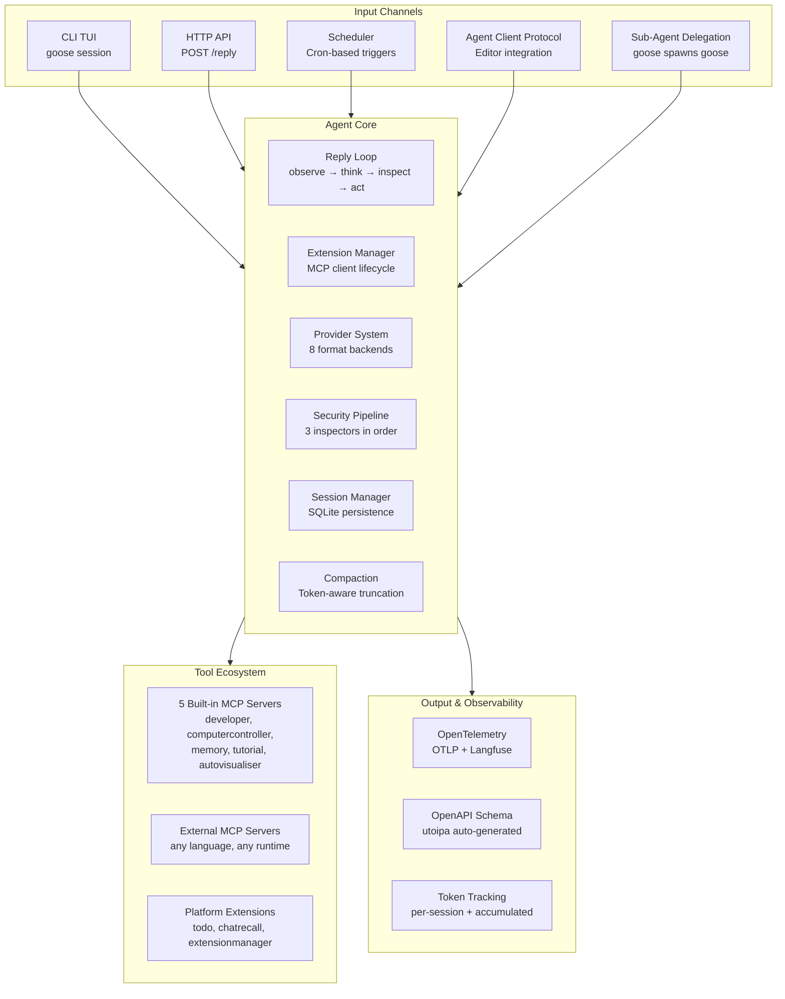

# Goose — On-Machine AI Agent by Block

**Goose is an on-machine AI agent built by Block (Square) — a developer's programmable assistant that connects to any LLM, orchestrates tools through MCP extensions, enforces a 3-layer security pipeline, persists sessions in SQLite, and runs as both a CLI TUI and HTTP server.** The codebase is 96,846 lines of Rust across 6 crates with 337 source files. Understanding it means understanding how an agent loop, extension system, provider abstraction, permission pipeline, session storage, recipe engine, and scheduler combine into a single binary that can autonomously write code, control a computer, manage its own memory, and deploy to production.

Source: `crates/` — 337 Rust files, 96,846 LOC, 6 crates, Apache-2.0

## Why Goose Matters

Goose is not a thin wrapper around an LLM API. It is a full agent operating system:



## Architecture at 30,000 Feet

The workspace has 6 crates with clear dependency arrows:

```
goose-server ──→ goose ──→ goose-mcp (via subprocess)
goose-cli ──────→ goose      goose-bench
                  ↓           ↓
              goose-mcp    goose (test)
              (5 servers)  goose-test
```

| Crate | LOC | Purpose |
|-------|-----|---------|
| `goose` | ~55,000 | Agent loop, extensions, providers, session, conversation, security, recipes, hints, tracing, scheduling |
| `goose-cli` | ~15,000 | TUI with 20+ clap subcommands, session builder, export, completion, ACP endpoint, web UI |
| `goose-mcp` | ~11,000 | 5 MCP servers: developer (3.7K lines), computercontroller, memory, tutorial, autovisualiser |
| `goose-server` | ~5,000 | Axum HTTP server with REST + WebSocket, OpenAPI, 8 route modules |
| `goose-bench` | ~3,000 | Eval runner, model runner, benchmark suites for developer and computercontroller |
| `goose-test` | ~50 | Capture/replay binary |

## Documents

### Foundation (read these first)

| # | Document | What You'll Master |
|---|----------|-------------------|
| 00 | **Overview** (this page) | Architecture, crate map, key design decisions |
| 01 | [Agent Architecture](01-architecture.md) | Agent struct, reply loop, tool dispatch, event system, compaction trigger |

### Deep Dives — Systems

| # | Document | What You'll Master |
|---|----------|-------------------|
| 02 | [Extensions](02-extensions.md) | ExtensionManager, MCP client trait, platform extensions, 5 transport types, malware scanning, env var deny-list |
| 03 | [Providers](03-providers.md) | Provider trait, 8 format backends, LeadWorker routing, OAuth, declarative providers, ModelInfo |
| 04 | [Security & Permissions](04-security-permissions.md) | 3-layer ToolInspection pipeline: SecurityInspector → PermissionInspector → RepetitionInspector, GooseMode |

### Deep Dives — Data

| # | Document | What You'll Master |
|---|----------|-------------------|
| 05 | [Session & Conversation](05-session-conversation.md) | SQLite schema v5, Session types, message model, token tracking, conversation repair |
| 06 | [Compaction & Context](06-compaction-context.md) | Token counting, threshold calculation, LLM-based summarization, message visibility metadata, context limit awareness |

### Deep Dives — Intelligence

| # | Document | What You'll Master |
|---|----------|-------------------|
| 07 | [Hints & Context Injection](07-hints-context.md) | `.goosehints` discovery (global → git root → cwd), `AGENTS.md`, `@file` references with import boundary, file expansion with depth limits |
| 08 | [Recipes](08-recipes.md) | YAML recipe format, sub-recipes, parameters, extensions, build pipeline, local discovery |
| 09 | [AutoPilot & Retry](09-autopilot-retry.md) | Model selector: trigger rules, premade roles, complexity analysis. Retry: success checks, failure actions, timeout config |

### Deep Dives — Infrastructure

| # | Document | What You'll Master |
|---|----------|-------------------|
| 10 | [MCP Servers](10-mcp-servers.md) | 5 built-in MCP servers: developer (filesystem+shell+text editor with tree-sitter), computercontroller (screenshots+automation+doc parsing), memory, tutorial, autovisualiser |
| 11 | [Tracing & Observability](11-tracing.md) | OpenTelemetry OTLP export, Langfuse observation layer, SpanTracker, BatchManager, tracing-to-OTEL mapping |
| 12 | [CLI Deep Dive](12-cli.md) | Every subcommand, session builder (12 steps), completion/export, ACP integration, web UI, scenario tests |
| 13 | [Server Deep Dive](13-server.md) | Axum routes, agent lifecycle, WebSocket streaming, OpenAPI generation, audio/scheduling/recipe endpoints |

## Key Design Decisions (The Aha Moments)

### 1. Tools are MCP Servers, Not Functions

Every tool — including the developer filesystem/shell tools — is a standalone MCP server communicating over stdio. The `ExtensionManager` is an MCP client manager. This means:
- **Any language works** — MCP servers can be Python, Node.js, Go, anything
- **Process isolation** — a crashing tool doesn't crash the agent
- **Hot reload** — tools can be enabled/disabled at runtime via the extensionmanager extension
- **Standard protocol** — any MCP-compatible server is automatically a goose extension

### 2. The Dual-Visibility Message Model

Messages have two independent visibility flags: `user_visible` and `agent_visible`. During compaction:
- Original messages remain `user_visible` (the human can scroll back) but become `agent_invisible` (the LLM doesn't see them)
- The compaction summary is `agent_visible` but `user_invisible` (the LLM sees context; the human doesn't see the summary clutter)
- This means compaction is lossy for the LLM but lossless for the human

### 3. Inspection = Deterministic Rules + LLM-as-Judge

The SecurityInspector is purely rule-based (no LLM) and runs first — it cannot be bypassed or hallucinated. The PermissionInspector calls the SAME LLM (with a classification tool) to determine read-only vs destructive — reusing the same provider for both permission checking and execution. If they differ in judgment, the rules win.

### 4. Providers are Format-Agnostic

Rather than 40 separate provider implementations, goose has ~8 **format** parsers (OpenAI, Anthropic, Google, Bedrock, Vertex, etc.). Each actual provider (OpenAI, Ollama, Venice, GitHub Copilot, DeepSeek) just declares which format it speaks. The format module handles request serialization and response parsing — the provider is just a URL + auth header.

### 5. Hints are Hierarchical

Goose discovers `.goosehints` files by walking from cwd up to git root, then checks global config. Each hints file can `@import` other files (up to 3 levels deep, bounded to the git root). This means a monorepo can have team-level hints at the root, project-level hints in subdirectories, and personal hints in `~/.config/goose/` — all composed at session start.

## Quick Start

```bash
# Start a session with default provider
goose session

# Start with specific provider and mode
goose session --provider anthropic --mode smart

# Run a recipe
goose run deploy-preview.yaml

# Start HTTP server
goosed --port 3000

# Schedule a recurring task
goose schedule add --cron "0 9 * * 1-5" --prompt "Check for critical CVEs"
```

## Next

→ [Agent Architecture](01-architecture.md) — The Agent struct, reply loop, tool dispatch, event system, and compaction mechanics.
