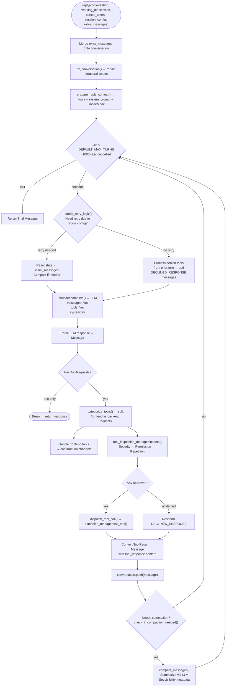

# Goose Agent Architecture — The Reply Loop, Tool Dispatch, Events

**The `Agent` struct (1,590 lines) is the central orchestrator.** It owns every subsystem: the LLM provider connection, the extension manager (MCP client lifecycle), the tool inspection pipeline (security/permission/repetition), the tool route manager, the retry manager, the autopilot model selector, the final output tool, and the frontend communication channels. The `reply()` method implements the main agent loop — a stateful cycle of [assemble context → call LLM → categorize tools → inspect → dispatch → format → compact → repeat] that runs until the LLM produces a text-only response or the turn limit (default: 1000) is reached.

Source: `crates/goose/src/agents/agent.rs` — 1,590 lines, `crates/goose/src/agents/tool_execution.rs`

## The Agent Struct: Every Field Explained

```rust
// crates/goose/src/agents/agent.rs:86-107
pub struct Agent {
    pub(super) provider: SharedProvider,              // Arc<Mutex<Option<Box<dyn Provider>>>>
    pub extension_manager: Arc<ExtensionManager>,      // MCP client manager (1,647 lines)
    pub(super) sub_recipe_manager: Mutex<SubRecipeManager>,
    pub(super) tasks_manager: TasksManager,            // Parallel sub-agent orchestration
    pub(super) final_output_tool: Arc<Mutex<Option<FinalOutputTool>>>,
    pub(super) frontend_tools: Mutex<HashMap<String, FrontendTool>>,
    pub(super) frontend_instructions: Mutex<Option<String>>,
    pub(super) prompt_manager: Mutex<PromptManager>,
    pub(super) confirmation_tx: mpsc::Sender<(String, PermissionConfirmation)>,
    pub(super) confirmation_rx: Mutex<mpsc::Receiver<(String, PermissionConfirmation)>>,
    pub(super) tool_result_tx: mpsc::Sender<(String, ToolResult<Vec<Content>>)>,
    pub(super) tool_result_rx: ToolResultReceiver,
    pub tool_route_manager: Arc<ToolRouteManager>,
    pub(super) scheduler_service: Mutex<Option<Arc<dyn SchedulerTrait>>>,
    pub(super) retry_manager: RetryManager,
    pub(super) tool_inspection_manager: ToolInspectionManager,
    pub(super) autopilot: Mutex<AutoPilot>,
}
```

### Channel Pair Pattern: confirmation_tx/rx + tool_result_tx/rx

**Aha:** Two `mpsc::channel(32)` pairs form an async request-response bridge between the agent's tokio task and the frontend (CLI or HTTP server). When the agent needs user confirmation for a destructive tool call:
1. Agent sends `(request_id, PermissionConfirmation)` on `confirmation_tx`
2. Agent awaits the response on `confirmation_rx`
3. Frontend renders the confirmation prompt, collects user input
4. Frontend sends the response back through `confirmation_tx`'s paired sender
5. Agent receives and proceeds

This decouples the agent loop from the UI without shared mutable state — the channels are the only touch point. The buffer size of 32 means up to 32 pending confirmations before the agent blocks.

### Provider as Arc<Mutex<Option<Box<dyn Provider>>>>

The provider is wrapped in THREE layers:
- `Arc` — shared across threads (agent, tool handlers, GooseClient)
- `Mutex` — mutable access (the provider can change during a session, e.g., autopilot model switching)
- `Option` — the provider is lazily initialized. On first access, `agent.provider().await` calls `Config::global()` to create the provider from config.

This means the agent doesn't hold an active LLM connection at rest — it's established on first use.

## The Complete Reply Loop



### Step 1: fix_conversation() — Structural Repair

```rust
// crates/goose/src/conversation/mod.rs
pub fn fix_conversation(conv: Conversation) -> (Conversation, Vec<ConversationIssue>) {
    // Runs on EVERY reply() call. Fixes:
    // 1. Duplicate system messages → keep only the most recent
    // 2. Tool responses without matching tool requests → remove orphan
    // 3. Non-alternating user/assistant roles → insert placeholder
    // 4. Empty messages → remove
    // 5. Multiple consecutive assistant messages → merge
}
```

**Why run this every time?** The LLM itself can produce malformed responses — a tool call without a name, a JSON parse failure, or duplicate content. If a previous turn's response was malformed and got into the conversation, the next `complete()` call would fail. `fix_conversation()` acts as a safety net: it ensures the conversation is always structurally valid before the LLM sees it, regardless of what the LLM produced last time.

### Step 2: prepare_reply_context() — Fresh Assembly Per Turn

```rust
// crates/goose/src/agents/agent.rs:245-281
async fn prepare_reply_context(&self, unfixed_conversation: Conversation,
    working_dir: &Path) -> Result<ReplyContext> {
    let (conversation, issues) = fix_conversation(unfixed_conversation.clone());
    let initial_messages = conversation.messages().clone();
    let config = Config::global();
    
    // Re-assemble tools and system prompt EVERY turn
    let (tools, toolshim_tools, system_prompt) =
        self.prepare_tools_and_prompt(working_dir).await?;
    
    let goose_mode = config.get_goose_mode().unwrap_or(GooseMode::Auto);
    self.tool_inspection_manager.update_permission_inspector_mode(goose_mode).await;
    
    Ok(ReplyContext { conversation, tools, toolshim_tools, system_prompt,
                      goose_mode, initial_messages })
}
```

**Aha:** Tools are re-assembled from the ExtensionManager on every turn. This means if a new extension was enabled mid-conversation (via the extensionmanager extension), its tools appear in the NEXT turn without restarting. The system prompt is ALSO re-rendered each turn — incorporating any hints or instructions that changed since the conversation started.

### Step 3: provider.complete() — The LLM Call

The `complete()` method on the Provider trait is the single LLM interface:

```rust
// crates/goose/src/providers/base.rs
#[async_trait]
pub trait Provider: Send + Sync {
    async fn complete(
        &self, system: &str, messages: &[Message], tools: &[Tool],
        cancel_token: Option<CancellationToken>,
    ) -> Result<(Message, ProviderUsage), ProviderError>;
}
```

It returns a fully-formed `Message` — NOT a stream of chunks. The format backends handle streaming internally: they buffer chunks, parse partial JSON for tool calls, and assemble the final `Message` only when the stream ends. This simplifies the reply loop enormously — it never deals with partial tool call JSON or mid-stream errors.

### Step 4: categorize_tools() — Frontend vs Backend Split

```rust
// crates/goose/src/agents/agent.rs:283-297
async fn categorize_tools(&self, response: &Message, _tools: &[Tool])
    -> ToolCategorizeResult {
    let (frontend_requests, remaining_requests, filtered_response) =
        self.categorize_tool_requests(response).await;
    ToolCategorizeResult { frontend_requests, remaining_requests, filtered_response }
}
```

Frontend tools (like `ask_user`, `file_picker`, `web_fetch`) are routed to the UI for rendering. Backend tools go through the inspection pipeline. This split prevents the LLM from calling `ask_user` 100 times in a loop — frontend tools are rate-limited by human response time.

### Step 5: tool_inspection_manager.inspect() — Three Layers

```rust
// crates/goose/src/tool_inspection/mod.rs
pub async fn inspect(&self, tool_requests: &[ToolRequest], messages: &[Message])
    -> Result<PermissionCheckResult> {
    // Layer 1: SecurityInspector (rule-based, deterministic)
    // Layer 2: PermissionInspector (LLM-as-judge, GooseMode-aware)
    // Layer 3: RepetitionInspector (loop detection)
    // Merged: any Deny → denied, any RequireApproval + no Deny → ask user
}
```

### Step 6: dispatch_tool_call() — MCP Execution

```rust
// crates/goose/src/agents/agent.rs:299-347
async fn handle_approved_and_denied_tools(&self, 
    permission_check_result: &PermissionCheckResult, ...) -> Result<Vec<(String, ToolStream)>> {
    for request in &permission_check_result.approved {
        let (req_id, tool_result) = self.dispatch_tool_call(
            tool_call, request.id.clone(), cancel_token.clone(), session).await;
        // Wrap in tool_stream: merge ServerNotifications with ToolResult
        tool_futures.push((req_id, tool_stream(notification_stream, result)));
    }
    // Denied tools get DECLINED_RESPONSE
    for request in &permission_check_result.denied {
        *response = response.clone().with_tool_response(
            request.id.clone(), Ok(vec![Content::text(DECLINED_RESPONSE)]));
    }
}
```

### The tool_stream() Pattern — Merging Progress Notifications

```rust
// crates/goose/src/agents/agent.rs:134-155
pub fn tool_stream<S, F>(rx: S, done: F) -> ToolStream
where S: Stream<Item = ServerNotification> + Send + Unpin + 'static,
      F: Future<Output = ToolResult<Vec<Content>>> + Send + 'static,
{
    Box::pin(async_stream::stream! {
        tokio::pin!(done);
        let mut rx = rx;
        loop {
            tokio::select! {
                Some(msg) = rx.next() => { yield ToolStreamItem::Message(msg); }
                r = &mut done => { yield ToolStreamItem::Result(r); break; }
            }
        }
    })
}
```

MCP servers can emit `ServerNotification` progress events during long tool calls (e.g., "cloning repository... 45%"). This function merges the notification stream with the eventual result into a single `ToolStream`. `tokio::select!` yields whichever resolves first — progress notifications stream to the UI immediately, and the stream ends cleanly when the result arrives.

## Agent Events

```rust
// crates/goose/src/agents/agent.rs:109-115
pub enum AgentEvent {
    Message(Message),                                   // New assistant message
    McpNotification((String, ServerNotification)),       // MCP server event
    ModelChange { model: String, mode: String },        // Provider/model switched
    HistoryReplaced(Conversation),                      // Full replacement (retry)
}
```

The `AgentEvent` enum is how the core communicates with the frontend. The CLI and HTTP server both consume these events and render them appropriately — the CLI as styled terminal output, the server as JSON over WebSocket.

## Agent Initialization

```rust
// crates/goose/src/agents/agent.rs:186-204
fn create_default_tool_inspection_manager() -> ToolInspectionManager {
    let mut manager = ToolInspectionManager::new();
    manager.add_inspector(Box::new(SecurityInspector::new()));       // Priority 1
    manager.add_inspector(Box::new(PermissionInspector::new(
        GooseMode::SmartApprove, HashSet::new(), HashSet::new())));  // Priority 2
    manager.add_inspector(Box::new(RepetitionInspector::new(None))); // Priority 3
    manager
}
```

The default inspectors are hardcoded in `new()` — not loaded from config. Only their parameters (GooseMode, readonly tools list, regular tools list) are updated dynamically from session config via `update_permission_inspector_mode()`.

## Cross-References

- [Extensions](02-extensions.md) — How ExtensionManager discovers, spawns, and manages MCP clients
- [Providers](03-providers.md) — The Provider trait and 8 format backends
- [Security & Permissions](04-security-permissions.md) — The 3-layer inspection pipeline in detail
- [Compaction & Context](06-compaction-context.md) — How the reply loop triggers and performs compaction

## Next

→ [Extensions](02-extensions.md) — MCP client management, platform extensions, transport types, malware scanning.
