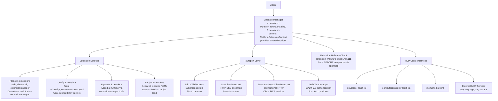
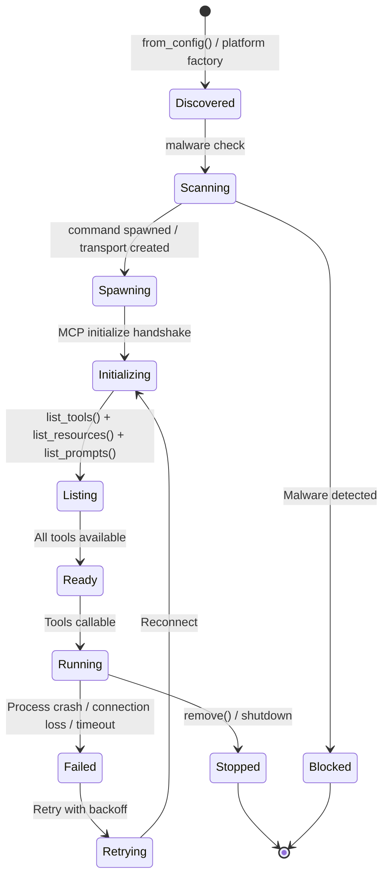

# Goose Extensions — MCP Client Management, Platform Extensions, Transports

**Every tool in goose — including the developer filesystem and shell tools — is an MCP server connected through the `ExtensionManager`.** There are no built-in tools in the traditional sense. The `ExtensionManager` (1,647 lines) handles the full lifecycle: discovery from config + platform + runtime, spawning processes, establishing transport connections, running the MCP initialize handshake, listing tools/resources/prompts, monitoring health, and teardown. Extensions can use 5 transport types and must pass a malware scanner before loading.

Source: `crates/goose/src/agents/extension_manager.rs` — 1,647 lines, `crates/goose/src/agents/extension.rs`, `crates/goose/src/agents/mcp_client.rs`, `crates/goose/src/agents/extension_malware_check.rs` — 511 lines

## Architecture



## The ExtensionManager Struct

```rust
// crates/goose/src/agents/extension_manager.rs:94-98
pub struct ExtensionManager {
    extensions: Mutex<HashMap<String, Extension>>,   // Running extensions by name
    context: Mutex<PlatformExtensionContext>,          // Shared context for factories
    provider: SharedProvider,                         // For GooseClient::sampling/createMessage
}
```

### The Internal Extension Struct

```rust
// crates/goose/src/agents/extension_manager.rs:52-58
struct Extension {
    pub config: ExtensionConfig,              // Name, transport, command, envs, etc.
    client: McpClientBox,                     // Arc<Mutex<Box<dyn McpClientTrait>>>
    server_info: Option<ServerInfo>,          // From MCP initialize handshake
    _temp_dir: Option<tempfile::TempDir>,     // Temp dir for process-based extensions
}
```

### Extension Lifecycle State Machine



## ExtensionConfig — What Defines an Extension

```rust
// crates/goose/src/agents/extension.rs
pub struct ExtensionConfig {
    pub name: String,                    // Unique identifier (used as tool prefix)
    pub enabled: bool,                   // Can be toggled at runtime
    pub transport: TransportType,        // How to connect
    pub command: Option<String>,         // For process-based: binary path
    pub args: Option<Vec<String>>,       // CLI arguments
    pub envs: Option<Envs>,             // Environment variables (heavily restricted)
    pub uri: Option<String>,            // For HTTP-based: endpoint URL
    pub timeout_secs: Option<u64>,      // Connection timeout
    pub permission_level: PermissionLevel,
    pub requires_oauth: Option<Vec<String>>,  // OAuth scopes needed
    pub oauth_config: Option<OAuthConfig>,
    pub description: Option<String>,
    pub cwd: Option<PathBuf>,           // Working directory override
}
```

## Transport Types

| Transport | When to Use | How It Works |
|-----------|------------|--------------|
| **Stdio** (TokioChildProcess) | Local tools — developer, computercontroller, any CLI tool | Spawn a subprocess. stdin/stdout carry MCP JSON-RPC messages. Most built-in servers use this. |
| **SSE** (SseClientTransport) | Remote MCP servers behind HTTP | HTTP GET to `/sse` endpoint. Server pushes events via Server-Sent Events. Client sends requests via HTTP POST. |
| **Streamable HTTP** (StreamableHttpClientTransport) | Cloud MCP services | Bidirectional HTTP streaming. Both client and server can push messages on the same connection. Supports `authRequired` error → OAuth flow. |
| **OAuth** (AuthClient wrapper) | Authenticated cloud services | Wraps Streamable HTTP with OAuth 2.0 Authorization Code flow + PKCE. Auto-refreshes tokens. Stores in OS keyring. |
| **Socket** | Local IPC | Unix domain sockets or TCP for same-machine MCP servers. Lower overhead than HTTP. |

### Process-Based Extension Spawning

```rust
// crates/goose/src/agents/extension_manager.rs (spawning logic)
let mut cmd = Command::new(&config.command);
cmd.args(&config.args.unwrap_or_default());
cmd.envs(&filtered_env_vars);  // DISALLOWED_KEYS already filtered
cmd.stdin(Stdio::piped());
cmd.stdout(Stdio::piped());
cmd.stderr(Stdio::piped());
cmd.kill_on_drop(true);        // Ensure cleanup on drop

let child = cmd.spawn()?;
let transport = TokioChildProcess::new(child)?;
let client = McpClient::new(transport, goose_client_handler).connect().await?;
```

**Aha:** `kill_on_drop(true)` is critical. If the extension manager is dropped (agent crash, session end, explicit shutdown), the spawned child processes are killed automatically by the tokio runtime. Without this, orphaned MCP server processes would accumulate on the user's machine.

## Env Var Deny-List — The Security Boundary

```rust
// crates/goose/src/agents/extension.rs:131-150
impl Envs {
    const DISALLOWED_KEYS: [&'static str; 31] = [
        "PATH", "PATHEXT", "SystemRoot", "windir",         // OS binary path manipulation
        "LD_LIBRARY_PATH", "LD_PRELOAD", "LD_AUDIT",       // Linux dynamic linker hijacking
        "LD_DEBUG", "LD_BIND_NOW", "LD_ASSUME_KERNEL",    // Linker debugging
        "DYLD_LIBRARY_PATH", "DYLD_INSERT_LIBRARIES",      // macOS dynamic linker
        "DYLD_FRAMEWORK_PATH",                              // macOS framework paths
        "PYTHONPATH", "PYTHONHOME",                         // Python module injection
        "NODE_PATH", "RUBYOPT", "RUBYLIB",                  // Node.js / Ruby
        "GEM_PATH", "GEM_HOME", "JAVA_HOME",               // Ruby / Java
        "GOPATH", "CARGO_HOME", "RUSTUP_HOME",             // Go / Rust
        "PERL5LIB", "PERLLIB", "CLASSPATH",                 // Perl / Java
        "TERM", "HOME", "USER", "LOGNAME",                  // Identity spoofing
    ];
}
```

Any environment variable in `DISALLOWED_KEYS` is silently stripped from the extension's environment. This prevents MCP servers from:
- **Hijacking the linker** — preloading malicious shared libraries via `LD_PRELOAD`
- **Injecting malicious modules** — overriding Python/Node/Ruby module resolution
- **Spoofing identity** — changing `USER`/`HOME` to access other users' files
- **Path traversal via PATH** — replacing system binaries with malicious versions

## Malware Scanner — extension_malware_check.rs (511 lines)

Before ANY extension is loaded, it's scanned:

```rust
// crates/goose/src/agents/extension_malware_check.rs
pub async fn scan_extension(config: &ExtensionConfig) -> Result<(), MalwareError> {
    // 1. Validate command path — is it a real binary? In PATH?
    // 2. Check for suspicious patterns in command name:
    //    - Path traversal (../, /etc/, C:\)
    //    - Shell injection (;, &&, |, $())
    //    - Encoded commands (base64, hex)
    // 3. Validate all arguments against same patterns
    // 4. Check environment variables against DISALLOWED_KEYS
    // 5. Validate OAuth redirect URIs (if applicable)
    // 6. Check file permissions on the binary (is it world-writable?)
}
```

## McpClientTrait — The MCP Interface

```rust
// crates/goose/src/agents/mcp_client.rs:37-79
#[async_trait::async_trait]
pub trait McpClientTrait: Send + Sync {
    async fn list_resources(&self, next_cursor: Option<String>,
        cancel_token: CancellationToken) -> Result<ListResourcesResult, Error>;
    async fn read_resource(&self, uri: &str,
        cancel_token: CancellationToken) -> Result<ReadResourceResult, Error>;
    async fn list_tools(&self, next_cursor: Option<String>,
        cancel_token: CancellationToken) -> Result<ListToolsResult, Error>;
    async fn call_tool(&self, name: &str, arguments: Option<JsonObject>,
        cancel_token: CancellationToken) -> Result<CallToolResult, Error>;
    async fn list_prompts(&self, next_cursor: Option<String>,
        cancel_token: CancellationToken) -> Result<ListPromptsResult, Error>;
    async fn get_prompt(&self, name: &str, arguments: Value,
        cancel_token: CancellationToken) -> Result<GetPromptResult, Error>;
    async fn subscribe(&self) -> mpsc::Receiver<ServerNotification>;
    fn get_info(&self) -> Option<&InitializeResult>;
}
```

### GooseClient — The ClientHandler That Enables MCP Sampling

```rust
// crates/goose/src/agents/mcp_client.rs:81-96
pub struct GooseClient {
    notification_handlers: Arc<Mutex<Vec<Sender<ServerNotification>>>>,
    provider: SharedProvider,
}

impl ClientHandler for GooseClient {
    // Implements the MCP sampling/createMessage capability
    // This means MCP servers can request LLM completions THROUGH goose
    // Server sends CreateMessageRequest → goose routes to LLM → returns result
}
```

**Aha:** This is bidirectional MCP. Not only does goose call tools on MCP servers — MCP servers can call goose's LLM for their own purposes. An MCP server can ask "summarize this file" or "classify this text" without having its own API key. GooseClient implements the `ClientHandler` trait to provide this capability. All notification handlers are shared across extensions via `Arc<Mutex<Vec<Sender>>>` — any MCP server notification is broadcast to all subscribers.

## Platform Extensions — The Three Built-ins

```rust
// crates/goose/src/agents/extension.rs:40-81
pub static PLATFORM_EXTENSIONS: Lazy<HashMap<&'static str, PlatformExtensionDef>> =
    Lazy::new(|| {
        let mut map = HashMap::new();
        
        // 1. Todo — Default enabled
        // Tools: add_todo, list_todos, complete_todo, remove_todo
        // Keeps track of what the agent is doing across session boundaries
        map.insert("todo", PlatformExtensionDef {
            name: "todo",
            description: "Enable a todo list for Goose so it can keep track of what it is doing",
            default_enabled: true,
            client_factory: |ctx| Box::new(TodoClient::new(ctx).unwrap()),
        });
        
        // 2. ChatRecall — Default disabled
        // Tools: search_conversations, load_session_summary
        // Searches past SQLite sessions for relevant context
        map.insert("chatrecall", PlatformExtensionDef {
            name: "chatrecall",
            description: "Search past conversations and load session summaries",
            default_enabled: false,
            client_factory: |ctx| Box::new(ChatRecallClient::new(ctx).unwrap()),
        });
        
        // 3. ExtensionManager — Default enabled
        // Tools: list_extensions, enable_extension, disable_extension, discover_extensions
        // Allows the AI to self-manage its tool set during a conversation
        map.insert("extensionmanager", PlatformExtensionDef {
            name: "extensionmanager",
            description: "Enable extension management tools",
            default_enabled: true,
            client_factory: |ctx| Box::new(ExtensionManagerClient::new(ctx).unwrap()),
        });
        map
    });
```

### PlatformExtensionContext

```rust
// crates/goose/src/agents/extension.rs:83-90
pub struct PlatformExtensionContext {
    pub session_id: Option<String>,
    pub extension_manager: Option<Weak<ExtensionManager>>,
    pub tool_route_manager: Option<Weak<ToolRouteManager>>,
}
```

**Aha:** The context uses `Weak` references — not `Arc`. Platform extensions can reference the ExtensionManager and ToolRouteManager without creating reference cycles. If the ExtensionManager is dropped, the Weak reference becomes `None` and the extension gracefully degrades (e.g., ChatRecall can't search sessions if the session manager is gone). This is Rust's ownership system preventing memory leaks at the architecture level.

## Tool Route Manager Integration

Extensions integrate with the ToolRouteManager for intelligent tool selection:

```rust
// crates/goose/src/agents/extension_manager.rs
// When tools are listed from an extension, they're registered with the tool router
// The router builds an embedding index of tool names + descriptions
// When the LLM asks "which tool can search files?", the router returns ranked results
```

## Cross-References

- [Architecture](01-architecture.md) — How Agent.reply() calls ExtensionManager
- [MCP Servers](10-mcp-servers.md) — The 5 built-in MCP server implementations
- [Security & Permissions](04-security-permissions.md) — How tool calls from extensions are inspected

## Next

→ [Providers](03-providers.md) — The LLM provider abstraction with 8 format backends.
