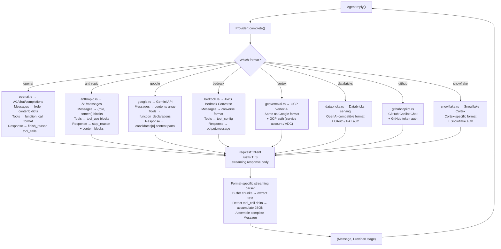

# Goose Providers — LLM Abstraction, 8 Format Backends, Model Routing

**Goose abstracts all LLM communication behind the `Provider` trait, with format-specific backends handling wire protocol differences.** Rather than 40 separate provider implementations, goose has ~8 **format parsers** — each handling a specific API wire format (OpenAI Chat Completions, Anthropic Messages, Google Gemini, AWS Bedrock Converse, etc.). A provider just declares which format it speaks, its endpoint URL, and auth credentials. The format module does all the work: serializing goose's internal `Message` type to the provider's expected JSON, parsing streaming responses, extracting tool calls, and tracking token usage.

Source: `crates/goose/src/providers/base.rs` — 675 lines, `providers/formats/` — 7 modules, `providers/lead_worker.rs` — 683 lines, `providers/utils.rs` — 1,177 lines

## Why Format Backends?

**Aha:** OpenAI, Ollama, Venice, GitHub Copilot, Together AI, Groq, DeepSeek, Perplexity, and dozens more all speak the SAME wire format: OpenAI's `/v1/chat/completions`. Rather than implementing 40 provider structs, goose has ONE `openai.rs` format module. Each provider is just:

```yaml
# Declarative config — no Rust code needed for OpenAI-compatible providers
format: "openai"
base_url: "https://api.together.xyz/v1"
default_model: "meta-llama/Llama-3.3-70B-Instruct-Turbo"
config_keys:
  - name: api_key
    secret: true
```

The format module handles request building, response streaming, tool call extraction, and token counting. The provider layer only manages authentication and endpoint routing.

## The Provider Trait

```rust
// crates/goose/src/providers/base.rs
#[async_trait]
pub trait Provider: Send + Sync {
    /// Primary completion method — returns a FULLY FORMED Message (not a stream)
    async fn complete(
        &self, system: &str, messages: &[Message], tools: &[Tool],
        cancel_token: Option<CancellationToken>,
    ) -> Result<(Message, ProviderUsage), ProviderError>;

    /// Fast completion — for internal use (compaction summaries, permission judging)
    async fn complete_fast(
        &self, system: &str, messages: &[Message], tools: &[Tool],
    ) -> Result<(Message, ProviderUsage), ProviderError>;

    /// Provider identity for UIs
    fn metadata(&self) -> ProviderMetadata;

    /// Current model config (name, context limit, costs)
    fn model_config(&self) -> ModelConfig;

    /// Feature support check
    fn supports(&self, feature: &str) -> bool;
}
```

**Aha:** `complete()` returns a **fully assembled Message**, not a stream. The format backends consume the streaming HTTP response internally, buffer chunks, parse partial JSON for tool calls, and return only when the complete Message is ready. This means the Agent reply loop never handles raw SSE chunks, partial tool call JSON, or mid-stream error recovery — the format backend handles all of that. The tradeoff: the UI can't show token-by-token streaming. Goose handles this by emitting `AgentEvent::Message` updates via the tool_stream pattern for progressive display.

### complete() vs complete_fast()

`complete_fast()` skips certain overhead (no tool shims, lighter validation) and is used for internal LLM calls:
- **Compaction summaries** — summarizing conversation history
- **Permission judging** — classifying tools as read-only vs destructive
- **Session name generation** — creating human-readable session titles

Both methods share the same provider instance and retry logic.

## ProviderMetadata — What the UI Shows

```rust
// crates/goose/src/providers/base.rs:94-110
pub struct ProviderMetadata {
    pub name: String,                    // "anthropic"
    pub display_name: String,            // "Anthropic"
    pub description: String,             // "Claude models via Anthropic API"
    pub default_model: String,           // "claude-sonnet-4-20250514"
    pub known_models: Vec<ModelInfo>,    // Pre-loaded model catalog
    pub model_doc_link: String,          // URL to model documentation
    pub config_keys: Vec<ConfigKey>,     // Required/optional configuration keys
}

pub struct ModelInfo {
    pub name: String,
    pub context_limit: usize,            // Max tokens this model accepts
    pub input_token_cost: Option<f64>,   // Per-token pricing
    pub output_token_cost: Option<f64>,
    pub currency: Option<String>,         // Default: "$"
    pub supports_cache_control: Option<bool>,  // Anthropic prompt caching
}
```

## Format Module Architecture



## LeadWorkerProvider — Tiered Model Routing

The `LeadWorkerProvider` is a `Provider` that wraps two other `Provider` instances and routes between them based on turn count and failure patterns:

```rust
// crates/goose/src/providers/lead_worker.rs:16-26
pub struct LeadWorkerProvider {
    lead_provider: Arc<dyn Provider>,        // Claude Opus / GPT-4o (thinking)
    worker_provider: Arc<dyn Provider>,      // Claude Haiku / GPT-4o-mini (execution)
    lead_turns: usize,                        // Default: 3 turns with lead model
    turn_count: Arc<Mutex<usize>>,
    failure_count: Arc<Mutex<usize>>,
    max_failures_before_fallback: usize,      // Default: 2 → switch back to lead
    fallback_turns: usize,                   // Default: 2 turns on lead after fallback
    in_fallback_mode: Arc<Mutex<bool>>,
    fallback_remaining: Arc<Mutex<usize>>,
}
```

### Routing Decision Algorithm

```
IF turn_count < lead_turns AND NOT in_fallback_mode:
    → Use lead_provider (strong model)
ELIF in_fallback_mode AND fallback_remaining > 0:
    → Use lead_provider (temporary fallback)
    → decrement fallback_remaining
ELSE:
    → Use worker_provider (cheaper model)
    
ON FAILURE with worker_provider:
    → increment failure_count
    → IF failure_count >= max_failures_before_fallback:
        → set in_fallback_mode = true
        → set fallback_remaining = fallback_turns
        → reset failure_count
        
ON SUCCESS:
    → reset failure_count to 0
```

**Aha:** The fallback isn't just about transient errors — it's about **breaking loops**. If the cheaper worker model gets stuck (same tool call failing repeatedly), fallback switches to the stronger lead model for 2 turns to "unstick" the conversation. A successful turn resets the failure counter to zero. The `turn_count` increments on every call, so the worker model activates only after the lead has "thought through" the initial approach.

## ProviderType Classification

```rust
// crates/goose/src/providers/base.rs:86-91
pub enum ProviderType {
    Preferred,   // User's primary provider (set in config)
    Builtin,     // Ships with goose (OpenAI, Anthropic, Google, Ollama)
    Declarative, // YAML/JSON definable, no Rust code needed
    Custom,      // User-registered at runtime via Provider trait
}
```

## Declarative Providers

Providers can be defined in YAML without writing Rust:

```yaml
# ~/.config/goose/providers/local-llm.yaml
name: "local-llm"
display_name: "Local LLM"
format: "openai"           # <-- Uses the OpenAI format module
default_model: "llama-3.1-70b"
base_url: "http://localhost:11434/v1"
config_keys:
  - name: api_key
    required: false        # Local models don't need keys
models:
  - name: "llama-3.1-70b"
    context_limit: 128000
```

## OAuth Support (582 lines)

```rust
// crates/goose/src/providers/oauth.rs
// OAuth 2.0 Authorization Code flow with PKCE
// Used by: Databricks, Google Cloud (Vertex AI), Snowflake
// Stores refresh tokens in OS keyring (never on disk)
// Auto-refreshes expired access tokens before each request

pub struct OAuthProvider {
    inner: Arc<dyn Provider>,           // The actual LLM provider
    oauth_client: OAuthClient,          // Token management
    token_store: KeyringTokenStore,     // OS keyring backend
}
```

## Token Counting

```rust
// crates/goose/src/token_counter.rs (308 lines)
// Uses tiktoken-rs for model-accurate token counting
// Supports cl100k_base (GPT-4, GPT-3.5) and o200k_base (GPT-4o)
// Used by:
//   - Compaction: "are we at 80% of context limit?"
//   - Session metadata: total_tokens, input_tokens, output_tokens
//   - Cost tracking: tokens × model prices from ModelInfo
```

## Global Model Tracking

```rust
// crates/goose/src/providers/base.rs:20-34
pub static CURRENT_MODEL: Lazy<Mutex<Option<String>>> = Lazy::new(|| Mutex::new(None));

pub fn set_current_model(model: &str) {
    // Set after every complete() call — the provider tells us the REAL model
    // (not the alias, e.g., "gpt-4o-2024-08-06" not "gpt-4o")
}

pub fn get_current_model() -> Option<String> {
    // Read by the UI to show "Using: gpt-4o-2024-08-06"
}
```

## Provider Retry Logic

Defined in `providers/base.rs` within the `Provider` trait's default method implementations. Uses a `RetryConfig`:

```rust
pub struct RetryConfig {
    pub max_retries: u32,           // Default: 3
    pub initial_delay_ms: u64,      // Default: 1000
    pub backoff_multiplier: f64,    // Default: 2.0
    pub max_delay_ms: u64,          // Default: 30000
    pub retryable_statuses: Vec<u16>,  // Default: [429, 500, 502, 503, 504]
}
```

## Cross-References

- [Architecture](01-architecture.md) — How provider.complete() fits in the reply loop
- [Compaction & Context](06-compaction-context.md) — Token counting and context limits
- [CLI Deep Dive](12-cli.md) — How providers are configured via CLI

## Next

→ [Security & Permissions](04-security-permissions.md) — The 3-layer tool inspection pipeline.
