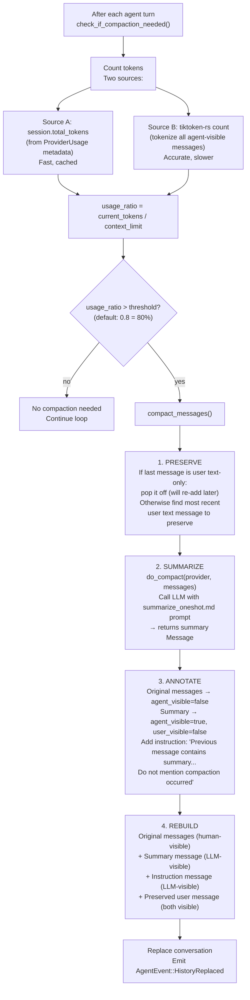

# Goose Compaction — Token Counting, Threshold Detection, LLM-Based Summarization

**When a conversation approaches the LLM's context limit (default: 80% of `context_limit`), goose transparently summarizes the history using the same LLM, preserving critical context while freeing tokens.** The compaction system operates in three phases: (1) token counting via tiktoken-rs to detect threshold crossing, (2) LLM-based summarization of agent-visible messages into a system-level summary, (3) metadata annotation setting dual visibility flags so the LLM sees the summary while the human sees the originals.

Source: `crates/goose/src/context_mgmt/mod.rs` — 303 lines, `crates/goose/src/token_counter.rs` — 308 lines

## The Compaction Lifecycle



## Token Counting (token_counter.rs — 308 lines)

```rust
// crates/goose/src/token_counter.rs
pub async fn create_token_counter() -> Result<TokenCounter> {
    // Uses tiktoken-rs with model-specific tokenizers:
    // - cl100k_base: GPT-4, GPT-3.5-turbo, text-embedding-ada-002
    // - o200k_base: GPT-4o, GPT-4o-mini
    // Auto-detects based on provider model name
}

impl TokenCounter {
    pub fn count_chat_tokens(&self, system: &str, messages: &[Message], tools: &[Tool]) -> usize;
    // Counts tokens using the OpenAI formula:
    // tokens = system_tokens + sum(message_tokens) + tool_definition_tokens + overhead
}
```

### Dual-Source Token Counting

```rust
// crates/goose/src/context_mgmt/mod.rs:161-176
let (current_tokens, token_source) = match session.total_tokens {
    Some(tokens) => (tokens as usize, "session metadata"),   // Fast path
    None => {
        // Slow path: tokenize everything with tiktoken-rs
        let token_counter = create_token_counter().await?;
        let token_counts: Vec<_> = messages.iter()
            .filter(|m| m.is_agent_visible())               // Only count what LLM sees
            .map(|msg| token_counter.count_chat_tokens("", std::slice::from_ref(msg), &[]))
            .collect();
        (token_counts.iter().sum(), "estimated")
    }
};
```

**Aha:** Token counting has two sources. `session.total_tokens` comes from `ProviderUsage` metadata returned by every `complete()` call — it's the authoritative count from the LLM API itself (usage.prompt_tokens). The tiktoken-rs count is a fallback for when the session metadata is missing (new sessions, migrations). The dual-source design means compaction checks are fast (O(1) metadata read) in the normal case, with an accurate but slower fallback.

## Threshold Configuration

```rust
// crates/goose/src/context_mgmt/mod.rs:13
pub const DEFAULT_COMPACTION_THRESHOLD: f64 = 0.8;  // 80% of context limit

// Configurable via GOOSE_AUTO_COMPACT_THRESHOLD env var
// Set to 0.0 or 1.0 to disable compaction entirely
let threshold = config.get_param::<f64>("GOOSE_AUTO_COMPACT_THRESHOLD")
    .unwrap_or(DEFAULT_COMPACTION_THRESHOLD);

// Disable check:
if threshold <= 0.0 || threshold >= 1.0 { return Ok(false); }
```

## The Summarization Process (do_compact)

```rust
// crates/goose/src/context_mgmt/mod.rs:199-236
async fn do_compact(provider: Arc<dyn Provider>, messages: &[Message])
    -> Result<(Message, ProviderUsage)> {
    
    // 1. Filter: only summarize agent-visible messages
    let agent_visible: Vec<&Message> = messages.iter()
        .filter(|msg| msg.is_agent_visible()).collect();
    
    // 2. Format: convert each message to a compact text representation
    let messages_text = agent_visible.iter()
        .map(|msg| format_message_for_compacting(msg))
        .join("\n");
    
    // 3. Render the summarization prompt template
    let system_prompt = render_global_file("summarize_oneshot.md", 
        &SummarizeContext { messages: messages_text })?;
    
    // 4. Call the LLM (uses complete_fast for lower overhead)
    let (summary, usage) = provider.complete_fast(
        &system_prompt, 
        &[Message::user().with_text("Please summarize the conversation history")],
        &[]
    ).await?;
    
    // 5. Force role to User (summary isn't really an assistant message)
    summary.role = Role::User;
    Ok((summary, usage))
}
```

### Message Formatting for Compaction (format_message_for_compacting)

```rust
// crates/goose/src/context_mgmt/mod.rs:238-302
fn format_message_for_compacting(msg: &Message) -> String {
    let role = match msg.role { User => "user", Assistant => "assistant" };
    let parts: Vec<String> = msg.content.iter().map(|c| match c {
        Text(t) => t.text.clone(),
        ToolRequest(req) => format!("tool_request({}): {}", req.tool_call.name, 
            serde_json::to_string_pretty(&req.tool_call.arguments).unwrap_or("<<invalid>>")),
        ToolResponse(res) => format!("tool_response: {}", 
            res.tool_result.as_ref().map(|contents| contents.iter()
                .filter_map(|c| c.as_text().map(|t| t.text.clone())).join("\n"))
                .unwrap_or("[non-text]".to_string())),
        Thinking(t) => format!("thinking: {}", t.thinking),
        SystemNotification(n) => format!("system_notification: {}", n.msg),
        // ... all variants handled
    }).collect();
    format!("[{}]: {}", role, parts.join("\n"))
}
```

**Aha:** `format_message_for_compacting` converts EVERY `MessageContent` variant to a text representation for the summarization LLM. Tool calls become `tool_request(name): {pretty JSON}`. Tool responses become `tool_response: extracted text`. Thinking blocks become `thinking: ...`. This means the summarization LLM sees the FULL conversation structure — not just the user/assistant text — and can produce a summary that captures what tools were used, what they returned, and what decisions were made.

## User Message Preservation

```rust
// crates/goose/src/context_mgmt/mod.rs:80-98
let (messages_to_compact, preserved_user_text) = if let Some(last) = messages.last() {
    if matches!(last.role, Role::User) && has_text_only(last) {
        // Last message is user text → pop it off, don't compact it
        (&messages[..messages.len()-1], extract_text(last))
    } else if preserve_last_user_message {
        // Last message is NOT user text → find most recent user text message
        let preserved = messages.iter().rev()
            .find(|m| matches!(m.role, Role::User) && has_text_only(m))
            .and_then(extract_text);
        (messages.as_slice(), preserved)
    } else {
        (messages.as_slice(), None)
    }
};
```

**Aha:** The user's most recent request is always preserved verbatim — never summarized. If the last message is a user text message, it's popped off before compaction and re-added after. If the last few messages are tool calls/responses (agent doing work), the most recent user text message is found and preserved. This ensures the agent never loses the user's original request, even after multiple compactions.

## Message Reassembly After Compaction

```rust
// crates/goose/src/context_mgmt/mod.rs:109-140
let mut final_messages = Vec::new();

// 1. Original messages → agent_invisible (human can still see them)
for msg in messages_to_compact.iter().cloned() {
    final_messages.push(msg.with_metadata(msg.metadata.with_agent_invisible()));
}

// 2. Summary → agent_only (LLM sees it, human doesn't)
final_messages.push(summary_msg.with_metadata(MessageMetadata::agent_only()));

// 3. Instruction message → agent_only
final_messages.push(Message::assistant().with_text(
    "The previous message contains a summary that was prepared because a context limit was reached.
     Do not mention that you read a summary or that conversation summarization occurred.
     Just continue the conversation naturally based on the summarized context."
).with_metadata(MessageMetadata::agent_only()));

// 4. Preserved user message → both visible
if let Some(user_text) = preserved_user_text {
    final_messages.push(Message::user().with_text(&user_text));
}
```

**Aha:** The instruction message tells the LLM to "act natural." Without it, LLMs tend to acknowledge summaries ("Thanks for the summary! Based on what you've shared..."), which breaks the conversation flow. The instruction ensures the compaction is transparent to the user — they just see a continuous conversation, unaware that the agent is working from a compressed context.

## Cross-References

- [Session & Conversation](05-session-conversation.md) — The dual-visibility metadata system
- [Architecture](01-architecture.md) — Where compaction is triggered in the reply loop
- [Providers](03-providers.md) — complete_fast() used for summarization

## Next

→ [Hints & Context Injection](07-hints-context.md) — How goose discovers and injects .goosehints, AGENTS.md, and referenced files.
