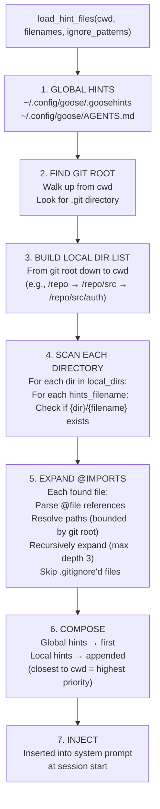

# Goose Hints — Context Injection from .goosehints, AGENTS.md, and Referenced Files

**Goose automatically discovers and injects project-specific context by walking the directory tree for `.goosehints` and `AGENTS.md` files.** The hints system operates at three levels: global (`~/.config/goose/`), repository (git root), and local (cwd up to git root). Each hints file can `@import` other files using a path reference syntax, with depth limits (3 levels) and security boundaries (cannot escape the git root). The entire composed hints document is injected into the system prompt at session start, giving the agent project-specific instructions without manual configuration.

Source: `crates/goose/src/hints/load_hints.rs` — 469 lines, `crates/goose/src/hints/import_files.rs` — 488 lines

## The Discovery Algorithm



### The Core Function

```rust
// crates/goose/src/hints/load_hints.rs:54-58
pub fn load_hint_files(cwd: &Path, hints_filenames: &[String],
    ignore_patterns: &Gitignore) -> String {
    // Returns the composed hints string, ready for system prompt injection
}
```

### Directory Walking Logic

```rust
// crates/goose/src/hints/load_hints.rs:30-52
fn get_local_directories(git_root: Option<&Path>, cwd: &Path) -> Vec<PathBuf> {
    match git_root {
        Some(git_root) => {
            let mut directories = Vec::new();
            let mut current_dir = cwd;
            loop {
                directories.push(current_dir.to_path_buf());
                if current_dir == git_root { break; }
                if let Some(parent) = current_dir.parent() { current_dir = parent; }
                else { break; }
            }
            directories.reverse();  // git root first, cwd last
            directories
        }
        None => vec![cwd.to_path_buf()],  // No git → only cwd
    }
}
```

**Aha:** The directory list is built from git root DOWN to cwd (reversed, so root comes first). This creates a natural priority: files in root provide defaults; files closer to cwd override or extend them. A monorepo with `AGENTS.md` at the root gives team-wide instructions, while `src/auth/.goosehints` adds module-specific context only when the session working directory is `src/auth/`.

## The @import Syntax — read_referenced_files()

```rust
// crates/goose/src/hints/import_files.rs:8-11
static FILE_REFERENCE_REGEX: Lazy<regex::Regex> = Lazy::new(|| {
    regex::Regex::new(
        r"(?:^|\s)@([a-zA-Z0-9_\-./]+(?:\.[a-zA-Z0-9]+)+|"  // @file.ts, @dir/file.rs
        r"[A-Z][a-zA-Z0-9_\-]*|"                                // @CamelCase
        r"[a-zA-Z0-9_\-./]*[./][a-zA-Z0-9_\-./]*)")            // @path/to/file
        .expect("Invalid file reference regex")
});
```

A `.goosehints` file can reference other files:

```
# Project context
This project uses Rust 2021 edition with the Tokio async runtime.

@README.md
@src/ARCHITECTURE.md

# Coding conventions
@CONVENTIONS.md
```

The `@filename` syntax triggers `read_referenced_files()`, which:
1. Parses `@` references from the file content
2. Resolves each reference relative to the including file's directory
3. Sanitizes paths (block absolute paths, path traversal)
4. Bounds resolution to the git root (the "import boundary")
5. Recursively processes referenced files (up to `MAX_DEPTH = 3`)
6. Skips files matching `.gitignore` patterns

### Security: Import Boundary

```rust
// crates/goose/src/hints/import_files.rs:15-49
fn sanitize_reference_path(reference: &Path, including_file_path: &Path,
    import_boundary: &Path) -> Result<PathBuf, std::io::Error> {
    if reference.is_absolute() {
        return Err(std::io::Error::new(PermissionDenied,
            "Absolute paths not allowed in file references"));
    }
    let resolved = including_file_path.join(reference);
    let boundary_canonical = import_boundary.canonicalize()?;
    
    if let Ok(canonical) = resolved.canonicalize() {
        if !canonical.starts_with(&boundary_canonical) {
            return Err(std::io::Error::new(PermissionDenied,
                format!("Include: '{}' is outside the import boundary '{}'",
                    resolved.display(), import_boundary.display())));
        }
        Ok(canonical)
    } else {
        Ok(resolved)  // File doesn't exist, but path is safe
    }
}
```

**Aha:** The import boundary is the git root. A `.goosehints` file in `/repo/src/auth/` can `@import ../shared/CONVENTIONS.md` (resolves to `/repo/src/shared/CONVENTIONS.md`) because that's inside the git root. But `@import ../../../../etc/passwd` is caught by the canonicalization check — the resolved canonical path falls outside the boundary and is rejected with `PermissionDenied`. The `canonicalize()` call resolves symlinks, so symlink-based escapes are also blocked.

### ReDoS Protection

```rust
// crates/goose/src/hints/import_files.rs:52-62
const MAX_CONTENT_LENGTH: usize = 131_072; // 128KB limit

if content.len() > MAX_CONTENT_LENGTH {
    tracing::warn!("Content too large for file reference parsing: {} bytes", content.len());
    return Vec::new();  // Skip parsing entirely for large files
}
```

The regex engine has a hard limit to prevent ReDoS attacks from maliciously crafted `.goosehints` files with pathological patterns.

## Global Hints

```rust
// crates/goose/src/hints/load_hints.rs:63-77
let global_hints_path = Paths::in_config_dir(hints_filename);
if global_hints_path.is_file() {
    let expanded_content = read_referenced_files(&global_hints_path,
        hints_dir, &mut visited, 0, ignore_patterns);
    if !expanded_content.is_empty() {
        global_hints_contents.push(expanded_content);
    }
}
```

Global hints live in `~/.config/goose/` and apply to ALL sessions regardless of working directory. This is where you'd put personal preferences ("always use 2-space indentation," "prefer async/await over callbacks").

## Integration with the System Prompt

The composed hints string is injected into the system prompt by `PromptManager` during `prepare_tools_and_prompt()`. It appears as a `<hints>` or `<project_context>` section in the system prompt, giving the agent project awareness from the first message.

## Cross-References

- [Architecture](01-architecture.md) — Where hints are injected during prepare_reply_context()
- [Recipes](08-recipes.md) — Recipes can also define system instructions
- [CLI Deep Dive](12-cli.md) — Working directory selection affects hint discovery

## Next

→ [Recipes](08-recipes.md) — YAML-based automation workflows with sub-recipes, parameters, and extension configs.
