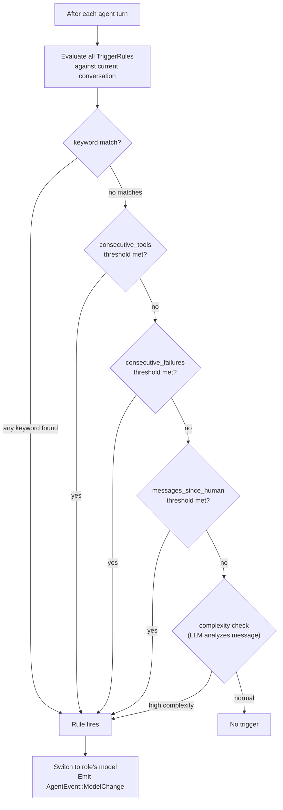

# Goose Autopilot & Retry — Model Auto-Selection and Intelligent Retry Management

**Goose can automatically switch LLM models mid-conversation based on trigger rules, and retry failed operations with configurable success checks.** The `AutoPilot` system matches conversation patterns (keywords, complexity, failures, tool usage) against premade roles that specify alternative models. The `RetryManager` tracks attempt counts, coordinates with the `RepetitionInspector`, and executes on-failure actions (commands, prompts) when retries are exhausted.

Source: `crates/goose/src/agents/model_selector/autopilot.rs`, `crates/goose/src/agents/retry.rs` — 497 lines

## AutoPilot — Trigger-Based Model Switching

### Trigger Rules

```rust
// crates/goose/src/agents/model_selector/autopilot.rs:42-80
pub struct TriggerRules {
    pub keywords: Vec<String>,                          // Match in user messages
    pub match_type: MatchType,                          // Any (OR) or All (AND)
    pub on_failure: bool,                               // After a tool execution failure
    pub after_tool_use: bool,                           // After any tool was used
    pub consecutive_tools: Option<usize>,                // After N consecutive tool uses
    pub consecutive_failures: Option<usize>,             // After N consecutive failures
    pub machine_messages_without_human: Option<usize>,   // After N AI-only messages
    pub tools_since_human: Option<usize>,                // After N tool calls since last human msg
    pub messages_since_human: Option<usize>,              // After N messages since last human input
    pub complexity_level: Option<ComplexityLevel>,       // Low / Medium / High
}
```

### How Triggers Are Evaluated



### Premade Roles

Pre-defined model switching roles live in `premade_roles.yaml` (embedded via `include_str!`):

```yaml
# Built-in premade roles (conceptual):
- name: "complex_reasoning"
  model: "claude-opus-4"
  trigger:
    keywords: ["design", "architecture", "refactor", "complex algorithm"]
    complexity_level: High

- name: "code_execution"
  model: "claude-sonnet-4"
  trigger:
    after_tool_use: true
    consecutive_tools: 3

- name: "recovery"
  model: "claude-opus-4"
  trigger:
    on_failure: true
    consecutive_failures: 2
```

**Aha:** The autopilot is NOT about "which model is best" — it's about matching model strengths to task phases. Complex reasoning triggers use a stronger model for design work; consecutive tool execution triggers switch to a faster/cheaper model for mechanical work; failure triggers switch back to the strong model for recovery. This is dynamic routing: the agent self-triages based on what's actually happening in the conversation.

### Complexity Analysis

```rust
pub enum ComplexityLevel { Low, Medium, High }

// The autopilot can ask the LLM to classify the current task's complexity
// by injecting a classification prompt. The result determines whether
// to switch to a more capable model for complex tasks.
```

## RetryManager — Stateful Retry Management

```rust
// crates/goose/src/agents/retry.rs:38-69
pub struct RetryManager {
    attempts: Arc<Mutex<u32>>,                            // Current retry count
    repetition_inspector: Option<Arc<Mutex<Option<RepetitionInspector>>>>,
}

impl RetryManager {
    pub async fn reset_attempts(&self) {
        *self.attempts.lock().await = 0;
        // Also reset the repetition inspector to clear loop detection state
        if let Some(inspector) = &self.repetition_inspector {
            if let Some(inspector) = inspector.lock().await.as_mut() {
                inspector.reset();
            }
        }
    }
    
    pub async fn increment_attempts(&self) -> u32 {
        let mut attempts = self.attempts.lock().await;
        *attempts += 1;
        *attempts
    }
}
```

### Retry Decision Logic

```rust
// crates/goose/src/agents/agent.rs:221-243
async fn handle_retry_logic(&self, messages: &mut Conversation,
    session_config: &SessionConfig, initial_messages: &[Message]) -> Result<bool> {
    
    let result = self.retry_manager.handle_retry_logic(
        messages, session_config, initial_messages, &self.final_output_tool).await?;
    
    match result {
        RetryResult::Retried => {
            // Conversation was reset to initial_messages + compacted context
            // Loop continues from fresh state
            Ok(true)
        }
        RetryResult::Skipped => Ok(false),           // No retry config
        RetryResult::MaxAttemptsReached => Ok(false), // Out of retries
        RetryResult::SuccessChecksPassed => Ok(false), // Everything worked
    }
}
```

### Retry Configuration (from Recipe)

```rust
pub struct RetryConfig {
    pub max_attempts: u32,                 // Default: 3
    pub strategy: RetryStrategy,           // Reset | Continue
    pub success_checks: Vec<SuccessCheck>, // Post-completion validation
    pub on_failure: Option<FailureAction>, // Final failure handler
    pub timeout_seconds: Option<u64>,      // Per-attempt timeout
}

pub enum RetryStrategy {
    Reset,      // Reset conversation to initial_messages on retry
    Continue,   // Continue from current state (the LLM knows it failed)
}
```

**Aha:** `RetryStrategy::Reset` vs `Continue` is the key design choice. `Reset` gives the LLM a clean slate — it gets the initial messages back plus a compacted summary of what happened in the failed attempt. This prevents the LLM from getting stuck in the same failure pattern. `Continue` keeps the full context, which is useful when the failure was external (network timeout) and the LLM should pick up where it left off.

### On-Failure Actions

When retries are exhausted:

```rust
const DEFAULT_RETRY_TIMEOUT_SECONDS: u64 = 300;    // 5 minutes
const DEFAULT_ON_FAILURE_TIMEOUT_SECONDS: u64 = 60; // 1 minute

// Environment variable overrides:
// GOOSE_RECIPE_RETRY_TIMEOUT_SECONDS
// GOOSE_RECIPE_ON_FAILURE_TIMEOUT_SECONDS
```

Failure actions execute shell commands (for notifications) or feed failure context to the LLM for a final recovery attempt.

## Cross-References

- [Architecture](01-architecture.md) — Where retry logic runs in the reply loop
- [Recipes](08-recipes.md) — Recipe-based retry configuration
- [Security & Permissions](04-security-permissions.md) — RepetitionInspector integration with retry reset

## Next

→ [MCP Servers](10-mcp-servers.md) — The 5 built-in MCP servers in detail.
