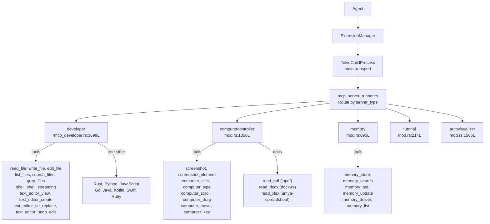

# Goose MCP Servers — Developer, ComputerController, Memory, Tutorial, Autovisualiser

**The `goose-mcp` crate contains five standalone MCP servers that provide goose's core capabilities.** Each is a separate MCP server implementation communicating over stdio via `rmcp`. The developer server (3,699 lines) is the most substantial, providing filesystem operations, shell execution, and a text editor with tree-sitter language awareness. The computer controller (1,350 lines) handles screenshots, GUI automation, and document parsing. Memory (695 lines) stores knowledge with vector embeddings. Tutorial (214 lines) provides guided learning. Autovisualiser (1,566 lines) generates data visualizations.

Source: `crates/goose-mcp/src/` — 10,743 lines across 5 servers

## Architecture



## 1. Developer Server (3,699 lines)

The developer server is goose's primary toolset for software development.

### Filesystem Tools

| Tool | Signature | Key Detail |
|------|-----------|------------|
| `read_file` | `path, offset?, limit?` | Partial reads with offset/limit for large files. Returns line-numbered content. |
| `write_file` | `path, content` | Creates parent directories automatically. Atomic write via temp file + rename. |
| `edit_file` | `path, old_string, new_string, replace_all?` | **Exact string matching** — must match whitespace, indentation, and line endings exactly. Fails with context on mismatch. |
| `list_files` | `path, depth?, offset?, limit?` | Paginated directory listing. Respects `.gitignore` when in a git repo. |
| `search_files` | `pattern, path?` | Glob pattern matching. Uses the `ignore` crate for gitignore-aware search. |
| `grep_files` | `pattern, path?, include?` | Regex content search. Uses ripgrep-style regex engine. |
| `file_info` | `path` | Returns size, permissions, modification time, line count. |

### Shell Tools

```rust
// crates/goose-mcp/src/developer/shell.rs:1-195
// shell tool:
// - Executes command in session's working_dir
// - Enforces timeout (configurable, default: 30s)
// - Captures stdout + stderr separately
// - Returns { exit_code, stdout, stderr }
// - Streaming variant: shell_streaming → progressive output via MCP notifications

// Security invariants:
// - Commands run as the USER (not root)
// - Working directory scoped to session root
// - Environment stripped of dangerous variables
// - Output truncated at 100KB to prevent token overflow
```

### Text Editor (1,106 lines)

The text editor implements a full find-and-replace workflow:

```rust
// crates/goose-mcp/src/developer/text_editor.rs
// text_editor_view: Returns file with line numbers (1-based)
// text_editor_create: Creates new file, creates parent dirs
// text_editor_str_replace: Exact string match → replace. Fails with context on mismatch.
// text_editor_undo_edit: Reverts last edit (single-level undo stack)
// text_editor_write: Overwrite entire file (use with caution)
```

**Aha:** `str_replace` uses exact string matching — NOT regex and NOT fuzzy matching. The LLM must produce the EXACT `old_string` that appears in the file, character-for-character. If matching fails because the LLM's whitespace, indentation, or line endings don't match the actual file, the tool returns the file content around the expected location so the LLM can retry with the correct string. This forces precision from the LLM — a surprising number of AI code editors silently apply edits to wrong locations because they use fuzzy matching.

### Tree-Sitter Language Support

```rust
// crates/goose-mcp/src/developer/lang.rs:1-39
// Supported languages (used for syntax validation before writes):
// Rust (tree-sitter-rust), Python (tree-sitter-python)
// JavaScript (tree-sitter-javascript), Go (tree-sitter-go)
// Java (tree-sitter-java), Kotlin (tree-sitter-kotlin)
// Swift (tree-sitter-swift), Ruby (tree-sitter-ruby)
```

## 2. ComputerController Server (1,350 lines)

### Screenshot Capture

Uses `xcap` for cross-platform screen capture (macOS via CoreGraphics, Windows via DXGI, Linux via X11 SHM + PipeWire):

```rust
// crates/goose-mcp/src/computercontroller/mod.rs
// screenshot: Full screen or specific monitor
// screenshot_element: Capture a specific UI element (by coordinates or accessibility ID)
// Images returned as base64-encoded PNG
```

### GUI Automation

```rust
// Simulated input via platform-specific APIs:
// macOS: CoreGraphics events (CGEvent)
// Windows: SendInput API
// Linux: uinput / XTest extension
```

| Tool | What It Does |
|------|-------------|
| `computer_click` | Click at (x, y) with button selection |
| `computer_type` | Type text at current focus |
| `computer_scroll` | Scroll at position by pixels or pages |
| `computer_drag` | Drag from (x1,y1) to (x2,y2) |
| `computer_move` | Move mouse to (x,y) |
| `computer_key` | Press key combination (e.g., "Ctrl+C") |

### Document Parsing

| Tool | Library | Supports |
|------|---------|----------|
| `read_pdf` | `lopdf` (0.35) | Text extraction, page count, metadata |
| `read_docx` | `docx-rs` (0.4) | Paragraphs, tables, headers, images metadata |
| `read_xlsx` | `umya-spreadsheet` (2.2) | Cell values, formulas, sheet names, merged cells |

## 3. Memory Server (695 lines)

```rust
// crates/goose-mcp/src/memory/mod.rs
// Persistent knowledge storage with vector embeddings for semantic search
// Stores: content (text), tags (Vec<String>), importance (0.0-1.0), metadata (JSON)
// Search: cosine similarity over embedding vectors
// Persistence: SQLite (separate from session database)
```

| Tool | Purpose |
|------|---------|
| `memory_store` | Store a fact with tags, importance, and metadata |
| `memory_search` | Semantic search — returns ranked results by cosine similarity |
| `memory_get` | Retrieve by exact ID |
| `memory_update` | Update content/tags/importance of existing fact |
| `memory_delete` | Remove a fact |
| `memory_list` | Paginated listing with tag filtering |

## 4. Tutorial Server (214 lines)

Provides step-by-step guided tutorials. Tools: `tutorial_start`, `tutorial_step`, `tutorial_check`. Used for onboarding new goose users with interactive walkthroughs.

## 5. Autovisualiser Server (1,566 lines)

```rust
// crates/goose-mcp/src/autovisualiser/mod.rs
// Generates charts and visualizations from structured data
// Output: SVG (static) or HTML/D3.js (interactive)
// Chart types: bar, line, scatter, pie, heatmap, area, radar
// Input: JSON data with { labels, datasets, options }
```

## Cross-References

- [Extensions](02-extensions.md) — How ExtensionManager spawns and manages these MCP servers
- [Architecture](01-architecture.md) — How tool calls flow from Agent to MCP servers
- [Security & Permissions](04-security-permissions.md) — How tool calls from these servers are inspected

## Next

→ [Tracing & Observability](11-tracing.md) — OpenTelemetry OTLP export and Langfuse integration.
