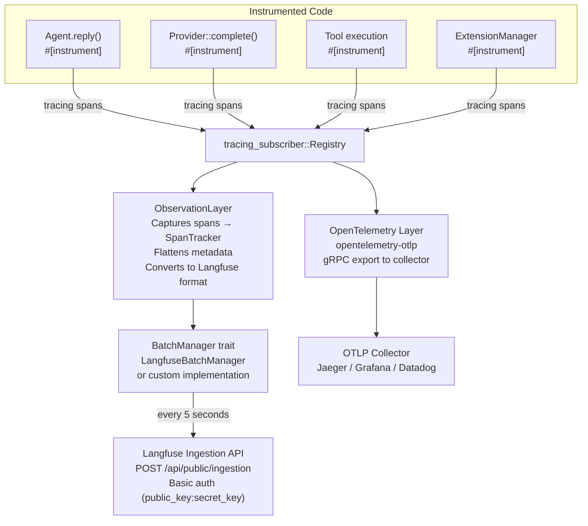

# Goose Observability — OpenTelemetry OTLP, Langfuse Integration, Span Tracking

**Goose integrates OpenTelemetry for distributed tracing and Langfuse for LLM observability (prompt/response capture, token tracking, cost attribution).** The tracing system uses a custom `ObservationLayer` that captures span data into a `SpanTracker`, batches events, and dispatches them to Langfuse's ingestion API every 5 seconds. OpenTelemetry is exported via OTLP over gRPC, with graceful shutdown on process exit.

Source: `crates/goose/src/tracing/langfuse_layer.rs` — 506 lines, `tracing/observation_layer.rs` — 521 lines, `tracing/`

## Architecture



## ObservationLayer — The Span Capture Layer

```rust
// crates/goose/src/tracing/observation_layer.rs:97-100
pub struct ObservationLayer {
    pub batch_manager: Arc<Mutex<dyn BatchManager>>,
    pub span_tracker: Arc<Mutex<SpanTracker>>,
}
```

### SpanTracker — Mapping Tracing Spans to Langfuse Observations

```rust
// crates/goose/src/tracing/observation_layer.rs:64-95
pub struct SpanTracker {
    active_spans: HashMap<u64, String>,   // tracing span_id → Langfuse observation_id (UUID v4)
    current_trace_id: Option<String>,     // Current Langfuse trace ID
}

impl SpanTracker {
    pub fn add_span(&mut self, span_id: u64, observation_id: String) {
        self.active_spans.insert(span_id, observation_id);
    }
    
    pub fn get_span(&self, span_id: u64) -> Option<&String> {
        self.active_spans.get(&span_id)
    }
    
    pub fn remove_span(&mut self, span_id: u64) -> Option<String> {
        self.active_spans.remove(&span_id)
    }
}
```

**Aha:** Tracing span IDs are `u64` integers, but Langfuse requires UUID v4 strings for observation IDs. The `SpanTracker` maintains the mapping: when a tracing span opens, a new UUID v4 is generated and associated with the span ID. When the span closes, the UUID is looked up and the complete span data (name, start_time, end_time, level, metadata, parent_span_id) is sent to Langfuse. This is a translation layer between two incompatible ID systems.

### Span Metadata Flattening

```rust
// crates/goose/src/tracing/observation_layer.rs:34-56
pub fn flatten_metadata(metadata: serde_json::Map<String, Value>) -> serde_json::Map<String, Value> {
    // Langfuse expects flat key-value metadata, but tracing spans can have nested objects
    // This function flattens: { "token": { "text": "42" } } → { "token": "42" }
    // Special handling: if a value has a "text" field, extract just the text
    // Nested objects without "text" are preserved as JSON objects
}
```

### Level Mapping

```rust
pub fn map_level(level: &Level) -> &'static str {
    match *level {
        Level::ERROR => "ERROR",
        Level::WARN => "WARNING",
        Level::INFO => "DEFAULT",
        Level::DEBUG => "DEBUG",
        Level::TRACE => "DEBUG",  // Langfuse doesn't have TRACE
    }
}
```

## LangfuseBatchManager — HTTP Ingestion

```rust
// crates/goose/src/tracing/langfuse_layer.rs:36-42
pub struct LangfuseBatchManager {
    pub batch: Vec<Value>,           // Accumulated events (up to 5 seconds worth)
    pub client: Client,              // reqwest HTTP client (10s timeout)
    pub base_url: String,            // Langfuse instance URL
    pub public_key: String,          // Langfuse public key
    pub secret_key: String,          // Langfuse secret key
}
```

### Batch Sender — Background Task

```rust
// crates/goose/src/tracing/langfuse_layer.rs:58-73
pub fn spawn_sender(manager: Arc<Mutex<Self>>) {
    const BATCH_INTERVAL: Duration = Duration::from_secs(5);
    
    tokio::spawn(async move {
        loop {
            tokio::time::sleep(BATCH_INTERVAL).await;
            if let Err(e) = manager.lock().await.send().await {
                tracing::error!("Failed to send batch to Langfuse: {}", e);
            }
        }
    });
}
```

**Aha:** The sender runs as a `tokio::spawn`'d background task with a 5-second interval. It doesn't block the agent loop — spans are added to the batch via `Arc<Mutex<>>` and the sender independently drains and sends. If Langfuse is unreachable, the batch is dropped and errors are logged — tracing is fire-and-forget, never blocking the agent.

### Ingestion API Call

```rust
// crates/goose/src/tracing/langfuse_layer.rs:75-130
pub async fn send(&mut self) -> Result<(), Box<dyn std::error::Error + Send + Sync>> {
    if self.batch.is_empty() { return Ok(()); }
    
    let payload = json!({ "batch": self.batch });
    let url = Url::parse(&self.base_url)?.join("api/public/ingestion")?;
    
    let response = self.client.post(url)
        .basic_auth(&self.public_key, Some(&self.secret_key))
        .json(&payload).send().await?;
    
    match response.status() {
        status if status.is_success() => {
            let body: LangfuseIngestionResponse = response.json().await?;
            for error in &body.errors {
                tracing::error!(id=%error.id, status=error.status,
                    "Langfuse ingestion error");
            }
            self.batch.clear();
        }
        status => {
            tracing::error!(%status, "Langfuse ingestion failed");
            // Batch is NOT cleared — will retry on next interval
        }
    }
    Ok(())
}
```

**Aha:** On failure, the batch is NOT cleared — it will be retried on the next 5-second interval. Langfuse's ingestion API is idempotent (events have unique IDs), so resending the same batch is safe. The batch accumulates across failures, so if Langfuse is down for 30 seconds, all 6 batches worth of events queue up and get sent when it recovers.

## OpenTelemetry OTLP Export

```rust
// crates/goose/src/tracing/ (OpenTelemetry setup)
// Uses opentelemetry-otlp with gRPC export
// Configurable via env vars:
//   OTEL_EXPORTER_OTLP_ENDPOINT  → collector URL
//   OTEL_SERVICE_NAME             → "goose"
// Graceful shutdown:
//   On SIGTERM/SIGINT → flush pending spans (500ms max wait)
//   Shorter dynamic wait for CLI (200ms) vs server (500ms)
```

### Graceful Shutdown

```rust
// crates/goose-cli/src/main.rs:17-31
let should_wait = config.get_param::<String>("otel_exporter_otlp_endpoint").is_ok();
if should_wait {
    let max_wait = Duration::from_millis(500);
    let start = Instant::now();
    while start.elapsed() < max_wait {
        sleep(Duration::from_millis(50)).await;
        if start.elapsed() >= Duration::from_millis(200) { break; }
    }
    goose::tracing::shutdown_otlp();
}
```

## Configuring Observability

```bash
# Langfuse (self-hosted or cloud)
export LANGFUSE_PUBLIC_KEY="pk-..."
export LANGFUSE_SECRET_KEY="sk-..."
export LANGFUSE_HOST="https://cloud.langfuse.com"

# OpenTelemetry
export OTEL_EXPORTER_OTLP_ENDPOINT="http://localhost:4317"
export OTEL_SERVICE_NAME="goose-agent"
```

## Cross-References

- [Architecture](01-architecture.md) — Where #[instrument] spans are defined
- [Providers](03-providers.md) — ProviderUsage metadata that feeds into token tracking
- [CLI Deep Dive](12-cli.md) — CLI logging setup and telemetry initialization

## Next

→ [CLI Deep Dive](12-cli.md) — Every subcommand, session builder, ACP integration, and web UI.
