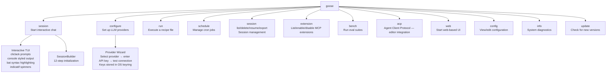

# Goose CLI — 20+ Subcommands, Session Builder, ACP, Web UI

**The `goose-cli` crate (15,275 lines) provides the command-line interface with 20+ clap subcommands for sessions, configuration, recipes, scheduling, extensions, benchmarks, and more.** The TUI session interface uses `cliclack` for interactive prompts, `console` for styled output, `bat` for syntax-highlighted code blocks, and `indicatif` for progress spinners. The session builder orchestrates 12 steps to initialize a running agent session. The ACP (Agent Client Protocol) subcommand enables editor integration (VS Code, JetBrains). The `web` subcommand serves a web-based UI.

Source: `crates/goose-cli/src/` — 15,275 lines, `cli.rs` — 1,415 lines, `session/mod.rs` — 1,594 lines

## Subcommand Tree



### Key Subcommands

| Command | What It Does |
|---------|-------------|
| `goose session` | Start interactive chat. Flags: `--provider`, `--model`, `--mode`, `--recipe`, `--working-dir` |
| `goose configure` | Interactive wizard to set up LLM providers. Stores API keys in OS keyring. |
| `goose run recipe.yaml` | Execute a recipe file. Non-interactive. Returns exit code 0 on success. |
| `goose schedule add --cron "0 9 * * 1-5" --prompt "..."` | Add a cron-triggered recurring task |
| `goose session list` | List all past sessions from SQLite |
| `goose session resume <id>` | Resume a past session from SQLite |
| `goose session export <id>` | Export session as JSON (for sharing/debugging) |
| `goose extension list` | List installed and running MCP extensions |
| `goose bench run --suite developer` | Run an eval benchmark suite |
| `goose acp` | Start ACP server for editor integration |

## The Session Builder — 12-Step Initialization

```rust
// crates/goose-cli/src/session/builder.rs (740 lines)
// SessionBuilder orchestrates the 12 steps to start a session:

// 1. Load config (~/.config/goose/config.yaml)
// 2. Initialize logging (file + stdout, configurable levels)
// 3. Initialize telemetry (OTLP if configured)
// 4. Create or resume session from SQLite
// 5. Load hints (.goosehints, AGENTS.md) for working directory
// 6. Load recipe if --recipe flag provided
// 7. Initialize provider from config (lazy — first LLM call)
// 8. Start ExtensionManager — spawn built-in MCP servers
// 9. Start user extensions from config
// 10. Build system prompt (base prompt + hints + recipe instructions)
// 11. Create Agent instance with all subsystems
// 12. If recipe mode: auto-send first prompt. If interactive: enter TUI loop.
```

### Session Export (1,164 lines)

```rust
// crates/goose-cli/src/session/export.rs
// Exports a complete session as JSON including:
// - All messages with full content
// - Token usage per message and accumulated
// - Extension states at session time
// - Recipe configuration
// - Provider metadata
// Uses: goose session export <id> > session.json
```

### Session Output Formatting (1,011 lines)

```rust
// crates/goose-cli/src/session/output.rs
// Formats agent output for terminal display:
// - Text messages: word-wrapped with console styling
// - Code blocks: syntax-highlighted via bat library
// - Tool calls: collapsible sections showing tool name + arguments + result
// - Thinking blocks: dimmed, collapsible (Claude extended thinking)
// - Errors: red with error context
// - Progress: indicatif spinners for long-running tool calls
```

### Session Completion (640 lines)

```rust
// crates/goose-cli/src/session/completion.rs
// Shell completion generation for bash, zsh, fish
// Auto-completes: subcommands, flags, session IDs, recipe paths
```

## ACP — Agent Client Protocol

```rust
// crates/goose-cli/src/commands/acp.rs (912 lines)
// Implements the Agent Client Protocol for editor integration
// ACP is a JSON-RPC based protocol for:
// - Editor sends: file contents, cursor position, selection
// - Goose responds: completions, refactoring suggestions, explanations
// 
// Integration modes:
// - VS Code: via extension
// - JetBrains: via plugin
// - Neovim: via LSP adapter
//
// Protocol runs over stdio (like LSP)
```

## Web UI

```rust
// crates/goose-cli/src/commands/web.rs (622 lines)
// Serves a web-based chat UI:
// - Axum HTTP server (same as goosed but bundled in CLI)
// - WebSocket for real-time message streaming
// - Optional: opens browser automatically (--open flag)
// - Port: configurable (default: 3001 to avoid conflict with goosed)
```

## Scenario Tests

```rust
// crates/goose-cli/src/scenario_tests/scenario_runner.rs (339 lines)
// Automated integration tests that:
// 1. Start goose with a recipe
// 2. Feed predefined prompts
// 3. Assert on tool calls and responses
// 4. Verify session state in SQLite
// Used for CI to validate agent behavior across provider changes
```

## Configuration

```bash
# ~/.config/goose/config.yaml
providers:
  - name: openai
    model: gpt-4o
  - name: anthropic
    model: claude-sonnet-4-20250514

extensions:
  - name: developer
    enabled: true
  - name: computercontroller
    enabled: false
  - name: memory
    enabled: true

settings:
  goose_mode: smart_approve
  auto_compact_threshold: 0.8
```

## Cross-References

- [Architecture](01-architecture.md) — The Agent that the CLI drives
- [Session & Conversation](05-session-conversation.md) — SQLite persistence that `session list` queries
- [Server Deep Dive](13-server.md) — The goosed HTTP server

## Next

→ [Server Deep Dive](13-server.md) — Axum HTTP server, REST API, WebSocket, OpenAPI generation.
