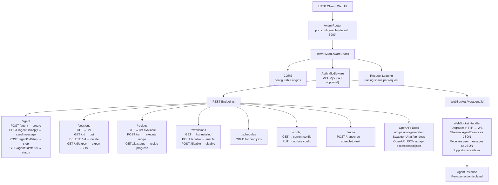
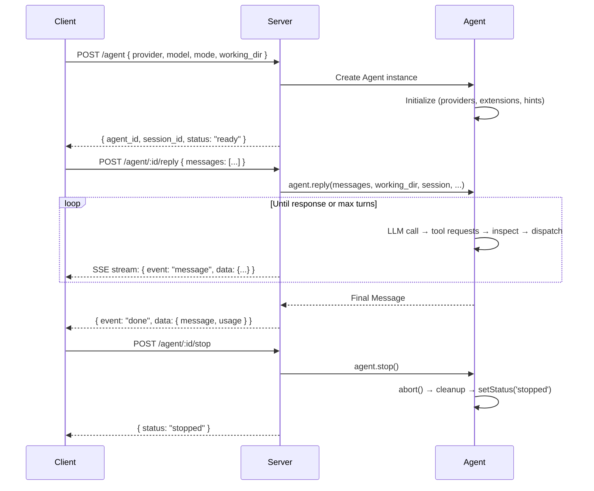

# Goose Server — HTTP API, WebSocket Streaming, OpenAPI, Multi-Agent Management

**The `goose-server` crate (5,329 lines) provides an Axum-based HTTP server exposing goose as a REST API with WebSocket streaming and auto-generated OpenAPI documentation.** The server manages multiple concurrent agent sessions — each with independent working directories, provider configurations, extension sets, and conversation contexts. Routes cover agent lifecycle (create, send messages, stop), session CRUD, recipe execution, extension management, audio transcription, scheduling, and configuration.

Source: `crates/goose-server/src/` — 5,329 lines, `routes/` — 8 modules

## Architecture



## Route Architecture

```rust
// crates/goose-server/src/main.rs
let app = Router::new()
    .nest("/agent", routes::agent::router())
    .nest("/sessions", routes::session::router())
    .nest("/recipes", routes::recipe::router())
    .nest("/extensions", routes::config_management::router())
    .nest("/schedules", routes::schedule::router())
    .nest("/audio", routes::audio::router())
    .nest("/config", routes::utils::router())
    .merge(utoipa_swagger_ui::SwaggerUi::new("/api-docs"))
    .layer(CorsLayer::permissive())
    .layer(TraceLayer::new_for_http());
```

## Route Modules

| Module | Lines | Key Endpoints |
|--------|-------|---------------|
| `routes/agent.rs` | 567 | `POST /agent` (create), `POST /agent/:id/reply` (send message), `POST /agent/:id/stop` |
| `routes/reply.rs` | 549 | Reply handler — constructs Agent, processes messages, returns streaming response |
| `routes/session.rs` | 324 | CRUD for sessions, export as JSON |
| `routes/recipe.rs` | 482 | Recipe listing, execution, status tracking |
| `routes/schedule.rs` | 544 | Cron job CRUD |
| `routes/config_management.rs` | 843 | Extension management, provider configuration |
| `routes/audio.rs` | 472 | Audio file upload, transcription via provider |
| `routes/utils.rs` | 172 | Utility endpoints (health check, version, config dump) |
| `openapi.rs` | 508 | OpenAPI schema generation via `utoipa` |

## Agent Lifecycle via HTTP



### Reply Streaming (reply.rs — 549 lines)

The reply endpoint streams responses as Server-Sent Events:

```rust
// crates/goose-server/src/routes/reply.rs
// Response format (SSE):
// event: message
// data: {"type":"text","content":"I'll help you with that..."}
//
// event: tool_call
// data: {"type":"tool_request","tool":"read_file","args":{"path":"src/main.rs"}}
//
// event: tool_result
// data: {"type":"tool_response","tool":"read_file","result":"..."}
//
// event: done
// data: {"type":"done","usage":{"input_tokens":150,"output_tokens":42}}
//
// event: error
// data: {"type":"error","message":"..."}
```

## WebSocket Streaming

```rust
// WebSocket endpoint: /ws/agent/:id
// Bidirectional JSON messaging:
// Client → Server: { "type": "message", "content": "..." }
// Client → Server: { "type": "stop" }
// Server → Client: { "type": "message", "data": {...} }
// Server → Client: { "type": "tool_call", "data": {...} }
// Server → Client: { "type": "done", "usage": {...} }
// WebSocket stays open across multiple reply() calls — session reuse
```

## OpenAPI Generation (508 lines)

```rust
// crates/goose-server/src/openapi.rs
// Uses utoipa crate with axum integration
// Auto-generates OpenAPI 3.0 schema from route handler type signatures
// Decorated with #[utoipa::path(...)] attributes on each handler
// Serves Swagger UI at /api-docs
// Serves raw OpenAPI JSON at /api-docs/openapi.json

#[derive(OpenApi)]
#[openapi(
    paths(
        routes::agent::create_agent,
        routes::agent::reply,
        routes::agent::stop_agent,
        routes::session::list_sessions,
        // ... all route handlers
    ),
    components(schemas(
        Session, Message, AgentConfig, Recipe, ExtensionConfig,
        // ... all types
    ))
)]
pub struct ApiDoc;
```

## Multi-Agent Concurrency

The server manages multiple concurrent agent sessions:

```rust
// Each agent session is isolated:
// - Independent tokio task
// - Separate working directory
// - Separate SQLite session ID
// - Separate ExtensionManager instance
// - Separate provider connection
// - Cancellation via CancellationToken per session
// - Cleanup on connection close (WebSocket disconnect or HTTP timeout)
```

## Audio Transcription (472 lines)

```rust
// crates/goose-server/src/routes/audio.rs
// POST /audio/transcribe
// Accepts: multipart/form-data with audio file (wav, mp3, m4a, webm)
// Returns: { "text": "transcribed content", "language": "en" }
// Uses the configured LLM provider for transcription
// Supports streaming transcription via WebSocket
```

## Running the Server

```bash
# Basic
goosed --port 3000

# With TLS
goosed --port 443 --tls-cert /etc/ssl/cert.pem --tls-key /etc/ssl/key.pem

# With authentication
goosed --port 3000 --api-key "secret-token"

# With custom config
goosed --config /etc/goose/server.yaml

# Docker
docker run -p 3000:3000 -v ~/.config/goose:/root/.config/goose ghcr.io/block/goose:latest
```

## Cross-References

- [Architecture](01-architecture.md) — The Agent that the server drives
- [CLI Deep Dive](12-cli.md) — CLI shares the same Agent core
- [Session & Conversation](05-session-conversation.md) — SQLite persistence
- [Providers](03-providers.md) — Provider configuration for the server

## Next

→ Back to [Overview](00-overview.md) for the big picture, or explore any deep-dive for a specific subsystem.
