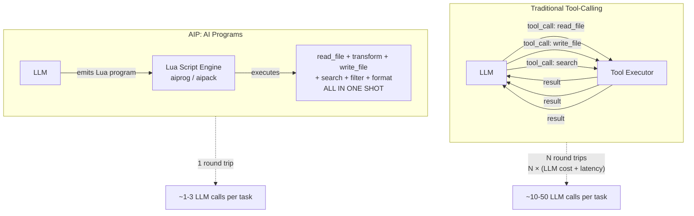
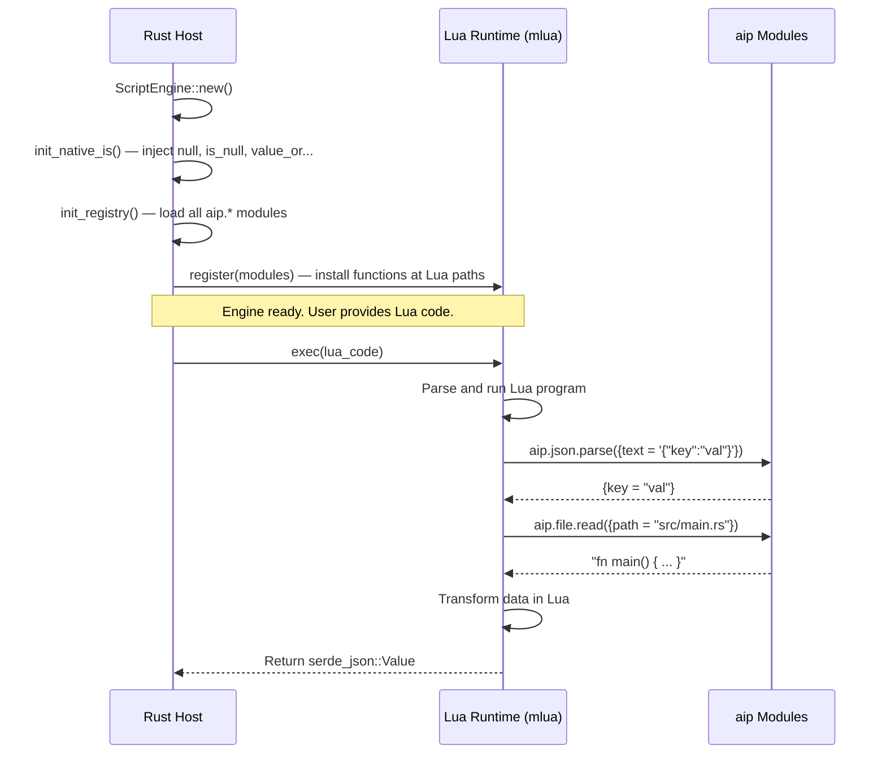
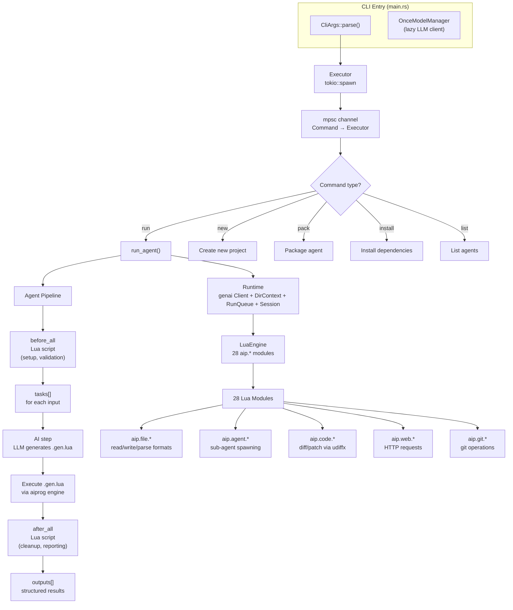
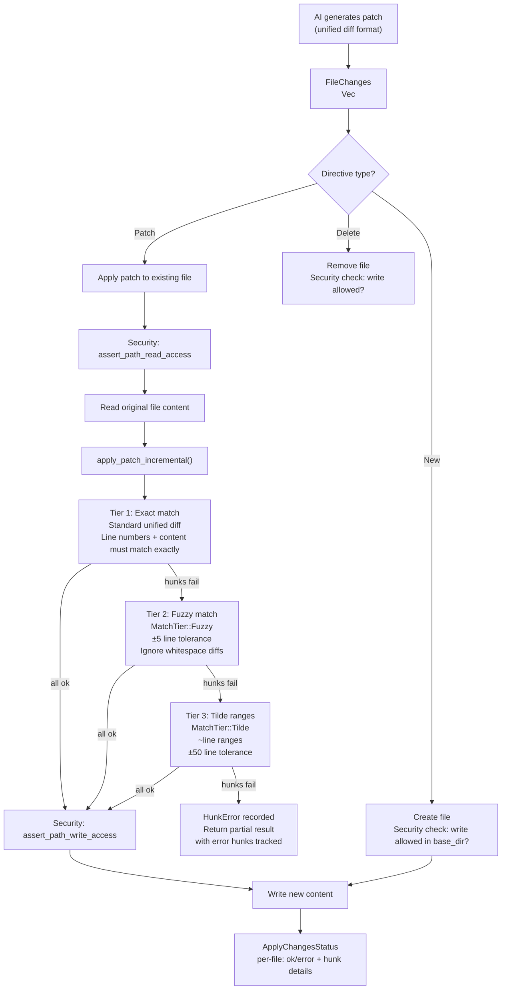
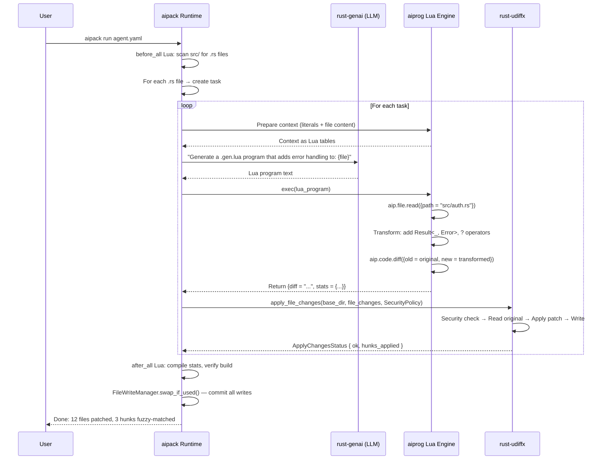

# src.jeremychone — The AIP Stack: AI Programs, Agent Orchestration, Diff Patching

**The AIP stack is Jeremy Chone's ecosystem for building AI agents that execute programs rather than calling tools.** The core innovation: instead of the LLM issuing individual tool calls (click, type, read_file, write_file), the LLM emits a **Lua program** (a `.gen.lua` script) that the runtime executes deterministically. This is a fundamentally different model — the LLM is a *programmer*, not a *tool-caller*. The stack has four key components:

- **aiprog** — The Lua-based AI program engine. Executes Lua scripts with built-in modules (JSON, HTML, files, web). Proc macros (`#[aip_handler]`) auto-generate Lua bindings from Rust functions.
- **aipack** — The agent orchestrator. Manages agent YAML configs, runtime lifecycle, a 28-module Lua scripting environment, file write safety, hub event bus, and multi-stage agent execution (before_all → tasks → AI → after_all).
- **rust-udiffx** — A security-hardened unified diff patcher. Applies AI-generated patches with tiered matching (exact → fuzzy → tilde ranges), a `SecurityPolicy` that confines reads/writes to allowed directories, and incremental patch application with per-hunk error tracking.
- **rust-genai** — The LLM provider library underpinning everything. 19+ providers behind a single `Client` API with adapter-driven format conversion.

Source: `/home/darkvoid/Boxxed/@formulas/src.rust/src.AI/src.jeremychone/` — 21 projects, 250K+ LOC

## The Big Idea: AI Programs, Not AI Tools



**Aha:** The key insight is that AI programs collapse N tool-calling round trips into 1. The LLM writes a Lua script that does everything — reads files, transforms data, writes output, searches, formats — and the runtime executes it deterministically. No back-and-forth. No "the tool returned X, now I need to call tool Y." The LLM thinks like a programmer: "here's the complete program that solves this task." This eliminates the primary failure mode of tool-calling agents: getting stuck in tool → result → tool loops.

## How aiprog Works



### The `#[aip_handler]` Macro

Rust functions become Lua-callable with a single attribute:

```rust
// In aiprog, any Rust fn becomes a Lua function:
#[aip_handler(path = "aip.json.parse")]
fn json_parse(lua: &Lua, value: Value) -> Result<Value> {
    // value comes from Lua, returned Value goes back to Lua
    // Proc macro auto-generates: Lua type conversion, error mapping, path registration
}
```

The macro generates:
1. A wrapper that handles `mlua` type conversions (Lua Value → Rust types → Lua Value)
2. Error propagation with proper Lua error messages
3. Registration into the `AipRegistry` at the correct `aip.json.parse` path
4. Auto-created intermediate tables (`aip` → `aip.json` → `aip.json.parse`)

### Built-in Modules (aiprog)

| Module | Functions | Purpose |
|--------|-----------|---------|
| `aip.json` | `parse`, `stringify` | JSON serialization with pretty-print |
| `aip.html` | `slim`, `to_md` | HTML minification, HTML→Markdown conversion |
| `aip.file` | `read`, `write`, `list`, `hash`, `csv`, `json`, `toml`, `yaml`, `md` | Full filesystem with typed file formats |
| `aip.web` | `get`, `post` | HTTP client for API calls |

### Lua Extensions (types/mod.rs + lua_exts)

Custom types can cross the Rust-Lua boundary bidirectionally:

```rust
#[derive(AipFromLua, AipIntoLua)]  // Auto-generates Lua ↔ Rust conversion
struct MyData {
    name: String,
    count: i32,
    tags: Vec<String>,
}
```

The `AipFromLua` derive generates code to extract a Rust struct from a Lua table. `AipIntoLua` generates the reverse. `AipParams` and `AipOutput` do the same for function parameters and return types specifically.

## How aipack Works — The Full Agent Orchestrator



### The Runtime

```rust
// aipack/src/runtime/runtime_impl.rs:22-24
pub struct Runtime {
    inner: Arc<RuntimeInner>,
}

struct RuntimeInner {
    dir_context: DirContext,        // .aipack and .aipack-base project structure
    genai_client: Client,           // LLM client (lazy)
    executor_tx: ExecutorTx,        // Send commands back to executor
    run_tx: RunTx,                  // Send run events
    session: Session,               // Unique session ID
    mm: ModelManager,               // Database for run history
    file_write_manager: FileWriteManager,  // Buffer writes until success
    cancel_trx: Option<CancelTrx>,  // Cancellation support
}
```

**Aha:** `FileWriteManager` uses a swap-file pattern. All file writes during agent execution go to `.tmp/` files first. Only after the entire agent run succeeds (all steps pass, no errors) does `swap_if_used()` atomically move the temp files to their final destinations. If the agent crashes or produces bad output, the working directory is untouched. This is transactional file writes for AI agents.

### The Agent Run Pipeline

```rust
// aipack/src/run/run_agent.rs:80-200
async fn run_agent_inner(runtime, run_id, agent, inputs, ...) -> Result<RunAgentResponse> {
    // 1. BEFORE ALL — Lua script runs pre-flight checks
    let ProcBeforeAllResponse { before_all, agent, inputs, skip, redo } = 
        process_before_all(runtime, ctx, run_id, agent, literals, inputs).await?;
    if skip { return Ok(RunAgentResponse::default()); }
    if redo { return Ok(RunAgentResponse { redo_requested: true, ..default() }); }

    // 2. TASKS — For each input, run task stages + AI step
    //    Tasks can be parallel (JoinSet) or serial
    //    Each task: task_stage_1 → task_stage_2 → AI → task_stage_3

    // 3. AI STEP — LLM generates .gen.lua program
    //    The LLM receives: system prompt + literals + task context + files
    //    The LLM outputs: a Lua program that solves the task
    
    // 4. AFTER ALL — Lua script runs cleanup/reporting
    let ProcAfterAllResponse { outputs, ... } = 
        process_after_all(runtime, ctx, agent, literals, outputs).await?;

    Ok(RunAgentResponse { outputs, after_all, redo_requested: false })
}
```

### The Hub Event Bus

```rust
// aipack/src/hub/hub_event.rs:20-52
pub enum HubEvent {
    Message(Arc<str>),           // Log messages
    InfoShort(Arc<str>),         // Status updates
    Error { error: Arc<Error> }, // Errors with full context
    Executor(ExecStatusEvent),   // Executor state changes
    LuaPrint(Arc<str>),          // Lua print() output
    Print(Arc<PrintEvent>),      // Formatted terminal output
    Prompt(PromptParams),        // User input requests
    Model(ModelEvent),           // LLM model events
    RtModelChange,               // Runtime model updated
    DoExecRedo,                  // Re-run request
    Quit,                        // Shutdown
}
```

The hub is a `tokio::sync::broadcast` channel. Any component can publish; any component can subscribe. This decouples the executor, TUI, agent runner, and Lua engine — they communicate only through typed events.

### 28 Lua Modules (aipack script engine)

```
aip.agent       — Sub-agent spawning and management
aip.cmd         — Shell command execution with output capture
aip.code        — Code generation + diff/patch via udiffx
aip.csv         — CSV parsing and generation
aip.editor      — File editing with str_replace
aip.file.*      — read, write, json, toml, yaml, csv, html, md, docx, hash, spans, change
aip.flow        — Flow control (loop, retry, redo)
aip.git         — Git operations
aip.hash        — Content hashing
aip.hbs         — Handlebars templating
aip.html        — HTML parsing, slim, to_md
aip.json        — JSON parse/stringify with schema validation
aip.lua         — Dynamic Lua execution
aip.md          — Markdown parsing
aip.path        — Path manipulation
aip.pdf         — PDF text extraction
aip.run         — Nested agent execution
aip.rust        — Rust code parsing/formatting
aip.semver      — Semantic version parsing
aip.shape       — Data shape/type validation (records, keys)
aip.tag         — Tag file generation
aip.task        — Task creation helpers
aip.text        — Text splitting, formatting, trimming
aip.time        — Date/time utilities
aip.toml        — TOML parsing
aip.udiffx      — Unified diff application
aip.uuid        — UUID generation
aip.web         — HTTP client
aip.yaml        — YAML parsing
aip.zip         — ZIP archive handling
```

## How udiffx Works — Security-Hardened Diff Patching



### SecurityPolicy

```rust
// rust-udiffx/src/security_policy.rs:19-30
pub struct SecurityPolicy {
    pub writable_dirs: Vec<SPath>,     // Directories where writes are allowed
    pub read_anywhere: bool,           // Allow reads outside writable_dirs (default: false)
    pub bypass_all_checks: bool,       // Disable all checks (default: false)
}

// Default: strict — writes and reads confined to base_dir
// SecurityPolicy::trusted_cwd() — allows writes in CWD
// SecurityPolicy::from_writable_dirs(...) — explicit allowlist
```

**Aha:** The default policy is zero-trust. `writable_dirs` is empty, meaning writes are restricted to `base_dir` ONLY. `read_anywhere` is false, meaning the AI can't read `/etc/passwd` or `~/.ssh/id_rsa`. Every file operation goes through `fs_guard::check_for_read()` and `fs_guard::check_for_write()` before touching the filesystem. This is not advisory — it's enforced. A patch that tries to write to `/etc/cron.d/` gets a `SecurityViolation` error, not a warning.

### FileDirective Types

```rust
// rust-udiffx/src/file_directives.rs
pub enum FileDirective {
    New { file_path: String, content: FileContent },      // Create/overwrite
    Patch { file_path: String, content: FileContent },     // Apply unified diff
    // Delete is handled via Patch with empty content
}

pub struct FileContent {
    pub content: String,             // File content or unified diff
    pub source: Option<String>,      // Which AI step produced this
}

pub type FileChanges = Vec<FileDirective>;
```

### ApplyChangesStatus — Per-File Tracking

```rust
// rust-udiffx/src/apply_changes_status.rs
pub struct ApplyChangesStatus {
    pub items: Vec<DirectiveStatus>,  // One per directive
    pub total_directives: usize,
    pub error_count: usize,
}

pub struct DirectiveStatus {
    pub file_path: String,
    pub directive_type: String,       // "new", "patch"
    pub status: DirectiveResult,      // OK / Error
    pub match_tier: Option<MatchTier>, // Which tier succeeded
    pub error_hunks: Vec<HunkError>,  // Which hunks failed
    pub total_hunks: usize,
}
```

## The Stack in a Real Task

Here's how the pieces fit together for a real task like "Add error handling to all Rust files in src/":



## Cross-References

- [aiprog](01-aiprog.md) — The Lua AI program engine deep dive
- [aipack](02-aipack.md) — Agent orchestrator, runtime, hub, 28 modules
- [rust-udiffx](03-udiffx.md) — Security-hardened unified diff patcher
- [rust-genai](04-genai.md) — LLM provider abstraction (19+ providers)

## Next

→ [aiprog](01-aiprog.md) — Lua scripting engine, proc macros, module system, type bridging.
