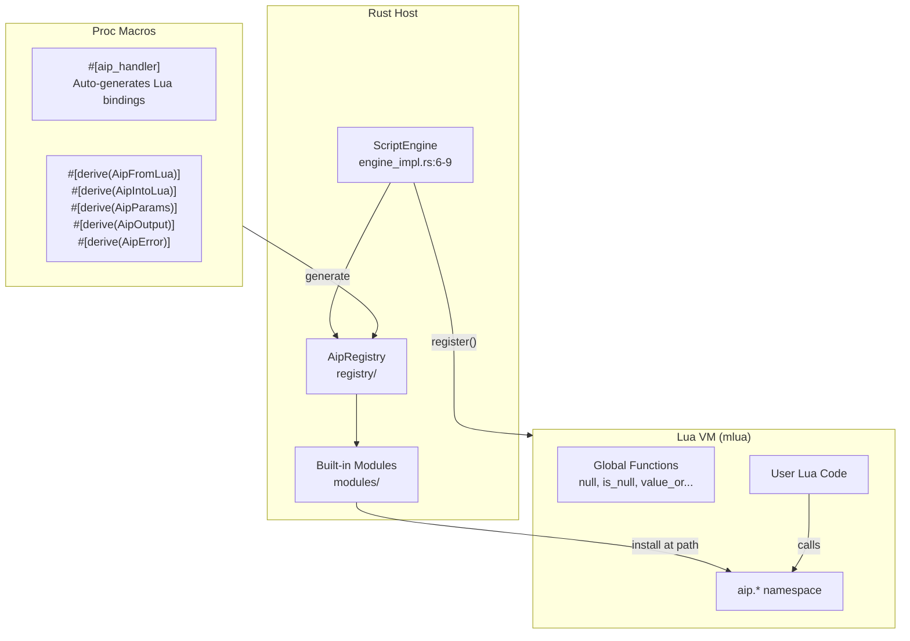

# aiprog — Lua-Based AI Program Engine

**aiprog is the engine that executes AI-generated Lua programs.** Instead of the LLM calling individual tools in a loop, the LLM writes a Lua script that the engine runs deterministically. The LLM thinks like a programmer — "here's the complete program that solves this task" — and aiprog provides the runtime: a Lua VM (mlua) with built-in modules for JSON, HTML, files, and web requests, accessible as `aip.json.parse()`, `aip.file.read()`, `aip.html.to_md()`, etc.

Source: `/home/darkvoid/Boxxed/@formulas/src.rust/src.AI/src.jeremychone/aiprog/` — 50+ Rust files

## Why Lua?

**Aha:** Lua was chosen because it's the smallest embeddable scripting language with a safe sandbox model. Unlike JavaScript (which would need Deno's full permission system), Lua in mlua can be restricted to ONLY the functions explicitly registered. The LLM can't access the filesystem, network, or process unless aiprog explicitly provides those functions. This is security-by-construction: the LLM's program runs in a capability-based sandbox where every operation requires an explicitly granted capability.

## Architecture



## ScriptEngine — The Core

```rust
// aiprog/src/engine/engine_impl.rs:6-9
pub struct ScriptEngine {
    pub(super) lua: Lua,
    pub(super) registered_fns: Vec<AipRegisteredFn>,
}
```

### Initialization

```rust
// engine_impl.rs:19-28
pub fn new() -> Result<Self> {
    let mut engine = Self { lua: Lua::new(), registered_fns: Vec::new() };
    engine.init_native_is()?;             // Inject null, is_null, value_or, is_table...
    let registry = crate::modules::init_registry()?;  // Load all aip.* modules
    engine.register(registry)?;            // Install at Lua paths
    Ok(engine)
}
```

### Execution

```rust
// engine_impl.rs:40-45
pub fn exec(&self, code: &str) -> Result<serde_json::Value> {
    let value = self.lua.load(code).eval()?;  // Run Lua
    let value = self.lua.from_value(value)?;   // Lua → serde_json::Value
    Ok(value)
}
```

**Aha:** The return type is `serde_json::Value`, not a Lua value. The engine automatically converts the Lua return value to JSON. This means the Rust host never deals with Lua types — it always receives plain JSON. The Lua script can return tables, strings, numbers, booleans, and nested structures, and they all come back as `serde_json::Value`. This is the bridge between the dynamic Lua world and the typed Rust world.

## The Registry System

Functions are registered at dotted paths using `install_value_at_path()`:

```rust
// engine_internal.rs:59-86
pub(crate) fn install_value_at_path(lua: &Lua, path: &str, value: Value) -> Result<()> {
    let segments: Vec<_> = path.split('.').collect();
    let (leaf, ancestors) = segments.split_last().unwrap();
    let globals = lua.globals();
    let mut current = globals;
    
    // Walk the path, creating intermediate tables as needed
    for &seg in ancestors {
        let next: Value = current.get(seg)?;
        if next.is_nil() {
            let table = lua.create_table()?;
            current.set(seg, table.clone())?;
            current = table;
        } else if let Value::Table(t) = next {
            current = t;
        } else {
            return Err(RuntimeError(format!("Segment '{}' exists but is not a table", seg)));
        }
    }
    current.set(*leaf, value)?;
    Ok(())
}
```

**Aha:** The path `aip.json.parse` auto-creates the intermediate tables. When the first `aip.json.*` function registers, it creates `aip` (a table), then `aip.json` (a nested table), then sets `aip.json.parse` to the function. When `aip.json.stringify` registers next, `aip` and `aip.json` already exist, so it just adds the function. This means modules can register in any order — the path infrastructure is created on demand.

### Registration Flow

```rust
// engine_internal.rs:8-50
pub(super) fn register(&mut self, registry: AipRegistry) -> Result<()> {
    for entry in registry.entries {
        let func = match entry.kind {
            AipFnKind::Sync => {
                lua.create_function(move |lua, args: MultiValue| -> Result<Value> {
                    let arg = args.into_iter().next().unwrap_or(Value::Nil);
                    handler(lua, arg)
                })?
            }
            AipFnKind::Async => {
                lua.create_async_function(move |lua, args: MultiValue| {
                    let arg = args.into_iter().next().unwrap_or(Value::Nil);
                    let response_fut = handler(&lua, arg);
                    async move {
                        let response_json = response_fut.await?;
                        let response_lua = Value::x_from_json_value(&lua, response_json)?;
                        Ok(response_lua)
                    }
                })?
            }
        };
        install_function_at_path(lua, &entry.path, func)?;
    }
}
```

Both sync and async handlers are supported. Async handlers are useful for file I/O and web requests — the Lua script can `await` them without blocking the Rust async runtime.

## Proc Macros — The Developer Experience

### #[aip_handler] — Register a Function

```rust
// In any crate, register a function at a Lua path:
#[aip_handler(path = "aip.json.parse")]
fn json_parse(lua: &Lua, value: Value) -> Result<Value> {
    // This function is now callable from Lua as aip.json.parse({text = "..."})
    let text: String = lua.x_deserialize(value)?;
    let parsed: serde_json::Value = serde_json::from_str(&text)?;
    lua.x_serialize(parsed)
}
```

The macro generates:
1. A wrapper that handles `mlua` type conversions
2. Registration into the `AipRegistry` at the correct path
3. Error propagation with Lua error messages

### Derive Macros — Type Bridging

```rust
#[derive(AipFromLua, AipIntoLua)]  // Bidirectional Lua ↔ Rust
struct FileInfo {
    name: String,
    size: u64,
    modified: String,
}

#[derive(AipParams)]    // For function parameters
struct ReadParams {
    path: String,
    offset: Option<usize>,
}

#[derive(AipOutput)]    // For function return types
struct ReadResult {
    content: String,
    hash: String,
}

#[derive(AipError)]     // For error types
enum FileError {
    NotFound(String),
    PermissionDenied,
    IoError(String),
}
```

## Built-in Modules

### aip.json — JSON Operations

```lua
-- Parse JSON string to Lua table
local data = aip.json.parse({text = '{"key": "value", "nested": {"count": 42}}'})
print(data.key)       -- "value"
print(data.nested.count) -- 42

-- Stringify Lua table to JSON
local json_str = aip.json.stringify({data = data, pretty = true})
```

### aip.html — HTML Processing

```lua
-- Slim/minify HTML (remove whitespace, comments, simplify)
local slimmed = aip.html.slim({html = raw_html, indent = 12})

-- Convert HTML to Markdown (preserves links, headings, lists)
local md = aip.html.to_md({html = slimmed})
```

### aip.file — Filesystem Operations

```lua
-- Read a file
local content = aip.file.read({path = "src/main.rs"})

-- Write a file
aip.file.write({path = "output.txt", content = "Hello"})

-- Read typed formats
local json_data = aip.file.json({path = "config.json"})
local toml_data = aip.file.toml({path = "Cargo.toml"})
local yaml_data = aip.file.yaml({path = "config.yaml"})

-- File metadata
local info = aip.file.hash({path = "src/main.rs"})
-- Returns {sha256 = "...", size = 1234}
```

### aip.web — HTTP Client

```lua
-- GET request
local response = aip.web.get({url = "https://api.example.com/data"})

-- POST with JSON body
local response = aip.web.post({
    url = "https://api.example.com/submit",
    body = {key = "value"},
    headers = {["Authorization"] = "Bearer token123"}
})
```

## Schema Reference System

aiprog includes a schema reference system (`schema_ref/`) that validates Lua function inputs against type schemas:

```rust
// schema_ref/mod.rs — validates that Lua tables match expected shapes
pub struct SchemaRef {
    fields: Vec<SchemaField>,
    required: Vec<String>,
}

// Example: validate that aip.file.read() received {path: string, offset?: number}
```

This catches type errors at the boundary — if the LLM generates a Lua program that calls `aip.file.read()` without a `path` field, the error message includes the expected schema.

## The Null Convention

aiprog normalizes Lua's `nil` and JSON's `null`:

```rust
// engine_internal.rs:52-99 (init_native_is)
globals.set("null", Value::NULL)?;
globals.set("Null", Value::NULL)?;
globals.set("NULL", Value::NULL)?;

// is_null(x) → boolean
globals.set("is_null", lua.create_function(|_, v: Value| 
    Ok(matches!(v, Value::Nil) || v == Value::NULL))?)?;

// nil_if_null(x) → x or nil
globals.set("nil_if_null", lua.create_function(|_, v: Value| {
    if matches!(v, Value::Nil) || v == Value::NULL { Ok(Value::Nil) } 
    else { Ok(v) }
})?)?;

// value_or(value, alt) → value or alt
globals.set("value_or", lua.create_function(|_, (v, alt): (Value, Value)| {
    if matches!(v, Value::Nil) || v == Value::NULL { Ok(alt) } 
    else { Ok(v) }
})?)?;
```

**Aha:** Lua uses `nil` for missing values; JSON uses `null`. When passing JSON data between Lua and Rust, these two concepts collide. aiprog solves this by making `null` a first-class Lua value (injected into globals) and providing utility functions that treat both `nil` and `null` equivalently. This eliminates an entire class of bugs where JSON `null` values silently became Lua `nil` and disappeared from tables.

## Cross-References

- [Overview](00-overview.md) — How aiprog fits in the AIP stack
- [aipack](02-aipack.md) — The agent orchestrator that uses aiprog's engine
- [rust-udiffx](03-udiffx.md) — Diff patching used by aipack's aip.code module

## Next

→ [aipack](02-aipack.md) — Agent orchestrator: runtime, hub, 28 Lua modules, agent pipeline.
