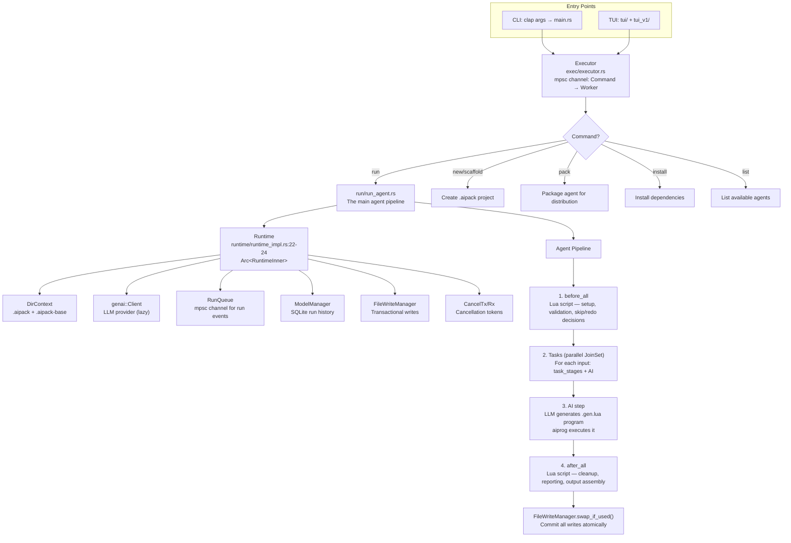

# aipack — AI Agent Orchestrator with Lua Scripting Runtime

**aipack is the agent orchestrator that turns AI programs into executed work.** It manages the full lifecycle: project structure (`.aipack` + `.aipack-base` directories), agent YAML configuration, a 28-module Lua scripting environment built on aiprog's engine, a hub event bus for decoupled component communication, a transactional file write manager, and a multi-stage agent execution pipeline (before_all → tasks → AI → after_all). It runs as both a CLI and a TUI application.

Source: `/home/darkvoid/Boxxed/@formulas/src.rust/src.AI/src.jeremychone/aipack/` — 381 files, 58,871 LOC

## The Big Idea: Agents are YAML, Behavior is Lua

**Aha:** In aipack, an "agent" is a YAML file + Lua scripts. The YAML declares what the agent IS (name, description, model, inputs, outputs, tools). The Lua scripts define what the agent DOES (before_all checks, task processing, after_all reporting). The LLM generates `.gen.lua` programs for the AI step — not individual tool calls. This is the key leap: the agent definition is declarative; the agent behavior is procedural Lua; the AI contributes new Lua programs to the pipeline.

## Architecture



## The Runtime

```rust
// aipack/src/runtime/runtime_impl.rs:22-24
pub struct Runtime { inner: Arc<RuntimeInner> }

// runtime_inner.rs
struct RuntimeInner {
    dir_context: DirContext,           // Project structure (.aipack, .aipack-base)
    genai_client: Client,             // LLM client via rust-genai
    executor_tx: ExecutorTx,          // Send commands back to executor
    run_tx: RunTx,                    // Send events to RunQueue
    session: Session,                 // Unique session UUID
    mm: ModelManager,                 // SQLite database for run history
    file_write_manager: FileWriteManager,  // Buffer writes → commit on success
    cancel_trx: Option<CancelTrx>,    // Cancellation support
}
```

### FileWriteManager — Transactional Writes

**Aha:** All file writes during agent execution go to temporary files first. Only when the entire run succeeds (all steps pass, no errors) does `swap_if_used()` atomically move them to their final destinations. If the agent crashes, produces bad output, or is cancelled, the working directory is untouched. This is ACID for AI agents — all-or-nothing file mutations.

### Runtime Cloning

```rust
// runtime_impl.rs:59
pub fn clone_inner(&self) -> Arc<RuntimeInner> { Arc::clone(&self.inner) }
```

The Runtime is designed to be cheaply cloned. Every component that needs it (Lua engine, run modules, TUI) gets a clone. The inner state is behind `Arc`, so cloning is O(1) reference counting.

## The Agent Pipeline

```rust
// run/run_agent.rs:80-200
async fn run_agent_inner(runtime, run_id, agent, inputs, ...) -> Result<RunAgentResponse> {
    // === STEP 1: BEFORE ALL ===
    let ProcBeforeAllResponse { before_all, agent, inputs, skip, redo } = 
        process_before_all(runtime, ctx, run_id, agent, literals, inputs).await?;
    if skip { return Ok(RunAgentResponse::default()); }   // Pre-condition not met
    if redo { return Ok(RunAgentResponse { redo_requested: true, ..default() }); }

    // === STEP 2: TASKS ===
    // Tasks can run in parallel (JoinSet) or sequentially
    // Each task: task_stage_1 → task_stage_2 → AI → task_stage_3
    // Inputs are batched; concurrency controlled by DEFAULT_CONCURRENCY
    
    // === STEP 3: AFTER ALL ===
    let ProcAfterAllResponse { outputs, ... } = 
        process_after_all(runtime, ctx, agent, literals, outputs).await?;
    
    // === COMMIT ===
    if parent_uid.is_none() {
        runtime.file_write_manager().swap_if_used();  // Only commit at top level
    }
    
    Ok(RunAgentResponse { outputs, after_all, redo_requested: false })
}
```

### Cancellation Support

```rust
// run_agent.rs:40-55
let run_future = run_agent_inner(runtime, run_id, agent, inputs, ...);
tokio::pin!(run_future);

let (run_agent_res, canceled) = if let Some(cancel_rx) = cancel_rx_opt {
    tokio::select! {
        res = &mut run_future => (res, false),
        _ = cancel_rx.cancelled() => (Ok(default_response), true)
    }
} else {
    (run_future.await, false)
};
```

`tokio::select!` races the agent run against the cancellation token. If the user hits Ctrl-C or the TUI sends a stop command, the cancellation future wins and the agent run is abandoned gracefully.

## The Hub Event Bus

```rust
// hub/hub_event.rs:20-52
pub enum HubEvent {
    Message(Arc<str>),           // Log messages → displayed in TUI
    InfoShort(Arc<str>),         // Status bar updates
    Error { error: Arc<Error> }, // Full error context
    Executor(ExecStatusEvent),   // Executor state transitions
    LuaPrint(Arc<str>),          // Lua print() output → captured in TUI
    Print(Arc<PrintEvent>),      // Formatted terminal output
    Prompt(PromptParams),        // User input requests (interactive mode)
    Model(ModelEvent),           // LLM model events (token usage, cost)
    RtModelChange,               // Database updated → refresh TUI
    DoExecRedo,                  // Request re-execution
    Quit,                        // Graceful shutdown signal
}
```

The hub is a `tokio::sync::broadcast` channel. Any component publishes; any component subscribes. The TUI subscribes to Message/Print/Error for display. The executor subscribes to DoExecRedo for re-run requests. The Lua engine's `print()` override publishes to LuaPrint. This is the nervous system of aipack — every component communicates through typed events, never through direct coupling.

## DirContext — Project Structure

```rust
// dir_context/mod.rs
pub struct DirContext {
    base_dir: SPath,       // .aipack-base (shared across agents)
    pack_dir: SPath,       // .aipack (agent-specific)
    // Agents are discovered in pack_dir/agents/*.yaml
    // Files are scoped to base_dir for security
}
```

## The 28 Lua Modules

The aipack Lua engine extends aiprog's built-in modules with domain-specific ones:

| Category | Modules | Purpose |
|----------|---------|---------|
| **File** | `aip.file.read/write/json/toml/yaml/csv/html/md/docx/hash/spans/change` | Full filesystem with typed format parsing |
| **Code** | `aip.code.*` | Code generation + diff/patch via udiffx |
| **Agent** | `aip.agent.*` | Sub-agent spawning and management |
| **Flow** | `aip.flow.*` | Loop, retry, redo control |
| **Git** | `aip.git.*` | Git operations (commit, diff, log) |
| **Web** | `aip.web.*` | HTTP client |
| **Format** | `aip.json.*`, `aip.yaml.*`, `aip.toml.*`, `aip.csv.*`, `aip.html.*`, `aip.md.*`, `aip.pdf.*` | Format parsing and generation |
| **Text** | `aip.text.*` | Splitting, formatting, trimming |
| **Template** | `aip.hbs.*` | Handlebars templating |
| **Shape** | `aip.shape.*` | Data validation (records, keys) |
| **Util** | `aip.time.*`, `aip.uuid.*`, `aip.semver.*`, `aip.path.*`, `aip.hash.*`, `aip.zip.*` | Utilities |

### Lua Engine in aipack

```rust
// runtime/runtime_impl.rs:96-103
impl Runtime {
    pub fn new_lua_engine_with_ctx(&self, ctx: &Literals, rt_ctx: RuntimeCtx) 
        -> Result<LuaEngine> {
        LuaEngine::new_with_ctx(self.clone(), ctx, rt_ctx)
    }
}
```

Each Lua engine is created fresh per invocation — no shared state. This isolates agent runs: the Lua state from one task cannot leak into another.

## Agent YAML Format

```yaml
name: "code-reviewer"
description: "Review code changes and provide feedback"
model: "claude-sonnet-4"
inputs:
  - name: "diff"
    type: "string"
    description: "Git diff to review"
outputs:
  - name: "review"
    type: "object"
    schema:
      issues: "array"
      summary: "string"
before_all: "before_all.lua"       # Lua script: pre-flight checks
task_stages:                        # Lua scripts per task stage
  - "prepare.lua"
  - "review.lua"
after_all: "after_all.lua"         # Lua script: post-processing
```

## ModelManager — Run History

```rust
// model/mod.rs
// SQLite-based persistence for:
// - Runs (agent + inputs + outputs + timestamps)
// - Stages (before_all, task_N, AI, after_all)
// - Events (tool calls, LLM responses, errors)
// - Token usage and cost tracking
```

Every agent run is recorded with full provenance: which model was used, how many tokens were consumed, what the inputs and outputs were, and whether it succeeded or failed.

## Cross-References

- [Overview](00-overview.md) — How aipack fits in the AIP stack
- [aiprog](01-aiprog.md) — The Lua engine that aipack extends
- [rust-udiffx](03-udiffx.md) — Diff patching via aip.code module

## Next

→ [rust-udiffx](03-udiffx.md) — Security-hardened unified diff patcher.
