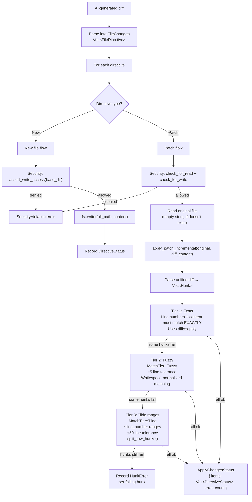

# rust-udiffx — Security-Hardened Unified Diff Patcher

**rust-udiffx applies AI-generated unified diffs to files with deterministic security enforcement.** It's not just a `patch` command wrapper — it's a library that takes `FileChanges` (New, Patch directives), validates every read and write against a configurable `SecurityPolicy`, applies patches with three tiers of matching (exact → fuzzy → tilde ranges), and returns per-file, per-hunk status tracking. It is the bridge between an AI's output ("here's a unified diff") and safe filesystem mutation.

Source: `/home/darkvoid/Boxxed/@formulas/src.rust/src.AI/src.jeremychone/rust-udiffx/` — 24 files, 5,792 LOC

## Why Not Just Use the `patch` Command?

**Aha:** The Unix `patch` command has no security model. It writes wherever the diff tells it to write. An AI-generated diff that prepends `../../../etc/cron.d/backdoor` as a file path would be applied without question. The `patch` command also fails silently on fuzzy matches — it applies what it can and leaves `.rej` files. udiffx makes both problems impossible: every file path is validated against a `SecurityPolicy` BEFORE any I/O, and every hunk match is tracked with explicit tier information.

## Architecture



## SecurityPolicy — Zero-Trust by Default

```rust
// rust-udiffx/src/security_policy.rs:19-30
pub struct SecurityPolicy {
    pub writable_dirs: Vec<SPath>,    // Explicit allowlist for writes
    pub read_anywhere: bool,          // Allow reads outside writable_dirs
    pub bypass_all_checks: bool,      // Disable all checks (use with extreme caution)
}

// DEFAULT: writable_dirs = [] — writes only in base_dir
// DEFAULT: read_anywhere = false — reads only in base_dir
// DEFAULT: bypass_all_checks = false — all checks enforced
```

### Write Access Check

```rust
// security_policy.rs:67-86
pub fn assert_write_access(&self, target: &SPath) -> Result<()> {
    if self.bypass_all_checks { return Ok(()); }
    
    // Check explicit writable directories
    for wd in &self.writable_dirs {
        if target.as_str().starts_with(wd.as_str()) {
            return Ok(());
        }
    }
    
    // Default: target must be under CWD
    let cwd = env::current_dir()?;
    let cwd_spath = SPath::from_std_path(cwd)?;
    if !target.as_str().starts_with(cwd_spath.as_str()) {
        return Err(Error::security_violation(target.to_string(), cwd_spath.to_string()));
    }
    Ok(())
}
```

### Read Access Check

```rust
// security_policy.rs:93-100
pub fn assert_path_read_access(&self, target: &SPath, base_dir: &SPath) -> Result<()> {
    if self.bypass_all_checks || self.read_anywhere { return Ok(()); }
    if target.as_str().starts_with(base_dir.as_str()) { return Ok(()); }
    // Check writable_dirs as fallback
    for wd in &self.writable_dirs {
        if target.as_str().starts_with(wd.as_str()) { return Ok(()); }
    }
    Err(Error::security_violation_read(target.to_string()))
}
```

**Aha:** The security policy is NOT advisory. `assert_write_access()` and `assert_path_read_access()` return `Result<()>`, not warnings. If a check fails, the error propagates and the file operation is aborted. There is no "apply anyway" escape hatch — `bypass_all_checks` must be explicitly set, and it's named to discourage casual use.

### Policy Presets

```rust
impl SecurityPolicy {
    pub fn trusted_cwd() -> Self {         // Writes allowed in CWD
        let mut policy = Self::default();
        if let Ok(cwd) = simple_fs::current_dir() {
            policy.writable_dirs.push(cwd);
        }
        policy
    }
    
    pub fn from_writable_dirs(dirs: impl IntoIterator<Item = impl Into<SPath>>) -> Self {
        Self { writable_dirs: dirs.into_iter().map(|d| d.into()).collect(), ..Default::default() }
    }
}

// None → SecurityPolicy::default() (strictest)
impl From<Option<SecurityPolicy>> for SecurityPolicy {
    fn from(opt: Option<SecurityPolicy>) -> Self { opt.unwrap_or_default() }
}
```

## FileDirective Types

```rust
// rust-udiffx/src/file_directives.rs
pub enum FileDirective {
    New { file_path: String, content: FileContent },
    Patch { file_path: String, content: FileContent },
}

pub struct FileContent {
    pub content: String,           // File content (New) or unified diff (Patch)
    pub source: Option<String>,    // Which AI step produced this
}
```

## The Three Match Tiers

### Tier 1: Exact Match

Standard unified diff application using `diffy::apply`. Line numbers and context lines must match exactly. This is the fast path — most AI-generated patches fall here because the LLM saw the exact file content it's patching.

### Tier 2: Fuzzy Match (MatchTier::Fuzzy)

When exact line numbers are off by a few lines (the file was edited between when the LLM saw it and when the patch is applied). ±5 line tolerance. Whitespace differences in context lines are normalized before comparison.

### Tier 3: Tilde Ranges (MatchTier::Tilde)

```rust
// rust-udiffx/src/patch_completer.rs
pub fn has_tilde_ranges(content: &str) -> bool { ... }
pub fn split_raw_hunks(content: &str) -> Vec<RawHunk> { ... }
```

When the LLM emits tilde ranges instead of exact line numbers:

```diff
@@ -~100,5 +~100,7 @@
 context line
-old line
+new line
 context line
```

**Aha:** Tilde ranges are an aipack convention — the LLM says "around line 100" instead of "exactly line 100." The `split_raw_hunks()` function parses these, and `complete()` resolves them against the actual file content with ±50 line tolerance. This is the last resort — if tilde matching fails, the hunk is recorded as an error but the remaining hunks are still applied.

## apply_file_changes() — The Main Entry Point

```rust
// rust-udiffx/src/applier.rs:32-36
pub fn apply_file_changes(
    base_dir: impl Into<SPath>,
    file_changes: FileChanges,
    security_policy: impl Into<SecurityPolicy>,
) -> Result<ApplyChangesStatus> {
    let base_dir = base_dir.into();
    let policy: SecurityPolicy = security_policy.into();
    
    // For each directive:
    match directive {
        FileDirective::New { file_path, content } => {
            let full_path = base_dir.join(&file_path);
            policy.assert_write_access(&full_path)?;       // Security check FIRST
            // ... write file ...
        }
        FileDirective::Patch { file_path, content } => {
            let full_path = base_dir.join(&file_path);
            policy.assert_path_read_access(&full_path, &base_dir)?;   // Read check
            policy.assert_write_access(&full_path)?;                   // Write check
            // ... read original, apply patch, write result ...
        }
    }
}
```

## ApplyChangesStatus — Per-File Tracking

```rust
// rust-udiffx/src/apply_changes_status.rs
pub struct ApplyChangesStatus {
    pub items: Vec<DirectiveStatus>,
    pub total_directives: usize,
    pub error_count: usize,
}

pub struct DirectiveStatus {
    pub file_path: String,
    pub directive_type: String,       // "new" or "patch"
    pub status: DirectiveResult,       // Ok or Error
    pub match_tier: Option<MatchTier>, // Exact / Fuzzy / Tilde
    pub error_hunks: Vec<HunkError>,   // Which hunks failed
    pub total_hunks: usize,
}
```

This granular reporting lets the AI know EXACTLY what happened: "3 of 5 hunks applied via exact match, 1 via fuzzy match (line offset: +3), 1 failed (hunk at line 42: context mismatch)." The AI can then regenerate only the failed hunk instead of the entire patch.

## Filesystem Guard

```rust
// rust-udiffx/src/fs_guard.rs
pub fn check_for_read(path: &SPath, base_dir: &SPath, policy: Option<&SecurityPolicy>) 
    -> Result<()> { ... }
pub fn check_for_write(path: &SPath, base_dir: &SPath, policy: Option<&SecurityPolicy>) 
    -> Result<()> { ... }
```

These are the single choke points for all filesystem access. Every read and write goes through these functions. They check:
1. Is the path within the allowed directories?
2. Is the path a symlink? (symlinks are resolved and checked)
3. Does the path escape via `../` traversal? (collapsed and checked)
4. Is the path absolute? (must be under an allowed directory)

## Cross-References

- [Overview](00-overview.md) — How udiffx bridges AI output and safe filesystem mutation
- [aipack](02-aipack.md) — aipack's aip.code module wraps udiffx
- [aiprog](01-aiprog.md) — Lua programs can call udiffx via aip.code

## Next

→ [rust-genai](04-genai.md) — The LLM provider library powering the entire stack.
