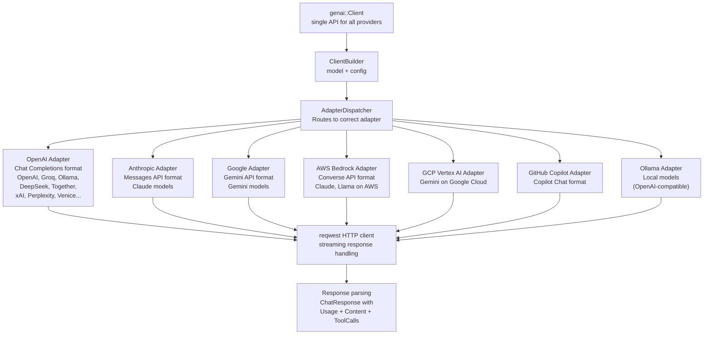

# rust-genai — Multi-Provider LLM Client for Rust

**rust-genai is the LLM provider abstraction that powers the entire AIP stack.** It provides a single `Client` API that works with 19+ AI providers (OpenAI, Anthropic, Google, Groq, Ollama, DeepSeek, xAI, Cohere, Together, Perplexity, and more). The key abstraction is the `Adapter` layer — rather than implementing each provider separately, genai uses format-specific adapters (OpenAI format, Anthropic format, Google format) that handle the wire protocol differences. Most providers just declare which adapter they use.

Source: `/home/darkvoid/Boxxed/@formulas/src.rust/src.AI/src.jeremychone/rust-genai/` — 174 files, 24,625 LOC

## The Adapter Pattern



**Aha:** The `Adapter` trait uses **static dispatch** — all methods take `AdapterKind` as an argument, no `&self`. This eliminates per-request allocations and state management. The `AdapterDispatcher` resolves the `AdapterKind` at config time and dispatches directly to the correct adapter's static methods. There's no `dyn Adapter` virtual dispatch — it's all monomorphized at compile time.

## Client API

```rust
use genai::Client;

// Create a client for any provider
let client = Client::builder()
    .with_model("gpt-4o")           // or "claude-sonnet-4", "gemini-2.0-flash"
    .with_api_key("sk-...")
    .build()?;

// Simple completion
let response = client.complete("Explain quantum computing in one paragraph").await?;
println!("{}", response.content());

// Chat with messages
let messages = vec![
    Message::user("What is Rust?"),
    Message::assistant("Rust is a systems programming language..."),
    Message::user("Show me an example"),
];
let response = client.chat(messages).await?;

// Streaming
let mut stream = client.stream("Write a haiku about programming").await?;
while let Some(chunk) = stream.next().await {
    print!("{}", chunk?);
}
```

### Configuration

```rust
let client = Client::builder()
    .with_model("claude-sonnet-4-20250514")
    .with_api_key_env("ANTHROPIC_API_KEY")    // Read from env var
    .with_temperature(0.3)
    .with_max_tokens(4096)
    .with_system_prompt("You are a helpful Rust expert.")
    .build()?;
```

## Provider Support

| Provider | Adapter | Model Examples |
|----------|---------|---------------|
| OpenAI | `openai` | gpt-4o, gpt-4-turbo, gpt-3.5-turbo |
| Anthropic | `anthropic` | claude-opus-4, claude-sonnet-4, claude-haiku-3.5 |
| Google Gemini | `google` | gemini-2.0-flash, gemini-2.5-pro |
| Groq | `openai` | llama-3.3-70b, mixtral-8x7b |
| Ollama | `ollama` | Any local model |
| DeepSeek | `openai` | deepseek-chat, deepseek-reasoner |
| xAI Grok | `openai` | grok-2 |
| Together AI | `openai` | 100+ open models |
| Cohere | `openai` | command-r-plus |
| Perplexity | `openai` | llama-3.1-sonar |
| Mistral | `openai` | mistral-large |
| AWS Bedrock | `bedrock` | Claude, Llama on AWS |
| GCP Vertex AI | `vertex` | Gemini on GCP |
| GitHub Copilot | `copilot` | GPT-4o via Copilot |
| Venice | `openai` | Various open models |

## The Resolver System

```rust
// genai supports a resolver pattern for dynamic model selection:
pub trait Resolver {
    fn resolve(&self, request: &ChatRequest) -> ResolvedModel;
}

// Built-in resolvers:
// - StaticResolver: always uses the configured model
// - RoundRobinResolver: cycles through a list of models
// - CostOptimizedResolver: picks the cheapest capable model
```

## Chat Types

```rust
pub struct ChatRequest {
    pub messages: Vec<Message>,
    pub system: Option<String>,
    pub temperature: Option<f32>,
    pub max_tokens: Option<u32>,
    pub tools: Option<Vec<Tool>>,
}

pub struct ChatResponse {
    pub content: ChatContent,
    pub usage: Usage,
    pub model: String,
}

pub enum ChatContent {
    Text(String),
    ToolCalls(Vec<ToolCall>),
    Mixed(String, Vec<ToolCall>),
}
```

## Cross-References

- [Overview](00-overview.md) — How genai powers the entire stack
- [aipack](02-aipack.md) — aipack's Runtime wraps genai::Client
- [aiprog](01-aiprog.md) — aiprog's aip.web module uses HTTP (genai not needed in Lua)

## Next

→ Back to [Overview](00-overview.md) for the big picture.
