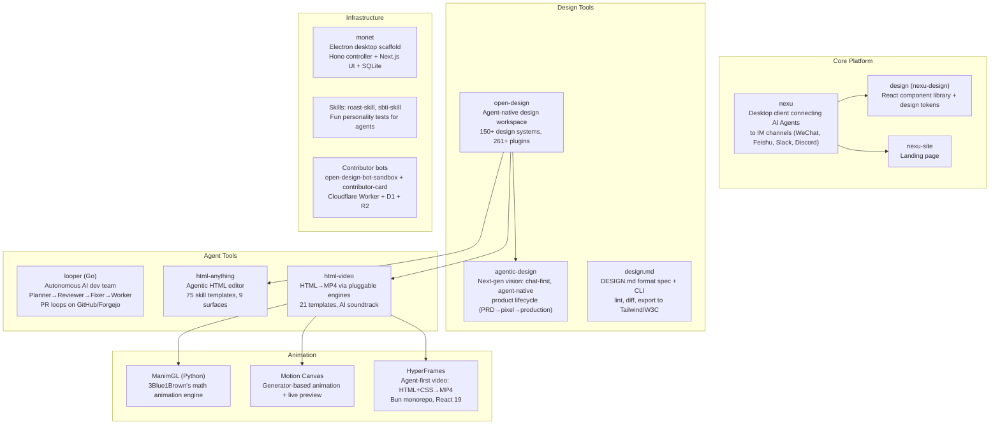
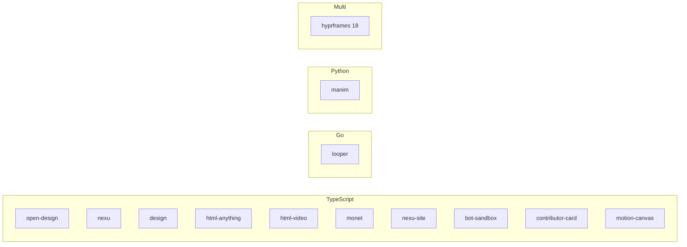

# src.Opendesign — The Open Design Ecosystem (nexu)

**19 projects centered on the nexu ecosystem — agent-native tools for design, chat, video, AI teams, and knowledge management.** The flagship **open-design** is an open-source alternative to Claude Design: a local-first workspace that detects coding-agent CLIs on PATH and uses 150+ design systems to generate HTML prototypes, decks, images, and HyperFrames motion graphics. **html-anything** converts any input (Markdown, CSV, Excel) into single-file HTML via local agents with 75 skill templates. **html-video** renders HTML to MP4 video via pluggable engines. **looper** runs autonomous AI dev teams (Planner→Reviewer→Fixer→Worker) that plan, review, fix, and ship PRs on a loop.

Source: `/home/darkvoid/Boxxed/@formulas/src.rust/src.AI/src.Opendesign/` — 19 projects

## The nexu Ecosystem



## Technology Stack by Project



## Key Projects

### open-design — Agent-Native Design Workspace

The flagship. Local-first, detects 8+ coding-agent CLIs on PATH (Claude Code, Cursor, Codex, Gemini CLI, GitHub Copilot CLI, OpenCode, Qwen Coder, Aider). Architecture:
- `apps/daemon` — Local privileged daemon + `od` CLI. Owns `/api/*`, agent spawning, skills, design systems
- `apps/web` — Next.js 16 + React 18 web UI
- `apps/desktop` — Electron shell with sidecar IPC
- `packages/contracts` — Pure TypeScript contract layer between web and daemon
- `skills/` — Composable skill templates invoked by agents mid-task
- `design-systems/` — 150+ DESIGN.md brand contracts
- **Sandboxed iframe preview** for generated artifacts

**Aha: Agent auto-detection on PATH.** Open Design discovers which coding agent you have installed and adapts its interface. No manual configuration — it works with whatever agent is available.

### html-anything — 75 Skills, 9 Surfaces

Converts any input to single-file HTML via local agents. 75 composable skill templates across 9 deliverable formats: magazine articles, keynote decks, resumes, posters, social cards, tweet cards, web prototypes, data reports, Hyperframes videos. All skills registered with `SKILL.md` frontmatter including `recommended` rank. Uses SSE streaming from agent spawn to iframe preview.

### html-video — HTML to MP4

Pluggable rendering engine architecture:
- Default: **HyperFrames** (headless Chromium + ffmpeg, libx264) — fully shipped
- Planned: Remotion, Motion Canvas/Revideo, Manim
- 21 curated, license-clean templates
- AI soundtrack via MiniMax (background music + narration)
- Multi-frame storyboards with content-graph
- Agent auto-detection: 14 backends

### looper — Autonomous AI Dev Team

```
Planner → Reviewer ←→ Fixer → Worker
   ↑                           ↓
   └─────── LOOP ──────────────┘
```

Four specialized agents running in isolated git worktrees: Planner creates task plan, Reviewer checks quality, Fixer corrects issues, Worker implements. GitHub label state machine as coordination. Each role runs with its own model and tool set. Network mode (`loopernet`) for multi-node deployments with lease-based coordination.

### monet — Desktop App Scaffold

Electron + Next.js + Hono local controller + Drizzle ORM + SQLite. Session workspaces with scoped file access. Writes inside session workspace auto-approved. macOS signing/notarization + Windows NSIS packaging support.

### ManimGL — Math Animation Engine

3Blue1Brown's personal Manim version. Python with system dependencies (FFmpeg, OpenGL, LaTeX, Pango). Package name on PyPI: `manimgl`. The community fork is `ManimCommunity/manim`.

### HyperFrames — Agent-First Video

Bun monorepo with React 19. Engine-agnostic: HTML + CSS + GSAP authoring model. Headless Chromium recording + ffmpeg encoding. Modular runtime builds. Cloud deployment via AWS Lambda and GCP Cloud Run.

## Documentation Index

- [Architecture](01-architecture.md) — Full dependency graph, layer diagram, module map
- [Nexu Platform](02-nexu-platform.md) — Controller, web, desktop, slimclaw
- [Open Design](03-open-design.md) — Daemon, web, contracts, brands engine
- [Agent Detection](04-agent-detection.md) — Agent detection, registry, 26 adapters
- [Design Systems](05-design-systems.md) — Design systems registry, brand engine
- [Design Tokens](06-design-tokens.md) — Token system, CSS variables, theming
- [Component Library](07-component-library.md) — 50+ primitives, 15 patterns
- [Plugin System](08-plugin-system.md) — Plugin runtime, registry, protocol
- [SkillHub](09-skillhub.md) — Skill catalog, install, npm-runner
- [HTML Anything](10-html-anything.md) — 75 skills, 9 surfaces, SSE streaming
- [HTML Video](11-html-video.md) — Engine adapters, templates, soundtrack
- [Looper](12-looper.md) — Autonomous AI dev team, worktrees
- [Monet](13-monet.md) — Desktop scaffold, sessions, live artifacts
- [Data Flow](14-data-flow.md) — End-to-end data flows
- [Developer Tooling](15-developer-tooling.md) — CLI, testing, CI/CD, deployment
- [Smaller Projects](16-smaller-projects.md) — Bots, skills, manim, hyprframes

## Cross-References

- [src.Google](../src.Google/markdown/00-overview.md) — Google's agent ecosystem
- [src.Wayfinder](../src.Wayfinder/markdown/00-overview.md) — Deterministic knowledge management
- [Goose](../src.block/markdown/00-overview.md) — Block's on-machine AI agent
