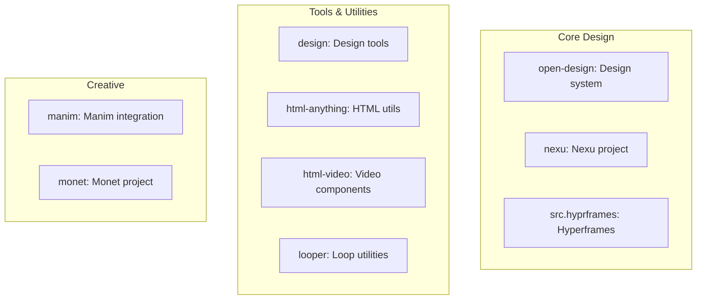

# src.Opendesign Projects Overview

**Collection of 18+ open design, UI, and creative projects.**

Source: 50,426 files

## Projects

## Project Count

18+ projects, 50,426 files total.

## Notes

- Massive collection
- Mix of design tools, utilities, creative projects
- TypeScript, Python, Rust

## Next

Individual project docs (when created)
