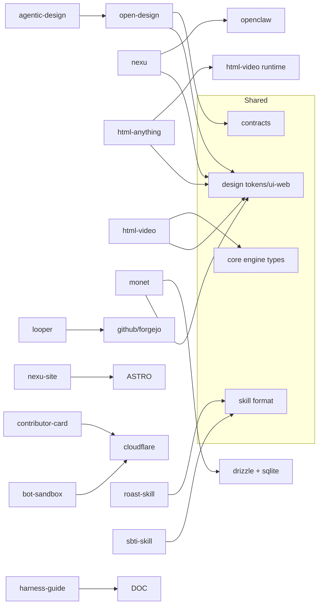

# 01 — Architecture — Full Ecosystem Dependency Graph

The nexu ecosystem is a multi-project monorepo of monorepos — 19 distinct projects, each with its own package manager, build system, and deployment target, unified by shared design patterns, agent-native philosophy, and cross-project contracts.

## Layered Architecture

```mermaid
flowchart TB
    subgraph L1["Layer 1: Agent Runtimes"]
        A1[Claude Code]
        A2[Codex CLI]
        A3[Cursor Agent]
        A4[OpenCode]
        A5[22+ more...]
    end

    subgraph L2["Layer 2: Local Daemons"]
        B1[open-design daemon<br/>Hono + agent spawning]
        B2[nexu controller<br/>Hono + OpenClaw orchestration]
        B3[html-anything CLI<br/>agent detection + SSE]
        B4[html-video CLI<br/>engine adapters]
        B5[looperd<br/>Go daemon + scheduler]
    end

    subgraph L3["Layer 3: Web Frontends"]
        C1[open-design web<br/>Next.js 16 + React 18]
        C2[nexu web<br/>React + Ant Design + Vite]
        C3[html-anything studio<br/>Vite + React]
        C4[html-video studio<br/>Vite + React]
        C5[monet controller<br/>Next.js]
    end

    subgraph L4["Layer 4: Desktop Shells"]
        D1[open-design desktop<br/>Electron sidecar IPC]
        D2[nexu desktop<br/>Electron + Hono sidecar]
        D3[monet desktop<br/>Electron + Drizzle ORM]
    end

    subgraph L5["Layer 5: Shared Libraries"]
        E1[nexu-design/tokens<br/>CSS variable tokens]
        E2[nexu-design/ui-web<br/>50+ React primitives]
        E3[@open-design/contracts<br/>TypeScript contract layer]
        E4[html-video/core<br/>Engine adapter types]
        E5[looper/internal<br/>Go agent libraries]
    end

    A1 --> B1 & B2 & B3 & B4 & B5
    A2 --> B1 & B2 & B3 & B4
    A3 --> B1 & B2 & B3
    A4 --> B1 & B3
    B1 --> C1 & D1
    B2 --> C2 & D2
    B3 --> C3
    B4 --> C4
    B5 --> C5 & D3
    C1 --> E1 & E2 & E3
    C2 --> E1 & E2
    C3 --> E2
    C4 --> E2 & E4
    D1 --> E1 & E2 & E3
    D2 --> E1 & E2
```

The architecture follows a clear dependency direction: agent runtimes are at the bottom (external CLIs on PATH), daemons orchestrate agents and expose HTTP APIs, web frontends consume those APIs, desktop shells package everything into distributable applications, and shared libraries provide typed contracts and UI primitives.

## Project Dependency Graph



## Monorepo Layout by Project

| Project | Package Manager | Apps | Packages | Tools |
|---------|----------------|------|----------|-------|
| **open-design** | pnpm 10.26 | daemon, web, desktop, landing-page, packaged, telemetry-worker | contracts | dev, launcher-proto |
| **nexu** | pnpm 10.26 | controller, web, desktop | shared, slimclaw, dev-utils | dev |
| **design** | pnpm 10.16 | storybook, demo, cloud-demo | tokens, ui-web | scripts |
| **html-anything** | pnpm | cli, next | core, runtime, studio-next, adapters | scripts |
| **html-video** | pnpm | studio-next | core, cli, runtime, adapter-hyperframes, adapter-remotion, content-graph | scripts |
| **looper** | Go modules | looper, looperd, loopernet | api | internal/* |
| **monet** | pnpm | controller | shared | scripts |

## Shared Patterns Across Projects

Every major project shares these architectural patterns:

1. **Hono-based HTTP APIs** — open-design daemon, nexu controller, monet controller all use Hono as their HTTP framework
2. **Agent detection on PATH** — open-design, html-anything, html-video, nexu all detect coding agents installed on the system PATH
3. **SSE streaming** — open-design daemon, html-anything, nexu controller all use Server-Sent Events for real-time agent output
4. **pnpm workspaces** — All TypeScript projects use pnpm workspaces for monorepo management
5. **Biome linting** — All TypeScript projects use Biome for lint and format
6. **Zod validation** — Shared schemas validate API inputs across project boundaries

**Aha:** The ecosystem's unifying pattern is **agent-as-infrastructure**. Rather than building their own AI models, every project treats coding agents as external, auto-detected executables on PATH. This means the platform works with whatever agent the user has installed — Claude Code, Codex, Cursor, OpenCode, or 22 others — without any configuration. The agent detection system (`apps/daemon/src/runtimes/detection.ts`) is the keystone that makes this possible.

Source: `open-design/apps/daemon/src/runtimes/registry.ts:28-53` — BASE_AGENT_DEFS array listing all 23 built-in agent adapters.

## Cross-Project Contracts

The `@open-design/contracts` package (in `open-design/packages/contracts/src/`) defines shared TypeScript interfaces that cross project boundaries:

| Contract Module | Purpose |
|----------------|---------|
| `api/` | REST API request/response types |
| `sse/` | SSE event shapes for chat, proxy |
| `plugins/` | Plugin manifest, marketplace, install types |
| `design-systems/` | Token schema, component manifest, derived outputs |
| `prompts/` | System prompts, atom blocks, plugin blocks |
| `errors.ts` | Shared error types |
| `common.ts` | Common types used across modules |

Source: `open-design/packages/contracts/src/index.ts` — re-exports all contract modules.

## Build Orchestration

```
pnpm-workspace.yaml (root)
  ├── apps/*        → individual app builds
  ├── packages/*    → shared library builds
  └── tools/*       → development tools

Root scripts:
  pnpm -r build          → builds all workspaces
  pnpm -r typecheck      → type checks all workspaces
  pnpm -r test           → runs all test suites
  biome check .          → lints entire workspace
```

Source: `open-design/package.json:1-60` — root scripts and dependencies.

## Key Insight: Controller-First Architecture

Both open-design and nexu follow a **controller-first** pattern: a local HTTP daemon owns all state (config, skills, templates, agent processes), and the web frontend is a thin client that calls the controller's API. The desktop shell is an orchestrator that starts the controller and web as sidecars.

```
Desktop Shell
    ├── starts Controller (sidecar process)
    ├── waits for Controller readiness
    ├── starts Web (sidecar process)
    └── delegates OpenClaw management to Controller
```

Source: `nexu/ARCHITECTURE.md:57-58` — "Desktop runtime boot" section.

This means the controller is the **single source of truth** for local state. The web frontend has no independent state management for configuration — it reads from and writes to the controller API.

## Next

- [02 — Nexu Platform](02-nexu-platform.md) — Deep dive into the nexu controller, web, desktop, and slimclaw
- [03 — Open Design](03-open-design.md) — Deep dive into the open-design daemon, web, and brands engine
