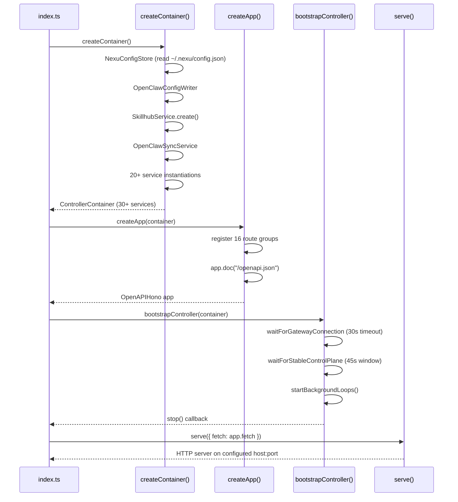

# 02 — Nexu Platform — Controller, Web, Desktop, Slimclaw

Nexu is a local-first platform that connects AI agents to IM channels (Slack, Discord, Feishu, WeChat). It uses a **controller-first architecture**: a single Hono-based HTTP daemon owns all configuration, orchestrates the OpenClaw runtime, and serves a React web frontend and Electron desktop shell.

Source: `/home/darkvoid/Boxxed/@formulas/src.rust/src.AI/src.Opendesign/nexu/`

## Monorepo Structure

```
nexu/
  apps/
    controller/          ← Hono HTTP daemon (the brain)
      src/
        index.ts         ← Entry: createContainer → createApp → serve
        app/
          container.ts   ← Dependency injection container (30+ services)
          create-app.ts  ← Route registration (16 route groups)
          bootstrap.ts   ← Gateway connection wait, control plane stability
          env.ts         ← Environment variable resolution
        routes/          ← 16 route groups (see below)
        services/        ← 18 business logic services
        runtime/         ← OpenClaw process management, health loops, sync
        store/           ← lowdb-backed JSON config under ~/.nexu/
        lib/             ← Compilers, loggers, proxy-fetch, secrets
    web/                 ← React + Ant Design + Vite frontend
    desktop/             ← Electron shell with sidecar IPC
  packages/
    shared/              ← Zod schemas (bot, channel, gateway, model, skill)
    slimclaw/            ← OpenClaw runtime adapter layer
    dev-utils/           ← Development utilities
  nexu-skills/           ← Public skill repository (SKILL.md frontmatter)
```

## Controller Entry Point

The controller bootstraps in a precise order:



Source: `nexu/apps/controller/src/index.ts:8-103` — main() function.

## Controller Container — 30+ Services

The DI container instantiates and wires together all controller services:

| Service | Responsibility |
|---------|---------------|
| `NexuConfigStore` | Reads/writes `~/.nexu/config.json` via lowdb |
| `OpenClawConfigWriter` | Compiles Nexu config into OpenClaw config JSON |
| `OpenClawProcessManager` | Starts/stops/restarts the OpenClaw process |
| `OpenClawSyncService` | Syncs config, skills, templates to OpenClaw runtime |
| `OpenClawAuthService` | Manages auth profiles for model providers |
| `SkillhubService` | Scans, catalogs, installs skills from `nexu-skills/` |
| `ChannelService` | Manages IM channel configurations (Slack, Discord, etc.) |
| `ChannelFallbackService` | Provides fallback responses when agents are unavailable |
| `SessionService` | Manages chat sessions |
| `AgentService` | Manages agent configurations |
| `ModelProviderService` | Manages model providers and refreshes model lists |
| `IntegrationService` | Manages third-party integrations (Composio) |
| `AnalyticsService` | Tracks usage analytics |
| `ArtifactService` | Manages generated artifacts |
| `TemplateService` | Manages workspace templates |
| `RuntimeConfigService` | Runtime configuration management |
| `GatewayClient` | HTTP client for the OpenClaw gateway |
| `OpenClawWsClient` | WebSocket client for OpenClaw gateway |
| `OpenClawGatewayService` | Gateway service abstraction |
| `ControlPlaneHealthService` | Probes control plane health |

Source: `nexu/apps/controller/src/app/container.ts:45-269` — ControllerContainer interface and createContainer().

## Route Registration

The controller registers 16 route groups, each handling a specific domain:

Source: `nexu/apps/controller/src/app/create-app.ts:37-51`

| Route Group | Prefix | Purpose |
|------------|--------|---------|
| `bot-routes` | `/api/bots/*` | Bot configuration |
| `channel-routes` | `/api/channels/*` | IM channel management |
| `desktop-routes` | `/api/desktop/*` | Desktop-specific endpoints |
| `desktop-compat-routes` | `/api/desktop/compat/*` | Desktop compatibility |
| `desktop-rewards-routes` | `/api/desktop/rewards/*` | Rewards system |
| `session-routes` | `/api/sessions/*` | Chat session management |
| `model-routes` | `/api/models/*` | Model provider management |
| `provider-oauth-routes` | `/api/providers/oauth/*` | OAuth flows for providers |
| `integration-routes` | `/api/integrations/*` | Third-party integrations |
| `artifact-routes` | `/api/artifacts/*` | Generated artifact management |
| `skillhub-routes` | `/api/skillhub/*` | Skill catalog and installation |
| `user-routes` | `/api/users/*` | User management |
| `runtime-config-routes` | `/api/runtime-config/*` | Runtime configuration |
| `workspace-template-routes` | `/api/workspace-templates/*` | Workspace templates |
| `misc-compat-routes` | `/api/misc/*` | Miscellaneous compatibility |

Plus: `GET /openapi.json` (OpenAPI spec) and `GET /health` (health probe).

## OpenClaw Config Compiler

The compiler transforms Nexu's local config into OpenClaw's config format:

Source: `nexu/apps/controller/src/lib/openclaw-config-compiler.ts`

Critical constraints enforced by the compiler:

1. `bindings[].agentId` must match `agents.list[].id`
2. `bindings[].match.accountId` must match `channels.{slack|feishu}.accounts` key
3. Slack HTTP mode requires `signingSecret`; `groupPolicy` must be `"open"`
4. LiteLLM models must set `compat.supportsStore: false`
5. Only one agent should have `default: true`

**Aha:** The compiler doesn't just translate config — it **validates cross-references** between agents, channels, and bindings at compile time. If you configure a Slack channel binding to an agent that doesn't exist, the compiler catches it before OpenClaw ever sees the config. This prevents the "silent misconfiguration" problem where OpenClaw starts but channels don't work, with no clear error message.

## Health Loop and Background Processes

The controller runs three background loops:

```mermaid
flowchart TD
    subgraph Health["Health Loop"]
        H1[Probe control plane every 5s]
        H2[Update runtimeState status]
        H3[Restart gateway if unhealthy]
    end

    subgraph Analytics["Analytics Loop"]
        A1[Collect session metrics]
        A2[Flush to analytics endpoint]
    end

    subgraph ModelRefresh["Model Refresh"]
        M1[Refresh Nexu official models every 60s]
        M2[Update model provider cache]
    end

    subgraph SkillScan["Skill Scan"]
        S1[Watch skill directories]
        S2[Scan for SKILL.md changes]
        S3[Trigger sync on change]
    end

    H1 --> H2 --> H3
    A1 --> A2
    M1 --> M2
    S1 --> S2 --> S3
```



Source: `nexu/apps/controller/src/app/container.ts:222-267` — startBackgroundLoops().

The health loop probes the control plane with a 1500ms timeout. If the gateway becomes unhealthy, it triggers a restart. The model refresh runs every 60 seconds with a guard to prevent concurrent refreshes (`isRefreshingNexuOfficialModels` flag).

## Slimclaw Package

`packages/slimclaw/` is the OpenClaw runtime adapter layer. It provides:

- OpenAPI spec generation from Zod schemas
- SDK generation for the web frontend
- Runtime plugin writing for OpenClaw
- Runtime model writing for OpenClaw

Source: `nexu/packages/slimclaw/` — OpenAPI spec and SDK generation.

## Shared Schemas

`packages/shared/src/schemas/` defines Zod schemas that are the single source of truth for types:

| Schema File | Purpose |
|------------|---------|
| `bot-schema.ts` | Bot configuration validation |
| `channel-schema.ts` | Channel configuration validation |
| `gateway-schema.ts` | Gateway configuration validation |
| `invite-schema.ts` | Invite flow validation |
| `model-schema.ts` | Model provider validation |
| `skill-schema.ts` | Skill catalog validation |
| `openclaw-config-schema.ts` | OpenClaw config validation |

Types flow one-way from these schemas:

```
Zod Schema → API route validation → OpenAPI spec → Frontend SDK types → local store types
```

**Aha:** Nexu never hand-writes types that duplicate a schema. Every type is `z.infer<typeof schema>`. This eliminates the "type drift" problem where API types, frontend types, and store types diverge over time. The `@hey-api/openapi-ts` generator auto-creates the frontend SDK from the OpenAPI spec, which is itself auto-generated from the Zod schemas at route registration time.

Source: `nexu/ARCHITECTURE.md:32-44` — Type safety chain.

## Persistence

All Nexu-owned state lives under `~/.nexu/`:

| Path | Purpose |
|------|---------|
| `~/.nexu/config.json` | Main configuration file |
| `~/.nexu/compiled/` | Compiled OpenClaw config |
| `~/.nexu/skills/` | Installed skills |
| `~/.nexu/templates/` | Workspace templates |
| `~/.nexu/auth-profiles/` | Auth credentials for providers |

The store uses lowdb (JSON file database) for persistence. Config reads and writes go through the `NexuConfigStore`, which handles schema validation, defaults, and migration.

## Desktop Shell

The Electron desktop shell (`apps/desktop/`) orchestrates sidecar processes:

1. Starts the controller as a sidecar process
2. Waits for controller readiness and auth bootstrap
3. Starts the web frontend as a sidecar process
4. Delegates OpenClaw process management to the controller
5. Handles macOS signing/notarization and Windows NSIS packaging

Source: `nexu/ARCHITECTURE.md:57-58` — Desktop runtime boot.

The desktop shell computes a normalized proxy policy from `HTTP_PROXY`, `HTTPS_PROXY`, `ALL_PROXY`, and `NO_PROXY`, applies it to Electron networking, and propagates it to all child processes with loopback bypass entries merged in.

## Nexu Skills Repository

`nexu-skills/` is a public skill repository. Each skill is a directory with:

- `SKILL.md` — Frontmatter metadata + skill instructions
- Skill implementation files

The controller scans this directory for `SKILL.md` frontmatter and serves catalog/install/uninstall flows. The local runtime watches the managed skills directory for hot-reload.

Source: `nexu/ARCHITECTURE.md:70` — Skill catalog.

## Next

- [03 — Open Design](03-open-design.md) — Deep dive into the open-design daemon, web, brands engine
- [04 — Agent Detection](04-agent-detection.md) — Agent detection system shared across projects
