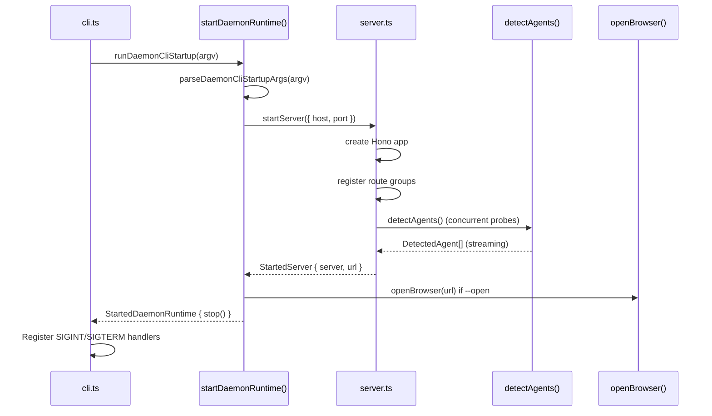
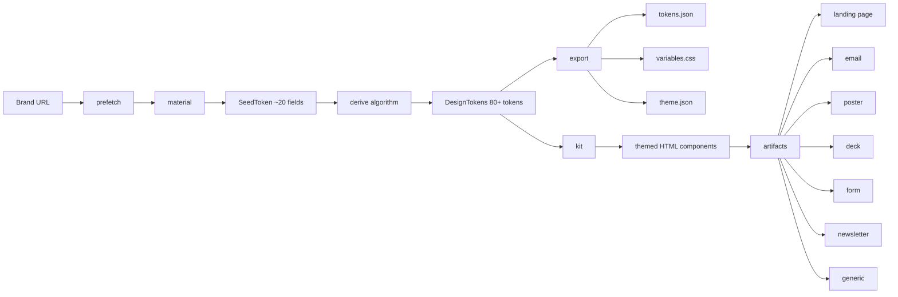

# 03 — Open Design — Daemon, Web, Contracts, Brands Engine

Open Design is the flagship project: an agent-native design workspace that detects coding agents on PATH, uses 150+ design systems to generate HTML prototypes, and provides a sandboxed iframe preview for generated artifacts.

Source: `/home/darkvoid/Boxxed/@formulas/src.rust/src.AI/src.Opendesign/open-design/`

## Monorepo Structure

```
open-design/
  apps/
    daemon/              ← Hono HTTP daemon (the brain) — 414 source files
      src/
        cli.ts           ← CLI entry: od start --port 7456 --host 127.0.0.1
        server.ts        ← Hono server setup, route registration
        agents.ts        ← Agent detection exports
        runtimes/        ← Agent detection, registry, spawning (see doc 04)
        brands/          ← Brand engine, design systems, seed tokens
          engine/        ← Seed → Derive → Export → Kit → Artifacts pipeline
        design-systems/  ← Design systems registry, import, preview
        critique/        ← Critique system (quality scoring, ratchet)
        artifacts/       ← Artifact creation, manifest, publication
        connectors/      ← Composio integration, MCP connectors
        craft/           ← Craft tool system
        skills/          ← Skill templates and invocation
    web/                 ← Next.js 16 + React 18 web UI
    desktop/             ← Electron shell with sidecar IPC
    landing-page/        ← Landing page
    packaged/            ← Packaged distribution
    telemetry-worker/    ← Telemetry collection
  packages/
    contracts/           ← TypeScript contract layer (70+ files)
  design-systems/        ← 150+ DESIGN.md brand contracts
  skills/                ← Composable skill templates (75+)
  craft/                 ← Craft tool definitions
  data/                  ← Data directory
  deploy/                ← Deployment configurations
  charts/                ← Helm charts
```

## Daemon CLI

```bash
od start --port 7456 --host 127.0.0.1   # Start daemon
od start --no-open                       # Don't auto-open browser
od -p 8080                               # Short form for port
```

Source: `open-design/apps/daemon/src/cli.ts:45-80` — parseDaemonCliStartupArgs().

The CLI parses `--port`, `--host`, `--no-open`, `-h`/`--help`. Default port is 7456 (from `OD_PORT` env or hardcoded). Default host is `127.0.0.1`.

## Daemon Startup Sequence



Source: `open-design/apps/daemon/src/cli.ts:151-180` — runDaemonCliStartup().

## Brands Engine — Seed to System Pipeline

The brand engine transforms a single URL into a complete design system through a deterministic pipeline:



Source: `open-design/apps/daemon/src/brands/engine/types.ts:7-11` — Pipeline comment.

### SeedToken — Minimal Input Surface

The entire design system derives from a `SeedToken` with only ~20 fields:

Source: `open-design/apps/daemon/src/brands/engine/types.ts:22-53`

| Field | Type | Default | Purpose |
|-------|------|---------|---------|
| `colorPrimary` | string | — | Brand seed color, becomes palette index 5 |
| `colorSuccess` | string | — | Success semantic color |
| `colorWarning` | string | — | Warning semantic color |
| `colorError` | string | — | Error semantic color |
| `colorInfo` | string | — | Info semantic color |
| `colorLink` | string | "" | Link color (falls back to colorInfo) |
| `colorTextBase` | string | "#000000"/"#ffffff" | Neutral text base |
| `colorBgBase` | string | "#ffffff"/"#000000" | Background base |
| `fontFamily` | string | — | Primary font family |
| `fontFamilyCode` | string | — | Code font family |
| `fontSize` | number | 14 | Base body font size in px |
| `borderRadius` | number | 6 | Base corner radius in px |
| `sizeUnit` | number | 4 | Spacing base unit (8px grid = sizeUnit*2) |
| `sizeStep` | number | 4 | Spacing step |
| `controlHeight` | number | 32 | Default control height in px |
| `lineWidth` | number | — | Border width |
| `motionUnit` | number | 0.1 | Motion duration unit in seconds |
| `motionBase` | number | 0 | Motion base offset |
| `wireframe` | boolean | false | Outline-only mode |
| `motion` | boolean | true | Global motion on/off |

**Aha:** The brand engine reduces an entire design system to ~20 seed fields. A single brand color (`colorPrimary`) generates a 10-step palette. That palette generates hover, active, border, background, and text variants. Those variants generate component themes. The entire system is **deterministic** — one URL yields a complete design system with no hand-authored tokens. Variants (light/dark/compact) are the same seed run through a different algorithm, never hand-authored.

Source: `open-design/apps/daemon/src/brands/engine/types.ts:7-18` — Frozen contract comment.

### DesignTokens — Complete Output

The derive step produces `DesignTokens` with 80+ fields:

Source: `open-design/apps/daemon/src/brands/engine/types.ts:79-181`

- **Primary color ladder**: `colorPrimary`, `colorPrimaryBg`, `colorPrimaryBgHover`, `colorPrimaryBorder`, `colorPrimaryBorderHover`, `colorPrimaryHover`, `colorPrimaryActive`, `colorPrimaryText`
- **Functional colors**: Success, Warning, Error, Info, Link — each with bg, border, hover, active variants
- **Neutral text ladder**: `colorText`, `colorTextSecondary`, `colorTextTertiary`, `colorTextQuaternary` (alpha ladder: 88/65/45/25%)
- **Neutral fill ladder**: `colorFill`, `colorFillSecondary`, `colorFillTertiary`, `colorFillQuaternary` (alpha ladder: 15/6/4/2%)
- **Typography**: `fontSize`, `fontSizeSM`, `fontSizeLG`, `fontSizeXL`, `fontSizeHeading1-5`, `lineHeight`, `fontWeightStrong`
- **Spacing scale**: 8 steps [4, 8, 12, 16, 20, 24, 32, 48] as `sizeXXS` through `sizeXXL`
- **Geometry**: `borderRadiusXS` through `borderRadiusLG`, `controlHeightXS` through `controlHeightLG`
- **Motion**: `motionDurationFast`, `motionDurationMid`, `motionDurationSlow`, `motionEaseInOut`, `motionEaseOut`
- **Raw palettes**: `primaryPalette` (10-step) and `presets` (named palettes for charts/sub-brands)

### CSS Variable System

The engine generates CSS custom properties with a consistent prefix:

Source: `open-design/apps/daemon/src/brands/engine/types.ts:196-245`

```typescript
// cssVar("colorPrimaryBg") → "--brand-color-primary-bg"
// cssVar("fontSizeHeading1") → "--brand-font-size-heading-1"
function cssVar(tokenKey: string): string {
  const kebab = tokenKey
    .replace(/([a-z0-9])([A-Z])/g, "$1-$2")
    .replace(/([A-Za-z])([0-9])/g, "$1-$2")
    .toLowerCase();
  return `--${CSS_VAR_PREFIX}-${kebab}`;
}
```

The `flattenTokens()` function converts DesignTokens into ordered `{ cssVarName, value }` pairs, expanding arrays (palettes) and objects (presets) into individual CSS variables.

### Artifacts

The brand engine produces 7 artifact types from the kit:

Source: `open-design/apps/daemon/src/brands/engine/artifacts/index.ts`

| Artifact | File | Purpose |
|----------|------|---------|
| Landing | `landing.ts` | Brand landing page |
| Email | `email.ts` | Themed email template |
| Poster | `poster.ts` | Brand poster |
| Deck | `deck.ts` | Presentation deck |
| Form | `form.ts` | Themed form |
| Newsletter | `newsletter.ts` | Newsletter template |
| Generic | `generic.ts` | Generic branded page |

## Critique System

The critique system scores and evaluates generated artifacts:

Source: `open-design/apps/daemon/src/critique/`

| Module | Purpose |
|--------|---------|
| `orchestrator.ts` | Orchestrates critique runs |
| `conformance.ts` | Checks conformance against design system |
| `parser.ts` | Parses critique output |
| `ratchet.ts` | Quality ratchet — prevents regression |
| `scoreboard.ts` | Tracks scores across runs |
| `persistence.ts` | Persists critique history |
| `rollout.ts` | Manages critique rollout |
| `transcript.ts` | Critique run transcripts |
| `run-registry.ts` | Registry of critique runs |

## Contracts Package

`packages/contracts/src/` defines 70+ TypeScript files shared across projects:

Source: `open-design/packages/contracts/src/`

| Module | Files | Purpose |
|--------|-------|---------|
| `api/` | 35+ files | REST API request/response types |
| `sse/` | 3 files | SSE event shapes (chat, proxy, common) |
| `plugins/` | 8 files | Plugin manifest, marketplace, install |
| `design-systems/` | 3 files | Token schema, component manifest, derived outputs |
| `prompts/` | 7 files | System prompts, atom blocks, plugin blocks |
| `analytics/` | 4 files | Analytics events, artifact IDs, observability |
| `errors.ts` | 1 file | Shared error types |

## Design Systems Directory

The `design-systems/` directory contains 150+ DESIGN.md brand contracts:

Source: `open-design/design-systems/`

Examples: `agentic`, `airbnb`, `apple`, `binance`, `bmw`, `canva`, `cisco`, `claude`, `coinbase`, `cursor`, `discord`, `duolingo`, `elevenlabs`, `expo`, `ferrari`, and 135 more.

Each design system is a directory with a `DESIGN.md` file that serves as the brand contract. The daemon imports these via `apps/daemon/src/design-systems/import.ts` and serves previews via `apps/daemon/src/design-systems/preview.ts`.

## Agent Session Resume

Open Design supports session resumption for agents that maintain their own conversation state:

Source: `open-design/apps/daemon/src/agent-session-resume.ts`

For agents like `agy -c` (antigravity) that have their own CLI session storage, the daemon skips packing the rendered web transcript and sends only the latest user message. This prevents the "double context" problem where the same prior turn appears twice.

## Next

- [04 — Agent Detection](04-agent-detection.md) — Deep dive into the agent detection, registry, and spawning system
- [05 — Design Systems](05-design-systems.md) — Design systems registry, import, preview, shadcn import
