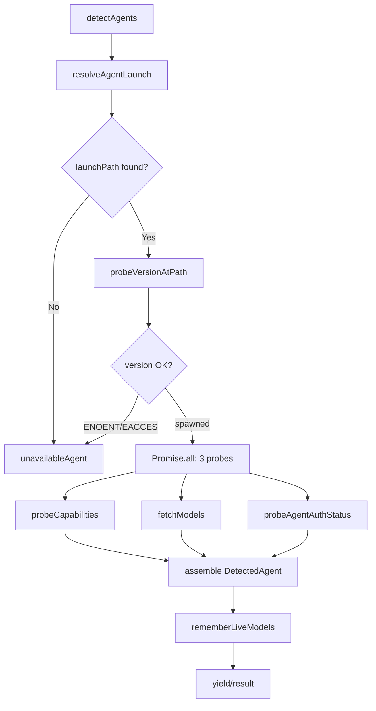

# 04 — Agent Detection — Registry, 26 Adapters, Spawning, SSE Streaming

The agent detection system is the keystone of the nexu ecosystem. It discovers which coding agents are installed on the system PATH, probes each for capabilities, models, and auth status, and provides a unified interface for spawning them — all without any manual configuration.

Source: `/home/darkvoid/Boxxed/@formulas/src.rust/src.AI/src.Opendesign/open-design/apps/daemon/src/runtimes/`

## Agent Registry

The registry maintains 23 built-in agent definitions plus any local profile extensions:

Source: `open-design/apps/daemon/src/runtimes/registry.ts:28-76`

```typescript
const BASE_AGENT_DEFS: RuntimeAgentDef[] = [
  amrAgentDef, claudeAgentDef, codexAgentDef, devinAgentDef,
  opencodeAgentDef, hermesAgentDef, traeCliAgentDef, grokBuildAgentDef,
  kimiAgentDef, cursorAgentDef, qwenAgentDef, qoderAgentDef,
  copilotAgentDef, ampAgentDef, piAgentDef, kiroAgentDef,
  kiloAgentDef, vibeAgentDef, deepseekAgentDef, aiderAgentDef,
  antigravityAgentDef, reasonixAgentDef, codebuddyAgentDef, mimoAgentDef,
];
```

| Agent ID | Name | Binary | Session Resume | MCP Injection |
|----------|------|--------|---------------|---------------|
| `amr` | AMR/Vela | `amr` | ACP load | — |
| `claude` | Claude Code | `claude` | — | claude-mcp-json |
| `codex` | Codex CLI | `codex` | capture-style | — |
| `devin` | Devin | `devin` | — | acp-merge |
| `opencode` | OpenCode | `opencode` | — | opencode-env-content |
| `hermes` | Hermes | `hermes` | — | acp-merge |
| `trae-cli` | Trae CLI | `trae` | — | — |
| `grok-build` | Grok Build | `grok-build` | — | — |
| `kimi` | Kimi | `kimi` | — | acp-merge |
| `cursor-agent` | Cursor Agent | `cursor-agent` | — | — |
| `qwen` | Qwen Coder | `qwen` | — | — |
| `qoder` | Qoder | `qoder` | — | — |
| `copilot` | GitHub Copilot | `copilot` | — | — |
| `amp` | Amp | `amp` | — | — |
| `pi` | Pi | `pi` | — | — |
| `kiro` | Kiro | `kiro` | — | acp-merge |
| `kilo` | Kilo | `kilo` | — | acp-merge |
| `vibe` | Vibe | `vibe` | — | acp-merge |
| `deepseek` | DeepSeek | `deepseek` | — | — |
| `aider` | Aider | `aider` | — | — |
| `antigravity` | Antigravity | `agy` | — | — |
| `reasonix` | Reasonix | `reasonix` | — | acp-merge (map env) |
| `codebuddy` | CodeBuddy | `codebuddy` | — | — |
| `mimo` | MiMo | `mimo` | — | mimo-env-content |

Source: `open-design/apps/daemon/src/runtimes/registry.ts:28-53` and individual `defs/*.ts` files.

## RuntimeAgentDef — Adapter Interface

Each agent adapter implements the `RuntimeAgentDef` interface:

Source: `open-design/apps/daemon/src/runtimes/types.ts:93-238`

| Field | Type | Purpose |
|-------|------|---------|
| `id` | string | Unique adapter identifier |
| `name` | string | Display name |
| `bin` | string | CLI binary name |
| `versionArgs` | string[] | Args for `--version` probe |
| `fallbackModels` | RuntimeModelOption[] | Models used when live fetch fails |
| `buildArgs` | function | Builds CLI args from prompt + context |
| `streamFormat` | string | Event stream format identifier |
| `promptViaStdin` | boolean | Prompt delivered via stdin |
| `promptViaFile` | boolean | Prompt read from daemon-created temp file |
| `promptInputFormat` | `'text'` \| `'stream-json'` | Stdin format for prompt |
| `listModels` | RuntimeListModels | How to list available models |
| `fetchModels` | function | Alternative model fetching |
| `authProbe` | `{ args, timeoutMs }` | Auth status check command |
| `helpArgs` | string[] | Args for `--help` probe |
| `capabilityFlags` | Record<string, string> | Flag → capability key mapping |
| `externalMcpInjection` | string | How MCP servers are forwarded |
| `resumesSessionViaCli` | boolean | Agent maintains own session |
| `capturesSessionIdFromStream` | boolean | Session ID from stream events |
| `resumesSessionViaAcpLoad` | boolean | ACP session resume support |
| `inactivityTimeoutMs` | number | Chat-run watchdog override |
| `fallbackBins` | string[] | Alternative binary names |
| `maxPromptArgBytes` | number | Command line budget |
| `env` | Record<string, string> | Default env overrides |

## Detection Pipeline



Source: `open-design/apps/daemon/src/runtimes/detection.ts:191-338` — probe() and detectAgents().

### Version Probe — Two Failure Modes

The version probe discriminates between two failure categories:

Source: `open-design/apps/daemon/src/runtimes/detection.ts:94-146`

1. **Not invocable**: OS rejected the spawn (EACCES = permission denied, ENOENT = binary not found, exit code 126 = not executable, 127 = command not found)
2. **Spawned but version unhappy**: Binary ran but `--version` failed (timeout, non-zero exit, stderr noise)

This distinction matters for UX: permission failures get a "fix permissions" suggestion, while missing binaries get an "install" suggestion.

### Concurrent Post-Version Probes

After version succeeds, three independent probes run concurrently:

Source: `open-design/apps/daemon/src/runtimes/detection.ts:231-235`

```typescript
const [caps, modelResult, auth] = await Promise.all([
  probeCapabilities(def, launch.launchPath, probeEnv),
  fetchModels(def, launch.launchPath, probeEnv),
  probeAgentAuthStatus(def, launch.launchPath, probeEnv),
]);
```

**Aha:** Running capabilities, models, and auth probes concurrently (rather than sequentially) reduces detection wall time from ~15s to ~5s. The slowest probe gates the result, not the sum.

## Adapter Definition Anatomy

```mermaid
classDiagram
    class RuntimeAgentDef {
        +string id
        +string name
        +string bin
        +string[] versionArgs
        +buildArgs(prompt, images, dirs, opts, ctx) string[]
        +string streamFormat
        +fetchModels(bin, env) Promise
        +listModels { args, timeout, parse }
        +RuntimeCapabilityMap capabilityFlags
        +string externalMcpInjection
        +boolean resumesSessionViaCli
        +boolean capturesSessionIdFromStream
        +AuthProbe authProbe
    }
    class DetectedAgent {
        +string id
        +string name
        +string path
        +string version
        +boolean available
        +RuntimeModelOption[] models
        +string modelsSource
        +string authStatus
        +AgentDiagnostic[] diagnostics
    }
    RuntimeAgentDef --> DetectedAgent : probe produces
```

### Streaming Detection

The `detectAgentsStream()` generator yields agents as their probes complete, in completion order rather than registry order:

Source: `open-design/apps/daemon/src/runtimes/detection.ts:346-363`

```typescript
export async function* detectAgentsStream(
  configuredEnvByAgent: Record<string, Record<string, string>> = {},
): AsyncGenerator<DetectedAgent> {
  const tagged = AGENT_DEFS.map((def, index) =>
    safeProbe(def, configuredEnvByAgent?.[def.id] ?? {}).then((agent) => {
      rememberDetectedLiveModels(def, configuredEnvByAgent?.[def.id] ?? {}, agent);
      return { index, agent };
    }),
  );
  const pending = new Set(tagged.keys());
  while (pending.size > 0) {
    const { index, agent } = await Promise.race(
      tagged.filter((_, i) => pending.has(i)),
    );
    pending.delete(index);
    yield agent;
  }
}
```

The UI uses this to paint agent cards as they resolve, instead of waiting for the slowest CLI.

## Fault Isolation

The `safeProbe()` wrapper ensures one adapter's failure doesn't collapse the whole picker:

Source: `open-design/apps/daemon/src/runtimes/detection.ts:289-305`

```typescript
async function safeProbe(def, configuredEnv): Promise<DetectedAgent> {
  try {
    return await probe(def, configuredEnv);
  } catch {
    // Fault isolation (issue #2297): one adapter's probe blowing up
    // must not collapse the whole agent picker.
    return unavailableAgent(def);
  }
}
```

**Aha:** Without this guard, a single adapter's synchronous filesystem throw during PATH walking (e.g., packaged Windows daemon) would cause `Promise.all` to reject, returning an empty agent list. The UI would silently lose every CLI option. The try/catch ensures each adapter is evaluated independently.

## DetectedAgent — Public API Shape

The `DetectedAgent` type strips runtime functions from the adapter definition and adds probe results:

Source: `open-design/apps/daemon/src/runtimes/types.ts:240-269`

```typescript
export type DetectedAgent = Omit<RuntimeAgentDef, 'buildArgs' | 'listModels' | 'fetchModels' | ...> & {
  models: RuntimeModelOption[];
  modelsSource: 'live' | 'fallback';
  available: boolean;
  authStatus?: 'ok' | 'missing' | 'unknown';
  authMessage?: string;
  path?: string;
  version?: string | null;
  diagnostics?: AgentDiagnostic[];
};
```

The function fields (`buildArgs`, `listModels`, etc.) are stripped because they are spawn-time internals, not part of the public API contract.

## Capability Probing

The `--help` capability probe parses an agent's help output to determine which optional flags it supports:

Source: `open-design/apps/daemon/src/runtimes/detection.ts:167-189`

```typescript
async function probeCapabilities(def, launchPath, env): Promise<RuntimeCapabilityMap | null> {
  if (!def.helpArgs || !def.capabilityFlags) return null;
  const { stdout } = await execAgentFile(launchPath, def.helpArgs, { env, timeout: 5000 });
  const caps: RuntimeCapabilityMap = {};
  for (const [flag, key] of Object.entries(def.capabilityFlags)) {
    caps[key] = String(stdout).includes(flag);
  }
  return caps;
}
```

For Claude, this probes `claude -p --help` (not `claude --help`) because `--add-dir` and `--include-partial-messages` are under the `-p` subcommand. This was a real bug fix (issue #430).

## Prompt Delivery Methods

Different agents accept prompts differently:

| Method | Agents | Why |
|--------|--------|-----|
| **stdin (text)** | Most agents | No argv length limit |
| **stdin (stream-json)** | Claude, Codex, others | Enables mid-conversation message injection |
| **file** | Some agents | Avoids argv budget and stdin close |
| **argv** | Agents with short prompts | Simple but capped at ~128KB (Linux) / ~32KB (Windows) |

Source: `open-design/apps/daemon/src/runtimes/types.ts:115-123` — promptViaFile, promptViaStdin, promptInputFormat.

The prompt budget guard checks against Linux `MAX_ARG_STRLEN` (~128KB) and Windows `CreateProcess` limits (~32KB direct, ~8KB via .cmd shim):

Source: `open-design/apps/daemon/src/runtimes/prompt-budget.ts` — checkPromptArgvBudget().

## MCP Server Injection

Agents forward external MCP servers differently at spawn time:

Source: `open-design/apps/daemon/src/runtimes/types.ts:135-164`

| Strategy | Agents | Mechanism |
|----------|--------|-----------|
| `claude-mcp-json` | Claude Code | Writes `.mcp.json` into project cwd |
| `acp-merge` | Hermes, Kimi, Kilo, Kiro, Vibe, Devin | Merges stdio entries into `mcpServers` array |
| `opencode-env-content` | OpenCode | `OPENCODE_CONFIG_CONTENT` env var |
| `mimo-env-content` | MiMo | `MIMOCODE_CONFIG_CONTENT` env var |

Agents without MCP transport wired (codex, cursor-agent, copilot, qoder, pi) show a settings hint explaining that external MCP servers are not forwarded.

## Session Resumption

Three session resumption modes exist:

| Mode | Description | Example |
|------|-------------|---------|
| **Daemon transcript** | Daemon packs full web transcript into prompt | Most agents |
| **CLI session** | Agent's CLI maintains own session memory | `agy -c` (antigravity) |
| **ACP load** | Agent uses ACP `session/load` for resume | AMR/vela |

The `resumesSessionViaCli` flag tells the daemon to skip packing the rendered transcript for follow-up turns, preventing the "double context" discovery-form loop bug.

Source: `open-design/apps/daemon/src/runtimes/types.ts:62-77` — comment on session opt-out.

## Spawn System

The spawn system (`open-design/apps/daemon/src/runtimes/spawn.ts`) handles:

1. Resolving the agent binary (PATH lookup, fallback bins)
2. Building CLI args from the prompt and context
3. Injecting MCP server configuration
4. Spawning the child process with appropriate env
5. Parsing the output stream (JSONL, text, etc.)

## Model Resolution

Models are resolved in priority order:

1. **Live fetch** from agent CLI (`def.fetchModels` or `def.listModels`)
2. **Remembered models** from previous detections (cached)
3. **MMD routes** from local proxy (for Claude-compatible models)
4. **Fallback models** hardcoded in the adapter

Source: `open-design/apps/daemon/src/runtimes/detection.ts:49-88` — fetchModels().

## Next

- [05 — Design Systems](05-design-systems.md) — Design systems registry, import, preview
- [03 — Open Design](03-open-design.md) — Open Design daemon and brands engine
