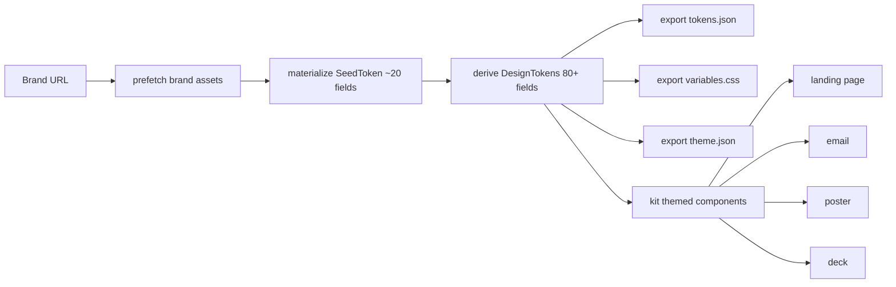
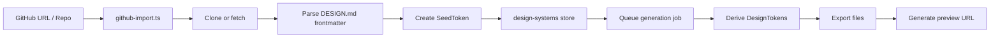

# 05 — Design Systems — Registry, Import, Preview, shadcn Import

The design systems module manages 150+ brand contracts, each defined by a DESIGN.md file. The daemon imports, previews, derives tokens from, and serves these design systems to the web frontend.

Source: `/home/darkvoid/Boxxed/@formulas/src.rust/src.AI/src.Opendesign/open-design/apps/daemon/src/design-systems/`

**Aha:** The design systems directory structure mirrors the brand slug convention — each brand gets its own directory with a single DESIGN.md file. This is the "one file per brand" pattern that makes the system scale: adding a new brand means creating one directory with one markdown file. The daemon parses the frontmatter, derives the full token set, and generates previews automatically. There's no manual token definition per brand — the brand engine handles everything from the 20 seed fields.

## Design System Token Derivation



## Directory Structure

```
open-design/design-systems/
  agentic/DESIGN.md
  airbnb/DESIGN.md
  apple/DESIGN.md
  ...  (150+ more)
```

Each design system is a single directory containing a `DESIGN.md` file that serves as the brand contract.

## Design Systems Module

| File | Purpose |
|------|---------|
| `index.ts` | Main entry — exports services |
| `import.ts` | GitHub import — clones/fetches design systems from repos |
| `preview.ts` | Generates preview URLs for design system artifacts |
| `frontmatter.ts` | Parses DESIGN.md frontmatter |
| `generation-jobs.ts` | Manages async token generation jobs |
| `github-import.ts` | GitHub API integration for importing repos |
| `rename-args.ts` | Handles design system rename operations |
| `server-services.ts` | Registers design system routes on the daemon |
| `shadcn-import.ts` | Imports shadcn/ui components as design system sources |
| `source-context.ts` | Builds source context for agent prompts |
| `swift-colors.ts` | Parses Swift UIColor definitions |
| `token-contract-rebuild.ts` | Rebuilds token contracts from DESIGN.md |

Source: `open-design/apps/daemon/src/design-systems/` — 12 source files.

## DESIGN.md Format

Each DESIGN.md file contains YAML frontmatter with brand properties:

```yaml
---
name: Apple
slug: apple
colorPrimary: "#0071e3"
colorSuccess: "#34c759"
colorWarning: "#ff9500"
colorError: "#ff3b30"
fontFamily: "-apple-system, BlinkMacSystemFont, 'SF Pro Display'"
fontFamilyCode: "SF Mono, Monaco, 'Cascadia Code'"
borderRadius: 12
---
```

Source: `open-design/apps/daemon/src/brands/design-md.ts` — DESIGN.md parsing.

The frontmatter is parsed into a `SeedToken` and fed through the brand engine pipeline (see doc 03).

## Import Pipeline



Source: `open-design/apps/daemon/src/design-systems/import.ts` — Import pipeline.

## GitHub Import

The GitHub import module fetches design systems from GitHub repositories:

Source: `open-design/apps/daemon/src/design-systems/github-import.ts`

1. Parses the GitHub URL to extract owner/repo
2. Clones or fetches the repo contents
3. Looks for DESIGN.md in the root
4. Parses frontmatter into a SeedToken
5. Stores in the design systems registry

## shadcn Import

The shadcn import module imports shadcn/ui components as design system sources:

Source: `open-design/apps/daemon/src/design-systems/shadcn-import.ts`

This extracts design tokens from shadcn/ui's CSS variables and component definitions, converting them into the nexu DesignTokens format.

## Swift Color Parsing

The swift color parser extracts color definitions from Swift UIColor code:

Source: `open-design/apps/daemon/src/design-systems/swift-colors.ts`

This enables importing design systems from iOS/macOS codebases by parsing `UIColor(red:green:blue:alpha:)` and hex literal definitions.

## Preview System

The preview module generates URLs for design system artifacts:

Source: `open-design/apps/daemon/src/design-systems/preview.ts`

Each design system gets preview URLs for:
- Landing page
- Email template
- Poster
- Deck
- Form
- Newsletter

## Generation Jobs

Token generation is async to avoid blocking the import flow:

Source: `open-design/apps/daemon/src/design-systems/generation-jobs.ts`

1. Import creates a generation job
2. Job queue processes jobs sequentially
3. Each job runs the derive → export pipeline
4. Results are stored and preview URLs are generated

## Source Context

The source context module builds context for agent prompts:

Source: `open-design/apps/daemon/src/design-systems/source-context.ts`

When an agent needs to generate artifacts for a specific design system, the source context module provides:
- Token values
- Component examples
- Design guidelines from DESIGN.md
- Color palettes

## Brand Routes

The daemon exposes HTTP routes for brand operations:

Source: `open-design/apps/daemon/src/brand-routes.ts`

| Route | Method | Purpose |
|-------|--------|---------|
| `/api/brands` | GET | List all design systems |
| `/api/brands/:slug` | GET | Get design system details |
| `/api/brands/:slug/tokens` | GET | Get derived DesignTokens |
| `/api/brands/:slug/preview/:artifact` | GET | Get preview URL |
| `/api/brands/import` | POST | Import from GitHub URL |
| `/api/brands/shadcn-import` | POST | Import from shadcn/ui |

## Design Systems Contract

The contracts package defines the shared types:

Source: `open-design/packages/contracts/src/design-systems/`

| File | Purpose |
|------|---------|
| `token-schema.ts` | Token definition schema |
| `derived-token-outputs.ts` | Derived output types (JSON, CSS, theme) |
| `components-manifest.ts` | Component manifest types |

## Next

- [06 — Design Tokens](06-design-tokens.md) — Token system in nexu-design/tokens
- [03 — Open Design](03-open-design.md) — Brands engine pipeline
