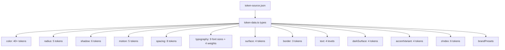
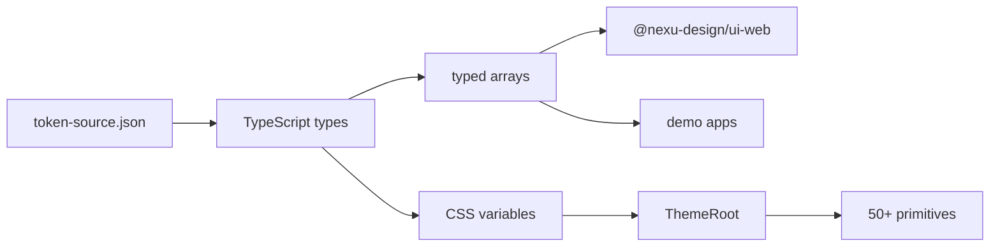

# 06 — Design Tokens — Token System, CSS Variables, Theming, Brand Presets

The design token system in `nexu-design/tokens` provides a centralized, type-safe token registry consumed by all UI projects in the ecosystem. Tokens are defined in a JSON source file and exported as typed TypeScript constants.

Source: `/home/darkvoid/Boxxed/@formulas/src.rust/src.AI/src.Opendesign/design/packages/tokens/`

## Package Structure

```
design/packages/tokens/
  src/
    index.ts           ← Exports all tokens
    token-data.ts      ← Token type definitions and exports
    token-source.json  ← Source of truth for all token values
```

Source: `design/packages/tokens/src/token-data.ts` — Token type definitions.

## Token Categories

The token system defines 15 categories:

Source: `design/packages/tokens/src/token-data.ts:5-19`

| Category | Count | Purpose |
|----------|-------|---------|
| `color` | 40+ | Semantic color tokens (primary, success, warning, error, info, link) |
| `radius` | 5 | Border radius tokens (XS, SM, default, LG, XL) |
| `shadow` | 6 | Shadow tokens for elevation |
| `motion` | 5 | Motion duration and easing tokens |
| `spacing` | 8 | Spacing scale (XXS through XXL: 4, 8, 12, 16, 20, 24, 32, 48) |
| `typography` | 4 | Font family tokens |
| `fontSize` | 9 | Font size tokens with px and lineHeight |
| `fontWeight` | 4 | Font weight tokens (numeric) |
| `surface` | 4 | Surface color tokens |
| `border` | 3 | Border color tokens |
| `text` | 4 | Text color tokens (primary, secondary, tertiary, quaternary) |
| `darkSurface` | 4 | Dark mode surface colors |
| `accentVariant` | 4 | Accent color variants |
| `zIndex` | 6 | Z-index layer tokens |

## Token Types

```typescript
export type TokenCategory =
  | "color" | "radius" | "shadow" | "motion" | "spacing"
  | "typography" | "fontSize" | "fontWeight" | "surface"
  | "border" | "text" | "darkSurface" | "accentVariant" | "zIndex";

export type TokenDefinition = {
  name: string;
  cssVar: `--${string}`;
  category: TokenCategory;
  utility?: string;
  value: string;
  description: string;
  foreground?: string;
};

export type FontSizeToken = TokenDefinition & {
  px: number;
  lineHeight: number;
};

export type FontWeightToken = Omit<TokenDefinition, "value"> & {
  value: number;
};
```

Source: `design/packages/tokens/src/token-data.ts:5-37`.

## Theme Variables

The token system supports both light and dark themes:

```typescript
type ThemeVariables = Record<`--${string}`, string>;

type TokenSource = {
  brandPresets: Record<string, BrandPresetDefinition>;
  metadata: {
    colors: TokenDefinition[];
    radii: TokenDefinition[];
    // ... all categories
  };
  themes: {
    light: ThemeVariables;
    dark: ThemeVariables;
  };
};
```

Source: `design/packages/tokens/src/token-data.ts:48-78`.

## Token Category Hierarchy



## Brand Presets

The token system includes brand presets for quick theme switching:

```typescript
export const brandPresets = typedTokenSource.brandPresets;
export const BRAND_PRESET_LABELS = Object.fromEntries(
  Object.entries(brandPresets).map(([key, preset]) => [key, preset.label])
);
export const BRAND_PRESET_HEX = Object.fromEntries(
  Object.entries(brandPresets)
    .filter(([, preset]) => preset.hex)
    .map(([key, preset]) => [key, preset.hex])
);
```

Source: `design/packages/tokens/src/token-data.ts:82-95`.

## Token Exports

All token categories are exported as typed arrays:

```typescript
export const semanticColorTokens = typedTokenSource.metadata.colors;
export const radiusTokens = typedTokenSource.metadata.radii;
export const shadowTokens = typedTokenSource.metadata.shadows;
export const motionTokens = typedTokenSource.metadata.motion;
export const spacingTokens = typedTokenSource.metadata.spacing;
export const typographyTokens = typedTokenSource.metadata.typography;
export const surfaceTokens = typedTokenSource.metadata.surfaces;
export const borderTokens = typedTokenSource.metadata.borders;
export const textLevelTokens = typedTokenSource.metadata.textLevels;
export const darkSurfaceTokens = typedTokenSource.metadata.darkSurfaces;
export const accentVariantTokens = typedTokenSource.metadata.accentVariants;
export const fontSizeTokens = typedTokenSource.metadata.fontSizes;
export const fontWeightTokens = typedTokenSource.metadata.fontWeights;
export const textStyleTokens = typedTokenSource.metadata.textStyles;
export const zIndexTokens = typedTokenSource.metadata.zIndex;
export const themeVariables = typedTokenSource.themes;
```

## Token Flow to Components



Source: `design/packages/tokens/src/token-data.ts:97-112`.

## CSS Variable Mapping

Each token maps to a CSS custom property:

```typescript
export type TokenDefinition = {
  name: string;           // "colorPrimaryBg"
  cssVar: `--${string}`;  // "--nexu-color-primary-bg"
  category: TokenCategory;
  value: string;          // "#f0f5ff"
  // ...
};
```

The `ui-web` package consumes these CSS variables through the `ThemeRoot` primitive, which applies the variables to a root element:

Source: `design/packages/ui-web/src/primitives/theme-root.tsx`.

**Aha:** The token system separates **definition** (token-data.ts) from **source** (token-source.json). The JSON file is the single source of truth for values; the TypeScript file provides typed access. This means design tokens can be edited in JSON (by designers or tools) and immediately consumed in TypeScript with full type safety. The build step validates the JSON against the TypeScript types.

## Integration with UI Components

The `@nexu-design/ui-web` package consumes tokens through:

1. **CSS variables** — Applied by `ThemeRoot` to the root element
2. **Utility classes** — Some tokens have associated utility classes
3. **Direct imports** — Components import specific token arrays for programmatic use

The spacing tokens map to an 8-step scale: `[4, 8, 12, 16, 20, 24, 32, 48]` named `sizeXXS` through `sizeXXL`. This creates a consistent spacing rhythm across all components.

## Text Style Tokens

Text styles combine font size, weight, and leading into named styles:

```typescript
export type TextStyleDefinition = {
  name: string;
  size: string;
  weight: string;
  leading: string;
  description: string;
};
```

Source: `design/packages/tokens/src/token-data.ts:40-46`.

These define the typographic scale used across the component library.

## Next

- [07 — Component Library](07-component-library.md) — 50+ primitives and 15 patterns
- [05 — Design Systems](05-design-systems.md) — Design systems registry
