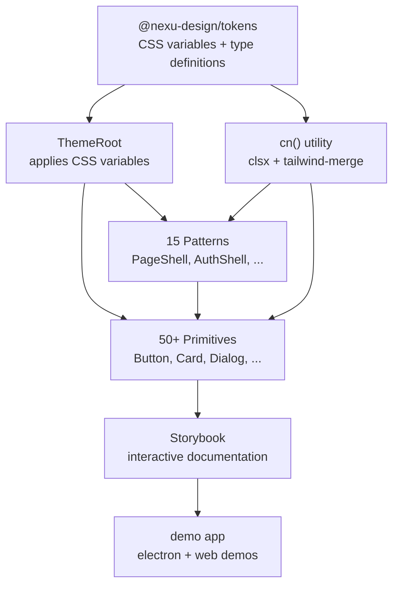
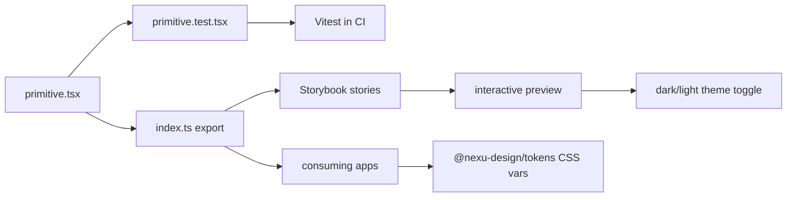

# 07 — Component Library — 50+ Primitives, 15 Patterns, Storybook

The `@nexu-design/ui-web` package provides a comprehensive React component library with 50+ primitives and 15 patterns, built on top of the design token system. All components are typed with TypeScript, include tests, and are themed via CSS variables.

Source: `/home/darkvoid/Boxxed/@formulas/src.rust/src.AI/src.Opendesign/design/packages/ui-web/`

## Package Structure

```
design/packages/ui-web/
  src/
    index.ts              ← Re-exports all components
    lib/
      cn.ts               ← Class name utility (clsx + tailwind-merge)
      mono-digits.tsx     ← Monospace digit formatter
    primitives/           ← 50+ base components
    patterns/             ← 15 composite components
```

Source: `design/packages/ui-web/src/index.ts` — Full export list.

## Primitives (50+ Components)

Primitives are atomic, single-purpose components with no business logic:

| Component | File | Purpose |
|-----------|------|---------|
| Accordion | `accordion.tsx` | Collapsible content sections |
| ActivityBar | `activity-bar.tsx` | IDE-style activity bar |
| Alert | `alert.tsx` | Alert/notification banners |
| Avatar | `avatar.tsx` | User avatar with fallback |
| Badge | `badge.tsx` | Status/counter badges |
| Breadcrumb | `breadcrumb.tsx` | Navigation breadcrumbs |
| Button | `button.tsx` | Button with variants |
| Card | `card.tsx` | Content card container |
| ChatMessage | `chat-message.tsx` | Chat message bubble |
| Checkbox | `checkbox.tsx` | Checkbox input |
| Collapsible | `collapsible.tsx` | Collapsible container |
| Combobox | `combobox.tsx` | Searchable dropdown |
| ConversationMessage | `conversation-message.tsx` | Conversation message with metadata |
| DataTable | `data-table.tsx` | Sortable/filterable data table |
| DetailPanel | `detail-panel.tsx` | Side detail panel |
| Dialog | `dialog.tsx` | Modal dialog |
| DropdownMenu | `dropdown-menu.tsx` | Dropdown menu |
| EntityCard | `entity-card.tsx` | Entity display card |
| EventNotice | `event-notice.tsx` | Event notification |
| FileAttachment | `file-attachment.tsx` | File attachment display |
| ImageAttachment | `image-attachment.tsx` | Image attachment display |
| ImageGallery | `image-gallery.tsx` | Image grid/gallery |
| Input | `input.tsx` | Text input |
| InteractiveRow | `interactive-row.tsx` | Interactive list row |
| Label | `label.tsx` | Form label |
| Logo | `logo.tsx` | Brand logo |
| NavItem | `nav-item.tsx` | Navigation item |
| PanelFooter | `panel-footer.tsx` | Panel footer bar |
| Popover | `popover.tsx` | Popover container |
| Progress | `progress.tsx` | Progress indicator |
| PricingCard | `pricing-card.tsx` | Pricing plan card |
| RadioGroup | `radio-group.tsx` | Radio button group |
| ScrollArea | `scroll-area.tsx` | Custom scroll container |
| Select | `select.tsx` | Select dropdown |
| Separator | `separator.tsx` | Visual separator |
| Sheet | `sheet.tsx` | Slide-out sheet |
| Sidebar | `sidebar.tsx` | Sidebar navigation |
| Skeleton | `skeleton.tsx` | Loading skeleton |
| Sonner | `sonner.tsx` | Toast notifications |
| Spinner | `spinner.tsx` | Loading spinner |
| StatCard | `stat-card.tsx` | Statistics display card |
| StatsBar | `stats-bar.tsx` | Statistics bar |
| SplitView | `split-view.tsx` | Split pane layout |
| StatusDot | `status-dot.tsx` | Status indicator dot |
| Stepper | `stepper.tsx` | Step-by-step wizard |
| Switch | `switch.tsx` | Toggle switch |
| Table | `table.tsx` | Data table |
| Tabs | `tabs.tsx` | Tab navigation |
| TagGroup | `tag-group.tsx` | Tag/group display |
| Textarea | `textarea.tsx` | Multi-line text input |
| TextLink | `text-link.tsx` | Styled text link |
| ThemeRoot | `theme-root.tsx` | Theme variable provider |
| Toggle | `toggle.tsx` | Toggle button |
| Tooltip | `tooltip.tsx` | Hover tooltip |
| TopicCard | `topic-card.tsx` | Topic display card |
| VideoAttachment | `video-attachment.tsx` | Video attachment display |
| VoiceMessage | `voice-message.tsx` | Voice message player |
| Prose | `prose.tsx` | Prose typography |

Source: `design/packages/ui-web/src/index.ts` — Full export list.

## Patterns (15 Composite Components)

Patterns are higher-level compositions that combine primitives for specific use cases:

| Pattern | File | Purpose |
|---------|------|---------|
| AuthShell | `auth-shell.tsx` | Authentication page layout |
| BrandRail | `brand-rail.tsx` | Brand sidebar/navigation rail |
| BudgetPopover | `budget-popover.tsx` | Budget display popover |
| ConfirmDialog | `confirm-dialog.tsx` | Confirmation dialog |
| CreditsCapsule | `credits-capsule.tsx` | Credits/usage display |
| EmptyState | `empty-state.tsx` | Empty state placeholder |
| FilterPills | `filter-pills.tsx` | Filter pill buttons |
| FollowUpInput | `follow-up-input.tsx` | Chat follow-up input |
| FormField | `form-field.tsx` | Form field with label/validation |
| PageHeader | `page-header.tsx` | Page header with title/actions |
| PageShell | `page-shell.tsx` | Full page layout shell |
| SectionHeader | `section-header.tsx` | Section header |
| SkillMarketplaceCard | `skill-marketplace-card.tsx` | Skill marketplace card |
| UnderlineTabs | `underline-tabs.tsx` | Underline-style tabs |

Source: `design/packages/ui-web/src/index.ts` — Pattern exports.

## Component Layer Architecture



## Component Architecture

Every primitive follows a consistent pattern:

```typescript
// 1. Props interface with variant types
interface ButtonProps {
  variant?: 'default' | 'primary' | 'secondary' | 'ghost' | 'destructive';
  size?: 'xs' | 'sm' | 'md' | 'lg';
  disabled?: boolean;
  children: React.ReactNode;
}

// 2. Component with cn() utility for class merging
export function Button({ variant = 'default', size = 'md', ... }: ButtonProps) {
  return (
    <button className={cn(baseClasses, variantClasses[variant], sizeClasses[size])}>
      {children}
    </button>
  );
}
```

The `cn()` utility combines `clsx` and `tailwind-merge` for safe class name merging:

Source: `design/packages/ui-web/src/lib/cn.ts`.

**Aha:** The primitives use CSS variables from the token system rather than hardcoded Tailwind values. This means a single theme change at the `ThemeRoot` level propagates to all 50+ components without any component modification. The CSS variable approach (`var(--nexu-color-primary)`) is what enables the brand engine's deterministic theming — change the seed color, and every component's primary states update.

## Testing

Each primitive has an accompanying test file:

```
primitives/accordion.test.tsx
primitives/activity-bar.test.tsx
primitives/alert.test.tsx
primitives/badge.test.tsx
primitives/button.test.tsx
primitives/card.test.tsx
primitives/chat-message.test.tsx
primitives/checkbox.test.tsx
// ... and more
```

## Component Development Workflow



Tests use Vitest and React Testing Library for component rendering and interaction tests.

## Storybook

The project includes a Storybook setup for interactive component documentation:

Source: `design/apps/storybook/`

Storybook provides:
- Interactive component playground
- Variant demonstrations
- Dark/light theme previews
- Accessibility testing

Build command: `pnpm build:storybook`

## Theme Root

The `ThemeRoot` component applies CSS variables to a root element:

Source: `design/packages/ui-web/src/primitives/theme-root.tsx`.

It reads the token system's `themeVariables` and applies them as inline styles, enabling theme switching at runtime.

## Mono Digits

The `mono-digits.tsx` utility formats numbers with monospace digits for aligned display in tables and stats:

Source: `design/packages/ui-web/src/lib/mono-digits.tsx`.

This uses the `font-variant-numeric: tabular-nums` CSS property for consistent digit width.

## Component Categorization

| Category | Components |
|----------|-----------|
| **Layout** | Accordion, ActivityBar, DetailPanel, PageShell, Sidebar, SplitView, PanelFooter |
| **Navigation** | Breadcrumb, NavItem, Tabs, UnderlineTabs |
| **Data Display** | Badge, Card, DataTable, EntityCard, StatCard, StatsBar, TopicCard, EventNotice |
| **Feedback** | Alert, Progress, Skeleton, Sonner, Spinner, StatusDot, EmptyState |
| **Inputs** | Button, Checkbox, Combobox, Input, RadioGroup, Select, Switch, Textarea, Toggle |
| **Overlays** | Dialog, DropdownMenu, Popover, Sheet, Tooltip |
| **Chat** | ChatMessage, ConversationMessage, FollowUpInput, VoiceMessage |
| **Media** | FileAttachment, ImageAttachment, ImageGallery, VideoAttachment |
| **Typography** | Label, Prose, TextLink |
| **Patterns** | AuthShell, BrandRail, BudgetPopover, ConfirmDialog, CreditsCapsule, FilterPills, FormField, PageHeader, SectionHeader, SkillMarketplaceCard |

## Next

- [08 — Plugin System](08-plugin-system.md) — Plugin runtime, registry, protocol
- [06 — Design Tokens](06-design-tokens.md) — Token system
