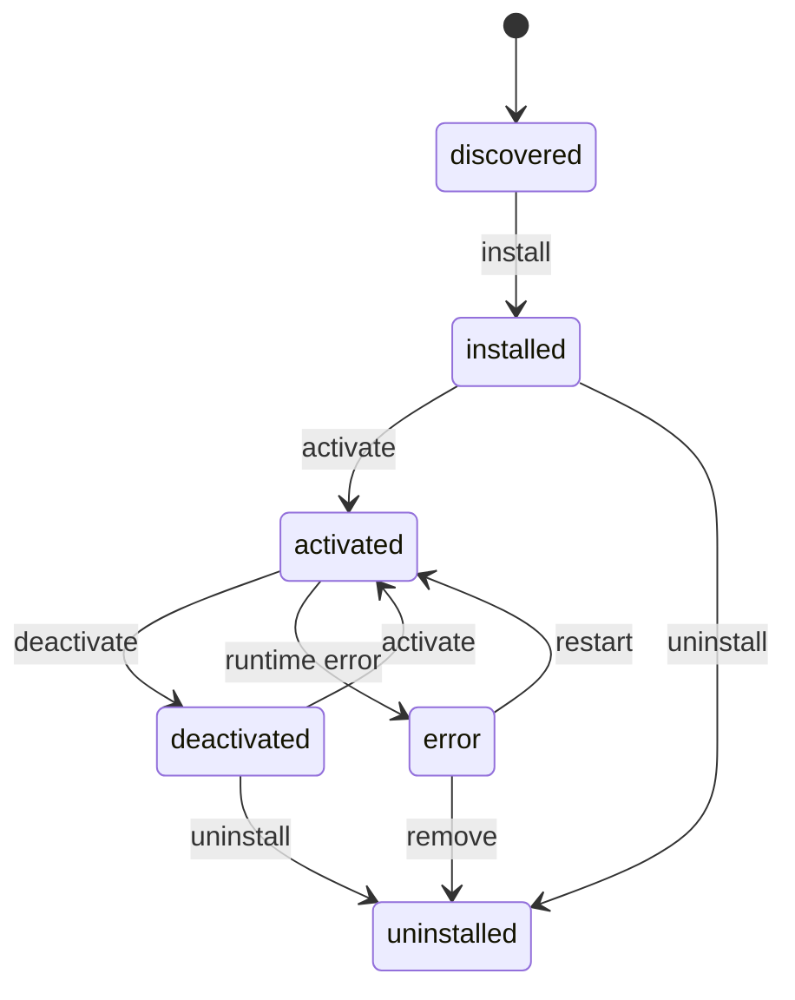
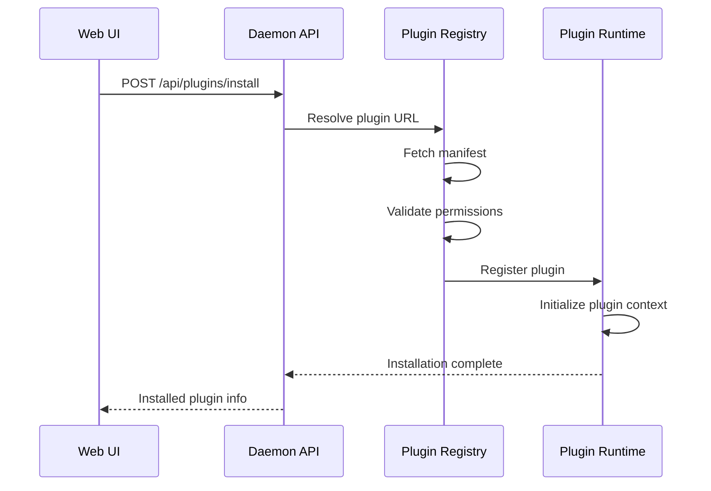

# 08 — Plugin System — Plugin Runtime, Registry Protocol, Manifest Schema

The plugin system enables extensible functionality across the nexu ecosystem. Plugins are defined by manifests, registered through a protocol, and executed by a runtime.

Source: `/home/darkvoid/Boxxed/@formulas/src.rust/src.AI/src.Opendesign/open-design/packages/contracts/src/plugins/`

## Plugin Lifecycle

## Plugin Contract Types

The contracts package defines the plugin types shared across projects:

Source: `open-design/packages/contracts/src/plugins/`

| File | Purpose |
|------|---------|
| `manifest.ts` | Plugin manifest schema |
| `marketplace.ts` | Marketplace listing types |
| `installed.ts` | Installed plugin state |
| `apply.ts` | Plugin application types |
| `context.ts` | Plugin execution context |
| `events.ts` | Plugin lifecycle events |
| `plugin-url.ts` | Plugin URL resolution |
| `share-actions.ts` | Plugin sharing actions |
| `scenario-defaults.ts` | Scenario-specific defaults |
| `index.ts` | Re-exports all plugin types |

## Plugin Manifest

The plugin manifest defines a plugin's metadata, capabilities, and requirements:

Source: `open-design/packages/contracts/src/plugins/manifest.ts`

A plugin manifest includes:
- **name** — Unique plugin identifier
- **version** — Semver version string
- **description** — Human-readable description
- **author** — Plugin author
- **icon** — Plugin icon
- **capabilities** — What the plugin can do
- **permissions** — Required permissions
- **entryPoint** — Plugin entry point URL or path
- **configSchema** — Plugin configuration schema

## Plugin Marketplace

The marketplace types define how plugins are listed, searched, and installed:

Source: `open-design/packages/contracts/src/plugins/marketplace.ts`

| Type | Purpose |
|------|---------|
| `PluginListing` | Marketplace listing with metadata |
| `PluginSearchResult` | Search result with relevance |
| `PluginCategory` | Plugin categorization |
| `PluginRating` | User rating |

## Plugin Installation Flow

## Plugin Execution Context

Plugins execute within a sandboxed context:

Source: `open-design/packages/contracts/src/plugins/context.ts`

The execution context provides:
- **workspace** — Access to the current workspace
- **config** — Plugin-specific configuration
- **secrets** — Secure secret storage
- **events** — Event emission and subscription
- **http** — HTTP client with scoped permissions

## Plugin Lifecycle Events

Source: `open-design/packages/contracts/src/plugins/events.ts`

| Event | Trigger |
|-------|---------|
| `plugin:installed` | Plugin installed |
| `plugin:activated` | Plugin activated |
| `plugin:deactivated` | Plugin deactivated |
| `plugin:uninstalled` | Plugin uninstalled |
| `plugin:error` | Plugin error occurred |
| `plugin:config:changed` | Plugin configuration changed |

## Plugin Runtime

The plugin runtime (`open-design/apps/daemon/src/plugin-runtime/`) manages plugin execution:

| Module | Purpose |
|--------|---------|
| `index.ts` | Runtime entry point |
| `registry.ts` | Plugin registration |
| `loader.ts` | Plugin loading from URL |
| `sandbox.ts` | Sandboxed execution environment |
| `permissions.ts` | Permission checking |

## Plugin URL Resolution

Plugins are resolved by URL:

Source: `open-design/packages/contracts/src/plugins/plugin-url.ts`

Supported URL schemes:
- `https://` — Remote plugin URL
- `file://` — Local plugin path
- `od://` — Built-in plugin reference

## Share Actions

Plugins can define share actions for artifact sharing:

Source: `open-design/packages/contracts/src/plugins/share-actions.ts`

Share actions define how artifacts are exported and shared through the plugin's capabilities.

## Scenario Defaults

Plugins can provide scenario-specific defaults:

Source: `open-design/packages/contracts/src/plugins/scenario-defaults.ts`

This allows plugins to configure themselves differently based on the current scenario (e.g., design mode, review mode, export mode).

**Aha:** The plugin system uses URL-based resolution rather than npm package names. This means plugins can be hosted anywhere — a GitHub repo, a CDN, a local file — and the runtime fetches the manifest from the URL to determine capabilities and permissions. This is fundamentally different from traditional plugin systems that require publishing to a registry.

## Plugin API Routes

The daemon exposes plugin-related API routes:

| Route | Method | Purpose |
|-------|--------|---------|
| `/api/plugins` | GET | List installed plugins |
| `/api/plugins/marketplace` | GET | Browse marketplace |
| `/api/plugins/install` | POST | Install a plugin |
| `/api/plugins/:id/uninstall` | DELETE | Uninstall a plugin |
| `/api/plugins/:id/config` | PUT | Update plugin config |
| `/api/plugins/:id/activate` | POST | Activate a plugin |
| `/api/plugins/:id/deactivate` | POST | Deactivate a plugin |

## Next

- [09 — SkillHub](09-skillhub.md) — Skill catalog, install, npm-runner, scanning
- [03 — Open Design](03-open-design.md) — Open Design daemon architecture
